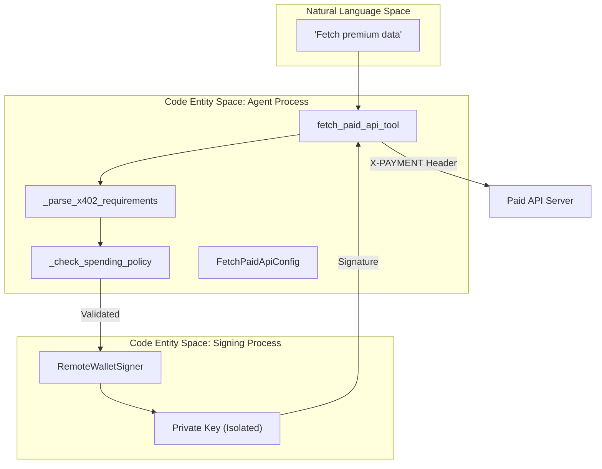
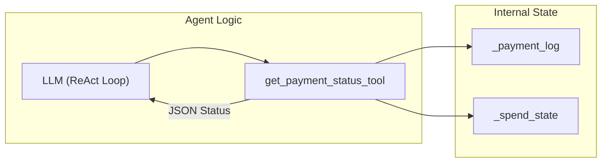

<!-- source: DeepWiki mcp.deepwiki.com · repo NVIDIA/NeMo-Agent-Toolkit-Examples · page 8.2 Wallet Signer Architecture · fetched 2026-10-26 -->

# Wallet Signer Architecture

Relevant source files

The following files were used as context for generating this wiki page:

- [examples/x402_payment_tool/.gitignore](examples/x402_payment_tool/.gitignore)
- [examples/x402_payment_tool/README.md](examples/x402_payment_tool/README.md)
- [examples/x402_payment_tool/pyproject.toml](examples/x402_payment_tool/pyproject.toml)
- [examples/x402_payment_tool/src/nat_x402_payment/configs/payment-agent.example.yml](examples/x402_payment_tool/src/nat_x402_payment/configs/payment-agent.example.yml)
- [examples/x402_payment_tool/src/nat_x402_payment/register.py](examples/x402_payment_tool/src/nat_x402_payment/register.py)
- [examples/x402_payment_tool/src/nat_x402_payment/wallet.py](examples/x402_payment_tool/src/nat_x402_payment/wallet.py)

The Wallet Signer Architecture provides a secure abstraction for agents to perform irreversible value transfers using the [x402 protocol](https://github.com/coinbase/x402) [examples/x402_payment_tool/src/nat_x402_payment/register.py:28-36](). The system is designed to isolate private keys from the agent's execution environment, enforcing spending policies before any cryptographic signing occurs [examples/x402_payment_tool/README.md:58-60]().

## Core Abstractions

The architecture centers around the `WalletSigner` abstract base class, which defines the interface for signing payments and querying wallet state.

### WalletSigner ABC
The `WalletSigner` [examples/x402_payment_tool/src/nat_x402_payment/wallet.py:49-83]() defines three mandatory methods:
*   `sign_payment(amount, recipient, asset, network)`: Generates a signed x402 payment header [examples/x402_payment_tool/src/nat_x402_payment/wallet.py:53-72]().
*   `get_address()`: Retrieves the public address of the wallet [examples/x402_payment_tool/src/nat_x402_payment/wallet.py:75-77]().
*   `get_balance(asset, network)`: Queries the current balance for a specific token [examples/x402_payment_tool/src/nat_x402_payment/wallet.py:79-82]().

### Implementation Modes
The toolkit provides two implementations to balance developer velocity with production security:

| Class | Key Storage | Use Case |
| :--- | :--- | :--- |
| `InlineWalletSigner` | `WALLET_PRIVATE_KEY` env var [examples/x402_payment_tool/src/nat_x402_payment/wallet.py:94-96]() | Local development and mock testing [examples/x402_payment_tool/README.md:64-64](). |
| `RemoteWalletSigner` | Isolated process memory [examples/x402_payment_tool/src/nat_x402_payment/wallet.py:152-155]() | Production deployments with real funds [examples/x402_payment_tool/README.md:65-65](). |

**Sources:** [examples/x402_payment_tool/src/nat_x402_payment/wallet.py:49-155](), [examples/x402_payment_tool/README.md:58-68]()

## Data Flow: Code Entity Mapping

The following diagram illustrates how natural language requests trigger specific code entities to negotiate payments.

**Payment Negotiation Lifecycle**

**Sources:** [examples/x402_payment_tool/src/nat_x402_payment/register.py:104-164](), [examples/x402_payment_tool/src/nat_x402_payment/wallet.py:148-186]()

## Wallet Signer Factory

The `create_wallet_signer` factory function manages the instantiation of the appropriate signer based on the provided configuration or environment variables [examples/x402_payment_tool/src/nat_x402_payment/wallet.py:202-210]().

**Factory Logic Hierarchy:**
1.  If `signer_url` is provided (via `FetchPaidApiConfig` or `WALLET_SIGNER_URL` env), it returns a `RemoteWalletSigner` [examples/x402_payment_tool/src/nat_x402_payment/wallet.py:207-207]().
2.  If `WALLET_PRIVATE_KEY` is set in the environment, it returns an `InlineWalletSigner` [examples/x402_payment_tool/src/nat_x402_payment/wallet.py:208-208]().

**Sources:** [examples/x402_payment_tool/src/nat_x402_payment/wallet.py:202-210](), [examples/x402_payment_tool/src/nat_x402_payment/register.py:172-172]()

## Spending Introspection

The architecture includes the `get_payment_status_tool` to allow agents to reason about their own spending and history.

### Spending Tracking
State is managed via module-level containers in `register.py`:
*   `_spend_state`: Tracks `daily_spent` and `last_reset_date` to enforce the `max_daily_spend` policy [examples/x402_payment_tool/src/nat_x402_payment/register.py:97-100]().
*   `_payment_log`: Stores an audit trail of all transactions, including amounts, recipients, and transaction hashes [examples/x402_payment_tool/src/nat_x402_payment/register.py:101-101]().

### Introspection Tool
The `get_payment_status_tool` (configured via `GetPaymentStatusConfig`) exposes this internal state to the LLM [examples/x402_payment_tool/src/nat_x402_payment/register.py:89-92](). This allows the agent to answer questions like "What is my current spending status?" or "Why was my last payment denied?" [examples/x402_payment_tool/README.md:151-154]().

**Component Interaction**

**Sources:** [examples/x402_payment_tool/src/nat_x402_payment/register.py:89-101](), [examples/x402_payment_tool/README.md:151-154]()

## Remote Signer HTTP Interface

When using `RemoteWalletSigner`, the agent communicates with a separate process via HTTP. The signer process must implement the following endpoints:

*   `GET /address`: Returns the wallet's public address [examples/x402_payment_tool/src/nat_x402_payment/wallet.py:165-167]().
*   `GET /balance?asset=...&network=...`: Returns the token balance [examples/x402_payment_tool/src/nat_x402_payment/wallet.py:171-178]().
*   `POST /sign`: Accepts a JSON body containing `amount`, `recipient`, `asset`, and `network`, and returns the signed x402 header [examples/x402_payment_tool/src/nat_x402_payment/wallet.py:189-199]().

**Sources:** [examples/x402_payment_tool/src/nat_x402_payment/wallet.py:148-200](), [examples/x402_payment_tool/README.md:199-203]()

---

