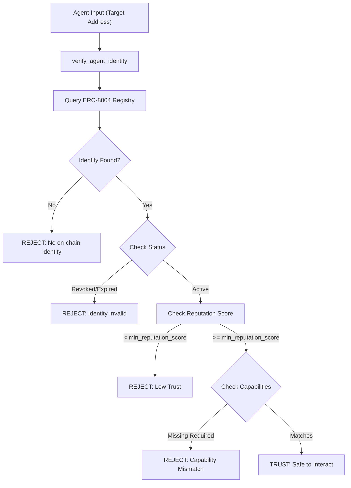
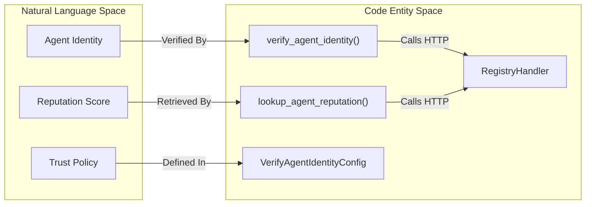
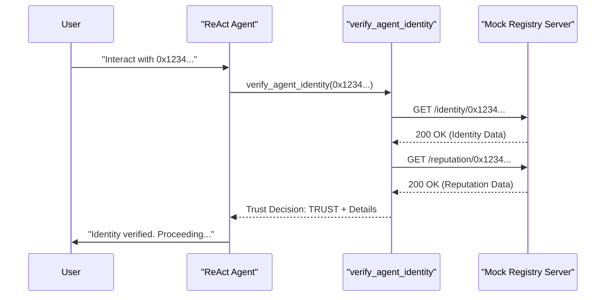

<!-- source: DeepWiki mcp.deepwiki.com · repo NVIDIA/NeMo-Agent-Toolkit-Examples · page 9 Example: Agent Identity Tool · fetched 2026-10-26 -->

# Example: Agent Identity Tool

Relevant source files

The following files were used as context for generating this wiki page:

- [ci/vale/styles/config/vocabularies/nemo-agent-toolkit-examples/accept.txt](ci/vale/styles/config/vocabularies/nemo-agent-toolkit-examples/accept.txt)
- [examples/agent_identity_tool/.gitignore](examples/agent_identity_tool/.gitignore)
- [examples/agent_identity_tool/README.md](examples/agent_identity_tool/README.md)
- [examples/agent_identity_tool/pyproject.toml](examples/agent_identity_tool/pyproject.toml)
- [examples/agent_identity_tool/scripts/mock_registry_server.py](examples/agent_identity_tool/scripts/mock_registry_server.py)
- [examples/agent_identity_tool/src/nat_agent_identity/__init__.py](examples/agent_identity_tool/src/nat_agent_identity/__init__.py)
- [examples/agent_identity_tool/src/nat_agent_identity/configs/identity-agent.example.yml](examples/agent_identity_tool/src/nat_agent_identity/configs/identity-agent.example.yml)
- [examples/agent_identity_tool/src/nat_agent_identity/register.py](examples/agent_identity_tool/src/nat_agent_identity/register.py)

The **Agent Identity Tool** example provides a trust layer for autonomous agents by implementing on-chain identity verification and reputation lookups. As agents increasingly delegate tasks and exchange value, they require a mechanism to verify that a counterparty agent is legitimate, has the required capabilities, and maintains a positive track record [examples/agent_identity_tool/README.md:20-28]().

This implementation leverages the **ERC-8004 (Trustless Agents)** standard, which utilizes ERC-721 tokens to represent non-transferable agent identities on blockchain networks like Ethereum, Base, and Arbitrum [examples/agent_identity_tool/README.md:62-72]().

## System Architecture

The system consists of a NeMo Agent Toolkit (NAT) workflow that interacts with an ERC-8004 compliant registry. For development and testing, a mock registry server is provided to simulate on-chain data [examples/agent_identity_tool/scripts/mock_registry_server.py:17-25]().

### Trust Decision Lifecycle
The following diagram illustrates the logical flow when an agent attempts to verify a counterparty.

**Agent Trust Verification Flow**

**Sources:** [examples/agent_identity_tool/README.md:32-60](), [examples/agent_identity_tool/src/nat_agent_identity/register.py:172-225]()

## Tool Implementation

The toolkit provides two primary functions registered via the `nat.components` entry point [examples/agent_identity_tool/pyproject.toml:28-29]().

### 1. verify_agent_identity
This tool performs a comprehensive check including identity existence, validity (not revoked/expired), reputation thresholds, and capability matching [examples/agent_identity_tool/src/nat_agent_identity/register.py:149-245]().

*   **Configuration**: Defined by `VerifyAgentIdentityConfig` [examples/agent_identity_tool/src/nat_agent_identity/register.py:46-68]().
    *   `registry_url`: The endpoint for the ERC-8004 service.
    *   `min_reputation_score`: Float threshold (0-100) for trust decisions.
    *   `required_capabilities`: List of strings the target agent must advertise.
*   **Logic**:
    1.  Fetches identity from `/identity/{agent_address}` [examples/agent_identity_tool/src/nat_agent_identity/register.py:177-180]().
    2.  Fetches reputation from `/reputation/{agent_address}` [examples/agent_identity_tool/src/nat_agent_identity/register.py:192-195]().
    3.  Aggregates data into a `trust_decision` (TRUST, REJECT, or UNKNOWN) [examples/agent_identity_tool/src/nat_agent_identity/register.py:216-225]().

### 2. lookup_agent_reputation
A specialized tool for retrieving detailed feedback and category-specific scores (e.g., accuracy, reliability, speed) [examples/agent_identity_tool/src/nat_agent_identity/register.py:248-285]().

*   **Configuration**: Defined by `LookupReputationConfig` [examples/agent_identity_tool/src/nat_agent_identity/register.py:71-85]().
*   **Logic**: Queries the `/reputation/{agent_address}` endpoint and allows optional filtering by category via query parameters [examples/agent_identity_tool/src/nat_agent_identity/register.py:270-275]().

**Sources:** [examples/agent_identity_tool/src/nat_agent_identity/register.py:46-85](), [examples/agent_identity_tool/src/nat_agent_identity/register.py:145-285]()

## Code Entity Mapping

The following diagram bridges the natural language concepts of identity verification to the specific Python classes and functions in the codebase.

**Identity Tool Entity Map**

**Sources:** [examples/agent_identity_tool/src/nat_agent_identity/register.py:46-149](), [examples/agent_identity_tool/scripts/mock_registry_server.py:156-160]()

## Mock Registry Server

The `mock_registry_server.py` provides a local HTTP environment for testing the identity lifecycle without a live blockchain connection [examples/agent_identity_tool/scripts/mock_registry_server.py:17-25]().

### Mock Data Structures
The server maintains two primary dictionaries to simulate on-chain state:
*   `MOCK_AGENTS`: Stores ERC-8004 identity tokens, including `agent_uri`, `capabilities`, `service_endpoints`, and status flags like `revoked` or `expired` [examples/agent_identity_tool/scripts/mock_registry_server.py:38-87]().
*   `MOCK_REPUTATION`: Stores scores and feedback history, including `overall_score` and `category_scores` [examples/agent_identity_tool/scripts/mock_registry_server.py:90-151]().

### Test Identities
The mock server includes predefined addresses for testing different trust scenarios:

| Scenario | Address | Expected Decision |
| :--- | :--- | :--- |
| **Trusted Provider** | `0x1234...5678` | `TRUST` (Score: 87.5) |
| **Revoked Agent** | `0xdead...beef` | `REJECT` (Revoked flag) |
| **Expired Identity** | `0xaaaa...aaaa` | `REJECT` (Expired flag) |
| **Unknown Address** | `0x0000...0000` | `REJECT` (404 Not Found) |

**Sources:** [examples/agent_identity_tool/scripts/mock_registry_server.py:38-151](), [examples/agent_identity_tool/README.md:123-131]()

## Workflow Integration

The identity tools are typically used within a `react_agent` workflow. The agent uses these tools to decide whether to proceed with a request involving a third-party agent address [examples/agent_identity_tool/src/nat_agent_identity/configs/identity-agent.example.yml:41-50]().

**Identity Verification Workflow**

**Sources:** [examples/agent_identity_tool/src/nat_agent_identity/configs/identity-agent.example.yml:19-50](), [examples/agent_identity_tool/src/nat_agent_identity/register.py:173-210]()

### Configuration
The `identity-agent.yml` configures the LLM and the tools, setting the `min_reputation_score` threshold that governs the tool's internal logic [examples/agent_identity_tool/src/nat_agent_identity/configs/identity-agent.example.yml:19-26]().

**Sources:** [examples/agent_identity_tool/src/nat_agent_identity/configs/identity-agent.example.yml:1-50](), [examples/agent_identity_tool/src/nat_agent_identity/register.py:46-68]()

---

