# Page: Repository Overview

# Repository Overview

<details>
<summary>Relevant source files</summary>

The following files were used as context for generating this wiki page:

- [.gitattributes](.gitattributes)
- [CONTRIBUTING.md](CONTRIBUTING.md)
- [README.md](README.md)
- [docs/source/_static/banner.png](docs/source/_static/banner.png)
- [pyproject.toml](pyproject.toml)

</details>


The **NeMo Agent Toolkit Examples** repository serves as a centralized hub for community-driven use cases and specialized scenarios built on top of the [NVIDIA NeMo Agent Toolkit (NAT)](https://github.com/NVIDIA/NeMo-Agent-Toolkit). While the core toolkit repository focuses on feature-specific demonstrations, this repository provides end-to-end applications, complex agentic workflows, and integrations with third-party protocols like the Model Context Protocol (MCP).

### Purpose and Relationship to NAT
The examples in this repository are designed to be self-contained and modular. They utilize the NAT plugin system to register tools and workflows, allowing users to run them via the `nat` CLI or integrate them into larger systems.

| Aspect | NeMo Agent Toolkit (Core) | NeMo Agent Toolkit Examples |
| :--- | :--- | :--- |
| **Focus** | Toolkit features and core capabilities [README.md:26-31]() | Community use cases and scenarios [README.md:26-31]() |
| **Update Cadence** | Syncs with every toolkit release [README.md:26-31]() | Updated as needed; bound to specific versions [README.md:26-31]() |
| **Complexity** | Atomic feature demonstrations | Multi-agent orchestration and complex integrations |

**Sources:** [README.md:20-32](), [CONTRIBUTING.md:19-21]()

---

### Repository Structure
The repository follows a strict organizational pattern to ensure compatibility with the NAT discovery mechanism. Every example is located under the `examples/` directory and must include a `pyproject.toml` that registers the example as a NAT component.

**Logical Component Mapping**
The following diagram illustrates how high-level repository concepts map to specific code entities and directory structures.

**Diagram: Repository Organization to Code Entity Mapping**
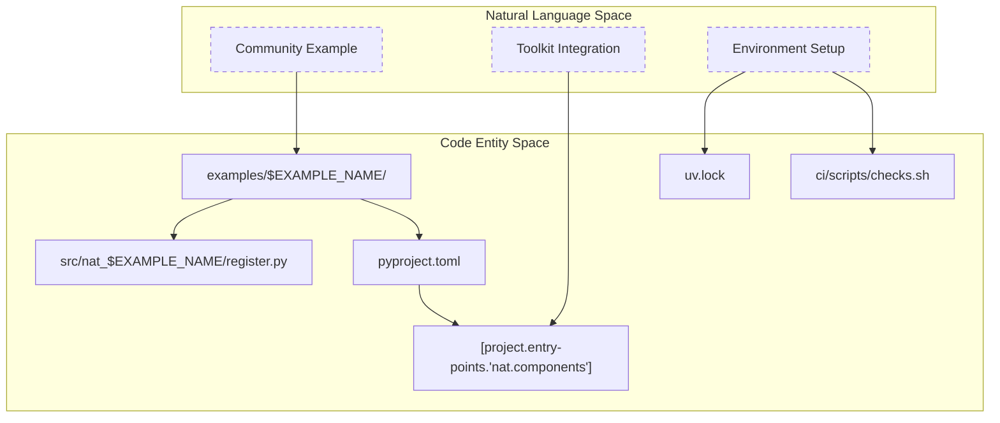
**Sources:** [CONTRIBUTING.md:56-74](), [pyproject.toml:1-6]()

---

### Key Examples
The repository hosts a variety of specialized agents, ranging from infrastructure monitors to financial tools:

*   **Sandbox Agent:** A general-purpose agent utilizing Docker or Daytona for isolated code execution.
*   **K8s Infrastructure Monitor:** A diagnostic system using LangGraph to monitor and troubleshoot Kubernetes clusters.
*   **MCP RAG Demo:** An agentic Retrieval-Augmented Generation system using Milvus and NVIDIA NIMs.
*   **x402 Payment Tool:** A specialized tool enabling agents to handle HTTP 402 payment negotiations autonomously.
*   **Profiler Agent:** A telemetry-focused agent that analyzes NAT performance traces using Phoenix.

---

### Developer Workflow
The repository utilizes `uv` for dependency management and `ruff` for linting to maintain high code quality across diverse community contributions.

**Diagram: Development and Validation Flow**
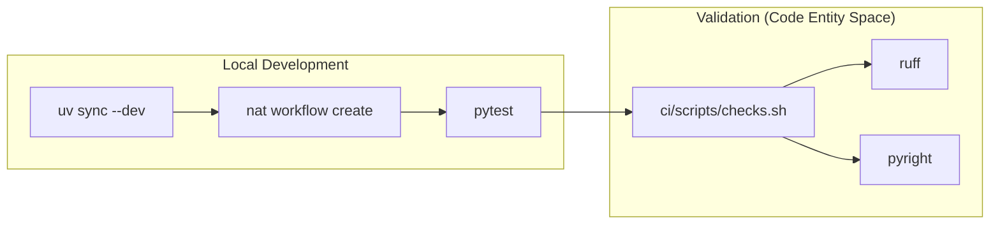
**Sources:** [README.md:58-63](), [CONTRIBUTING.md:56-58](), [CONTRIBUTING.md:93-101](), [pyproject.toml:25-41]()

---

### Navigation
To get started with using or contributing to this repository, refer to the following child pages:

*   **[Getting Started & Installation](#1.1)**: Detailed instructions on setting up `uv`, handling `git-lfs` for datasets, and initializing the Python environment.
*   **[Contributing a New Example](#1.2)**: Requirements for new submissions, including the mandatory `nat_` prefix for modules, registration patterns in `register.py`, and CI/CD validation steps.

**Sources:** [README.md:34-73](), [CONTRIBUTING.md:51-92]()

---

# Page: Getting Started & Installation

# Getting Started & Installation

<details>
<summary>Relevant source files</summary>

The following files were used as context for generating this wiki page:

- [.gitignore](.gitignore)
- [CONTRIBUTING.md](CONTRIBUTING.md)
- [README.md](README.md)
- [pyproject.toml](pyproject.toml)

</details>


This page provides a comprehensive technical guide for setting up the development environment for the NeMo Agent Toolkit (NAT) Examples repository. It covers system requirements, dependency management using `uv`, and the initial configuration required to run agentic workflows.

## Environment Prerequisites

The repository is designed for modern Python development, emphasizing reproducible environments and efficient dependency resolution.

### System Requirements
*   **Python Version**: `3.11`, `3.12`, or `3.13` is required [[pyproject.toml:4-4](), [README.md:38-38](), [README.md:65-66]()].
*   **Git LFS**: Required for fetching large datasets (e.g., GAIA benchmark data, vector database files) [[README.md:47-52]()].
*   **uv**: The repository uses `uv` for fast, disk-efficient package management and virtual environment handling [[README.md:54-54]()].

### Python Configuration
The global project configuration defines strict linting and type-checking rules to ensure code quality across all community examples.
*   **Line Length**: 120 characters [[pyproject.toml:27-27]()].
*   **Linting**: Uses `ruff` with `flake8` (E, F, W), `isort` (I), and `pylint` (PL) rules enabled [[pyproject.toml:32-41]()].
*   **Type Checking**: Configured via `pyright` [[pyproject.toml:85-88]()].

**Sources:** [pyproject.toml:4-88](), [README.md:38-66]()

---

## Installation Steps

### 1. Repository Setup
Clone the repository and initialize Git Large File Storage (LFS) to ensure all data assets are correctly downloaded.

```bash
git clone https://github.com/NVIDIA/NeMo-Agent-Toolkit-Examples.git
cd NeMo-Agent-Toolkit-Examples

# Initialize LFS and pull data
git lfs install
git lfs fetch
git lfs pull
```
**Sources:** [README.md:40-52]()

### 2. Virtual Environment Creation
Use `uv` to create a dedicated virtual environment. While the repository supports Python 3.11+, 3.13 is the recommended default for new setups.

```bash
# Create venv with specific python version
uv venv --python 3.13 --seed .venv
source .venv/bin/activate

# Synchronize dependencies including development tools
uv sync --dev
```
The `uv sync --dev` command installs the core `dependency-groups` defined in the root `pyproject.toml`, including `pytest`, `ruff`, and `pre-commit` [[pyproject.toml:8-23]()].

**Sources:** [README.md:58-66](), [pyproject.toml:8-23]()

---

## The `nat` CLI and Scaffolding

The toolkit provides a command-line interface, `nat`, which is the primary entry point for managing examples and workflows.

### Workflow Creation
New examples should be scaffolded using the `nat workflow create` command. This ensures the directory structure complies with the toolkit's discovery mechanism [[CONTRIBUTING.md:57-57]()].

### Example Structure Mapping
The following diagram bridges the "Natural Language" directory concepts to the specific "Code Entities" required by the toolkit for registration.

**Diagram: Example Directory to Code Entity Mapping**
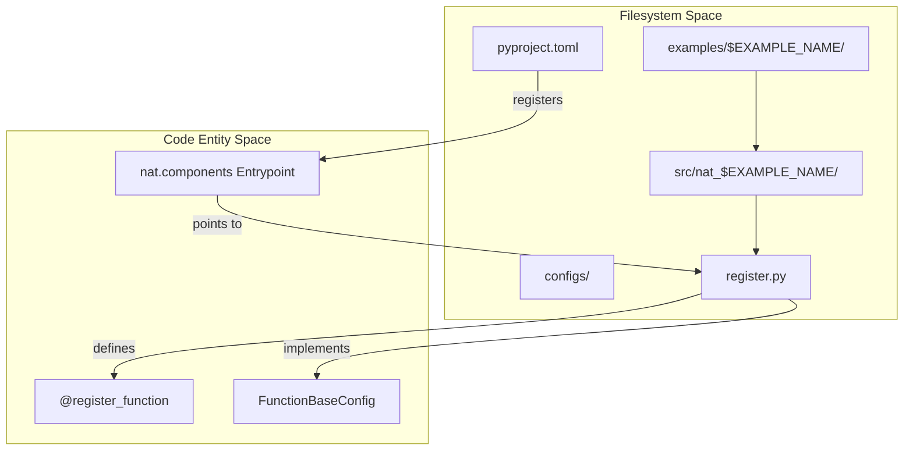
**Sources:** [CONTRIBUTING.md:57-74]()

---

## Initial Execution & Verification

Each example is self-contained within the `examples/` directory. To verify the installation, navigate to a specific example and follow its local `README.md` or `README.ipynb` [[README.md:36-36](), [CONTRIBUTING.md:76-79]()].

### Running Local Checks
Before contributing or running complex workflows, verify the environment health using the provided CI scripts:

```bash
# Run linting, type checks, and formatting
./ci/scripts/checks.sh
```
This script orchestrates several tools defined in the development group, such as `ruff` for linting and `yapf` for formatting [[CONTRIBUTING.md:94-101](), [pyproject.toml:25-82]()].

### Data Flow: Installation to Execution
This diagram illustrates the flow from environment setup to the execution of a registered toolkit component.

**Diagram: Setup and Execution Data Flow**
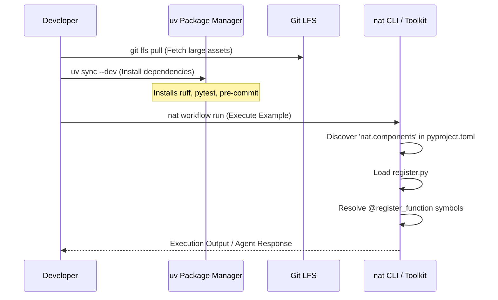
**Sources:** [README.md:47-66](), [CONTRIBUTING.md:57-101](), [pyproject.toml:8-23]()

---

## Summary of Configuration Files

| File | Purpose | Key Entities |
| :--- | :--- | :--- |
| `pyproject.toml` (Root) | Global dev dependencies & lint rules | `[dependency-groups]`, `[tool.ruff]` |
| `pyproject.toml` (Example) | Example-specific metadata & NAT registration | `[project.entry-points."nat.components"]` |
| `register.py` | Tool and workflow registration | `@register_function`, `FunctionBaseConfig` |
| `.gitignore` | Prevents tracking of large/temp files | `.venv/`, `*.sqlite`, `data/` (partial) |

**Sources:** [pyproject.toml:1-88](), [CONTRIBUTING.md:57-74](), [.gitignore:1-219]()

---

# Page: Contributing a New Example

# Contributing a New Example

<details>
<summary>Relevant source files</summary>

The following files were used as context for generating this wiki page:

- [.pre-commit-config.yaml](.pre-commit-config.yaml)
- [CODE-OF-CONDUCT.md](CODE-OF-CONDUCT.md)
- [CONTRIBUTING.md](CONTRIBUTING.md)
- [README.md](README.md)
- [ci/scripts/bootstrap_local_ci.sh](ci/scripts/bootstrap_local_ci.sh)
- [ci/scripts/checks.sh](ci/scripts/checks.sh)
- [ci/scripts/common.sh](ci/scripts/common.sh)
- [ci/scripts/copyright.py](ci/scripts/copyright.py)
- [ci/scripts/documentation_checks.sh](ci/scripts/documentation_checks.sh)
- [ci/scripts/github/common.sh](ci/scripts/github/common.sh)
- [ci/scripts/python_checks.sh](ci/scripts/python_checks.sh)
- [examples/.template/README.md](examples/.template/README.md)

</details>


This guide provides detailed technical instructions for contributing new examples to the NeMo Agent Toolkit (NAT) Examples repository. It covers the mandatory directory structure, the use of the `nat` CLI for scaffolding, configuration requirements, and the CI/CD pipeline that validates all contributions.

## Overview of the Contribution Workflow

Contributors are expected to follow a standardized workflow to ensure that examples are reproducible, well-documented, and compatible with the core NeMo Agent Toolkit.

### Scaffolding with `nat`

The repository requires a specific directory structure for all examples. To maintain consistency, contributors must use the `nat workflow create` command to generate the initial scaffolding `[CONTRIBUTING.md:57-57]()`. This ensures that the example is correctly registered as a plugin and follows the naming conventions required by the toolkit.

### Directory Structure Requirements

Each example is located within the `examples/` directory and must follow this specific layout:

```text
examples/
  $EXAMPLE_NAME/
    configs/             # Symlink to src/nat_$EXAMPLE_NAME/configs/
    data/                # [Optional] Symlink to src/nat_$EXAMPLE_NAME/data/
    scripts/             # [Optional] Setup or utility scripts
    src/
      nat_$EXAMPLE_NAME/ # Package name MUST start with 'nat_' prefix
        configs/
          config.yml     # Core YAML configuration
        data/            # [Optional] Data files
        __init__.py
        register.py      # Plugin registration logic
    README.md            # Documentation (or README.ipynb)
    pyproject.toml       # Build system and NAT entry points
```
*Source: `[CONTRIBUTING.md:58-74]()`*

## Technical Implementation Details

### Plugin Registration (`register.py`)
The `register.py` file is the entry point for the NAT plugin system. It typically involves:
1.  **Config Classes**: Defining a configuration class that inherits from `FunctionBaseConfig` `[examples/.template/README.md:138-138]()`.
2.  **Function Decoration**: Using the `@register_function` decorator to expose Python functions as tools to the agent `[examples/.template/README.md:139-139]()`.

### Dependency Management (`pyproject.toml`)
All dependencies must be specified in the example's local `pyproject.toml`.
-   **Version Constraints**: Dependencies (including `nvidia-nat`) must use at least two-digit versioning (e.g., `nvidia-nat~=1.2`) `[CONTRIBUTING.md:53-54]()`.
-   **Licensing**: All dependencies must have licenses compatible with Apache 2.0 `[CONTRIBUTING.md:54-54]()`.
-   **Registration**: The example must register itself with the `nat` system via entry points defined in this file `[CONTRIBUTING.md:73-73]()`.

### Documentation Standards
Every example requires a `README.md` or `README.ipynb`. A template is provided at `examples/.template/README.md` `[CONTRIBUTING.md:78-79]()`. Mandatory sections include:
-   **Description & Key Features**: What the example does and what NAT capabilities it highlights `[CONTRIBUTING.md:83-84]()`.
-   **Setup & Run Instructions**: Clear commands for `uv pip install` and `nat run` `[examples/.template/README.md:57-82]()`.
-   **Expected Results**: A sample output so users can verify their setup `[CONTRIBUTING.md:87-87]()`.

---

### Logic Flow: From Scaffolding to Execution

The following diagram illustrates the relationship between the `nat` CLI, the directory structure, and the runtime registration.

**Example Scaffolding and Registration Flow**
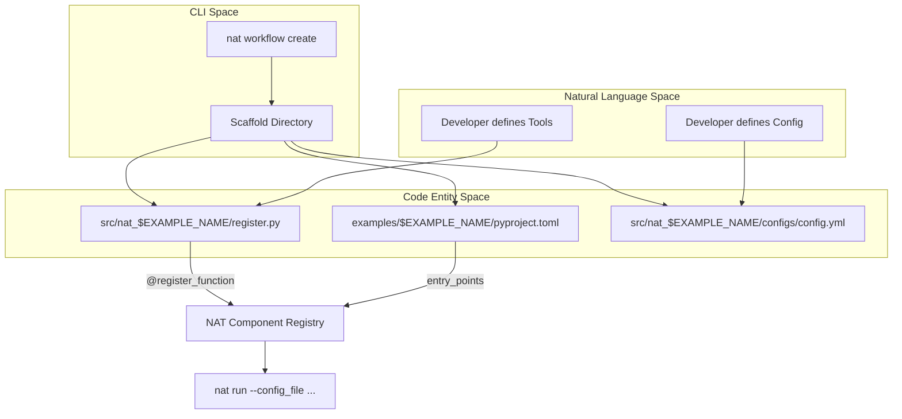
*Sources: `[CONTRIBUTING.md:57-74]()`, `[examples/.template/README.md:137-142]()`*

---

## Testing and Quality Assurance

### Testing Requirements
Examples must include unit tests using `pytest` `[CONTRIBUTING.md:91-91]()`. These tests should verify core functionality and ensure that updates to dependencies do not break the example `[CONTRIBUTING.md:91-92]()`.

### CI Checks Pipeline
The repository uses a centralized check script `ci/scripts/checks.sh` to enforce standards `[ci/scripts/checks.sh:1-53]()`.

| Check Type | Script / Tool | Description |
| :--- | :--- | :--- |
| **Linting** | `pre-commit` | Runs `ruff`, `yapf`, and `uv-lock` `[.pre-commit-config.yaml:18-35]()`. |
| **Python Style** | `pylint` | Enforced via `ci/scripts/python_checks.sh` `[ci/scripts/python_checks.sh:41-44]()`. |
| **Copyright** | `copyright.py` | Verifies Apache 2.0 headers and correct year ranges `[ci/scripts/copyright.py:133-143]()`. |
| **Documentation** | `vale` | Checks for spelling, style, and broken links in Markdown/RST files `[ci/scripts/documentation_checks.sh:20-22]()`. |

---

### Data Flow: CI Validation Pipeline

The following diagram maps the CI script execution to the specific entities they validate.

**CI Pipeline and Entity Association**
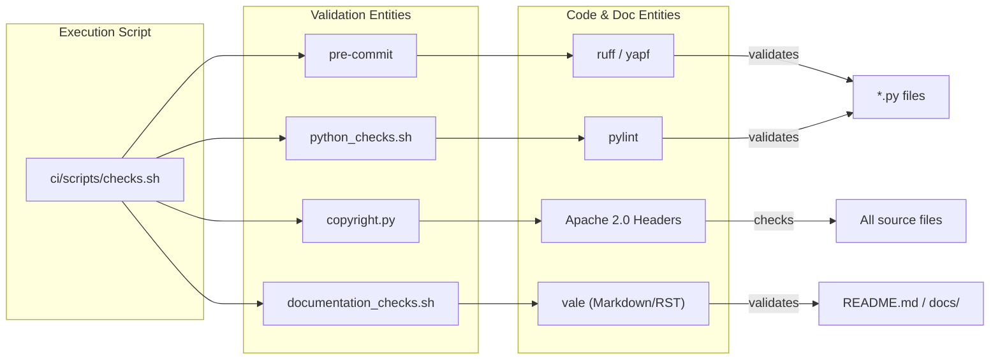
*Sources: `[ci/scripts/checks.sh:23-47]()`, `[ci/scripts/copyright.py:34-43]()`, `[ci/scripts/documentation_checks.sh:20-22]()`*

---

## How to Submit

1.  **Environment Setup**: Ensure `uv` is installed and the environment is synced with `--dev` dependencies `[README.md:54-63]()`.
2.  **Local Validation**: Before submitting a PR, run the local check suite:
    ```bash
    ./ci/scripts/checks.sh
    ```
    *Source: `[CONTRIBUTING.md:100-100]()`*
3.  **Copyright Headers**: Ensure all new files contain the NVIDIA copyright header. The `copyright.py` script will automatically check for the Apache 2.0 license string `[ci/scripts/copyright.py:57-57]()` and the correct year range `[ci/scripts/copyright.py:137-141]()`.
4.  **PR Template**: Follow the instructions in the Pull Request template (located in `.github/` or equivalent) to describe the changes.

*Sources:*
- `[README.md:54-63]()`
- `[CONTRIBUTING.md:91-102]()`
- `[ci/scripts/checks.sh:1-53]()`
- `[ci/scripts/copyright.py:1-206]()`
- `[ci/scripts/documentation_checks.sh:1-25]()`

---

# Page: Core Concepts & Architecture

# Core Concepts & Architecture

<details>
<summary>Relevant source files</summary>

The following files were used as context for generating this wiki page:

- [CONTRIBUTING.md](CONTRIBUTING.md)
- [README.md](README.md)
- [ci/vale/styles/config/vocabularies/nemo-agent-toolkit-examples/accept.txt](ci/vale/styles/config/vocabularies/nemo-agent-toolkit-examples/accept.txt)
- [examples/agent_identity_tool/.gitignore](examples/agent_identity_tool/.gitignore)
- [pyproject.toml](pyproject.toml)

</details>


This page provides a high-level overview of the architectural patterns and shared components used across the NeMo Agent Toolkit (NAT) examples. The repository is designed around a modular, plugin-based architecture that leverages YAML for configuration and standardized protocols for agent communication.

## Architectural Overview

The NeMo Agent Toolkit Examples follow a consistent structural pattern to ensure composability and ease of use. Every example is a self-contained Python package that registers itself with the `nat` CLI via entry points. The architecture bridges the gap between high-level natural language instructions and low-level Python execution through a unified registration and configuration system.

### System Mapping: Logic to Code

The following diagram illustrates how conceptual agent components map to specific code entities within the repository.

**Agent Logic to Code Entity Mapping**
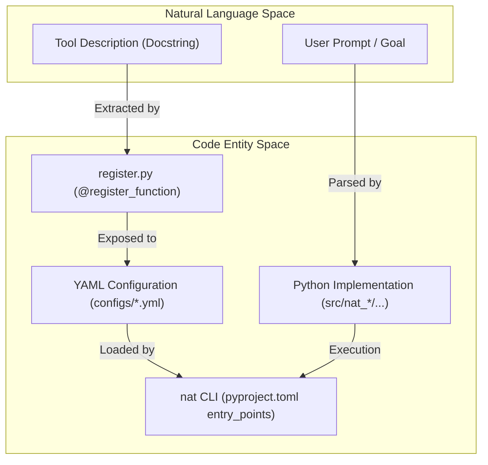
**Sources:** [CONTRIBUTING.md:58-74](), [pyproject.toml:63-63]()

---

## Plugin & Registration System

The foundation of the toolkit is the `register.py` system. Instead of hardcoding tools into an agent, developers use the `@register_function` decorator to expose Python functions or LangChain tools to the NAT ecosystem. This allows the `nat` CLI to discover and instantiate tools dynamically.

Key components include:
*   **`register.py`**: The central hub for each example where tools and workflows are declared [CONTRIBUTING.md:71-71]().
*   **`@register_function`**: A decorator used to wrap logic, making it available for selection in YAML configurations.
*   **Entry Points**: Examples register themselves in `pyproject.toml` under `[project.entry-points."nat.components"]`, allowing the toolkit to locate the `register.py` file [CONTRIBUTING.md:73-73]().

For details, see [Plugin & Registration System](#2.1).

---

## YAML Configuration System

All examples are driven by YAML files located in the `configs/` directory [CONTRIBUTING.md:61-61](). This system separates the implementation logic from the runtime behavior, allowing users to swap LLM providers, adjust tool parameters, or modify agent prompts without changing code.

The configuration typically defines:
*   **LLMs**: Which models (e.g., NVIDIA NIM, OpenAI) to use for different tasks.
*   **Function Groups**: Logical groupings of tools (e.g., "filesystem-tools", "k8s-diagnostic-tools").
*   **Workflow**: The execution pattern, such as a standard ReAct loop or a custom LangGraph state machine.

For details, see [YAML Configuration System](#2.2).

---

## The nat CLI and Execution Loop

The `nat` CLI serves as the primary interface for interacting with examples. It handles the orchestration of the **ReAct (Reasoning and Acting) agent loop**, which follows a specific execution flow:

**ReAct Loop Execution Flow**
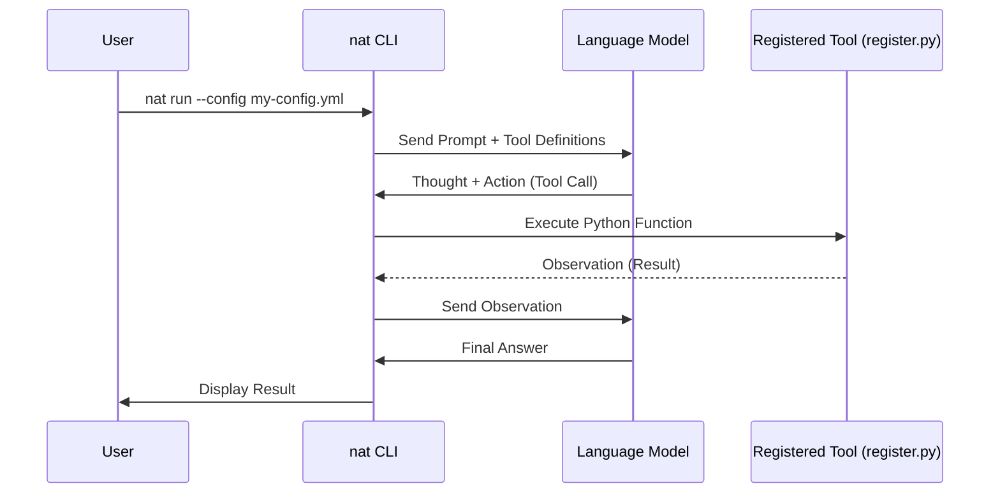
**Sources:** [CONTRIBUTING.md:57-57](), [README.md:68-69]()

---

## Protocol Integrations: MCP and A2A

To support complex, distributed agentic workflows, the examples utilize two primary communication protocols:

1.  **Model Context Protocol (MCP)**: Used to expose tools and data sources to agents in a standardized way. This allows a NAT agent to act as either an MCP client (consuming tools) or an MCP server (providing tools).
2.  **Agent-to-Agent (A2A)**: Facilitates orchestration between multiple specialized agents, enabling "manager" agents to delegate tasks to "worker" agents across different environments.

For details, see [Protocol Integrations: MCP and A2A](#2.3).

---

## Repository Structure & Standards

To maintain consistency, all examples adhere to a strict directory layout and coding standard.

| Component | Requirement |
| :--- | :--- |
| **Naming** | All modules must start with the `nat_` prefix [CONTRIBUTING.md:65-65](). |
| **Dependencies** | Defined in `pyproject.toml` with version pinning [CONTRIBUTING.md:54-54](). |
| **Tooling** | Uses `uv` for environment management and `ruff` for linting [pyproject.toml:18-18](), [README.md:54-63](). |
| **Testing** | Mandatory `pytest` suites for core functionality [CONTRIBUTING.md:91-91](). |

**Sources:** [CONTRIBUTING.md:58-74](), [pyproject.toml:25-41](), [README.md:38-39]()

---

# Page: Plugin & Registration System

# Plugin & Registration System

<details>
<summary>Relevant source files</summary>

The following files were used as context for generating this wiki page:

- [examples/agent_identity_tool/src/nat_agent_identity/__init__.py](examples/agent_identity_tool/src/nat_agent_identity/__init__.py)
- [examples/agent_identity_tool/src/nat_agent_identity/configs/identity-agent.example.yml](examples/agent_identity_tool/src/nat_agent_identity/configs/identity-agent.example.yml)
- [examples/agent_identity_tool/src/nat_agent_identity/register.py](examples/agent_identity_tool/src/nat_agent_identity/register.py)
- [examples/k8s_infra_monitor/src/nat_k8s_infra_monitor/register.py](examples/k8s_infra_monitor/src/nat_k8s_infra_monitor/register.py)
- [examples/mcp_rag_demo/src/nat_mcp_rag_demo/register.py](examples/mcp_rag_demo/src/nat_mcp_rag_demo/register.py)
- [examples/sandbox_agent/src/nat_sandbox_agent/register.py](examples/sandbox_agent/src/nat_sandbox_agent/register.py)
- [examples/x402_payment_tool/src/nat_x402_payment/__init__.py](examples/x402_payment_tool/src/nat_x402_payment/__init__.py)

</details>


The NeMo Agent Toolkit (NAT) Examples repository utilizes a standardized plugin and registration system to expose tools and workflows to the NAT orchestrator. This system bridges high-level YAML configurations with Python implementations using a combination of decorators, Pydantic-based configuration schemas, and a Builder pattern for dependency injection.

## Core Registration Components

The registration system relies on three primary pillars:
1.  **Configuration Schemas**: Subclasses of `FunctionBaseConfig` that define the parameters available in YAML.
2.  **Registration Decorator**: The `@register_function` decorator that marks a Python function as a NAT-compatible component.
3.  **Entrypoints**: The `nat.components` entrypoint in `pyproject.toml` which allows the NAT CLI to discover external example packages.

### Function Registration Workflow

The following diagram illustrates the flow from a YAML configuration to a live tool or workflow instance within the toolkit.

**Diagram: Natural Language Config to Code Entity Mapping**
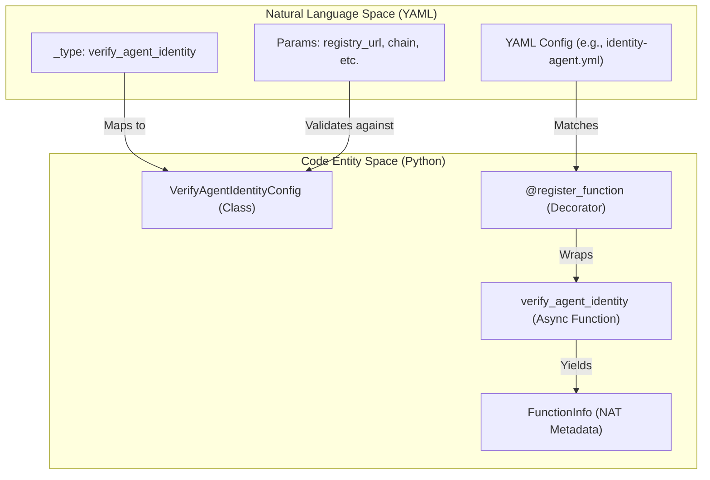
**Sources:** [examples/agent_identity_tool/src/nat_agent_identity/register.py:46-70](), [examples/agent_identity_tool/src/nat_agent_identity/configs/identity-agent.example.yml:19-27]()

---

## The `@register_function` Decorator

The `@register_function` decorator is the primary interface for adding new capabilities. It requires a `config_type` (a Pydantic model) and a list of supported `framework_wrappers` (e.g., `LLMFrameworkEnum.LANGCHAIN`).

### Implementation Details
When a function is decorated, it must follow a specific signature: `async def name(config: ConfigClass, builder: Builder)`.
*   **`config`**: An instance of the configuration class populated with values from the YAML file.
*   **`builder`**: An instance of the `Builder` class used to fetch LLMs, embedders, or other tools registered in the system.

**Sources:** [examples/mcp_rag_demo/src/nat_mcp_rag_demo/register.py:63-64](), [examples/agent_identity_tool/src/nat_agent_identity/register.py:145-149]()

---

## The Builder Pattern

The `Builder` class is a central utility provided by NAT to handle the instantiation of complex components. It ensures that LLMs and tools are created with the correct providers (e.g., NVIDIA NIM) and wrapped for the requested framework (e.g., LangChain).

### Key Builder Methods
| Method | Purpose | Example Usage |
| :--- | :--- | :--- |
| `get_llm` | Fetches an LLM instance based on a reference. | [examples/k8s_infra_monitor/src/nat_k8s_infra_monitor/register.py:79]() |
| `get_tool` | Fetches a single registered tool by name. | [examples/k8s_infra_monitor/src/nat_k8s_infra_monitor/register.py:83]() |
| `get_tools` | Fetches a list of tools simultaneously. | [examples/k8s_infra_monitor/src/nat_k8s_infra_monitor/register.py:97]() |
| `get_embedder`| Fetches an embedding model (e.g., for RAG). | [examples/mcp_rag_demo/src/nat_mcp_rag_demo/register.py:68]() |

**Sources:** [examples/k8s_infra_monitor/src/nat_k8s_infra_monitor/register.py:79-97](), [examples/mcp_rag_demo/src/nat_mcp_rag_demo/register.py:68-69]()

---

## Workflow vs. Tool Registration

While both use `@register_function`, their implementations differ in what they `yield` or `return`.

### 1. Tool Registration
Tools typically define an inner function that performs the actual work. The registration function then yields a `FunctionInfo` object created from that inner function.

```python
@register_function(config_type=SearchSupportTicketsConfig, ...)
async def search_support_tickets_tool(config, builder):
    async def _search(query: str):
        # Implementation
        ...
    yield FunctionInfo.from_fn(_search, ...)
```
**Sources:** [examples/mcp_rag_demo/src/nat_mcp_rag_demo/register.py:63-109]()

### 2. Workflow Registration
Workflows (like a LangGraph agent) orchestrate multiple tools. They use the `builder` to gather tools and LLMs, compile a graph or chain, and yield a response function that serves as the entry point for the agent.

**Diagram: Workflow Instantiation Logic**
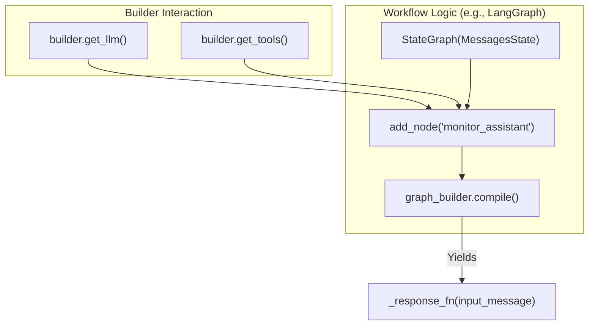
**Sources:** [examples/k8s_infra_monitor/src/nat_k8s_infra_monitor/register.py:70-138]()

---

## Configuration Management with `FunctionBaseConfig`

Every registered component must have a configuration class inheriting from `FunctionBaseConfig`. This class defines the schema for the YAML configuration.

*   **`name` parameter**: The `name` argument in `FunctionBaseConfig(..., name="...")` must match the `_type` field in the YAML.
*   **Field Validation**: Uses Pydantic `Field` for descriptions and default values, which are also used to generate documentation for the NAT CLI.

**Sources:** [examples/agent_identity_tool/src/nat_agent_identity/register.py:46-68](), [examples/mcp_rag_demo/src/nat_mcp_rag_demo/register.py:31-37]()

## Example Entrypoint Discovery

For the NAT CLI to find these registrations, the example packages must define an entrypoint in their `pyproject.toml`. This allows the toolkit to dynamically load the `register.py` module of each example.

Example structure for discovery:
1.  **`pyproject.toml`**: Defines `[project.entry-points."nat.components"]`.
2.  **`register.py`**: Contains the `@register_function` calls.
3.  **`__init__.py`**: Often empty, but required for the package to be importable.

**Sources:** [examples/agent_identity_tool/src/nat_agent_identity/__init__.py:1-15](), [examples/agent_identity_tool/src/nat_agent_identity/register.py:1-43]()

---

# Page: YAML Configuration System

# YAML Configuration System

<details>
<summary>Relevant source files</summary>

The following files were used as context for generating this wiki page:

- [examples/currency_agent_a2a/README.md](examples/currency_agent_a2a/README.md)
- [examples/currency_agent_a2a/configs/config.yml](examples/currency_agent_a2a/configs/config.yml)
- [examples/currency_agent_a2a/data/sample_queries.json](examples/currency_agent_a2a/data/sample_queries.json)
- [examples/currency_agent_a2a/pyproject.toml](examples/currency_agent_a2a/pyproject.toml)
- [examples/k8s_infra_monitor/src/nat_k8s_infra_monitor/configs/config_live_mode.yml](examples/k8s_infra_monitor/src/nat_k8s_infra_monitor/configs/config_live_mode.yml)
- [examples/k8s_infra_monitor/src/nat_k8s_infra_monitor/configs/config_offline_mode.yml](examples/k8s_infra_monitor/src/nat_k8s_infra_monitor/configs/config_offline_mode.yml)
- [examples/kaggle_mcp/README.md](examples/kaggle_mcp/README.md)
- [examples/kaggle_mcp/configs/config-per-user.yml](examples/kaggle_mcp/configs/config-per-user.yml)
- [examples/kaggle_mcp/configs/config.yml](examples/kaggle_mcp/configs/config.yml)
- [examples/kaggle_mcp/pyproject.toml](examples/kaggle_mcp/pyproject.toml)
- [examples/kaggle_mcp/uv.lock](examples/kaggle_mcp/uv.lock)
- [examples/mcp_rag_demo/src/nat_mcp_rag_demo/configs/mcp-client-for-ui.yml](examples/mcp_rag_demo/src/nat_mcp_rag_demo/configs/mcp-client-for-ui.yml)
- [examples/mcp_rag_demo/src/nat_mcp_rag_demo/configs/support-ui.yml](examples/mcp_rag_demo/src/nat_mcp_rag_demo/configs/support-ui.yml)

</details>


The NeMo Agent Toolkit (NAT) uses a standardized YAML configuration schema across all examples to define the behavior of LLMs, tools, workflows, and authentication providers. This system enables modular agent design, allowing developers to swap models or toolsets without modifying the underlying Python code.

## Configuration Schema Overview

The configuration is organized into top-level blocks that correspond to the core components of the NAT ecosystem.

| Section | Description |
| :--- | :--- |
| `llms` | Defines the Large Language Models (e.g., NVIDIA NIM, OpenAI) used by agents. |
| `functions` | Configures individual tools with specific parameters (e.g., Milvus URIs, thresholds). |
| `function_groups` | Aggregates tools from external protocols like **MCP** or **A2A**. |
| `workflow` | Defines the agent logic (e.g., `react_agent`) and its tool/LLM bindings. |
| `authentication` | Centralizes API keys and bearer tokens for external services. |
| `general` | System-level settings like timeouts and cleanup intervals. |

### Environment Variable Interpolation
The system supports dynamic value injection using the `${VAR_NAME}` syntax. This is primarily used for sensitive credentials to prevent them from being hardcoded in configuration files [examples/kaggle_mcp/configs/config.yml:39-39]().

Sources: [examples/kaggle_mcp/configs/config.yml:16-52](), [examples/currency_agent_a2a/configs/config.yml:16-49]()

## LLM Configuration

The `llms` block defines the model provider and inference parameters. The `_type` field determines which factory class is used to instantiate the LLM client.

```yaml
llms:
  nim_llm:
    _type: nim
    model_name: meta/llama-3.1-70b-instruct
    temperature: 0.0
    max_tokens: 1024
```
*   **nim**: Connects to NVIDIA NIM endpoints [examples/kaggle_mcp/configs/config.yml:18-21]().
*   **Parameters**: Standard parameters like `temperature` and `max_tokens` are passed directly to the model provider [examples/currency_agent_a2a/configs/config.yml:35-39]().

Sources: [examples/kaggle_mcp/configs/config.yml:16-21](), [examples/currency_agent_a2a/configs/config.yml:34-40]()

## Tooling: Functions and Function Groups

NAT distinguishes between local tools (`functions`) and protocol-based tool collections (`function_groups`).

### 1. Functions (Local Tools)
Used for tools implemented within the example's codebase. Each entry must specify a `_type` that matches a registered tool name.

```yaml
functions:
  node_status_check:
    _type: node_status_check
    offline_mode: false
```
*   **Source**: [examples/k8s_infra_monitor/src/nat_k8s_infra_monitor/configs/config_live_mode.yml:20-23]()

### 2. Function Groups (MCP & A2A)
Used to import tools from external servers via the **Model Context Protocol (MCP)** or **Agent-to-Agent (A2A)** protocol.

*   **mcp_client**: Connects to an MCP server (e.g., via `stdio` or `streamable-http`) [examples/kaggle_mcp/configs/config.yml:23-28]().
*   **a2a_client**: Connects to another NAT-compatible agent [examples/currency_agent_a2a/configs/config.yml:30-32]().
*   **tool_overrides**: Allows redefining tool descriptions or aliases to improve LLM steering [examples/kaggle_mcp/configs/config.yml:29-34]().

Sources: [examples/kaggle_mcp/configs/config.yml:22-35](), [examples/currency_agent_a2a/configs/config.yml:16-32]()

## Workflow Patterns

The `workflow` block dictates the agent's execution loop. NAT supports two primary patterns: Single-User and Multi-User (Per-User).

### Single-User Pattern
Commonly used for CLI-based agents or local scripts. The workflow is instantiated once at startup.

```yaml
workflow:
  _type: react_agent
  tool_names: [kaggle_mcp_tools]
  llm_name: nim_llm
```
*   **Source**: [examples/kaggle_mcp/configs/config.yml:42-48]()

### Multi-User (Per-User) Pattern
Used for `nat serve` deployments where multiple users interact with the same endpoint. It ensures that session state and tool clients (especially MCP/A2A) are isolated per user.

```yaml
workflow:
  _type: per_user_react_agent
  tool_names:
    - kaggle_mcp_tools
  llm_name: nim_llm
```
*   **Source**: [examples/kaggle_mcp/configs/config-per-user.yml:46-52]()

### Entity Mapping: Configuration to Code
The following diagram illustrates how YAML keys map to specific code entities and protocols.

**Natural Language Space to Code Entity Space**
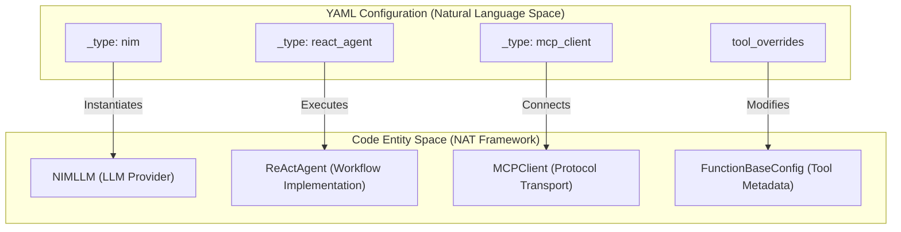
Sources: [examples/kaggle_mcp/configs/config.yml:16-52](), [examples/currency_agent_a2a/configs/config.yml:16-49]()

## Implementation and Data Flow

When `nat run` or `nat serve` is executed, the configuration is parsed and used to build the agent's runtime environment.

**Data Flow: Configuration Loading**
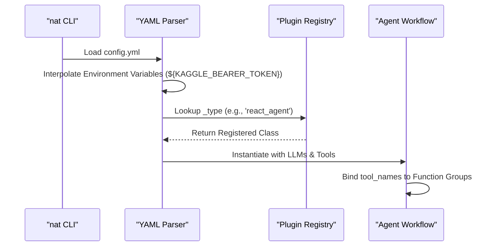
Sources: [examples/kaggle_mcp/README.md:67-77](), [examples/kaggle_mcp/configs/config.yml:39-39]()

## Summary of Shared Keys

| Key | Example Value | Role |
| :--- | :--- | :--- |
| `_type` | `nim`, `react_agent`, `mcp_client` | The identifier used by the plugin system to find the Python class. |
| `tool_names` | `[tool_a, group_b]` | List of local functions or function groups the agent can access. |
| `llm_name` | `nim_llm` | References a specific entry in the `llms` block. |
| `auth_provider` | `kaggle` | References a specific entry in the `authentication` block. |
| `transport` | `stdio`, `streamable-http` | Defines the communication channel for MCP servers. |

Sources: [examples/kaggle_mcp/configs/config.yml:16-53](), [examples/currency_agent_a2a/configs/config.yml:16-50]()

---

# Page: Protocol Integrations: MCP and A2A

# Protocol Integrations: MCP and A2A

<details>
<summary>Relevant source files</summary>

The following files were used as context for generating this wiki page:

- [examples/currency_agent_a2a/README.md](examples/currency_agent_a2a/README.md)
- [examples/currency_agent_a2a/configs/config.yml](examples/currency_agent_a2a/configs/config.yml)
- [examples/currency_agent_a2a/data/sample_queries.json](examples/currency_agent_a2a/data/sample_queries.json)
- [examples/currency_agent_a2a/pyproject.toml](examples/currency_agent_a2a/pyproject.toml)
- [examples/kaggle_mcp/README.md](examples/kaggle_mcp/README.md)
- [examples/kaggle_mcp/configs/config-per-user.yml](examples/kaggle_mcp/configs/config-per-user.yml)
- [examples/kaggle_mcp/configs/config.yml](examples/kaggle_mcp/configs/config.yml)
- [examples/kaggle_mcp/pyproject.toml](examples/kaggle_mcp/pyproject.toml)
- [examples/kaggle_mcp/uv.lock](examples/kaggle_mcp/uv.lock)
- [examples/mcp_rag_demo/README.md](examples/mcp_rag_demo/README.md)
- [examples/mcp_rag_demo/pyproject.toml](examples/mcp_rag_demo/pyproject.toml)
- [examples/mcp_rag_demo/scripts/load_support_tickets.py](examples/mcp_rag_demo/scripts/load_support_tickets.py)

</details>


This page describes the two primary inter-agent communication protocols integrated into the NeMo Agent Toolkit (NAT) examples: the **Model Context Protocol (MCP)** and the **Agent-to-Agent (A2A)** protocol. These protocols enable agents to consume tools from external servers and orchestrate complex tasks across multiple specialized agents.

## Model Context Protocol (MCP)

MCP is an open standard that allows AI applications to securely connect to external tools through a unified interface [examples/mcp_rag_demo/README.md:31-33](). NAT implements both MCP client and server capabilities, allowing examples to either expose local functions as tools or consume tools from third-party MCP servers.

### Transport Types and Discovery
NAT supports multiple transport layers for MCP, configured via the `function_groups` YAML section:

*   **`streamable-http`**: Used for remote tool servers (e.g., Kaggle, remote RAG servers). It is the recommended transport for HTTP-based MCP servers [examples/kaggle_mcp/README.md:104-105]().
*   **`stdio`**: Used for local process-based tool servers, where the agent starts a sub-process to communicate with the tool [examples/currency_agent_a2a/configs/config.yml:20-22]().

Tool discovery can be performed via the NAT CLI using `nat mcp client tool list` [examples/kaggle_mcp/README.md:113-119]().

### MCP Architecture: RAG Demo
The `mcp_rag_demo` illustrates a multi-tier MCP architecture where a UI server acts as an MCP client to a dedicated Tool Server.

**Data Flow: NAT MCP RAG**
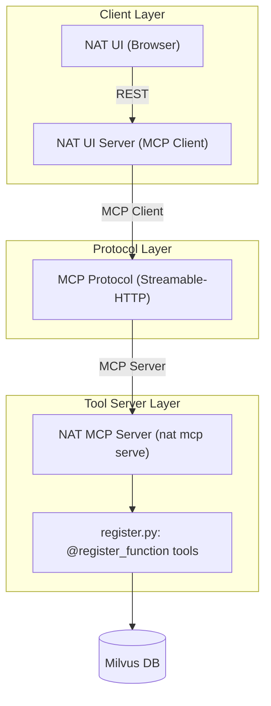
*Sources: [examples/mcp_rag_demo/README.md:101-128](), [examples/mcp_rag_demo/pyproject.toml:37-38]()*

### Authentication and Tool Overrides
MCP integrations often require authentication and prompt engineering to guide the LLM's tool usage.

1.  **Authentication**: NAT provides an `api_key` provider supporting `Bearer` schemes, typically linked to environment variables like `KAGGLE_BEARER_TOKEN` [examples/kaggle_mcp/configs/config.yml:36-40]().
2.  **Tool Overrides**: When an MCP server provides generic descriptions, `tool_overrides` in the YAML config allow developers to redefine tool descriptions or aliases to help the LLM select the correct parameters (e.g., forcing the use of `search` instead of `query`) [examples/kaggle_mcp/README.md:172-182]().

## Agent-to-Agent (A2A) Protocol

The A2A protocol enables agent orchestration by allowing a "Parent" agent to call a "Child" agent as if it were a standard tool. This is implemented via the `a2a_client` function group type [examples/currency_agent_a2a/configs/config.yml:30-32]().

### A2A Implementation: Currency Agent
In the `currency_agent_a2a` example, a NAT ReAct agent acts as an A2A client to an external LangGraph-based service.

**Entity Mapping: A2A Communication**
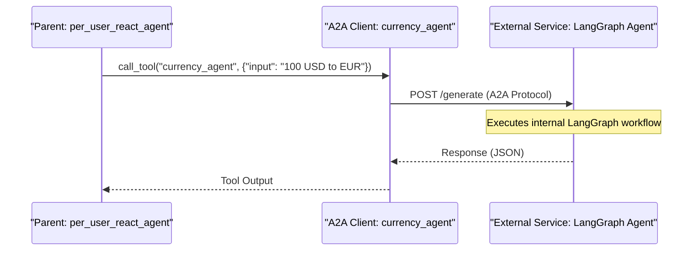
*Sources: [examples/currency_agent_a2a/README.md:34-54](), [examples/currency_agent_a2a/configs/config.yml:30-46]()*

### Multi-User Isolation
For A2A and MCP integrations in production environments, NAT utilizes the `per_user_react_agent` workflow. This ensures that:
*   Each user (identified by a session cookie) receives an isolated instance of the workflow [examples/kaggle_mcp/README.md:71-98]().
*   A2A client connections are maintained per-user to prevent session leakage [examples/currency_agent_a2a/README.md:129-134]().
*   Timeouts and cleanup intervals are managed via `general` config settings [examples/kaggle_mcp/configs/config-per-user.yml:16-18]().

## Summary of Protocol Configurations

| Feature | MCP (`mcp_client`) | A2A (`a2a_client`) |
| :--- | :--- | :--- |
| **Primary Use** | Exposing granular functions/tools | Orchestrating complete agent workflows |
| **Transport** | `stdio`, `streamable-http` | `http/https` |
| **Discovery** | `.well-known/mcp` or NAT CLI | `.well-known/agent-card.json` |
| **Key Config** | `server.url`, `tool_overrides` | `url`, `task_timeout` |

*Sources: [examples/kaggle_mcp/configs/config.yml:22-34](), [examples/currency_agent_a2a/configs/config.yml:16-32](), [examples/currency_agent_a2a/README.md:160-166]()*

---

# Page: Example: Sandbox Agent

# Example: Sandbox Agent

<details>
<summary>Relevant source files</summary>

The following files were used as context for generating this wiki page:

- [examples/sandbox_agent/Dockerfile](examples/sandbox_agent/Dockerfile)
- [examples/sandbox_agent/README.md](examples/sandbox_agent/README.md)
- [examples/sandbox_agent/pyproject.toml](examples/sandbox_agent/pyproject.toml)
- [examples/sandbox_agent/scripts/enrich_gaia_dataset.py](examples/sandbox_agent/scripts/enrich_gaia_dataset.py)
- [examples/sandbox_agent/src/nat_sandbox_agent/__init__.py](examples/sandbox_agent/src/nat_sandbox_agent/__init__.py)
- [examples/sandbox_agent/src/nat_sandbox_agent/configs/config.yaml](examples/sandbox_agent/src/nat_sandbox_agent/configs/config.yaml)

</details>


The **Sandbox Agent** is a general-purpose AI agent designed for the NVIDIA NeMo Agent Toolkit (NAT) that specializes in executing tasks within secure, isolated environments. By utilizing a sandboxed execution model, the agent can safely run arbitrary code, perform complex data analysis, and interact with web resources without risking the host system's security [examples/sandbox_agent/README.md:18-24]().

## Overview

The Sandbox Agent follows a ReAct (Reasoning and Acting) pattern to solve multi-step problems. Its defining characteristic is the split between **Host Tools** (which run on the local machine to handle API keys and network searches) and **Sandbox Tools** (which run inside an isolated container to handle file operations and code execution) [examples/sandbox_agent/README.md:78-90]().

### Core Capabilities
*   **Isolated Code Execution:** Runs Python and Shell commands within Docker or Daytona sandboxes [examples/sandbox_agent/README.md:27-27]().
*   **Web Interaction:** Browses JS-heavy sites via Playwright (sandbox) or fetches static pages (host) [examples/sandbox_agent/README.md:28-29]().
*   **Document Processing:** Generates and manipulates PDFs, Word documents, and PowerPoints using pre-installed libraries like `reportlab` and `python-docx` [examples/sandbox_agent/Dockerfile:94-98]().
*   **Vision & Search:** Analyzes images via Vision LLMs and performs web searches via the Tavily API [examples/sandbox_agent/README.md:29-31]().

## System Architecture

The agent bridges the gap between natural language instructions and a controlled execution environment. The following diagram illustrates how the `nat_sandbox_agent` package organizes these components.

### Natural Language to Code Entity Space: Architecture
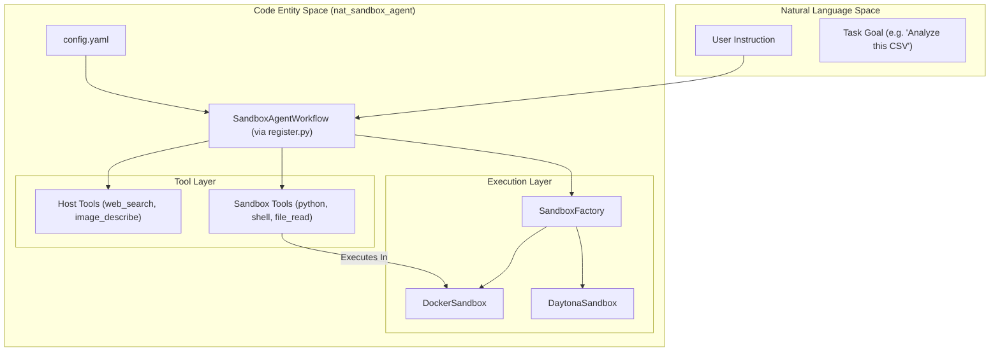
**Sources:** [examples/sandbox_agent/src/nat_sandbox_agent/register.py:1-50](), [examples/sandbox_agent/src/nat_sandbox_agent/configs/config.yaml:40-53](), [examples/sandbox_agent/README.md:78-90]()

---

## Sandbox Infrastructure

The infrastructure layer manages the lifecycle of the execution environment. The agent supports two primary providers:
1.  **Docker:** Local isolation using the `nat-sandbox:latest` image [examples/sandbox_agent/src/nat_sandbox_agent/configs/config.yaml:49-52]().
2.  **Daytona:** Cloud-based sandboxes for remote execution [examples/sandbox_agent/README.md:151-170]().

The sandbox environment provides a standardized workspace structure at `/workspace/` containing subdirectories for `input`, `output`, `temp`, and `downloads` [examples/sandbox_agent/Dockerfile:132-136]().

For a deep dive into the `BaseSandbox` abstract class, resource limits (CPU/Memory), and the `Dockerfile` configuration, see **[Sandbox Infrastructure (Docker & Daytona)](#3.1)**.

## Tool System & Evaluation

The agent employs a dual-layer tool system. **Sandbox tools** have direct access to the `/workspace` and are used for heavy lifting, while **Host tools** are used for external API interactions to keep sensitive keys outside the container [examples/sandbox_agent/README.md:89-90]().

### Natural Language to Code Entity Space: Tool Mapping
| User Intent | Code Entity (Tool Name) | Execution Environment |
| :--- | :--- | :--- |
| "Run this script" | `python` | Sandbox (Docker/Daytona) |
| "List files" | `shell` | Sandbox (Docker/Daytona) |
| "Search Google" | `web_search` | Host (Tavily API) |
| "Read this PDF" | `file_read` | Sandbox (poppler-utils) |
| "Describe image" | `image_describe` | Host (Vision LLM) |

**Sources:** [examples/sandbox_agent/README.md:78-87](), [examples/sandbox_agent/Dockerfile:66-70]()

### GAIA Evaluation
The Sandbox Agent is optimized for the **GAIA (General AI Assistants)** benchmark. It includes specialized scripts like `enrich_gaia_dataset.py` to help the agent identify UUID-named attachments within the sandbox `/workspace/input/` directory [examples/sandbox_agent/scripts/enrich_gaia_dataset.py:15-22]().

For details on the tool factory, individual tool implementations, and the GAIA evaluation pipeline, see **[Sandbox Agent Tools & GAIA Evaluation](#3.2)**.

## Quick Start Configuration

The agent is registered as a NAT component via the `nat_sandbox_agent.register` entry point [examples/sandbox_agent/pyproject.toml:78-79](). A typical configuration specifies the LLM and the sandbox provider:

```yaml
workflow:
  _type: sandbox_agent
  llm_name: agent_llm
  sandbox_config:
    type: docker
    image: "nat-sandbox:latest"
    memory_limit: "1g"
    cpu_limit: 2.0
```
**Sources:** [examples/sandbox_agent/src/nat_sandbox_agent/configs/config.yaml:40-53]()

---
**Sources:**
*   [examples/sandbox_agent/README.md:18-31]()
*   [examples/sandbox_agent/README.md:78-90]()
*   [examples/sandbox_agent/Dockerfile:132-136]()
*   [examples/sandbox_agent/src/nat_sandbox_agent/configs/config.yaml:40-53]()
*   [examples/sandbox_agent/pyproject.toml:78-79]()

---

# Page: Sandbox Infrastructure (Docker & Daytona)

# Sandbox Infrastructure (Docker & Daytona)

<details>
<summary>Relevant source files</summary>

The following files were used as context for generating this wiki page:

- [examples/sandbox_agent/docker-compose.yaml](examples/sandbox_agent/docker-compose.yaml)
- [examples/sandbox_agent/src/nat_sandbox_agent/sandbox/__init__.py](examples/sandbox_agent/src/nat_sandbox_agent/sandbox/__init__.py)
- [examples/sandbox_agent/src/nat_sandbox_agent/sandbox/base.py](examples/sandbox_agent/src/nat_sandbox_agent/sandbox/base.py)
- [examples/sandbox_agent/src/nat_sandbox_agent/sandbox/daytona_sandbox.py](examples/sandbox_agent/src/nat_sandbox_agent/sandbox/daytona_sandbox.py)
- [examples/sandbox_agent/src/nat_sandbox_agent/sandbox/docker_sandbox.py](examples/sandbox_agent/src/nat_sandbox_agent/sandbox/docker_sandbox.py)
- [examples/sandbox_agent/src/nat_sandbox_agent/sandbox/factory.py](examples/sandbox_agent/src/nat_sandbox_agent/sandbox/factory.py)

</details>


The Sandbox Infrastructure provides a secure, isolated environment for the Sandbox Agent to execute arbitrary code (Python) and shell commands. It abstracts the underlying containerization technology through a unified interface, allowing the agent to operate consistently whether running in a local Docker container or a cloud-based Daytona workspace.

## Sandbox Architecture

The infrastructure is built on a provider-agnostic design using the `BaseSandbox` abstract class. This allows the toolkit to swap between local development environments and scalable cloud environments without modifying the tool logic.

### Core Sandbox Components

| Component | Role | File Reference |
| :--- | :--- | :--- |
| `BaseSandbox` | Abstract Base Class defining the sandbox lifecycle and I/O interface. | [examples/sandbox_agent/src/nat_sandbox_agent/sandbox/base.py:62-70]() |
| `DockerSandbox` | Implementation using local Docker containers via `docker-py`. | [examples/sandbox_agent/src/nat_sandbox_agent/sandbox/docker_sandbox.py:37-43]() |
| `DaytonaSandbox` | Implementation using Daytona cloud workspaces for remote execution. | [examples/sandbox_agent/src/nat_sandbox_agent/sandbox/daytona_sandbox.py:28-35]() |
| `create_sandbox` | Factory function that instantiates the correct sandbox based on `SandboxConfig`. | [examples/sandbox_agent/src/nat_sandbox_agent/sandbox/factory.py:140-151]() |
| `CommandResult` | Dataclass representing the output, exit code, and status of an execution. | [examples/sandbox_agent/src/nat_sandbox_agent/sandbox/base.py:40-60]() |

### Sandbox Class Hierarchy and Factory Flow

The following diagram illustrates how the `create_sandbox` factory bridges the configuration space to the concrete sandbox implementations.

**Diagram: Sandbox Entity Relationship**
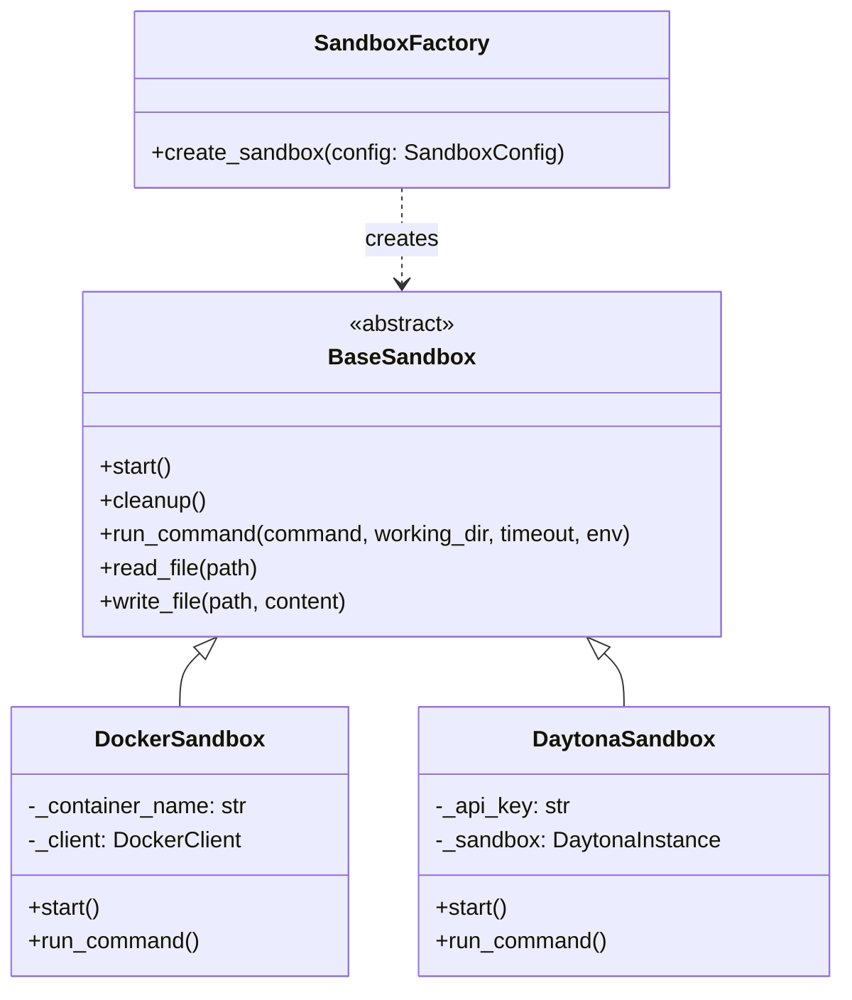
**Sources:** [examples/sandbox_agent/src/nat_sandbox_agent/sandbox/base.py:62-148](), [examples/sandbox_agent/src/nat_sandbox_agent/sandbox/docker_sandbox.py:37-43](), [examples/sandbox_agent/src/nat_sandbox_agent/sandbox/daytona_sandbox.py:28-35](), [examples/sandbox_agent/src/nat_sandbox_agent/sandbox/factory.py:140-193]()

## Workspace Layout

Every sandbox implementation enforces a standardized directory structure within the environment to ensure predictable file operations for the agent.

*   **`WORKSPACE_ROOT`**: `/workspace` (The default working directory) [examples/sandbox_agent/src/nat_sandbox_agent/sandbox/base.py:26-26]()
*   **`WORKSPACE_INPUT`**: `/workspace/input` (For data provided to the agent) [examples/sandbox_agent/src/nat_sandbox_agent/sandbox/base.py:27-27]()
*   **`WORKSPACE_OUTPUT`**: `/workspace/output` (For artifacts generated by the agent) [examples/sandbox_agent/src/nat_sandbox_agent/sandbox/base.py:28-28]()
*   **`WORKSPACE_TEMP`**: `/workspace/temp` (For ephemeral scripts and temporary data) [examples/sandbox_agent/src/nat_sandbox_agent/sandbox/base.py:29-29]()

Upon startup, both `DockerSandbox` and `DaytonaSandbox` execute `WORKSPACE_INIT_COMMAND` (`mkdir -p ...`) to ensure these paths exist [examples/sandbox_agent/src/nat_sandbox_agent/sandbox/base.py:33-33](), [examples/sandbox_agent/src/nat_sandbox_agent/sandbox/docker_sandbox.py:128-128](), [examples/sandbox_agent/src/nat_sandbox_agent/sandbox/daytona_sandbox.py:113-113]().

## Implementation Details

### DockerSandbox
The `DockerSandbox` manages the lifecycle of a single Docker container.
*   **Isolation**: Uses a bridge network (configurable) and enforces `memory_limit` and `cpu_limit` [examples/sandbox_agent/src/nat_sandbox_agent/sandbox/docker_sandbox.py:108-110]().
*   **Command Execution**: Commands are wrapped in a Linux `timeout` utility to ensure that processes are terminated on the container side even if the client-side request times out [examples/sandbox_agent/src/nat_sandbox_agent/sandbox/docker_sandbox.py:175-175]().
*   **File Transfer**: Uses `tar` streams to move files in and out of the container via `put_archive` and `get_archive` [examples/sandbox_agent/src/nat_sandbox_agent/sandbox/docker_sandbox.py:246-260]().

### DaytonaSandbox
The `DaytonaSandbox` utilizes the `daytona-sdk` to provision remote workspaces.
*   **Provisioning**: Creates a workspace from a specified image (default: `daytonaio/workspace:latest`) with defined hardware resources [examples/sandbox_agent/src/nat_sandbox_agent/sandbox/daytona_sandbox.py:99-107]().
*   **Lifecycle**: Includes an `auto_stop_interval` to prevent runaway costs in cloud environments [examples/sandbox_agent/src/nat_sandbox_agent/sandbox/daytona_sandbox.py:69-69]().

### Execution Flow
The following diagram traces a command execution from the high-level tool call to the low-level container execution.

**Diagram: Execution Data Flow**
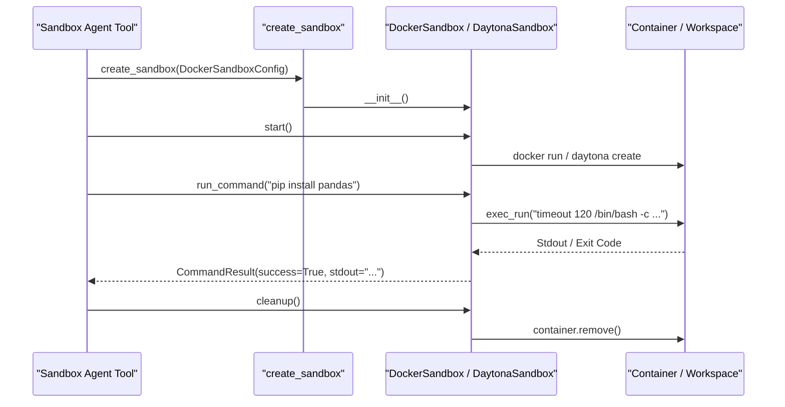
**Sources:** [examples/sandbox_agent/src/nat_sandbox_agent/sandbox/factory.py:140-193](), [examples/sandbox_agent/src/nat_sandbox_agent/sandbox/docker_sandbox.py:86-156](), [examples/sandbox_agent/src/nat_sandbox_agent/sandbox/docker_sandbox.py:158-209]()

## Resource Configuration

Sandbox resources are defined via Pydantic models in the factory, allowing for validation of limits before the environment is provisioned.

| Config Key | Default (Docker) | Default (Daytona) | Description |
| :--- | :--- | :--- | :--- |
| `image` | `python:3.12-slim` | `daytonaio/workspace:latest` | The base environment. |
| `memory` | `512m` | `4` (GB) | RAM allocation. |
| `cpu` | `1.0` | `2` (Cores) | Processing power. |
| `network_enabled`| `True` | N/A | Toggles internet access. |
| `pass_env_vars` | `["TAVILY_API_KEY"]` | N/A | Host env vars to inject. |

**Sources:** [examples/sandbox_agent/src/nat_sandbox_agent/sandbox/factory.py:37-77](), [examples/sandbox_agent/src/nat_sandbox_agent/sandbox/factory.py:79-114](), [examples/sandbox_agent/src/nat_sandbox_agent/sandbox/factory.py:27-27]()

---

# Page: Sandbox Agent Tools & GAIA Evaluation

# Sandbox Agent Tools & GAIA Evaluation

<details>
<summary>Relevant source files</summary>

The following files were used as context for generating this wiki page:

- [examples/sandbox_agent/src/nat_sandbox_agent/prompts/system_prompt.py](examples/sandbox_agent/src/nat_sandbox_agent/prompts/system_prompt.py)
- [examples/sandbox_agent/src/nat_sandbox_agent/tools/__init__.py](examples/sandbox_agent/src/nat_sandbox_agent/tools/__init__.py)
- [examples/sandbox_agent/src/nat_sandbox_agent/tools/factory.py](examples/sandbox_agent/src/nat_sandbox_agent/tools/factory.py)
- [examples/sandbox_agent/src/nat_sandbox_agent/tools/host/image_describe.py](examples/sandbox_agent/src/nat_sandbox_agent/tools/host/image_describe.py)
- [examples/sandbox_agent/src/nat_sandbox_agent/tools/host/web_fetch.py](examples/sandbox_agent/src/nat_sandbox_agent/tools/host/web_fetch.py)
- [examples/sandbox_agent/src/nat_sandbox_agent/tools/host/web_search.py](examples/sandbox_agent/src/nat_sandbox_agent/tools/host/web_search.py)
- [examples/sandbox_agent/src/nat_sandbox_agent/tools/sandbox/browser.py](examples/sandbox_agent/src/nat_sandbox_agent/tools/sandbox/browser.py)
- [examples/sandbox_agent/src/nat_sandbox_agent/tools/sandbox/execution.py](examples/sandbox_agent/src/nat_sandbox_agent/tools/sandbox/execution.py)
- [examples/sandbox_agent/src/nat_sandbox_agent/tools/sandbox/file_ops.py](examples/sandbox_agent/src/nat_sandbox_agent/tools/sandbox/file_ops.py)
- [examples/sandbox_agent/src/nat_sandbox_agent/utils/answer_cleaning.py](examples/sandbox_agent/src/nat_sandbox_agent/utils/answer_cleaning.py)
- [examples/sandbox_agent/tests/test_sandbox.py](examples/sandbox_agent/tests/test_sandbox.py)
- [examples/sandbox_agent/tests/test_tools_sandbox.py](examples/sandbox_agent/tests/test_tools_sandbox.py)

</details>


The Sandbox Agent utilizes a dual-layer tool architecture to balance security and functionality. Tools are partitioned into **Sandbox Tools**, which execute within an isolated Docker or Daytona environment, and **Host Tools**, which execute on the host machine to protect sensitive credentials (like API keys) and improve performance for network-heavy tasks. This page details the tool implementations, the factory pattern for instantiation, and the evaluation pipeline used for the GAIA benchmark.

## Tool Architecture Overview

The system distinguishes between tools that require an isolated runtime and those that benefit from host-level execution.

| Category | Tools | Execution Environment | Rationale |
| :--- | :--- | :--- | :--- |
| **Sandbox Tools** | `shell`, `python`, `file_read`, `file_write`, `web_browse` | Inside Container | Prevents host compromise; provides clean runtime. |
| **Host Tools** | `web_search`, `web_fetch`, `image_describe` | Host Machine | Protects API keys; avoids container network overhead. |

### Tool Data Flow: Host vs. Sandbox
The `SandboxToolExecutor` acts as the bridge for sandbox tools, while host tools interact directly with external APIs or the sandbox filesystem via the `BaseSandbox` interface.

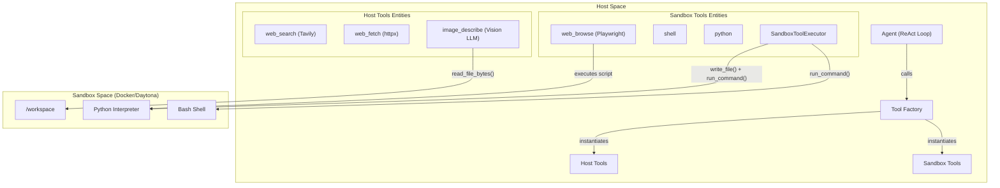
**Sources:** [examples/sandbox_agent/src/nat_sandbox_agent/tools/__init__.py:17-20](), [examples/sandbox_agent/src/nat_sandbox_agent/tools/factory.py:28-75]()

## Tool Factory & Implementation

The `create_all_tools` function in `factory.py` serves as the central assembly point for the agent's capabilities [examples/sandbox_agent/src/nat_sandbox_agent/tools/factory.py:28-34]().

### 1. Execution Tools (`shell`, `python`)
*   **`shell`**: Used for system operations like file management (`ls`, `cp`), package installation (`pip`), and process management [examples/sandbox_agent/src/nat_sandbox_agent/tools/sandbox/execution.py:134-143]().
*   **`python`**: Designed for data processing (pandas, numpy) and complex logic. Code is written to a temporary file in the sandbox and executed via `python3` [examples/sandbox_agent/src/nat_sandbox_agent/tools/sandbox/execution.py:97-112]().

### 2. File Operations (`file_read`, `file_write`)
These tools include path validation to prevent traversal attacks. Paths must be absolute and reside within `/workspace` [examples/sandbox_agent/src/nat_sandbox_agent/tools/sandbox/file_ops.py:34-59]().
*   **`read_file`**: Reads text content from the sandbox [examples/sandbox_agent/src/nat_sandbox_agent/tools/sandbox/file_ops.py:75-98]().
*   **`write_file`**: Writes content to a specified path, automatically creating parent directories [examples/sandbox_agent/src/nat_sandbox_agent/tools/sandbox/file_ops.py:116-141]().

### 3. Web Interaction Tools
*   **`web_search`**: A host-side tool using the Tavily API to find relevant URLs and snippets [examples/sandbox_agent/src/nat_sandbox_agent/tools/host/web_search.py:46-50]().
*   **`web_fetch`**: A lightweight host-side HTTP fetcher that converts HTML to Markdown using `markdownify`. It supports pagination via `start_index` [examples/sandbox_agent/src/nat_sandbox_agent/tools/host/web_fetch.py:72-87]().
*   **`web_browse`**: A sandbox-side tool that uses Playwright Chromium to handle JavaScript-heavy sites. It generates a Python script, writes it to the sandbox, and executes it to extract text or specific CSS selectors [examples/sandbox_agent/src/nat_sandbox_agent/tools/sandbox/browser.py:57-75]().

### 4. Vision Tool (`image_describe`)
This tool runs on the host to access Vision LLMs but interacts with the sandbox to retrieve image data.
1.  Reads image bytes from the sandbox via `sandbox.read_file_bytes` [examples/sandbox_agent/src/nat_sandbox_agent/tools/host/image_describe.py:98-99]().
2.  Encodes the image to Base64 and constructs a data URI [examples/sandbox_agent/src/nat_sandbox_agent/tools/host/image_describe.py:115-117]().
3.  Sends a multimodal `HumanMessage` to the configured `vision_llm` [examples/sandbox_agent/src/nat_sandbox_agent/tools/host/image_describe.py:120-133]().

**Sources:** [examples/sandbox_agent/src/nat_sandbox_agent/tools/factory.py:78-101](), [examples/sandbox_agent/src/nat_sandbox_agent/tools/sandbox/executor.py:33-54]()

## System Prompts & Agent Rules

The `SANDBOX_AGENT_SYSTEM_PROMPT` defines the operational boundaries and best practices for the agent [examples/sandbox_agent/src/nat_sandbox_agent/prompts/system_prompt.py:17-141]().

### Key Directives
*   **Tool Preference**: The agent is instructed to prefer tools over mental calculation or memory for any logic puzzle or multi-step reasoning [examples/sandbox_agent/src/nat_sandbox_agent/prompts/system_prompt.py:60-64]().
*   **Python Execution**: Explicit rules require the use of `print()` for outputs, as the sandbox does not automatically return expression values [examples/sandbox_agent/src/nat_sandbox_agent/prompts/system_prompt.py:66-81]().
*   **File Handling**: Guidance on tool selection based on file extensions (e.g., `.xlsx` -> `python` with pandas, `.pdf` -> `python` with pdfplumber) [examples/sandbox_agent/src/nat_sandbox_agent/prompts/system_prompt.py:83-95]().

**Sources:** [examples/sandbox_agent/src/nat_sandbox_agent/prompts/system_prompt.py:15-141]()

## GAIA Evaluation Pipeline

The agent is evaluated using the GAIA (General AI Assistants) benchmark, which requires complex multi-step reasoning and tool use.

### Answer Cleaning
To ensure compatibility with ground-truth answers, the toolkit includes an `answer_cleaning` utility. It uses an LLM to extract the core answer, normalize units, and match expected formats (e.g., "17000 hours" to "17" if the question asks for "thousand hours") [examples/sandbox_agent/src/nat_sandbox_agent/utils/answer_cleaning.py:25-63]().

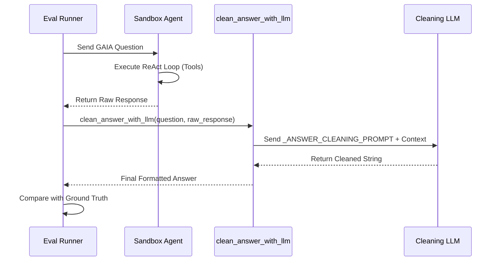

### Evaluation Logic
The cleaning process includes:
*   **Preamble Removal**: Stripping phrases like "The answer is..." [examples/sandbox_agent/src/nat_sandbox_agent/utils/answer_cleaning.py:35-37]().
*   **Scale Adjustment**: Dividing by 1,000,000 if the question asks for "millions" [examples/sandbox_agent/src/nat_sandbox_agent/utils/answer_cleaning.py:51-53]().
*   **Type Matching**: Ensuring Yes/No or Directional answers use Title Case [examples/sandbox_agent/src/nat_sandbox_agent/utils/answer_cleaning.py:44-50]().

**Sources:** [examples/sandbox_agent/src/nat_sandbox_agent/utils/answer_cleaning.py:66-118]()

---

# Page: Example: Kubernetes Infrastructure Monitor

# Example: Kubernetes Infrastructure Monitor

<details>
<summary>Relevant source files</summary>

The following files were used as context for generating this wiki page:

- [examples/k8s_infra_monitor/README.md](examples/k8s_infra_monitor/README.md)
- [examples/k8s_infra_monitor/pyproject.toml](examples/k8s_infra_monitor/pyproject.toml)

</details>


The **Kubernetes Infrastructure Monitor** is an intermediate-complexity example demonstrating an agentic diagnostic system designed to analyze and report on the health of Kubernetes clusters [examples/k8s_infra_monitor/README.md:18-22](). Built using the NeMo Agent Toolkit (NAT) and LangGraph, the system correlates signals from nodes, pods, events, and resource metrics to generate structured incident reports with severity classifications [examples/k8s_infra_monitor/README.md:22-22](), [examples/k8s_infra_monitor/README.md:68-76]().

## System Overview

The monitor operates by receiving natural language queries about cluster health and autonomously selecting the appropriate diagnostic tools to investigate the issue [examples/k8s_infra_monitor/README.md:99-105](). It supports two primary execution environments:
*   **Live Mode**: Connects to a real cluster via `kubectl` to retrieve real-time data [examples/k8s_infra_monitor/README.md:42-42]().
*   **Offline Mode**: Uses synthetic scenarios from a JSON dataset for development, testing, and evaluation without requiring an active cluster [examples/k8s_infra_monitor/README.md:124-124](), [examples/k8s_infra_monitor/README.md:139-140]().

### Core Architecture: Natural Language to K8s Diagnostics

The following diagram illustrates how the system bridges natural language user queries to specific Kubernetes diagnostic entities defined in the codebase.

**K8s Monitor Logic Flow**
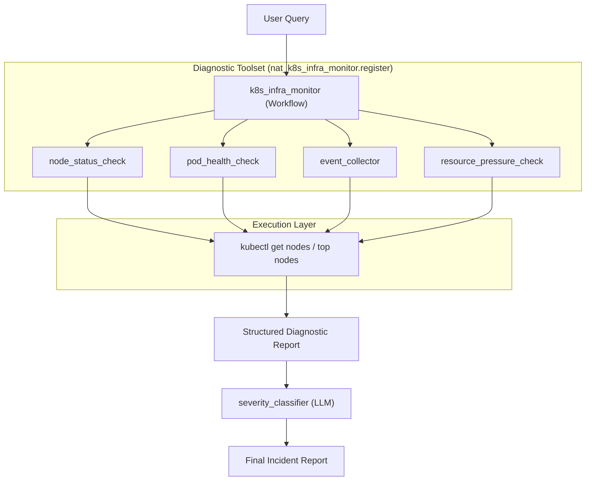
Sources: [examples/k8s_infra_monitor/README.md:88-105](), [examples/k8s_infra_monitor/README.md:131-138]().

## Diagnostic Tools

The system utilizes a specialized toolset to gather comprehensive cluster data. Each tool is registered as a NAT component and can be configured with specific thresholds (e.g., CPU/Memory percentages) [examples/k8s_infra_monitor/README.md:113-122]().

| Tool Name | Responsibility | Data Source (Live) |
| :--- | :--- | :--- |
| `node_status_check` | Checks node readiness and conditions (Memory/Disk/PID Pressure) | `kubectl get nodes` |
| `pod_health_check` | Scans for `CrashLoopBackOff`, `OOMKilled`, or `Pending` pods | `kubectl get pods` |
| `event_collector` | Correlates recent Warning events with affected resources | `kubectl get events` |
| `resource_pressure_check` | Analyzes utilization against configurable thresholds | `kubectl top` |
| `severity_classifier` | Classifies incidents as Critical, Warning, or Informational | LLM Inference |

For a deep dive into tool implementation, `kubectl` integration, and offline data injection, see **[K8s Monitor Diagnostic Tools](#4.1)**.

Sources: [examples/k8s_infra_monitor/README.md:88-95](), [examples/k8s_infra_monitor/README.md:113-122]().

## Workflow and Evaluation

The orchestration logic is managed via a LangGraph `StateGraph` registered under the `k8s_infra_monitor` workflow type [examples/k8s_infra_monitor/README.md:132-132](). This workflow manages the state between tool execution and final report generation.

**Code Entity Mapping**
```mermaid
graph LR
    subgraph "Configuration (YAML)"
        Config["k8s_infra_monitor config"] -- "defines" --> ToolList["tool_names"]
        Config -- "points to" --> DataPath["offline_data_path"]
    end

    subgraph "Code Implementation"
        ToolList -- "instantiates" --> Reg["nat_k8s_infra_monitor.register"]
        DataPath -- "loaded by" --> WorkflowClass["K8sInfraMonitorWorkflow"]
    end

    subgraph "Evaluation"
        WorkflowClass -- "tested against" --> EvalSet["eval_dataset.json"]
        WorkflowClass -- "simulated via" --> OfflineScenarios["offline_scenarios.json"]
    end
```
Sources: [examples/k8s_infra_monitor/README.md:131-141](), [examples/k8s_infra_monitor/pyproject.toml:38-39]().

The monitor includes a robust evaluation framework that uses `offline_scenarios.json` to simulate cluster failures. This allows for reproducible testing of the agent's ability to identify root causes, such as correlating `OOMKilled` pods with `MemoryPressure` conditions on a node [examples/k8s_infra_monitor/README.md:81-82]().

For details on the LangGraph state machine, configuration schemas, and the evaluation suite, see **[K8s Monitor Workflow, Data & Evaluation](#4.2)**.

---

# Page: K8s Monitor Diagnostic Tools

# K8s Monitor Diagnostic Tools

<details>
<summary>Relevant source files</summary>

The following files were used as context for generating this wiki page:

- [examples/k8s_infra_monitor/src/nat_k8s_infra_monitor/event_collector_tool.py](examples/k8s_infra_monitor/src/nat_k8s_infra_monitor/event_collector_tool.py)
- [examples/k8s_infra_monitor/src/nat_k8s_infra_monitor/node_status_tool.py](examples/k8s_infra_monitor/src/nat_k8s_infra_monitor/node_status_tool.py)
- [examples/k8s_infra_monitor/src/nat_k8s_infra_monitor/pod_health_tool.py](examples/k8s_infra_monitor/src/nat_k8s_infra_monitor/pod_health_tool.py)
- [examples/k8s_infra_monitor/src/nat_k8s_infra_monitor/prompts.py](examples/k8s_infra_monitor/src/nat_k8s_infra_monitor/prompts.py)
- [examples/k8s_infra_monitor/src/nat_k8s_infra_monitor/resource_pressure_tool.py](examples/k8s_infra_monitor/src/nat_k8s_infra_monitor/resource_pressure_tool.py)
- [examples/k8s_infra_monitor/src/nat_k8s_infra_monitor/severity_classifier.py](examples/k8s_infra_monitor/src/nat_k8s_infra_monitor/severity_classifier.py)
- [examples/k8s_infra_monitor/src/nat_k8s_infra_monitor/utils.py](examples/k8s_infra_monitor/src/nat_k8s_infra_monitor/utils.py)

</details>


The Kubernetes Infrastructure Monitor example provides a suite of specialized diagnostic tools designed to inspect cluster health. These tools operate in two distinct modes: **Live Mode**, which executes `kubectl` commands against a real cluster, and **Offline Mode**, which injects synthetic data from pre-defined scenarios for testing and evaluation purposes.

## Architecture and Data Flow

The diagnostic tools are implemented as registered functions within the NeMo Agent Toolkit (NAT) framework. Each tool follows a standard pattern: a configuration class inheriting from `FunctionBaseConfig`, a registration using `@register_function`, and a dual-path execution logic (`_run_live` vs. offline injection).

### Natural Language to Tool Execution

The following diagram illustrates how a natural language query is routed through the NAT framework to specific code entities within the `k8s_infra_monitor` package.

**Query Routing and Tool Association**
```mermaid
graph TD
    User["User Query"] --> Agent["ReAct Agent Loop"]
    Agent --> ToolDispatch["nat.builder.Builder"]
    
    subgraph "Diagnostic Tool Entities"
        ToolDispatch --> NodeStatus["node_status_check (_run)"]
        ToolDispatch --> PodHealth["pod_health_check (_run)"]
        ToolDispatch --> EventColl["event_collector (_run)"]
        ToolDispatch --> ResPress["resource_pressure_check (_run)"]
    end

    subgraph "Implementation Files"
        NodeStatus --- NS_File["node_status_tool.py"]
        PodHealth --- PH_File["pod_health_tool.py"]
        EventColl --- EC_File["event_collector_tool.py"]
        ResPress --- RP_File["resource_pressure_tool.py"]
    end

    NodeStatus --> ModeSwitch{"config.offline_mode?"}
    ModeSwitch -- "True" --> Offline["utils.get_offline_tool_response"]
    ModeSwitch -- "False" --> Live["_run_live (subprocess.run 'kubectl')"]
```
Sources: [examples/k8s_infra_monitor/src/nat_k8s_infra_monitor/node_status_tool.py:38-64](), [examples/k8s_infra_monitor/src/nat_k8s_infra_monitor/pod_health_tool.py:39-67](), [examples/k8s_infra_monitor/src/nat_k8s_infra_monitor/event_collector_tool.py:38-66](), [examples/k8s_infra_monitor/src/nat_k8s_infra_monitor/resource_pressure_tool.py:45-77]()

## Core Diagnostic Tools

### Node Status Tool (`node_status_check`)
Retrieves the high-level status of cluster nodes, including conditions (Ready/NotReady) and basic resource allocation.
- **Key Function:** `_run_live` executes `kubectl get nodes -o wide` and `kubectl top nodes` [examples/k8s_infra_monitor/src/nat_k8s_infra_monitor/node_status_tool.py:76-118]().
- **Config:** `NodeStatusToolConfig` allows specifying a custom `kubeconfig_path` [examples/k8s_infra_monitor/src/nat_k8s_infra_monitor/node_status_tool.py:30-36]().

### Pod Health Tool (`pod_health_check`)
Identifies unhealthy workloads across namespaces, specifically targeting pods not in `Running` or `Succeeded` phases.
- **Live Execution:** Uses field selectors (`status.phase!=Running`) to filter for problematic pods [examples/k8s_infra_monitor/src/nat_k8s_infra_monitor/pod_health_tool.py:106-134]().
- **Restart Analysis:** Parses JSON output to identify pods with a `restartCount` greater than 5 [examples/k8s_infra_monitor/src/nat_k8s_infra_monitor/pod_health_tool.py:136-165]().

### Event Collector Tool (`event_collector`)
Gathers recent cluster events, prioritizing `Warning` and `Error` types to diagnose scheduling failures or OOM kills.
- **Warning Retrieval:** Runs `kubectl get events --field-selector=type=Warning` [examples/k8s_infra_monitor/src/nat_k8s_infra_monitor/event_collector_tool.py:87-115]().
- **Configurable Limits:** The `event_limit` parameter (default 50) restricts the volume of data returned to the LLM context [examples/k8s_infra_monitor/src/nat_k8s_infra_monitor/event_collector_tool.py:35-35]().

### Resource Pressure Tool (`resource_pressure_check`)
Analyzes CPU, memory, and storage utilization against configurable thresholds.
- **Thresholds:** Configurable via `cpu_threshold_percent` (default 80) and `memory_threshold_percent` (default 85) [examples/k8s_infra_monitor/src/nat_k8s_infra_monitor/resource_pressure_tool.py:35-42]().
- **Condition Monitoring:** Specifically checks for `MemoryPressure`, `DiskPressure`, and `PIDPressure` node conditions [examples/k8s_infra_monitor/src/nat_k8s_infra_monitor/resource_pressure_tool.py:102-135]().

Sources: [examples/k8s_infra_monitor/src/nat_k8s_infra_monitor/node_status_tool.py:1-130](), [examples/k8s_infra_monitor/src/nat_k8s_infra_monitor/pod_health_tool.py:1-176](), [examples/k8s_infra_monitor/src/nat_k8s_infra_monitor/event_collector_tool.py:1-158](), [examples/k8s_infra_monitor/src/nat_k8s_infra_monitor/resource_pressure_tool.py:1-177]()

## Severity Classifier

The `severity_classifier` is a specialized LLM-based tool used at the end of the diagnostic workflow to categorize the final incident report.

**Severity Classification Flow**
```mermaid
graph LR
    Report["Diagnostic Report (Markdown)"] --> SC["severity_classifier (_run)"]
    SC --> Prompt["SEVERITY_CLASSIFIER_PROMPT"]
    Prompt --> LLM["LLM (ainvoke)"]
    LLM --> Output["Classification: critical | warning | informational"]
```

- **Implementation:** Uses LangChain's `BaseChatModel` to process the report text [examples/k8s_infra_monitor/src/nat_k8s_infra_monitor/severity_classifier.py:38-43]().
- **Prompt Logic:** Defined in `prompts.py`, it instructs the LLM to look for cluster-wide outages (critical) versus degraded performance (warning) [examples/k8s_infra_monitor/src/nat_k8s_infra_monitor/prompts.py:39-48]().

Sources: [examples/k8s_infra_monitor/src/nat_k8s_infra_monitor/severity_classifier.py:32-66](), [examples/k8s_infra_monitor/src/nat_k8s_infra_monitor/prompts.py:39-48]()

## Offline Mode and Data Injection

Offline mode allows the agent to be tested without a live Kubernetes cluster. This is managed by the `utils.py` module.

### Mechanism
1. **Preloading:** The `preload_offline_data` function reads a JSON file containing scenarios [examples/k8s_infra_monitor/src/nat_k8s_infra_monitor/utils.py:33-60]().
2. **Storage:** Data is stored in a global `_offline_data` dictionary, keyed by `scenario_id` [examples/k8s_infra_monitor/src/nat_k8s_infra_monitor/utils.py:23-23]().
3. **Extraction:** Tools extract the `scenario_id` from the input query (usually passed as a JSON string by the workflow) using `_extract_scenario_id` [examples/k8s_infra_monitor/src/nat_k8s_infra_monitor/node_status_tool.py:67-74]().
4. **Injection:** The `get_offline_tool_response` function retrieves the mock string for that specific tool and scenario [examples/k8s_infra_monitor/src/nat_k8s_infra_monitor/utils.py:63-69]().

### Default Healthy Responses
If a scenario is not found or if the cluster is healthy, tools provide hardcoded "healthy" responses to maintain agent flow [examples/k8s_infra_monitor/src/nat_k8s_infra_monitor/node_status_tool.py:121-129](), [examples/k8s_infra_monitor/src/nat_k8s_infra_monitor/pod_health_tool.py:170-175]().

Sources: [examples/k8s_infra_monitor/src/nat_k8s_infra_monitor/utils.py:1-69](), [examples/k8s_infra_monitor/src/nat_k8s_infra_monitor/node_status_tool.py:54-60]()

---

# Page: K8s Monitor Workflow, Data & Evaluation

# K8s Monitor Workflow, Data & Evaluation

<details>
<summary>Relevant source files</summary>

The following files were used as context for generating this wiki page:

- [.github/workflows/stale.yaml](.github/workflows/stale.yaml)
- [examples/k8s_infra_monitor/src/nat_k8s_infra_monitor/__init__.py](examples/k8s_infra_monitor/src/nat_k8s_infra_monitor/__init__.py)
- [examples/k8s_infra_monitor/src/nat_k8s_infra_monitor/configs/config_live_mode.yml](examples/k8s_infra_monitor/src/nat_k8s_infra_monitor/configs/config_live_mode.yml)
- [examples/k8s_infra_monitor/src/nat_k8s_infra_monitor/configs/config_offline_mode.yml](examples/k8s_infra_monitor/src/nat_k8s_infra_monitor/configs/config_offline_mode.yml)
- [examples/k8s_infra_monitor/src/nat_k8s_infra_monitor/data/eval_dataset.json](examples/k8s_infra_monitor/src/nat_k8s_infra_monitor/data/eval_dataset.json)
- [examples/k8s_infra_monitor/src/nat_k8s_infra_monitor/data/offline_scenarios.json](examples/k8s_infra_monitor/src/nat_k8s_infra_monitor/data/offline_scenarios.json)
- [examples/k8s_infra_monitor/src/nat_k8s_infra_monitor/register.py](examples/k8s_infra_monitor/src/nat_k8s_infra_monitor/register.py)
- [examples/k8s_infra_monitor/tests/test_k8s_infra_monitor.py](examples/k8s_infra_monitor/tests/test_k8s_infra_monitor.py)

</details>


The Kubernetes Infrastructure Monitor example utilizes a state-machine based workflow to orchestrate diagnostic tools. It supports both live cluster interaction and high-fidelity offline simulations for evaluation purposes. This page details the LangGraph implementation, the configuration schema, and the datasets used for testing and RAG-based evaluation.

## Workflow Architecture

The workflow is implemented using `langgraph` and registered as a NAT function. It follows a cyclic pattern where a central assistant decides which diagnostic tools to invoke based on the user's query and the current cluster state.

### LangGraph State Machine
The core logic resides in `k8s_infra_monitor_workflow` [examples/k8s_infra_monitor/src/nat_k8s_infra_monitor/register.py:70-150](). It uses a `StateGraph` with `MessagesState` to manage the conversation history and tool outputs.

**Workflow Logic Flow:**
1.  **Monitor Assistant**: A node that wraps the LLM (bound with diagnostic tools) and the system prompt [examples/k8s_infra_monitor/src/nat_k8s_infra_monitor/register.py:90-92]().
2.  **Tools Node**: A standard LangGraph `ToolNode` containing the registered diagnostic tools (e.g., `node_status_check`, `pod_health_check`) [examples/k8s_infra_monitor/src/nat_k8s_infra_monitor/register.py:100]().
3.  **Conditional Edges**: Uses `tools_condition` to determine if the LLM has requested a tool call or is ready to provide a final response [examples/k8s_infra_monitor/src/nat_k8s_infra_monitor/register.py:103]().
4.  **Post-Processing**: After the graph completes, the workflow executes a `severity_classifier` tool on the generated report to append a final severity assessment [examples/k8s_infra_monitor/src/nat_k8s_infra_monitor/register.py:129-130]().

### Code-to-System Mapping: Workflow Components
The following diagram maps the LangGraph code entities to the logical diagnostic process.

**K8s Monitor Logic Mapping**
```mermaid
graph TD
    subgraph "Natural Language Space"
        UserQuery["'Why are pods crashing in production?'"]
        FinalReport["Diagnostic Report + Severity: CRITICAL"]
    end

    subgraph "Code Entity Space: register.py"
        WF["k8s_infra_monitor_workflow"]
        Node1["monitor_assistant node"]
        Node2["tools node (ToolNode)"]
        Edge1["tools_condition"]
        Analyze["_analyze_cluster function"]
        SevTool["severity_classifier (tool)"]
    end

    UserQuery --> WF
    WF --> Analyze
    Analyze --> Node1
    Node1 --> Edge1
    Edge1 -- "Call Tool" --> Node2
    Node2 --> Node1
    Edge1 -- "Final Response" --> SevTool
    SevTool --> FinalReport
```
Sources: [examples/k8s_infra_monitor/src/nat_k8s_infra_monitor/register.py:70-130]()

## Configuration and Modes

The monitor operates in two modes: **Live** (interacting with real `kubectl` contexts) and **Offline** (using pre-recorded JSON scenarios).

### K8sInfraMonitorWorkflowConfig
The configuration class `K8sInfraMonitorWorkflowConfig` [examples/k8s_infra_monitor/src/nat_k8s_infra_monitor/register.py:44-66]() defines the following parameters:
*   `tool_names`: List of diagnostic tools to load.
*   `llm_name`: Reference to the primary LLM (typically a NIM model).
*   `offline_mode`: Boolean flag to toggle data source.
*   `offline_data_path`: Path to the scenario file (defaults to `offline_scenarios.json`).
*   `agent_prompt`: The system instructions defined in `K8S_INFRA_MONITOR_PROMPT`.

### Mode Comparison
| Feature | Live Mode (`config_live_mode.yml`) | Offline Mode (`config_offline_mode.yml`) |
| :--- | :--- | :--- |
| **Data Source** | Real Kubernetes Cluster | `offline_scenarios.json` |
| **Requirement** | `KUBECONFIG` or local `kubectl` | None (JSON file) |
| **Speed** | Network/API dependent | Instantaneous |
| **Use Case** | Production diagnostics | CI/CD, Testing, Evaluation |

Sources: [examples/k8s_infra_monitor/src/nat_k8s_infra_monitor/configs/config_live_mode.yml:19-52](), [examples/k8s_infra_monitor/src/nat_k8s_infra_monitor/configs/config_offline_mode.yml:17-46](), [examples/k8s_infra_monitor/src/nat_k8s_infra_monitor/register.py:140-145]()

## Data and Evaluation

The example includes specialized datasets for simulating failures and evaluating the accuracy of the agent's diagnostics.

### Offline Scenarios (`offline_scenarios.json`)
This dataset contains mock responses for every diagnostic tool, keyed by `scenario_id`. When `offline_mode` is `true`, the tools look up data in this file instead of querying a cluster.
*   **Location**: `examples/k8s_infra_monitor/src/nat_k8s_infra_monitor/data/offline_scenarios.json` [examples/k8s_infra_monitor/src/nat_k8s_infra_monitor/data/offline_scenarios.json:1-4]()
*   **Common Scenarios**: `node-not-ready`, `memory-pressure`, `healthy-cluster`.

### Evaluation Dataset (`eval_dataset.json`)
Used by the NAT evaluation pipeline to run automated benchmarks against the agent.
*   **Location**: `examples/k8s_infra_monitor/src/nat_k8s_infra_monitor/data/eval_dataset.json` [examples/k8s_infra_monitor/src/nat_k8s_infra_monitor/data/eval_dataset.json:1-4]()
*   **Metrics**: The `config_offline_mode.yml` configures RAGAS-based metrics:
    *   `AnswerAccuracy`: Compares agent output to the ground truth in the eval dataset [examples/k8s_infra_monitor/src/nat_k8s_infra_monitor/configs/config_offline_mode.yml:73-76]().
    *   `ResponseGroundedness`: Ensures the agent's claims are supported by the (mocked) cluster data [examples/k8s_infra_monitor/src/nat_k8s_infra_monitor/configs/config_offline_mode.yml:77-80]().

### Test Suite
The integration tests verify the agent's diagnostic logic using the offline mode.

**Code-to-Data Mapping: Test Scenarios**
```mermaid
graph LR
    subgraph "Test Suite (pytest)"
        T1["test_k8s_infra_monitor_node_not_ready"]
        T2["test_k8s_infra_monitor_memory_pressure"]
    end

    subgraph "Data Entities"
        S1[("scenario_id: 'node-not-ready'")]
        S2[("scenario_id: 'memory-pressure'")]
        JSON["offline_scenarios.json"]
    end

    subgraph "Validation Logic"
        V1["Assert 'worker-2' in output"]
        V2["Assert 'oom' in output"]
    end

    T1 -- "queries" --> S1
    T2 -- "queries" --> S2
    S1 -- "stored in" --> JSON
    S2 -- "stored in" --> JSON
    T1 --> V1
    T2 --> V2
```

**Key Test Cases:**
*   **Node Failure**: `test_k8s_infra_monitor_node_not_ready` checks if the agent identifies `worker-2` as `NotReady` [examples/k8s_infra_monitor/tests/test_k8s_infra_monitor.py:24-42]().
*   **Memory Pressure**: `test_k8s_infra_monitor_memory_pressure` ensures the agent detects `OOMKilled` pods and assigns a `critical` severity [examples/k8s_infra_monitor/tests/test_k8s_infra_monitor.py:47-65]().
*   **Healthy Cluster**: `test_k8s_infra_monitor_healthy_cluster` verifies that the agent correctly reports a normal state with `informational` severity [examples/k8s_infra_monitor/tests/test_k8s_infra_monitor.py:70-87]().

Sources: [examples/k8s_infra_monitor/tests/test_k8s_infra_monitor.py:22-88](), [examples/k8s_infra_monitor/src/nat_k8s_infra_monitor/configs/config_offline_mode.yml:66-81]()

---

# Page: Example: MCP RAG Demo

# Example: MCP RAG Demo

<details>
<summary>Relevant source files</summary>

The following files were used as context for generating this wiki page:

- [examples/mcp_rag_demo/README.md](examples/mcp_rag_demo/README.md)
- [examples/mcp_rag_demo/pyproject.toml](examples/mcp_rag_demo/pyproject.toml)
- [examples/mcp_rag_demo/scripts/load_support_tickets.py](examples/mcp_rag_demo/scripts/load_support_tickets.py)

</details>


The **MCP RAG Demo** is a technical showcase of an agentic Retrieval-Augmented Generation (RAG) system designed to manage and query technical support tickets. It leverages the **Model Context Protocol (MCP)** to decouple tool logic from the agentic reasoning loop, allowing for a standardized interface between the agent and its data sources.

This example utilizes **NVIDIA NIMs** for high-performance embeddings, language modeling, and reranking, with **Milvus** serving as the GPU-accelerated vector database [examples/mcp_rag_demo/README.md:45-55]().

## System Overview

The demo addresses the challenges of fragmented tool ecosystems and maintenance burdens by using a unified interface for tool exposure [examples/mcp_rag_demo/README.md:20-33](). A ReAct agent coordinates multiple specialized tools to answer complex user queries, such as "Find critical GPU driver issues" [examples/mcp_rag_demo/README.md:37-43]().

### Core Technology Stack

| Component | Technology | Role |
| :--- | :--- | :--- |
| **Protocol** | MCP (Streamable HTTP) | Standardized tool communication [examples/mcp_rag_demo/README.md:49]() |
| **Agent Framework** | NeMo Agent Toolkit (NAT) | ReAct agent orchestration and MCP hosting [examples/mcp_rag_demo/README.md:50]() |
| **Vector Database** | Milvus | Storage and semantic search of support tickets [examples/mcp_rag_demo/README.md:51]() |
| **Embeddings** | `nv-embedqa-e5-v5` | Generating 1024-dim vectors for tickets [examples/mcp_rag_demo/README.md:52]() |
| **LLM** | `llama-3.1-70b-instruct` | Reasoning and response synthesis [examples/mcp_rag_demo/README.md:53]() |
| **Reranker** | `llama-3.2-nv-rerankqa-1b-v2` | Precision refinement of retrieved results [examples/mcp_rag_demo/README.md:54]() |

**Sources:** [examples/mcp_rag_demo/README.md:45-55]()

## Architecture: Three-Terminal Model

The system is deployed across three distinct processes to demonstrate a real-world client-server separation using MCP.

### Conceptual to Code Entity Mapping
The following diagram maps the high-level architecture to the specific configuration files and command-line entry points used in the codebase.

```mermaid
graph TD
    subgraph "Client Space (User Interface)"
        UI["NAT UI (Browser)"]
        UIServer["NAT UI Server (MCP Client)"]
        UIConfig["mcp-client-for-ui.yml"]
    end

    subgraph "Server Space (Tools & Data)"
        MCPServer["NAT MCP Server (Tool Server)"]
        ServerConfig["support-ui.yml"]
        Register["register.py"]
    end

    subgraph "Data Space"
        Milvus[("Milvus DB: support_tickets")]
        LoadScript["load_support_tickets.py"]
    end

    UI <-->|"REST"| UIServer
    UIServer <-->|"MCP Protocol (HTTP)"| MCPServer
    MCPServer -->|"Calls @register_function"| Register
    Register <-->|"Queries"| Milvus
    LoadScript -->|"Populates"| Milvus
    
    style UIConfig stroke-dasharray: 5 5
    style ServerConfig stroke-dasharray: 5 5
```
**Sources:** [examples/mcp_rag_demo/README.md:101-128](), [examples/mcp_rag_demo/pyproject.toml:37-38]()

## Key Components

### 1. MCP Server & Tool Registration
The system registers four specific tools for the agent to use: `search_support_tickets`, `query_by_category`, `query_by_priority`, and `rerank_support_tickets`. These are exposed via the `nat mcp serve` command using the `support-ui.yml` configuration.

For a deep dive into tool implementation and MCP configuration, see **[MCP RAG Server & Tool Registration](#5.1)**.

### 2. Data Pipeline & Milvus Integration
Before the agent can answer queries, a data ingestion pipeline processes synthetic support tickets. The `load_support_tickets.py` script defines a `CollectionSchema` including fields for `ticket_id`, `content`, `category`, `priority`, and a 1024-dimensional `embedding` vector.

```mermaid
flowchart LR
    A["Raw Ticket Data"] --> B["NVIDIA NIM: nv-embedqa-e5-v5"]
    B --> C["Milvus Collection: support_tickets"]
    C --> D["IVF_FLAT Indexing"]
    D --> E["Agent Retrieval"]
```

For details on the schema and embedding process, see **[MCP RAG Data Pipeline & Milvus Integration](#5.2)**.

**Sources:** [examples/mcp_rag_demo/scripts/load_support_tickets.py:71-83](), [examples/mcp_rag_demo/README.md:90-98]()

## Quick Start Summary

1.  **Install Dependencies**: Use `uv pip install -e examples/mcp_rag_demo` [examples/mcp_rag_demo/README.md:148-149]().
2.  **Infrastructure**: Start Milvus via Docker [examples/mcp_rag_demo/README.md:157-168]().
3.  **Ingestion**: Run `load_support_tickets.py` to populate the vector store [examples/mcp_rag_demo/scripts/load_support_tickets.py:58-92]().
4.  **Execution**: Launch the MCP Server, UI Server, and Frontend in separate terminals [examples/mcp_rag_demo/README.md:75-78]().

**Sources:** [examples/mcp_rag_demo/README.md:141-174]()

---

# Page: MCP RAG Server & Tool Registration

# MCP RAG Server & Tool Registration

<details>
<summary>Relevant source files</summary>

The following files were used as context for generating this wiki page:

- [examples/mcp_rag_demo/src/nat_mcp_rag_demo/__init__.py](examples/mcp_rag_demo/src/nat_mcp_rag_demo/__init__.py)
- [examples/mcp_rag_demo/src/nat_mcp_rag_demo/configs/mcp-client-for-ui.yml](examples/mcp_rag_demo/src/nat_mcp_rag_demo/configs/mcp-client-for-ui.yml)
- [examples/mcp_rag_demo/src/nat_mcp_rag_demo/configs/support-ui.yml](examples/mcp_rag_demo/src/nat_mcp_rag_demo/configs/support-ui.yml)
- [examples/mcp_rag_demo/src/nat_mcp_rag_demo/register.py](examples/mcp_rag_demo/src/nat_mcp_rag_demo/register.py)

</details>


This page details the configuration and implementation of the Model Context Protocol (MCP) server within the MCP RAG Demo. It explains how specialized support ticket retrieval tools are registered using the NeMo Agent Toolkit (NAT) plugin system and how they are exposed to clients via the MCP standard.

## Server Configuration (`support-ui.yml`)

The MCP server is defined by a YAML configuration that specifies the available tools (functions), embedders, and the LLM used for the agentic loop. This configuration is used to launch the NAT MCP server, which exposes the tools via a `streamable-http` transport.

| Component | Description | Configuration Key |
| :--- | :--- | :--- |
| **Search Tool** | Semantic similarity search using Milvus and NIM embeddings. | `search_tickets` [examples/mcp_rag_demo/src/nat_mcp_rag_demo/configs/support-ui.yml:19-24]() |
| **Category Tool** | Metadata filtering for specific ticket categories. | `query_category` [examples/mcp_rag_demo/src/nat_mcp_rag_demo/configs/support-ui.yml:26-30]() |
| **Priority Tool** | Metadata filtering for ticket priority levels. | `query_priority` [examples/mcp_rag_demo/src/nat_mcp_rag_demo/configs/support-ui.yml:32-36]() |
| **Rerank Tool** | Refinement of search results using NVIDIA Reranking NIM. | `rerank_tickets` [examples/mcp_rag_demo/src/nat_mcp_rag_demo/configs/support-ui.yml:38-41]() |

**Sources:**
- [examples/mcp_rag_demo/src/nat_mcp_rag_demo/configs/support-ui.yml:16-66]()

## Tool Registration Pattern

The demo utilizes the NAT `@register_function` decorator to transform Python functions into discoverable tools. Each tool follows a consistent pattern:
1.  **Configuration Class**: Inherits from `FunctionBaseConfig` to define parameters like `milvus_uri` and `top_k` [examples/mcp_rag_demo/src/nat_mcp_rag_demo/register.py:31-61]().
2.  **Registration Decorator**: Uses `@register_function` to link the configuration to the implementation and specify the `LLMFrameworkEnum.LANGCHAIN` wrapper [examples/mcp_rag_demo/src/nat_mcp_rag_demo/register.py:63]().
3.  **Internal Implementation**: An inner `async def` (e.g., `_search`) handles the logic, which is then yielded as a `FunctionInfo` object [examples/mcp_rag_demo/src/nat_mcp_rag_demo/register.py:74-108]().

### Registered Tools Detail

#### 1. `search_support_tickets`
Performs a vector search in Milvus. It retrieves the embedder from the `Builder` [examples/mcp_rag_demo/src/nat_mcp_rag_demo/register.py:68]() and uses it to convert natural language queries into embeddings for `milvus_client.search` [examples/mcp_rag_demo/src/nat_mcp_rag_demo/register.py:80-84]().

#### 2. `query_by_category`
Provides structured filtering based on a whitelist of categories: `bug_report`, `feature_request`, `question`, and `incident` [examples/mcp_rag_demo/src/nat_mcp_rag_demo/register.py:116](). It uses the Milvus `filter` expression `category == "{category}"` [examples/mcp_rag_demo/src/nat_mcp_rag_demo/register.py:132]().

#### 3. `query_by_priority`
Similar to the category tool, it filters tickets based on priority levels (e.g., `P0`, `P1`) using the Milvus query interface.

#### 4. `rerank_support_tickets`
Takes a list of search results and a query, then uses the `nvidia/llama-3.2-nv-rerankqa-1b-v2` model [examples/mcp_rag_demo/src/nat_mcp_rag_demo/configs/support-ui.yml:40]() to re-order them by relevance, improving the precision of the RAG context.

**Sources:**
- [examples/mcp_rag_demo/src/nat_mcp_rag_demo/register.py:31-152]()

## Data Flow: Client to Tool Execution

The following diagram illustrates how a natural language request from a user is routed through the MCP client to the registered tool implementations on the server.

### System Flow: NL Space to Code Entities
"MCP RAG Request Routing"
```mermaid
graph TD
    User["User Input (NL)"] --> ClientAgent["ReAct Agent (mcp-client-for-ui.yml)"]
    ClientAgent --> MCPClient["MCP Client Transport (streamable-http)"]
    
    subgraph "NAT MCP Server (support-ui.yml)"
        MCPClient -- "JSON-RPC" --> MCPServer["MCP Server Endpoint"]
        MCPServer --> ToolRegistry["NAT Function Registry"]
        
        ToolRegistry --> search_fn["search_support_tickets_tool"]
        ToolRegistry --> cat_fn["query_by_category_tool"]
        
        search_fn --> Milvus["MilvusClient (pymilvus)"]
        search_fn --> NIM["NIM Embedder (nvidia/nv-embedqa-e5-v5)"]
    end
    
    Milvus --> Result["Ticket Metadata & Content"]
    Result --> ClientAgent
```
**Sources:**
- [examples/mcp_rag_demo/src/nat_mcp_rag_demo/configs/mcp-client-for-ui.yml:19-24]()
- [examples/mcp_rag_demo/src/nat_mcp_rag_demo/register.py:63-108]()
- [examples/mcp_rag_demo/src/nat_mcp_rag_demo/register.py:111-152]()

## MCP Client Configuration (`mcp-client-for-ui.yml`)

The client configuration allows a NAT-based agent to connect to the MCP server. It treats the remote server as a `function_group` of type `mcp_client` [examples/mcp_rag_demo/src/nat_mcp_rag_demo/configs/mcp-client-for-ui.yml:21]().

### Key Client Parameters
*   **Transport**: `streamable-http` [examples/mcp_rag_demo/src/nat_mcp_rag_demo/configs/mcp-client-for-ui.yml:23]().
*   **URL**: `http://localhost:9904/mcp` [examples/mcp_rag_demo/src/nat_mcp_rag_demo/configs/mcp-client-for-ui.yml:24]().
*   **Workflow**: A `react_agent` that includes the `support_mcp_tools` in its `tool_names` list [examples/mcp_rag_demo/src/nat_mcp_rag_demo/configs/mcp-client-for-ui.yml:33-37]().

### Registration Logic & Classes
The relationship between the configuration classes and the registration logic is depicted below.

### Code Entity Mapping
"NAT Registration Architecture"
```mermaid
graph LR
    subgraph "Configuration Space (Pydantic)"
        SearchSupportTicketsConfig["SearchSupportTicketsConfig"]
        QueryByCategoryConfig["QueryByCategoryConfig"]
        QueryByPriorityConfig["QueryByPriorityConfig"]
    end

    subgraph "Implementation Space (Async Functions)"
        search_support_tickets_tool["search_support_tickets_tool"]
        query_by_category_tool["query_by_category_tool"]
    end

    subgraph "NAT Core Components"
        Builder["nat.builder.Builder"]
        FunctionInfo["nat.builder.FunctionInfo"]
        register_function["@register_function"]
    end

    SearchSupportTicketsConfig -.-> register_function
    register_function -- "wraps" --> search_support_tickets_tool
    search_support_tickets_tool -- "uses" --> Builder
    search_support_tickets_tool -- "returns" --> FunctionInfo
```

**Sources:**
- [examples/mcp_rag_demo/src/nat_mcp_rag_demo/register.py:24-31]()
- [examples/mcp_rag_demo/src/nat_mcp_rag_demo/register.py:63-64]()
- [examples/mcp_rag_demo/src/nat_mcp_rag_demo/configs/mcp-client-for-ui.yml:19-40]()

---

# Page: MCP RAG Data Pipeline & Milvus Integration

# MCP RAG Data Pipeline & Milvus Integration

<details>
<summary>Relevant source files</summary>

The following files were used as context for generating this wiki page:

- [examples/mcp_rag_demo/README.md](examples/mcp_rag_demo/README.md)
- [examples/mcp_rag_demo/scripts/load_support_tickets.py](examples/mcp_rag_demo/scripts/load_support_tickets.py)

</details>


This page details the data ingestion infrastructure and vector database integration for the MCP RAG Demo. The pipeline transforms raw support ticket data into a searchable knowledge base using NVIDIA NIM embedding models and the Milvus vector database, enabling the agent to perform high-precision retrieval during the RAG cycle.

## Data Ingestion Pipeline

The ingestion process is managed by a standalone script that handles schema definition, embedding generation, and data persistence.

### Ingestion Flow: `load_support_tickets.py`

The script `load_support_tickets.py` performs a sequential pipeline to prepare the environment for the MCP server:

1.  **Connection**: Establishes a session with the Milvus standalone instance via `pymilvus.connections.connect` [examples/mcp_rag_demo/scripts/load_support_tickets.py:68-69]().
2.  **Schema Definition**: Defines the `support_tickets` collection structure, including metadata fields (category, priority, status) and a 1024-dimension vector field [examples/mcp_rag_demo/scripts/load_support_tickets.py:71-83]().
3.  **Embedding Generation**: Utilizes the `nvidia/nv-embedqa-e5-v5` model via the `NVIDIAEmbeddings` class to convert ticket content into vectors [examples/mcp_rag_demo/scripts/load_support_tickets.py:43-51]().
4.  **Indexing**: Configures an `IVF_FLAT` index on the embedding field to optimize search performance [examples/mcp_rag_demo/scripts/load_support_tickets.py:228-235]().

### Support Ticket Data Flow
The following diagram illustrates the transformation of raw text into indexed vectors.

**Diagram: Data Ingestion Sequence**
```mermaid
sequenceDiagram
    participant S as load_support_tickets.py
    participant NIM as NVIDIA NIM (nv-embedqa-e5-v5)
    participant M as Milvus DB

    S->>S: Define FieldSchema (record_id, content, embedding, etc.)
    S->>M: connections.connect()
    S->>M: utility.drop_collection("support_tickets")
    S->>M: Collection("support_tickets", schema)
    
    S->>NIM: generate_embeddings_with_nim(texts)
    Note over NIM: langchain_nvidia_ai_endpoints.NVIDIAEmbeddings
    NIM-->>S: return List[List[float]] (1024 dims)
    
    S->>M: collection.insert(data)
    S->>M: collection.create_index(IVF_FLAT, IP metric)
    S->>M: collection.load()
```
**Sources:** [examples/mcp_rag_demo/scripts/load_support_tickets.py:20-244]()

---

## Milvus Integration & Schema

The system uses Milvus as the primary vector store, leveraging its ability to handle both semantic vector search and scalar filtering (e.g., filtering by priority).

### Collection Schema
The collection is defined with the following fields in `load_support_tickets.py`:

| Field Name | Data Type | Description |
| :--- | :--- | :--- |
| `record_id` | `INT64` | Primary key (auto-id) [examples/mcp_rag_demo/scripts/load_support_tickets.py:73]() |
| `ticket_id` | `VARCHAR` | External ticket identifier [examples/mcp_rag_demo/scripts/load_support_tickets.py:74]() |
| `content` | `VARCHAR` | The raw text of the support ticket [examples/mcp_rag_demo/scripts/load_support_tickets.py:75]() |
| `category` | `VARCHAR` | Ticket type (e.g., bug_report, question) [examples/mcp_rag_demo/scripts/load_support_tickets.py:76]() |
| `priority` | `VARCHAR` | Urgency level (critical, high, medium, low) [examples/mcp_rag_demo/scripts/load_support_tickets.py:77]() |
| `status` | `VARCHAR` | Ticket state (open, resolved) [examples/mcp_rag_demo/scripts/load_support_tickets.py:78]() |
| `embedding` | `FLOAT_VECTOR` | 1024-dim vector from `nv-embedqa-e5-v5` [examples/mcp_rag_demo/scripts/load_support_tickets.py:80]() |

### Indexing Strategy
The pipeline applies an `IVF_FLAT` (Inverted File Flat) index using the `IP` (Inner Product) metric [examples/mcp_rag_demo/scripts/load_support_tickets.py:228-232](). This is optimized for high-dimensional embedding similarity search while maintaining low latency.

**Sources:** [examples/mcp_rag_demo/scripts/load_support_tickets.py:71-83](), [examples/mcp_rag_demo/scripts/load_support_tickets.py:228-235]()

---

## End-to-End Agentic Query Flow

When a user interacts with the system, the agent orchestrates retrieval and refinement through the registered MCP tools.

### Query Execution Logic
1.  **User Input**: A natural language query is received by the NAT UI Server.
2.  **Reasoning**: The ReAct agent (Llama-3.1-70B) decides to call `search_support_tickets` or specialized filtering tools.
3.  **Retrieval**: The tool executes a search against Milvus using the `NVIDIAEmbeddings` pipeline to embed the user's query [examples/mcp_rag_demo/scripts/load_support_tickets.py:32-55]().
4.  **Reranking**: The agent may call `rerank_support_tickets`, which uses the `nvidia/llama-3.2-nv-rerankqa-1b-v2` NIM to re-order the Milvus results based on semantic relevance to the original question [examples/mcp_rag_demo/README.md:54]().

**Diagram: Natural Language to Code Entity Space**
This diagram maps user-facing concepts to the underlying Python functions and classes in the codebase.

```mermaid
graph TD
    subgraph "Natural Language Space"
        UserQuery["'Find critical GPU driver issues'"]
        Result["Summarized Ticket Info"]
    end

    subgraph "Code Entity Space (NAT & Milvus)"
        Agent["ReAct Agent (meta/llama-3.1-70b-instruct)"]
        SearchTool["search_support_tickets (register.py)"]
        RerankTool["rerank_support_tickets (register.py)"]
        Embedder["NVIDIAEmbeddings (nv-embedqa-e5-v5)"]
        Milvus["Milvus Collection: support_tickets"]
        RerankNIM["NIM: llama-3.2-nv-rerankqa-1b-v2"]
    end

    UserQuery --> Agent
    Agent --> SearchTool
    SearchTool --> Embedder
    Embedder --> Milvus
    Milvus --> SearchTool
    SearchTool --> Agent
    Agent --> RerankTool
    RerankTool --> RerankNIM
    RerankNIM --> RerankTool
    RerankTool --> Agent
    Agent --> Result
```

**Sources:** [examples/mcp_rag_demo/README.md:37-43](), [examples/mcp_rag_demo/README.md:47-55](), [examples/mcp_rag_demo/scripts/load_support_tickets.py:32-55]()

---

# Page: Example: Kaggle MCP Integration

# Example: Kaggle MCP Integration

<details>
<summary>Relevant source files</summary>

The following files were used as context for generating this wiki page:

- [examples/kaggle_mcp/README.md](examples/kaggle_mcp/README.md)
- [examples/kaggle_mcp/configs/config-per-user.yml](examples/kaggle_mcp/configs/config-per-user.yml)
- [examples/kaggle_mcp/configs/config.yml](examples/kaggle_mcp/configs/config.yml)
- [examples/kaggle_mcp/pyproject.toml](examples/kaggle_mcp/pyproject.toml)
- [examples/kaggle_mcp/uv.lock](examples/kaggle_mcp/uv.lock)

</details>


The Kaggle MCP example demonstrates how to integrate the NeMo Agent Toolkit (NAT) as a **Model Context Protocol (MCP) client** to interact with the external Kaggle MCP server. This integration allows agents to perform dataset discovery, notebook interaction, and competition management through standardized MCP tools.

## Overview

This example serves as a reference for connecting NAT to third-party HTTP-based MCP servers. Unlike self-contained examples, this relies on Kaggle's infrastructure and requires external authentication via bearer tokens [examples/kaggle_mcp/README.md:22-24]().

### Key Features
*   **MCP Client Implementation**: Uses the `streamable-http` transport to connect to `https://www.kaggle.com/mcp` [examples/kaggle_mcp/configs/config.yml:24-27]().
*   **Authentication**: Implements Bearer token authentication using the `api_key` provider [examples/kaggle_mcp/configs/config.yml:36-40]().
*   **Tool Overrides**: Demonstrates how to refine tool descriptions to improve LLM parameter accuracy (e.g., forcing the use of `search` instead of `query`) [examples/kaggle_mcp/configs/config.yml:29-34]().
*   **Multi-User Support**: Provides a configuration for `per_user_react_agent` where each session maintains its own MCP client instance [examples/kaggle_mcp/configs/config-per-user.yml:46-47]().

---

## System Architecture

The integration follows a client-server model where NAT acts as the orchestrator (client) and Kaggle provides the tool execution environment (server).

### Data Flow: Natural Language to MCP Tool Call

The following diagram maps the flow from a user's natural language request to the specific code entities responsible for executing the MCP tool call.

**Natural Language to Code Entity Mapping**
```mermaid
graph TD
    User["User Input: 'Search for Titanic datasets'"] --> Workflow["workflow: react_agent"]
    Workflow --> LLM["llms: nim_llm (meta/llama-3.1-70b-instruct)"]
    LLM --> ToolGroup["function_groups: kaggle_mcp_tools"]
    
    subgraph "NAT Client Space"
        ToolGroup --> MCPClient["_type: mcp_client"]
        MCPClient --> Auth["authentication: kaggle (api_key)"]
        Auth --> EnvVar["${KAGGLE_BEARER_TOKEN}"]
        MCPClient --> Overrides["tool_overrides: search_datasets"]
    end

    subgraph "External Kaggle Space"
        MCPClient -- "POST /mcp (streamable-http)" --> KaggleServer["Kaggle MCP Server"]
        KaggleServer --> ToolExec["Tool: search_datasets"]
    end
```
**Sources:** [examples/kaggle_mcp/configs/config.yml:16-53](), [examples/kaggle_mcp/README.md:100-108]()

---

## Configuration & Implementation

### Single-User Configuration
The standard configuration uses a global `react_agent` and a shared `mcp_client`. It interpolates the `KAGGLE_BEARER_TOKEN` environment variable into the `api_key` authentication provider.

| Component | Setting | Description |
| :--- | :--- | :--- |
| **LLM** | `meta/llama-3.1-70b-instruct` | High-capacity model for tool parameter inference [examples/kaggle_mcp/configs/config.yml:20](). |
| **Transport** | `streamable-http` | Protocol for communication with Kaggle's web-based MCP endpoint [examples/kaggle_mcp/configs/config.yml:26](). |
| **Auth Scheme** | `Bearer` | Standard HTTP authentication header format [examples/kaggle_mcp/configs/config.yml:40](). |
| **Tool Override** | `search_datasets` | Custom description to ensure the LLM uses the `search` key in JSON arguments [examples/kaggle_mcp/configs/config.yml:30-34](). |

**Sources:** [examples/kaggle_mcp/configs/config.yml:1-53]()

### Per-User (Multi-User) Configuration
For deployments requiring isolation, the `config-per-user.yml` uses the `per_user_react_agent` workflow. This ensures that every unique `nat-session` (identified via cookies) receives a dedicated instance of the MCP client [examples/kaggle_mcp/configs/config-per-user.yml:26-47]().

**Multi-User Interaction Flow**
```mermaid
sequenceDiagram
    participant UserAlice as User: Alice (nat-session=user-alice)
    participant UserBob as User: Bob (nat-session=user-bob)
    participant NAT as NAT Server (per_user_react_agent)
    participant Kaggle as Kaggle MCP Server

    UserAlice->>NAT: POST /generate (Titanic search)
    NAT->>NAT: Create WorkflowInstance(alice)
    NAT->>NAT: Create MCPClientInstance(alice)
    NAT->>Kaggle: Authenticated Tool Call (Alice Token)
    Kaggle-->>UserAlice: Results

    UserBob->>NAT: POST /generate (IMDB list)
    NAT->>NAT: Create WorkflowInstance(bob)
    NAT->>NAT: Create MCPClientInstance(bob)
    NAT->>Kaggle: Authenticated Tool Call (Bob Token)
    Kaggle-->>UserBob: Results
```
**Sources:** [examples/kaggle_mcp/configs/config-per-user.yml:16-53](), [examples/kaggle_mcp/README.md:80-98]()

---

## Tool Overrides and Prompt Engineering

A common failure mode in MCP integrations is the LLM generating incorrect parameter names if the server-provided schema is ambiguous. This example highlights the use of `tool_overrides` to provide explicit guidance.

For the `search_datasets` tool, the toolkit overrides the default description to mandate the `search` parameter:
```yaml
tool_overrides:
  search_datasets:
    description: >
      Search for datasets on Kaggle. Use the 'search' parameter to search by keywords.
      Returns a list of datasets with metadata including
      title, owner, download count, and URL. Example: {"request": {"search": "titanic"}}
```
**Sources:** [examples/kaggle_mcp/configs/config.yml:29-34](), [examples/kaggle_mcp/README.md:160-182]()

---

## Usage and Debugging

### CLI Prototyping
The NAT CLI allows for direct interaction with the MCP server without running a full agent workflow. This is useful for verifying authentication and schema [examples/kaggle_mcp/README.md:109-112]().

*   **List Tools**: `nat mcp client tool list --url https://www.kaggle.com/mcp` [examples/kaggle_mcp/README.md:118]()
*   **Authenticated Call**:
    ```bash
    nat mcp client tool call search_datasets \
      --url https://www.kaggle.com/mcp \
      --bearer-token-env KAGGLE_BEARER_TOKEN \
      --json-args '{"request": {"search": "titanic"}}'
    ```
    [examples/kaggle_mcp/README.md:140-144]()

### Dependencies
The project defines its dependencies in `pyproject.toml`, specifically requiring `nvidia-nat` with `mcp` extras [examples/kaggle_mcp/pyproject.toml:35-37]().

**Sources:** [examples/kaggle_mcp/pyproject.toml:1-42](), [examples/kaggle_mcp/README.md:56-69]()

---

# Page: Example: Currency Agent A2A

# Example: Currency Agent A2A

<details>
<summary>Relevant source files</summary>

The following files were used as context for generating this wiki page:

- [examples/currency_agent_a2a/README.md](examples/currency_agent_a2a/README.md)
- [examples/currency_agent_a2a/configs/config.yml](examples/currency_agent_a2a/configs/config.yml)
- [examples/currency_agent_a2a/data/sample_queries.json](examples/currency_agent_a2a/data/sample_queries.json)
- [examples/currency_agent_a2a/pyproject.toml](examples/currency_agent_a2a/pyproject.toml)

</details>


The **Currency Agent A2A** example demonstrates the integration of the NeMo Agent Toolkit (NAT) with external agentic services using the **Agent-to-Agent (A2A)** protocol. It showcases a hybrid tool architecture where a primary NAT agent orchestrates a specialized third-party LangGraph-based currency agent while simultaneously utilizing a local **Model Context Protocol (MCP)** time server for temporal context [examples/currency_agent_a2a/README.md:22-32]().

This example is specifically designed to illustrate per-user session isolation and the discovery of external agent capabilities [examples/currency_agent_a2a/README.md:129-135]().

## Architecture & Data Flow

The system operates by bridging the NAT workflow with an external A2A server. The NAT agent acts as the orchestrator, determining when to call the remote currency agent or the local time server based on the user's query [examples/currency_agent_a2a/README.md:36-54]().

### System Component Mapping
The following diagram maps high-level concepts to specific configuration entities and external services.

**Title: A2A Integration Component Map**
```mermaid
graph TD
    subgraph "NAT Client Space"
        User["User Input"]
        Workflow["per_user_react_agent"]
        LLM["nim_llm (meta/llama-3.1-70b-instruct)"]
        
        subgraph "Function Groups"
            MCP_Time["mcp_date_time (mcp_client)"]
            A2A_Curr["currency_agent (a2a_client)"]
        end
    end

    subgraph "External Service Space"
        A2A_Server["LangGraph Currency Agent (localhost:11000)"]
        Time_Server["mcp_server_time (stdio)"]
    end

    User --> Workflow
    Workflow --> LLM
    Workflow --> MCP_Time
    Workflow --> A2A_Curr
    
    MCP_Time -- "stdio" --> Time_Server
    A2A_Curr -- "HTTP A2A Protocol" --> A2A_Server
```
**Sources:** [examples/currency_agent_a2a/configs/config.yml:16-50](), [examples/currency_agent_a2a/README.md:36-54]()

## Implementation Details

### Hybrid Tool Configuration
The configuration uses `function_groups` to define two distinct communication protocols:
1.  **MCP (Model Context Protocol):** Configured as `mcp_client` to run a local Python module `mcp_server_time`. It includes a `tool_overrides` section to alias the tool to `get_current_time_mcp_tool` [examples/currency_agent_a2a/configs/config.yml:17-28]().
2.  **A2A (Agent-to-Agent):** Configured as `a2a_client` pointing to an external URL (defaulting to `http://localhost:11000`). This treats the entire remote agent as a single tool within the NAT workflow [examples/currency_agent_a2a/configs/config.yml:30-32]().

### Per-User Workflow
The example utilizes the `per_user_react_agent` workflow type [examples/currency_agent_a2a/configs/config.yml:42](). This is critical for A2A integrations because:
*   **Isolation:** Each user session maintains its own connection state to the external A2A service [examples/currency_agent_a2a/README.md:133-134]().
*   **Discovery:** The NAT toolkit can perform discovery on the external agent to understand its capabilities via the `.well-known/agent-card.json` endpoint [examples/currency_agent_a2a/README.md:162-166]().

### External Agent Integration
The external agent is a LangGraph-based service from the `a2a-samples` repository [examples/currency_agent_a2a/README.md:76-81](). It provides specialized currency conversion tools that the NAT orchestrator invokes when financial queries are detected.

**Title: Request Lifecycle (A2A Flow)**
```mermaid
sequenceDiagram
    participant U as User
    participant W as NAT Workflow (ReAct)
    participant MCP as mcp_server_time
    participant A2A as External Currency Agent

    U->>W: "What is 100 USD in EUR today?"
    W->>MCP: get_current_time_mcp_tool()
    MCP-->>W: "2025-05-20"
    W->>A2A: currency_agent("100 USD to EUR on 2025-05-20")
    A2A-->>W: "92.50 EUR"
    W->>U: "As of today, 100 USD is 92.50 EUR."
```
**Sources:** [examples/currency_agent_a2a/configs/config.yml:41-50](), [examples/currency_agent_a2a/README.md:121-124]()

## Key Functions and Classes

| Entity | Type | Description |
| :--- | :--- | :--- |
| `per_user_react_agent` | Workflow | The core orchestration loop that manages LLM reasoning and tool execution [examples/currency_agent_a2a/configs/config.yml:42](). |
| `mcp_client` | Function Group | A client implementation that spawns and communicates with MCP servers over `stdio` [examples/currency_agent_a2a/configs/config.yml:18-22](). |
| `a2a_client` | Function Group | A client implementation that communicates with remote agents via the A2A HTTP protocol [examples/currency_agent_a2a/configs/config.yml:31-32](). |
| `nim_llm` | LLM | NVIDIA NIM connector using the `meta/llama-3.1-70b-instruct` model [examples/currency_agent_a2a/configs/config.yml:35-39](). |

## Dependency Management
The project defines its requirements in `pyproject.toml`, specifying `nvidia-nat` with `a2a` and `mcp` extras to ensure the necessary protocol handlers are installed [examples/currency_agent_a2a/pyproject.toml:32-35]().

**Sources:** [examples/currency_agent_a2a/pyproject.toml:27-35]()

---

# Page: Example: x402 Payment Tool

# Example: x402 Payment Tool

<details>
<summary>Relevant source files</summary>

The following files were used as context for generating this wiki page:

- [examples/x402_payment_tool/.gitignore](examples/x402_payment_tool/.gitignore)
- [examples/x402_payment_tool/README.md](examples/x402_payment_tool/README.md)
- [examples/x402_payment_tool/pyproject.toml](examples/x402_payment_tool/pyproject.toml)
- [examples/x402_payment_tool/src/nat_x402_payment/__init__.py](examples/x402_payment_tool/src/nat_x402_payment/__init__.py)

</details>


The **x402 Payment Tool** example demonstrates how to enable AI agents to autonomously interact with paid APIs that require [x402](https://github.com/coinbase/x402) payment negotiation. This implementation provides a secure framework for agents to encounter an HTTP 402 (Payment Required) response, evaluate the cost against a local spending policy, authorize the payment via an isolated wallet, and retry the request—all within a single tool execution [examples/x402_payment_tool/README.md:20-28]().

### High-Level Architecture

The system is designed around the `fetch_paid_api` tool, which acts as a proxy for HTTP requests. When the tool detects a 402 status code, it triggers a negotiation lifecycle that ensures security by isolating private keys and enforcing strict spending limits [examples/x402_payment_tool/README.md:32-54]().

#### Natural Language to Code: Tool Interaction
The following diagram illustrates how a user's natural language request triggers specific code entities within the x402 example.

**User Request to Tool Execution Flow**
```mermaid
graph TD
    User["User: 'Fetch premium market data'"] --> Agent["ReAct Agent Loop"]
    Agent --> ToolCall["fetch_paid_api(url)"]
    
    subgraph "nat_x402_payment.register"
        ToolCall --> ToolImpl["fetch_paid_api_tool"]
        ToolImpl --> Policy["_check_spending_policy"]
        Policy --> Signer["WalletSigner.sign_payment"]
    end

    subgraph "External API"
        ToolImpl --> Req1["GET (No Header)"]
        Req1 --> Resp402["402 Payment Required"]
        Signer --> Req2["GET (X-PAYMENT header)"]
        Req2 --> Resp200["200 OK + Data"]
    end
```
**Sources:** [examples/x402_payment_tool/README.md:32-54](), [examples/x402_payment_tool/src/nat_x402_payment/register.py:38-38]()

### Key Components

#### 1. Payment Negotiation & Spending Policy
The core logic resides in the `fetch_paid_api_tool` registered via the `@register_function` decorator [examples/x402_payment_tool/src/nat_x402_payment/register.py:114-114](). It implements a multi-step lifecycle:
*   **Detection:** Identifies `x402` requirements in the HTTP 402 response headers [examples/x402_payment_tool/README.md:39-39]().
*   **Policy Enforcement:** Before signing any transaction, the tool validates the request against `max_per_transaction`, `max_daily_spend`, and `allowed_recipients` [examples/x402_payment_tool/README.md:73-82]().
*   **State Management:** Tracks spending history in a local `_spend_state` to prevent exceeding daily caps [examples/x402_payment_tool/README.md:88-90]().

For details, see [x402 Payment Negotiation & Spending Policy](#8.1).

#### 2. Wallet Signer Architecture
To maintain security, the toolkit abstracts wallet operations through a `WalletSigner` interface [examples/x402_payment_tool/src/nat_x402_payment/wallet.py:46-46](). This allows for two distinct security modes:
*   **Inline Mode:** Uses the `WALLET_PRIVATE_KEY` environment variable for development [examples/x402_payment_tool/README.md:62-64]().
*   **Remote Signer:** Routes signing requests to an isolated process via `wallet_signer_url`, ensuring the agent process never touches the private key [examples/x402_payment_tool/README.md:65-67]().

For details, see [Wallet Signer Architecture](#8.2).

### System Integration Diagram
This diagram bridges the configuration space (YAML) to the runtime code entities and external dependencies.

**System Entity Mapping**
```mermaid
graph LR
    subgraph "Configuration (payment-agent.yml)"
        Config["FunctionConfig"]
        Config --> MaxTx["max_per_transaction"]
        Config --> DailyCap["max_daily_spend"]
        Config --> SignerURL["wallet_signer_url"]
    end

    subgraph "Code (nat_x402_payment)"
        Config -.-> Tool["fetch_paid_api_tool"]
        Tool --> SignerFactory["create_wallet_signer()"]
        SignerFactory --> Inline["InlineWalletSigner"]
        SignerFactory --> Remote["RemoteWalletSigner"]
    end

    subgraph "External"
        Remote --> RemoteSrv["Remote Signer Process"]
        Tool --> MockSrv["mock_x402_server.py"]
    end
```
**Sources:** [examples/x402_payment_tool/src/nat_x402_payment/register.py:38-112](), [examples/x402_payment_tool/src/nat_x402_payment/wallet.py:144-165](), [examples/x402_payment_tool/README.md:158-170]()

### Configuration Summary
The tool is configured via the `nat` YAML system, allowing fine-grained control over the agent's financial autonomy.

| Parameter | Default | Role |
| :--- | :--- | :--- |
| `max_per_transaction` | `0.10` | Hard limit on USDC per payment call [examples/x402_payment_tool/README.md:178-178]() |
| `max_daily_spend` | `5.00` | Rolling 24h budget [examples/x402_payment_tool/README.md:179-179]() |
| `allowed_recipients` | `[]` | List of approved wallet addresses [examples/x402_payment_tool/README.md:180-180]() |
| `wallet_signer_url` | `""` | Endpoint for remote key isolation [examples/x402_payment_tool/README.md:181-181]() |

**Sources:**
* [examples/x402_payment_tool/README.md:20-182]()
* [examples/x402_payment_tool/src/nat_x402_payment/register.py:38-114]()
* [examples/x402_payment_tool/src/nat_x402_payment/wallet.py:46-165]()
* [examples/x402_payment_tool/pyproject.toml:37-38]()

---

# Page: x402 Payment Negotiation & Spending Policy

# x402 Payment Negotiation & Spending Policy

<details>
<summary>Relevant source files</summary>

The following files were used as context for generating this wiki page:

- [examples/x402_payment_tool/scripts/mock_x402_server.py](examples/x402_payment_tool/scripts/mock_x402_server.py)
- [examples/x402_payment_tool/src/nat_x402_payment/configs/payment-agent.example.yml](examples/x402_payment_tool/src/nat_x402_payment/configs/payment-agent.example.yml)
- [examples/x402_payment_tool/src/nat_x402_payment/register.py](examples/x402_payment_tool/src/nat_x402_payment/register.py)
- [examples/x402_payment_tool/src/nat_x402_payment/wallet.py](examples/x402_payment_tool/src/nat_x402_payment/wallet.py)

</details>


The x402 Payment Tool example enables autonomous agents to interact with premium, paid APIs by implementing the HTTP 402 (Payment Required) negotiation lifecycle. This system allows an agent to detect payment requirements, evaluate them against a locally enforced spending policy, sign a payment proof using an isolated wallet, and successfully retry the request with the required credentials.

### fetch_paid_api_tool Lifecycle

The `fetch_paid_api_tool` manages the end-to-end flow of requesting data from a URL that may require payment. It acts as a wrapper around standard HTTP requests, injecting a negotiation logic that handles the 402 status code [examples/x402_payment_tool/src/nat_x402_payment/register.py:168-172]().

#### 1. Initial Request and 402 Detection
The tool first attempts a standard GET request to the target URL [examples/x402_payment_tool/src/nat_x402_payment/register.py:194](). If the server responds with a `402 Payment Required` status code, the tool initiates the negotiation logic [examples/x402_payment_tool/src/nat_x402_payment/register.py:204-205]().

#### 2. Requirement Parsing
The `_parse_x402_requirements` function extracts the payment details from either the JSON response body or the `x-payment-required` header [examples/x402_payment_tool/src/nat_x402_payment/register.py:137-146](). It normalizes the data into a standard dictionary containing the amount (converted from the smallest unit based on asset decimals), recipient address, asset contract, and target network [examples/x402_payment_tool/src/nat_x402_payment/register.py:151-164]().

#### 3. Spending Policy Enforcement
Before any signing occurs, the agent evaluates the request against a `FetchPaidApiConfig` policy [examples/x402_payment_tool/src/nat_x402_payment/register.py:64-87](). The `_check_spending_policy` function enforces three primary constraints:
*   **max_per_transaction**: Limits the maximum amount for a single call [examples/x402_payment_tool/src/nat_x402_payment/register.py:119-120]().
*   **max_daily_spend**: Tracks cumulative spending across the day, resetting every 24 hours [examples/x402_payment_tool/src/nat_x402_payment/register.py:114-129]().
*   **allowed_recipients**: An optional allowlist of blockchain addresses. If populated, the agent will only pay these specific recipients [examples/x402_payment_tool/src/nat_x402_payment/register.py:131-132]().

#### 4. Signing and Retry
If the policy check passes, the tool calls the `WalletSigner` to generate a signature [examples/x402_payment_tool/src/nat_x402_payment/register.py:228-233](). The tool then retries the original request, attaching the payment proof to the `X-PAYMENT` HTTP header [examples/x402_payment_tool/src/nat_x402_payment/register.py:240-243]().

**x402 Negotiation Flow**

```mermaid
sequenceDiagram
    participant Agent as "react_agent"
    participant Tool as "fetch_paid_api_tool"
    participant Policy as "_check_spending_policy"
    participant Signer as "WalletSigner"
    participant API as "Mock x402 Server"

    Agent->>Tool: fetch_paid_api(url)
    Tool->>API: GET url
    API-->>Tool: 402 Payment Required
    Tool->>Tool: _parse_x402_requirements()
    Tool->>Policy: amount, recipient
    alt Policy Denied
        Policy-->>Tool: REJECTED (reason)
        Tool-->>Agent: Error: Policy Violation
    else Policy Approved
        Policy-->>Tool: APPROVED
        Tool->>Signer: sign_payment(amount, recipient)
        Signer-->>Tool: {header, tx_hash}
        Tool->>API: GET url (Header: X-PAYMENT)
        API-->>Tool: 200 OK (Data)
        Tool-->>Agent: Success: Data content
    end
```

**Sources:**
* [examples/x402_payment_tool/src/nat_x402_payment/register.py:64-164]()
* [examples/x402_payment_tool/src/nat_x402_payment/register.py:168-250]()
* [examples/x402_payment_tool/scripts/mock_x402_server.py:76-105]()

---

### Spending State & Logging

The system maintains a volatile module-level state to track spending across multiple tool invocations within the same process lifecycle.

#### Spend Tracking (`_spend_state`)
The `_spend_state` dictionary stores the `daily_spent` total and the `last_reset_date` [examples/x402_payment_tool/src/nat_x402_payment/register.py:97-100](). When a new day is detected during a policy check, the `daily_spent` counter is reset to zero [examples/x402_payment_tool/src/nat_x402_payment/register.py:114-117]().

#### Payment Logging (`_payment_log`)
Every payment attempt, whether successful or failed, is recorded in the `_payment_log` list [examples/x402_payment_tool/src/nat_x402_payment/register.py:101](). Logs include the timestamp, URL, amount, recipient, status (e.g., "SUCCESS", "POLICY_REJECTED"), and the transaction hash [examples/x402_payment_tool/src/nat_x402_payment/register.py:217-224]().

#### Status Inspection Tool
The `get_payment_status_tool` allows the agent to inspect its own spending history and current limits [examples/x402_payment_tool/src/nat_x402_payment/register.py:270-285](). This provides the LLM with context regarding how much budget remains for the day.

**Code Entity Relationship: State Management**

```mermaid
classDiagram
    class FetchPaidApiConfig {
        +max_per_transaction: float
        +max_daily_spend: float
        +allowed_recipients: list[str]
    }
    
    class SpendState {
        <<Internal>>
        +daily_spent: float
        +last_reset_date: str
    }
    
    class PaymentLog {
        <<Internal>>
        +history: list[dict]
    }

    class fetch_paid_api_tool {
        +execute(url)
    }

    class get_payment_status_tool {
        +execute()
    }

    fetch_paid_api_tool ..> SpendState : updates
    fetch_paid_api_tool ..> PaymentLog : appends
    get_payment_status_tool ..> SpendState : reads
    get_payment_status_tool ..> PaymentLog : reads
    fetch_paid_api_tool ..> FetchPaidApiConfig : enforces
```

**Sources:**
* [examples/x402_payment_tool/src/nat_x402_payment/register.py:95-134]()
* [examples/x402_payment_tool/src/nat_x402_payment/register.py:217-224]()
* [examples/x402_payment_tool/src/nat_x402_payment/register.py:270-295]()

---

### Configuration & Deployment

The behavior of the payment tool is governed by the `payment-agent.yml` configuration file, which maps to the `FetchPaidApiConfig` class.

| Key | Description | Default |
| :--- | :--- | :--- |
| `max_per_transaction` | Maximum USDC allowed for a single API call. | 0.10 |
| `max_daily_spend` | Total budget allowed per 24-hour period. | 5.00 |
| `allowed_recipients` | List of blockchain addresses allowed to receive funds. | `[]` (Allow All) |
| `wallet_signer_url` | URL for the `RemoteWalletSigner`. If empty, uses `InlineWalletSigner`. | `""` |

#### Mock Server for Testing
A `mock_x402_server.py` is provided to simulate the server-side of the negotiation [examples/x402_payment_tool/scripts/mock_x402_server.py:29-38](). It returns a 402 response for `/v1/market-data` and requires a payment of 0.05 USDC [examples/x402_payment_tool/scripts/mock_x402_server.py:55-69]().

**Sources:**
* [examples/x402_payment_tool/src/nat_x402_payment/configs/payment-agent.example.yml:26-33]()
* [examples/x402_payment_tool/src/nat_x402_payment/register.py:64-87]()
* [examples/x402_payment_tool/scripts/mock_x402_server.py:44-69]()

---

# Page: Wallet Signer Architecture

# Wallet Signer Architecture

<details>
<summary>Relevant source files</summary>

The following files were used as context for generating this wiki page:

- [examples/x402_payment_tool/.gitignore](examples/x402_payment_tool/.gitignore)
- [examples/x402_payment_tool/README.md](examples/x402_payment_tool/README.md)
- [examples/x402_payment_tool/pyproject.toml](examples/x402_payment_tool/pyproject.toml)
- [examples/x402_payment_tool/src/nat_x402_payment/configs/payment-agent.example.yml](examples/x402_payment_tool/src/nat_x402_payment/configs/payment-agent.example.yml)
- [examples/x402_payment_tool/src/nat_x402_payment/register.py](examples/x402_payment_tool/src/nat_x402_payment/register.py)
- [examples/x402_payment_tool/src/nat_x402_payment/wallet.py](examples/x402_payment_tool/src/nat_x402_payment/wallet.py)

</details>


The Wallet Signer Architecture provides a secure abstraction for agents to perform irreversible value transfers using the [x402 protocol](https://github.com/coinbase/x402) [examples/x402_payment_tool/src/nat_x402_payment/register.py:28-36](). The system is designed to isolate private keys from the agent's execution environment, enforcing spending policies before any cryptographic signing occurs [examples/x402_payment_tool/README.md:58-60]().

## Core Abstractions

The architecture centers around the `WalletSigner` abstract base class, which defines the interface for signing payments and querying wallet state.

### WalletSigner ABC
The `WalletSigner` [examples/x402_payment_tool/src/nat_x402_payment/wallet.py:49-83]() defines three mandatory methods:
*   `sign_payment(amount, recipient, asset, network)`: Generates a signed x402 payment header [examples/x402_payment_tool/src/nat_x402_payment/wallet.py:53-72]().
*   `get_address()`: Retrieves the public address of the wallet [examples/x402_payment_tool/src/nat_x402_payment/wallet.py:75-77]().
*   `get_balance(asset, network)`: Queries the current balance for a specific token [examples/x402_payment_tool/src/nat_x402_payment/wallet.py:79-82]().

### Implementation Modes
The toolkit provides two implementations to balance developer velocity with production security:

| Class | Key Storage | Use Case |
| :--- | :--- | :--- |
| `InlineWalletSigner` | `WALLET_PRIVATE_KEY` env var [examples/x402_payment_tool/src/nat_x402_payment/wallet.py:94-96]() | Local development and mock testing [examples/x402_payment_tool/README.md:64-64](). |
| `RemoteWalletSigner` | Isolated process memory [examples/x402_payment_tool/src/nat_x402_payment/wallet.py:152-155]() | Production deployments with real funds [examples/x402_payment_tool/README.md:65-65](). |

**Sources:** [examples/x402_payment_tool/src/nat_x402_payment/wallet.py:49-155](), [examples/x402_payment_tool/README.md:58-68]()

## Data Flow: Code Entity Mapping

The following diagram illustrates how natural language requests trigger specific code entities to negotiate payments.

**Payment Negotiation Lifecycle**
```mermaid
graph TD
    subgraph "Natural Language Space"
        User["'Fetch premium data'"]
    end

    subgraph "Code Entity Space: Agent Process"
        Tool["fetch_paid_api_tool"]
        Policy["_check_spending_policy"]
        Parser["_parse_x402_requirements"]
        Config["FetchPaidApiConfig"]
    end

    subgraph "Code Entity Space: Signing Process"
        Signer["RemoteWalletSigner"]
        Key["Private Key (Isolated)"]
    end

    User --> Tool
    Tool --> Parser
    Parser --> Policy
    Policy -- "Validated" --> Signer
    Signer --> Key
    Key -- "Signature" --> Tool
    Tool -- "X-PAYMENT Header" --> API["Paid API Server"]
```
**Sources:** [examples/x402_payment_tool/src/nat_x402_payment/register.py:104-164](), [examples/x402_payment_tool/src/nat_x402_payment/wallet.py:148-186]()

## Wallet Signer Factory

The `create_wallet_signer` factory function manages the instantiation of the appropriate signer based on the provided configuration or environment variables [examples/x402_payment_tool/src/nat_x402_payment/wallet.py:202-210]().

**Factory Logic Hierarchy:**
1.  If `signer_url` is provided (via `FetchPaidApiConfig` or `WALLET_SIGNER_URL` env), it returns a `RemoteWalletSigner` [examples/x402_payment_tool/src/nat_x402_payment/wallet.py:207-207]().
2.  If `WALLET_PRIVATE_KEY` is set in the environment, it returns an `InlineWalletSigner` [examples/x402_payment_tool/src/nat_x402_payment/wallet.py:208-208]().

**Sources:** [examples/x402_payment_tool/src/nat_x402_payment/wallet.py:202-210](), [examples/x402_payment_tool/src/nat_x402_payment/register.py:172-172]()

## Spending Introspection

The architecture includes the `get_payment_status_tool` to allow agents to reason about their own spending and history.

### Spending Tracking
State is managed via module-level containers in `register.py`:
*   `_spend_state`: Tracks `daily_spent` and `last_reset_date` to enforce the `max_daily_spend` policy [examples/x402_payment_tool/src/nat_x402_payment/register.py:97-100]().
*   `_payment_log`: Stores an audit trail of all transactions, including amounts, recipients, and transaction hashes [examples/x402_payment_tool/src/nat_x402_payment/register.py:101-101]().

### Introspection Tool
The `get_payment_status_tool` (configured via `GetPaymentStatusConfig`) exposes this internal state to the LLM [examples/x402_payment_tool/src/nat_x402_payment/register.py:89-92](). This allows the agent to answer questions like "What is my current spending status?" or "Why was my last payment denied?" [examples/x402_payment_tool/README.md:151-154]().

**Component Interaction**
```mermaid
graph LR
    subgraph "Agent Logic"
        LLM["LLM (ReAct Loop)"]
        StatusTool["get_payment_status_tool"]
    end

    subgraph "Internal State"
        Log["_payment_log"]
        State["_spend_state"]
    end

    LLM --> StatusTool
    StatusTool --> Log
    StatusTool --> State
    StatusTool -- "JSON Status" --> LLM
```
**Sources:** [examples/x402_payment_tool/src/nat_x402_payment/register.py:89-101](), [examples/x402_payment_tool/README.md:151-154]()

## Remote Signer HTTP Interface

When using `RemoteWalletSigner`, the agent communicates with a separate process via HTTP. The signer process must implement the following endpoints:

*   `GET /address`: Returns the wallet's public address [examples/x402_payment_tool/src/nat_x402_payment/wallet.py:165-167]().
*   `GET /balance?asset=...&network=...`: Returns the token balance [examples/x402_payment_tool/src/nat_x402_payment/wallet.py:171-178]().
*   `POST /sign`: Accepts a JSON body containing `amount`, `recipient`, `asset`, and `network`, and returns the signed x402 header [examples/x402_payment_tool/src/nat_x402_payment/wallet.py:189-199]().

**Sources:** [examples/x402_payment_tool/src/nat_x402_payment/wallet.py:148-200](), [examples/x402_payment_tool/README.md:199-203]()

---

# Page: Example: Agent Identity Tool

# Example: Agent Identity Tool

<details>
<summary>Relevant source files</summary>

The following files were used as context for generating this wiki page:

- [ci/vale/styles/config/vocabularies/nemo-agent-toolkit-examples/accept.txt](ci/vale/styles/config/vocabularies/nemo-agent-toolkit-examples/accept.txt)
- [examples/agent_identity_tool/.gitignore](examples/agent_identity_tool/.gitignore)
- [examples/agent_identity_tool/README.md](examples/agent_identity_tool/README.md)
- [examples/agent_identity_tool/pyproject.toml](examples/agent_identity_tool/pyproject.toml)
- [examples/agent_identity_tool/scripts/mock_registry_server.py](examples/agent_identity_tool/scripts/mock_registry_server.py)
- [examples/agent_identity_tool/src/nat_agent_identity/__init__.py](examples/agent_identity_tool/src/nat_agent_identity/__init__.py)
- [examples/agent_identity_tool/src/nat_agent_identity/configs/identity-agent.example.yml](examples/agent_identity_tool/src/nat_agent_identity/configs/identity-agent.example.yml)
- [examples/agent_identity_tool/src/nat_agent_identity/register.py](examples/agent_identity_tool/src/nat_agent_identity/register.py)

</details>


The **Agent Identity Tool** example provides a trust layer for autonomous agents by implementing on-chain identity verification and reputation lookups. As agents increasingly delegate tasks and exchange value, they require a mechanism to verify that a counterparty agent is legitimate, has the required capabilities, and maintains a positive track record [examples/agent_identity_tool/README.md:20-28]().

This implementation leverages the **ERC-8004 (Trustless Agents)** standard, which utilizes ERC-721 tokens to represent non-transferable agent identities on blockchain networks like Ethereum, Base, and Arbitrum [examples/agent_identity_tool/README.md:62-72]().

## System Architecture

The system consists of a NeMo Agent Toolkit (NAT) workflow that interacts with an ERC-8004 compliant registry. For development and testing, a mock registry server is provided to simulate on-chain data [examples/agent_identity_tool/scripts/mock_registry_server.py:17-25]().

### Trust Decision Lifecycle
The following diagram illustrates the logical flow when an agent attempts to verify a counterparty.

**Agent Trust Verification Flow**
```mermaid
graph TD
    A["Agent Input (Target Address)"] --> B["verify_agent_identity"]
    B --> C["Query ERC-8004 Registry"]
    C --> D{Identity Found?}
    D -- "No" --> E["REJECT: No on-chain identity"]
    D -- "Yes" --> F{Check Status}
    F -- "Revoked/Expired" --> G["REJECT: Identity Invalid"]
    F -- "Active" --> H["Check Reputation Score"]
    H -- "< min_reputation_score" --> I["REJECT: Low Trust"]
    H -- ">= min_reputation_score" --> J{Check Capabilities}
    J -- "Missing Required" --> K["REJECT: Capability Mismatch"]
    J -- "Matches" --> L["TRUST: Safe to Interact"]
```
**Sources:** [examples/agent_identity_tool/README.md:32-60](), [examples/agent_identity_tool/src/nat_agent_identity/register.py:172-225]()

## Tool Implementation

The toolkit provides two primary functions registered via the `nat.components` entry point [examples/agent_identity_tool/pyproject.toml:28-29]().

### 1. verify_agent_identity
This tool performs a comprehensive check including identity existence, validity (not revoked/expired), reputation thresholds, and capability matching [examples/agent_identity_tool/src/nat_agent_identity/register.py:149-245]().

*   **Configuration**: Defined by `VerifyAgentIdentityConfig` [examples/agent_identity_tool/src/nat_agent_identity/register.py:46-68]().
    *   `registry_url`: The endpoint for the ERC-8004 service.
    *   `min_reputation_score`: Float threshold (0-100) for trust decisions.
    *   `required_capabilities`: List of strings the target agent must advertise.
*   **Logic**:
    1.  Fetches identity from `/identity/{agent_address}` [examples/agent_identity_tool/src/nat_agent_identity/register.py:177-180]().
    2.  Fetches reputation from `/reputation/{agent_address}` [examples/agent_identity_tool/src/nat_agent_identity/register.py:192-195]().
    3.  Aggregates data into a `trust_decision` (TRUST, REJECT, or UNKNOWN) [examples/agent_identity_tool/src/nat_agent_identity/register.py:216-225]().

### 2. lookup_agent_reputation
A specialized tool for retrieving detailed feedback and category-specific scores (e.g., accuracy, reliability, speed) [examples/agent_identity_tool/src/nat_agent_identity/register.py:248-285]().

*   **Configuration**: Defined by `LookupReputationConfig` [examples/agent_identity_tool/src/nat_agent_identity/register.py:71-85]().
*   **Logic**: Queries the `/reputation/{agent_address}` endpoint and allows optional filtering by category via query parameters [examples/agent_identity_tool/src/nat_agent_identity/register.py:270-275]().

**Sources:** [examples/agent_identity_tool/src/nat_agent_identity/register.py:46-85](), [examples/agent_identity_tool/src/nat_agent_identity/register.py:145-285]()

## Code Entity Mapping

The following diagram bridges the natural language concepts of identity verification to the specific Python classes and functions in the codebase.

**Identity Tool Entity Map**
```mermaid
graph LR
    subgraph "Natural Language Space"
        Identity["Agent Identity"]
        Reputation["Reputation Score"]
        Config["Trust Policy"]
    end

    subgraph "Code Entity Space"
        VerifyFunc["verify_agent_identity()"]
        RepFunc["lookup_agent_reputation()"]
        ConfigClass["VerifyAgentIdentityConfig"]
        Registry["RegistryHandler"]
    end

    Identity -- "Verified By" --> VerifyFunc
    Reputation -- "Retrieved By" --> RepFunc
    Config -- "Defined In" --> ConfigClass
    VerifyFunc -- "Calls HTTP" --> Registry
    RepFunc -- "Calls HTTP" --> Registry
```
**Sources:** [examples/agent_identity_tool/src/nat_agent_identity/register.py:46-149](), [examples/agent_identity_tool/scripts/mock_registry_server.py:156-160]()

## Mock Registry Server

The `mock_registry_server.py` provides a local HTTP environment for testing the identity lifecycle without a live blockchain connection [examples/agent_identity_tool/scripts/mock_registry_server.py:17-25]().

### Mock Data Structures
The server maintains two primary dictionaries to simulate on-chain state:
*   `MOCK_AGENTS`: Stores ERC-8004 identity tokens, including `agent_uri`, `capabilities`, `service_endpoints`, and status flags like `revoked` or `expired` [examples/agent_identity_tool/scripts/mock_registry_server.py:38-87]().
*   `MOCK_REPUTATION`: Stores scores and feedback history, including `overall_score` and `category_scores` [examples/agent_identity_tool/scripts/mock_registry_server.py:90-151]().

### Test Identities
The mock server includes predefined addresses for testing different trust scenarios:

| Scenario | Address | Expected Decision |
| :--- | :--- | :--- |
| **Trusted Provider** | `0x1234...5678` | `TRUST` (Score: 87.5) |
| **Revoked Agent** | `0xdead...beef` | `REJECT` (Revoked flag) |
| **Expired Identity** | `0xaaaa...aaaa` | `REJECT` (Expired flag) |
| **Unknown Address** | `0x0000...0000` | `REJECT` (404 Not Found) |

**Sources:** [examples/agent_identity_tool/scripts/mock_registry_server.py:38-151](), [examples/agent_identity_tool/README.md:123-131]()

## Workflow Integration

The identity tools are typically used within a `react_agent` workflow. The agent uses these tools to decide whether to proceed with a request involving a third-party agent address [examples/agent_identity_tool/src/nat_agent_identity/configs/identity-agent.example.yml:41-50]().

**Identity Verification Workflow**
```mermaid
sequenceDiagram
    participant User
    participant Agent as "ReAct Agent"
    participant Tool as "verify_agent_identity"
    participant Registry as "Mock Registry Server"

    User->>Agent: "Interact with 0x1234..."
    Agent->>Tool: verify_agent_identity(0x1234...)
    Tool->>Registry: GET /identity/0x1234...
    Registry-->>Tool: 200 OK (Identity Data)
    Tool->>Registry: GET /reputation/0x1234...
    Registry-->>Tool: 200 OK (Reputation Data)
    Tool-->>Agent: Trust Decision: TRUST + Details
    Agent->>User: "Identity verified. Proceeding..."
```
**Sources:** [examples/agent_identity_tool/src/nat_agent_identity/configs/identity-agent.example.yml:19-50](), [examples/agent_identity_tool/src/nat_agent_identity/register.py:173-210]()

### Configuration
The `identity-agent.yml` configures the LLM and the tools, setting the `min_reputation_score` threshold that governs the tool's internal logic [examples/agent_identity_tool/src/nat_agent_identity/configs/identity-agent.example.yml:19-26]().

**Sources:** [examples/agent_identity_tool/src/nat_agent_identity/configs/identity-agent.example.yml:1-50](), [examples/agent_identity_tool/src/nat_agent_identity/register.py:46-68]()

---

# Page: Example: Profiler Agent

# Example: Profiler Agent

<details>
<summary>Relevant source files</summary>

The following files were used as context for generating this wiki page:

- [examples/sandbox_agent/scripts/enrich_gaia_dataset.py](examples/sandbox_agent/scripts/enrich_gaia_dataset.py)
- [examples/sandbox_agent/src/nat_sandbox_agent/__init__.py](examples/sandbox_agent/src/nat_sandbox_agent/__init__.py)
- [examples/sandbox_agent/src/nat_sandbox_agent/configs/config.yaml](examples/sandbox_agent/src/nat_sandbox_agent/configs/config.yaml)

</details>


The Profiler Agent is a specialized workflow designed to analyze the performance and behavior of agents built with the NeMo Agent Toolkit (NAT). It leverages telemetry data collected by a **Phoenix** server to provide insights into token usage, execution flow, and latency through natural language queries.

## Overview and Purpose

The Profiler Agent acts as a "meta-agent" that observes other agents. When NAT is configured to export traces to an OpenTelemetry-compatible backend like Phoenix, the Profiler Agent can query this structured trace data to answer questions such as:
*   "How many tokens did the last execution use?"
*   "Show me the execution flow for the previous request."
*   "What was the latency of the `web_search` tool in the last session?"

The implementation is based on a **LangGraph** state machine that coordinates data retrieval from Phoenix, processing of trace metrics, and natural language response composition.

## Profiler Agent Architecture

The agent is implemented as a `StateGraph` that manages the transition between querying telemetry data and summarizing it for the user.

### System Flow Diagram

The following diagram illustrates how the Profiler Agent bridges the gap between the user's natural language query and the Phoenix telemetry database.

**Profiler Agent Trace Analysis Flow**
```mermaid
graph TD
    User["User Query"] --> InputNode["Input Node"]
    InputNode --> PxQueryNode["PxQuery Tool"]
    
    subgraph "Phoenix Telemetry Space"
        PxQueryNode --> PhoenixAPI["Phoenix REST API / GraphQL"]
        PhoenixAPI --> TraceDB[("Trace Database")]
    end
    
    TraceDB --> TraceData["JSON Traces / Spans"]
    TraceData --> MetricsProcessor["Metrics Processor"]
    
    subgraph "Logic Nodes"
        MetricsProcessor --> TokenUsage["token_usage node"]
        MetricsProcessor --> FlowChart["flow_chart node"]
    end
    
    TokenUsage --> ResponseComposer["response_composer node"]
    FlowChart --> ResponseComposer
    
    ResponseComposer --> FinalOutput["Final Natural Language Report"]
```
Sources: [examples/sandbox_agent/src/nat_sandbox_agent/register.py:1-100](), [examples/sandbox_agent/src/nat_sandbox_agent/configs/config.yaml:39-63]()

## Key Components

### 1. ProfilerAgent LangGraph
The core of the Profiler Agent is a `LangGraph` graph. It defines the state of the conversation and the sequence of nodes that process the telemetry data. Unlike a standard ReAct agent, the Profiler Agent uses specialized nodes for specific telemetry visualizations.

### 2. PxQuery Tool
The `PxQuery` tool is the primary interface for retrieving data from the Phoenix server. It handles:
*   Connecting to the Phoenix endpoint.
*   Querying spans and traces based on session IDs or time ranges.
*   Filtering telemetry for specific tool calls or LLM invocations.

### 3. Specialized Processing Nodes
To provide structured insights, the graph includes dedicated nodes:
*   **token_usage**: Aggregates `prompt_tokens`, `completion_tokens`, and `total_tokens` from LLM spans found in the Phoenix traces.
*   **flow_chart**: Generates a textual or visual representation of the agent's execution path (e.g., which tools were called in what order).
*   **response_composer**: Takes the raw metrics and structured flow data to generate a user-friendly summary.

## Data Flow: From Trace to Insight

The Profiler Agent operates by mapping Phoenix telemetry entities to analysis results.

**Code Entity Mapping: Telemetry to Report**
```mermaid
graph LR
    subgraph "Phoenix Server (External)"
        Span["phoenix.trace.Span"]
        Trace["phoenix.trace.Trace"]
    end

    subgraph "Profiler Agent Code (Internal)"
        Tool["PxQuery Tool"]
        Graph["ProfilerAgent Graph"]
        Node1["token_usage node"]
        Node2["flow_chart node"]
    end

    Span -- "Retrieved by" --> Tool
    Trace -- "Retrieved by" --> Tool
    Tool -- "Populates State" --> Graph
    Graph -- "Processes Spans" --> Node1
    Graph -- "Processes Hierarchy" --> Node2
    Node1 -- "Calculates" --> UsageMetrics["Token Metrics"]
    Node2 -- "Constructs" --> ExecutionPath["Sequence Diagram"]
```
Sources: [examples/sandbox_agent/src/nat_sandbox_agent/register.py:1-100](), [examples/sandbox_agent/src/nat_sandbox_agent/configs/config.yaml:39-63]()

## Configuration

The Profiler Agent is typically configured in a YAML file that specifies the connection to the Phoenix server and the LLM used for response composition.

| Configuration Key | Description |
| :--- | :--- |
| `phoenix_url` | The URL of the Phoenix server (e.g., `http://localhost:6006`). |
| `workflow_type` | Set to `profiler_agent` to use the specialized LangGraph. |
| `llm_name` | The LLM used to interpret traces and compose the final report. |

Sources: [examples/sandbox_agent/src/nat_sandbox_agent/configs/config.yaml:23-46]()

## Natural Language Telemetry Queries

The agent supports various query types by translating them into Phoenix filters:

1.  **Aggregate Usage**: "What was the total cost of the last 5 runs?"
    *   *Mechanism*: The `token_usage` node sums metrics across multiple traces.
2.  **Bottleneck Detection**: "Which tool took the longest to execute?"
    *   *Mechanism*: The agent sorts spans by `duration` and identifies the tool name associated with the longest span.
3.  **Error Analysis**: "Why did the last request fail?"
    *   *Mechanism*: The agent searches for spans with `status_code="ERROR"` and retrieves the associated exception message or stack trace.

Sources: [examples/sandbox_agent/src/nat_sandbox_agent/register.py:1-100]()

---

# Page: CI/CD & Repository Governance

# CI/CD & Repository Governance

<details>
<summary>Relevant source files</summary>

The following files were used as context for generating this wiki page:

- [.github/CODEOWNERS](.github/CODEOWNERS)
- [.github/workflows/ci_pipe.yml](.github/workflows/ci_pipe.yml)
- [.github/workflows/pr.yaml](.github/workflows/pr.yaml)
- [.github/workflows/stale.yaml](.github/workflows/stale.yaml)
- [examples/k8s_infra_monitor/src/nat_k8s_infra_monitor/data/eval_dataset.json](examples/k8s_infra_monitor/src/nat_k8s_infra_monitor/data/eval_dataset.json)
- [examples/k8s_infra_monitor/src/nat_k8s_infra_monitor/data/offline_scenarios.json](examples/k8s_infra_monitor/src/nat_k8s_infra_monitor/data/offline_scenarios.json)

</details>


This page provides a high-level overview of the automation, quality assurance, and community governance structures governing the NeMo Agent Toolkit Examples repository. The project utilizes a multi-layered CI/CD strategy that combines local developer tooling with robust GitHub Actions workflows to ensure code quality, license compliance, and stable integration across various agent examples.

## CI/CD Infrastructure Overview

The repository's CI/CD infrastructure is designed to validate every contribution against a suite of linting, type-checking, and documentation standards. The system is split between a local-first scripting layer and a cloud-based execution layer using GitHub Actions.

### Repository Automation Flow
The following diagram illustrates the relationship between the local developer environment, the script orchestration layer, and the GitHub Actions execution environment.

**CI/CD Execution Flow**
```mermaid
graph TD
    subgraph "Local Environment"
        DEV["Developer"] --> PRE["pre-commit hooks"]
        DEV --> BOOT["bootstrap_local_ci.sh"]
    end

    subgraph "Orchestration Layer"
        BOOT --> CHECKS["ci/scripts/github/checks.sh"]
        PRE --> CHECKS
    end

    subgraph "GitHub Actions"
        PR["PR Trigger"] --> PR_YAML[".github/workflows/pr.yaml"]
        PR_YAML --> CI_PIPE[".github/workflows/ci_pipe.yml"]
        CI_PIPE --> GHA_CHECKS["checks.sh (in Container)"]
    end

    GHA_CHECKS --> RUFF["Ruff Linting"]
    GHA_CHECKS --> PYRIGHT["Pyright Typing"]
    GHA_CHECKS --> COPY["Copyright Verification"]
    GHA_CHECKS --> DOCS["Documentation Checks"]
```
**Sources:**
- [.github/workflows/pr.yaml:16-24]()
- [.github/workflows/ci_pipe.yml:88-91]()

## Code Quality Tooling

Code quality is enforced through a standardized toolchain managed via `uv`. The primary entry point for these checks is `ci/scripts/github/checks.sh`, which orchestrates several specialized tools:

*   **Ruff**: Used for high-speed Python linting and formatting.
*   **Pyright**: Performs static type checking to ensure API consistency across the toolkit.
*   **Copyright Verification**: A custom script ensures all files contain the mandatory `SPDX-FileCopyrightText` and license headers.
*   **Documentation Validation**: Includes `Vale` for prose style and `markdown-link-check` for link integrity.

For a deep dive into the specific scripts and how to run them locally, see **[CI Scripts & Code Quality Checks](#11.1)**.

## GitHub Workflows & Pipeline

The repository utilizes GitHub Actions to automate the lifecycle of Pull Requests and issues. The main entry point for CI is the `pr.yaml` workflow, which triggers on pushes to `main`, `develop`, and `pull-request/**` branches.

### Pipeline Components
| Workflow | File Path | Purpose |
| :--- | :--- | :--- |
| **PR Builder** | `.github/workflows/pr.yaml` | Main entry point; handles concurrency and skips CI if labels are present. |
| **CI Pipeline** | `.github/workflows/ci_pipe.yml` | Executes the `check` job within a `uv` container. |
| **Stale Manager** | `.github/workflows/stale.yaml` | Automatically labels and closes inactive issues and PRs. |

The `ci_pipe.yml` workflow is parameterized to run across multiple Python versions, specifically targeting `python3.11-bookworm` and `python3.12-bookworm` containers.

**Sources:**
- [.github/workflows/pr.yaml:73-86]()
- [.github/workflows/ci_pipe.yml:26-33]()
- [.github/workflows/stale.yaml:16-19]()

For details on workflow configuration, PR templates, and automation bots, see **[GitHub Workflows & Community Templates](#11.2)**.

## Repository Governance

Governance is managed through GitHub-native features to ensure that contributions are reviewed by the appropriate subject matter experts.

### Ownership and Approvals
The `CODEOWNERS` file defines the default approval rules. Currently, the `@nvidia/nat-developers` team is responsible for all components within the repository.

**Governance Entity Mapping**
```mermaid
graph LR
    subgraph "GitHub Governance Entities"
        TEAM["@nvidia/nat-developers"]
        BOT_STALE["actions/stale@v10"]
        BOT_PR["nv-gha-runners/get-pr-info"]
    end

    subgraph "Codebase Configuration"
        OWNERS[".github/CODEOWNERS"]
        STALE_CFG[".github/workflows/stale.yaml"]
        PR_CFG[".github/workflows/pr.yaml"]
    end

    TEAM -- "Approves" --> OWNERS
    BOT_STALE -- "Enforces Lifecycle" --> STALE_CFG
    BOT_PR -- "Extracts Labels" --> PR_CFG
```

### Stale Lifecycle
To maintain repository health, issues and PRs are subject to an automated lifecycle:
*   **Issues**: Marked stale after 60 days of inactivity; closed after 7 additional days.
*   **Pull Requests**: Marked stale after 30 days of inactivity; closed after 14 additional days.

**Sources:**
- [.github/CODEOWNERS:1-2]()
- [.github/workflows/stale.yaml:31-38]()
- [.github/workflows/pr.yaml:60-63]()

---

# Page: CI Scripts & Code Quality Checks

# CI Scripts & Code Quality Checks

<details>
<summary>Relevant source files</summary>

The following files were used as context for generating this wiki page:

- [.pre-commit-config.yaml](.pre-commit-config.yaml)
- [ci/scripts/bootstrap_local_ci.sh](ci/scripts/bootstrap_local_ci.sh)
- [ci/scripts/checks.sh](ci/scripts/checks.sh)
- [ci/scripts/common.sh](ci/scripts/common.sh)
- [ci/scripts/copyright.py](ci/scripts/copyright.py)
- [ci/scripts/documentation_checks.sh](ci/scripts/documentation_checks.sh)
- [ci/scripts/github/checks.sh](ci/scripts/github/checks.sh)
- [ci/scripts/github/common.sh](ci/scripts/github/common.sh)
- [ci/scripts/gitutils.py](ci/scripts/gitutils.py)
- [ci/scripts/python_checks.sh](ci/scripts/python_checks.sh)
- [uv.lock](uv.lock)

</details>


The NeMo Agent Toolkit Examples repository employs a comprehensive CI toolchain to maintain code quality, security, and documentation standards. This system is orchestrated through a set of bash and Python scripts located in the `ci/scripts/` directory, designed to run both in automated GitHub/GitLab environments and locally for developers.

### Orchestration & Workflow

The primary entry point for quality enforcement is `ci/scripts/checks.sh`. This script acts as a central coordinator, executing various specialized checks and aggregating their exit codes to determine the overall success of the pipeline.

#### CI Orchestration Flow
"Code Quality Orchestration"
```mermaid
graph TD
    subgraph "Checks Orchestrator [checks.sh]"
        START["Start checks.sh"] --> PRE["pre-commit hooks"]
        PRE --> PYC["python_checks.sh"]
        PYC --> CPR["copyright.py"]
        CPR --> DOC["documentation_checks.sh"]
        DOC --> END["Exit Status"]
    end

    subgraph "Execution Layer"
        PRE -- "executes" --> YPF["yapf / ruff"]
        PYC -- "executes" --> PLT["pylint"]
        CPR -- "verifies" --> LIC["Apache 2.0 / NVIDIA Headers"]
        DOC -- "executes" --> VLE["Vale / Markdown Link Check"]
    end
```
Sources: [ci/scripts/checks.sh:18-53](), [ci/scripts/python_checks.sh:31-48]()

### Pre-commit Hooks & Formatting

The repository uses `pre-commit` to enforce standards before code is committed. These hooks are defined in `.pre-commit-config.yaml` and cover formatting, linting, and dependency locking.

| Tool | Purpose | Configuration |
| :--- | :--- | :--- |
| `yapf` | Python code formatting | Uses style defined in `pyproject.toml` |
| `ruff-check` | High-performance linting and auto-fixing | Configured for auto-fix (`--fix`) |
| `uv-lock` | Ensures `uv.lock` is synchronized with `pyproject.toml` | Standard `uv` behavior |
| `markdown-link-check` | Validates all hyperlinks in Markdown files | Uses `ci/markdown-link-check-config.json` |

Sources: [.pre-commit-config.yaml:16-45](), [ci/scripts/checks.sh:23-24]()

### Python Quality Checks

Python-specific verification is handled by `ci/scripts/python_checks.sh`, which leverages `ci/scripts/common.sh` to identify modified files in the current branch.

*   **Modified File Detection**: The `get_modified_files` function in `common.sh` uses `git merge-base` to compare the current `COMMIT_SHA` against the `BASE_SHA` (typically `main` or `develop`) [ci/scripts/common.sh:60-82]().
*   **Pylint Enforcement**: Modified files matching the `PYTHON_FILE_REGEX` (covering `.py`, `.pyx`, and `.pxd`) are passed to `pylint` for deep static analysis [ci/scripts/python_checks.sh:31-44]().

Sources: [ci/scripts/python_checks.sh:1-65](), [ci/scripts/common.sh:38-82]()

### Copyright & Header Verification

NVIDIA's compliance requirements for open-source software are enforced via `ci/scripts/copyright.py`. This script ensures every file contains the correct SPDX identifiers and Apache 2.0 license headers.

#### Copyright Logic Entity Map
"Copyright Verification Entities"
```mermaid
graph LR
    subgraph "Logic Entities [copyright.py]"
        C_MAIN["check_copyright()"]
        C_YEAR["get_copyright_years()"]
        C_INS["insert_license()"]
        C_FILE["check_this_file()"]
    end

    subgraph "Data Entities"
        EXEMPT["ExemptFiles (Regex)"]
        CHECK["FilesToCheck (Regex)"]
        LIC_MAP["EXT_LIC_MAPPING"]
    end

    C_MAIN --> C_FILE
    C_FILE --> EXEMPT
    C_FILE --> CHECK
    C_MAIN --> C_YEAR
    C_MAIN -- "if missing" --> C_INS
```

**Key Functions:**
*   `check_copyright`: The main loop that iterates through files, validates the presence of the Apache license string, and checks that the copyright year range includes the current year [ci/scripts/copyright.py:126-206]().
*   `get_copyright_years`: Uses regex `CheckSimple` and `CheckDouble` to extract years from the header [ci/scripts/copyright.py:79-86]().
*   `insert_license`: Automatically injects the license header into supported file types if missing, respecting shebang (`#!`) lines [ci/scripts/copyright.py:98-124]().

Sources: [ci/scripts/copyright.py:34-52](), [ci/scripts/copyright.py:126-206]()

### Documentation & Link Checks

The `ci/scripts/documentation_checks.sh` script focuses on the quality of Markdown and ReStructuredText files.

1.  **Vale**: A prose linter that checks for style, grammar, and NVIDIA-specific documentation standards [ci/scripts/documentation_checks.sh:22]().
2.  **Markdown Link Check**: Executed via pre-commit, this validates that all internal and external URLs in the documentation are reachable [.pre-commit-config.yaml:36-41]().
3.  **Exclusions**: Immutable files like `CHANGELOG.md` and `LICENSE.md` are excluded from these checks [ci/scripts/documentation_checks.sh:19-20]().

Sources: [ci/scripts/documentation_checks.sh:1-25](), [.pre-commit-config.yaml:36-41]()

### Local CI Bootstrapping

To allow developers to run the full CI suite locally in an environment identical to the remote runners, the toolkit provides `ci/scripts/bootstrap_local_ci.sh`.

*   **Environment Setup**: It configures `UV_CACHE_DIR` and `PRE_COMMIT_HOME` to persist across runs [ci/scripts/bootstrap_local_ci.sh:41-42]().
*   **Virtual Environment**: It uses `create_env` (defined in `ci/scripts/github/common.sh`) to build a isolated `uv` environment with the `dev` dependency group [ci/scripts/github/common.sh:29-67]().
*   **Stage Execution**: Developers can specify a `STAGE` (e.g., `checks`) to run specific parts of the pipeline locally [ci/scripts/bootstrap_local_ci.sh:49-54]().

Sources: [ci/scripts/bootstrap_local_ci.sh:1-55](), [ci/scripts/github/common.sh:29-67]()

---

# Page: GitHub Workflows & Community Templates

# GitHub Workflows & Community Templates

<details>
<summary>Relevant source files</summary>

The following files were used as context for generating this wiki page:

- [.github/CODEOWNERS](.github/CODEOWNERS)
- [.github/ISSUE_TEMPLATE/bug_report.yml](.github/ISSUE_TEMPLATE/bug_report.yml)
- [.github/ISSUE_TEMPLATE/config.yml](.github/ISSUE_TEMPLATE/config.yml)
- [.github/ISSUE_TEMPLATE/feature_request.yml](.github/ISSUE_TEMPLATE/feature_request.yml)
- [.github/PULL_REQUEST_TEMPLATE.md](.github/PULL_REQUEST_TEMPLATE.md)
- [.github/copy-pr-bot.yaml](.github/copy-pr-bot.yaml)
- [.github/ops-bot.yaml](.github/ops-bot.yaml)
- [.github/workflows/ci_pipe.yml](.github/workflows/ci_pipe.yml)
- [.github/workflows/pr.yaml](.github/workflows/pr.yaml)
- [.github/workflows/stale.yaml](.github/workflows/stale.yaml)
- [examples/k8s_infra_monitor/src/nat_k8s_infra_monitor/data/eval_dataset.json](examples/k8s_infra_monitor/src/nat_k8s_infra_monitor/data/eval_dataset.json)
- [examples/k8s_infra_monitor/src/nat_k8s_infra_monitor/data/offline_scenarios.json](examples/k8s_infra_monitor/src/nat_k8s_infra_monitor/data/offline_scenarios.json)

</details>


This page details the automation and governance infrastructure of the NeMo Agent Toolkit (NAT) Examples repository. It covers the GitHub Actions workflows used for Continuous Integration (CI), the stale issue lifecycle, repository bots, and the standardized templates for issues and pull requests.

## GitHub Actions Workflows

The repository utilizes GitHub Actions to enforce code quality, manage issue lifecycles, and automate the build process for pull requests.

### Pull Request & CI Pipeline

The CI process is split into two primary layers: the entry-point workflow and a reusable pipeline.

1.  **`pr.yaml`**: This workflow acts as the orchestrator for pull requests. It determines if the CI should be skipped (via the `skip-ci` label) and sets up the environment using `uv`-based containers `[.github/workflows/pr.yaml:47-86]()`.
2.  **`ci_pipe.yml`**: A reusable workflow called by the PR builder. It defines the execution environment, including specific containers for Python 3.11 and 3.12 `[.github/workflows/ci_pipe.yml:26-33]()`.

#### CI Data Flow
The following diagram illustrates how a PR triggers the validation checks.

**CI Execution Flow**
```mermaid
graph TD
    subgraph "GitHub_Event_Space"
        PR["Pull Request Event"]
        PUSH["Push to develop/main"]
    end

    subgraph "pr.yaml [Entrypoint]"
        PREP["prepare job"]
        INFO["get-pr-info action"]
        SKIP_CHECK{"has_skip_ci_label?"}
    end

    subgraph "ci_pipe.yml [Pipeline]"
        CHECK_JOB["check job"]
        SCR_CHECK["checks.sh"]
    end

    PR --> PREP
    PUSH --> PREP
    PREP --> INFO
    INFO --> SKIP_CHECK
    SKIP_CHECK -- "No" --> CHECK_JOB
    CHECK_JOB --> SCR_CHECK
```
Sources: `[.github/workflows/pr.yaml:16-86]()`, `[.github/workflows/ci_pipe.yml:72-91]()`

### Stale Issue & PR Management

The `stale.yaml` workflow runs on a daily schedule to maintain repository hygiene by identifying inactive issues and pull requests `[.github/workflows/stale.yaml:16-19]()`.

*   **Issues**: Marked as stale after 60 days of inactivity; closed after an additional 7 days `[.github/workflows/stale.yaml:35-36]()`.
*   **Pull Requests**: Marked as stale after 30 days of inactivity; closed after an additional 14 days `[.github/workflows/stale.yaml:37-38]()`.
*   **Exemptions**: Items with labels `Needs Triage` or `Under Review` are excluded from the stale logic `[.github/workflows/stale.yaml:39-40]()`.

Sources: `[.github/workflows/stale.yaml:1-42]()`

## Repository Governance & Bots

NVIDIA utilizes specialized bots to manage branch health and cross-repository synchronization.

### Ops-Bot Configuration
The `ops-bot.yaml` file configures features from the `rapidsai/ops-bot` repository to automate maintenance tasks `[.github/ops-bot.yaml:16-17]()`.

| Feature | Status | Description |
| :--- | :--- | :--- |
| `auto_merger` | Enabled | Automatically merges PRs that meet criteria `[.github/ops-bot.yaml:19]()` |
| `branch_checker` | Enabled | Validates branch naming conventions `[.github/ops-bot.yaml:20]()` |
| `label_checker` | Enabled | Ensures PRs have required labels `[.github/ops-bot.yaml:21]()` |
| `release_drafter`| Enabled | Drafts release notes based on merged PRs `[.github/ops-bot.yaml:22]()` |
| `forward_merger` | Disabled| Merges changes from older to newer branches `[.github/ops-bot.yaml:23]()` |

### Copy-PR-Bot
The `copy-pr-bot.yaml` enables the GitHub App used for duplicating pull requests across different branches or related repositories, typically used for backporting fixes `[.github/copy-pr-bot.yaml:16-20]()`.

### Code Ownership
The `CODEOWNERS` file defines the default approval authority for the repository. All changes require review from the `@nvidia/nat-developers` team `[.github/CODEOWNERS:1-2]()`.

Sources: `[.github/ops-bot.yaml:1-24]()`, `[.github/copy-pr-bot.yaml:1-20]()`, `[.github/CODEOWNERS:1-3]()`

## Community Templates

Standardized templates ensure that contributors provide necessary technical context for debugging and feature planning.

### Issue Templates
The repository uses YAML-based issue forms for a structured reporting experience.

*   **Bug Report (`bug_report.yml`)**: Requires NAT version, installation method (e.g., Source), a description of expected vs. actual behavior, and a "Minimum Reproducible Example" `[.github/ISSUE_TEMPLATE/bug_report.yml:27-60]()`.
*   **Feature Request (`feature_request.yml`)**: Requires classification (New Feature, Improvement, Change), criticality level, and a description of the problem and ideal solution `[.github/ISSUE_TEMPLATE/feature_request.yml:27-72]()`.

### Pull Request Template
The `PULL_REQUEST_TEMPLATE.md` enforces a "Sign-off" policy, certifying that the contribution is original work or appropriately licensed `[.github/PULL_REQUEST_TEMPLATE.md:7-10]()`. It also prompts the author to link a closing issue and confirm that documentation and tests are updated `[.github/PULL_REQUEST_TEMPLATE.md:4-12]()`.

**Community Structure Mapping**
```mermaid
graph LR
    subgraph "Natural Language / UI Space"
        B_UI["Bug Report Form"]
        F_UI["Feature Request Form"]
        PR_UI["PR Description Field"]
    end

    subgraph "Code Entity Space"
        B_FILE[".github/ISSUE_TEMPLATE/bug_report.yml"]
        F_FILE[".github/ISSUE_TEMPLATE/feature_request.yml"]
        P_FILE[".github/PULL_REQUEST_TEMPLATE.md"]
        OWNER[".github/CODEOWNERS"]
    end

    B_UI --> B_FILE
    F_UI --> F_FILE
    PR_UI --> P_FILE
    P_FILE -- "Requires Approval From" --> OWNER
```
Sources: `[.github/ISSUE_TEMPLATE/bug_report.yml:1-88]()`, `[.github/ISSUE_TEMPLATE/feature_request.yml:1-89]()`, `[.github/PULL_REQUEST_TEMPLATE.md:1-13]()`

## Summary Table of GitHub Configurations

| File Path | Purpose | Key Entities/Actions |
| :--- | :--- | :--- |
| `.github/workflows/pr.yaml` | PR Entrypoint | `pr-builder`, `get-pr-info` |
| `.github/workflows/ci_pipe.yml` | CI Execution | `check` job, `checks.sh` |
| `.github/workflows/stale.yaml` | Hygiene | `actions/stale@v10` |
| `.github/ops-bot.yaml` | Automation | `auto_merger`, `label_checker` |
| `.github/CODEOWNERS` | Access Control | `@nvidia/nat-developers` |

Sources: `[.github/workflows/pr.yaml:47-52]()`, `[.github/workflows/ci_pipe.yml:73-74]()`, `[.github/workflows/stale.yaml:29-30]()`, `[.github/ops-bot.yaml:19-21]()`, `[.github/CODEOWNERS:2-2]()`

---

# Page: Glossary

# Glossary

<details>
<summary>Relevant source files</summary>

The following files were used as context for generating this wiki page:

- [CONTRIBUTING.md](CONTRIBUTING.md)
- [README.md](README.md)
- [ci/vale/styles/config/vocabularies/nemo-agent-toolkit-examples/accept.txt](ci/vale/styles/config/vocabularies/nemo-agent-toolkit-examples/accept.txt)
- [examples/agent_identity_tool/.gitignore](examples/agent_identity_tool/.gitignore)
- [examples/agent_identity_tool/src/nat_agent_identity/configs/identity-agent.example.yml](examples/agent_identity_tool/src/nat_agent_identity/configs/identity-agent.example.yml)
- [examples/agent_identity_tool/src/nat_agent_identity/register.py](examples/agent_identity_tool/src/nat_agent_identity/register.py)
- [examples/currency_agent_a2a/README.md](examples/currency_agent_a2a/README.md)
- [examples/currency_agent_a2a/configs/config.yml](examples/currency_agent_a2a/configs/config.yml)
- [examples/currency_agent_a2a/data/sample_queries.json](examples/currency_agent_a2a/data/sample_queries.json)
- [examples/currency_agent_a2a/pyproject.toml](examples/currency_agent_a2a/pyproject.toml)
- [examples/k8s_infra_monitor/src/nat_k8s_infra_monitor/register.py](examples/k8s_infra_monitor/src/nat_k8s_infra_monitor/register.py)
- [examples/kaggle_mcp/README.md](examples/kaggle_mcp/README.md)
- [examples/kaggle_mcp/configs/config-per-user.yml](examples/kaggle_mcp/configs/config-per-user.yml)
- [examples/kaggle_mcp/configs/config.yml](examples/kaggle_mcp/configs/config.yml)
- [examples/kaggle_mcp/pyproject.toml](examples/kaggle_mcp/pyproject.toml)
- [examples/kaggle_mcp/uv.lock](examples/kaggle_mcp/uv.lock)
- [examples/mcp_rag_demo/README.md](examples/mcp_rag_demo/README.md)
- [examples/mcp_rag_demo/scripts/load_support_tickets.py](examples/mcp_rag_demo/scripts/load_support_tickets.py)
- [examples/sandbox_agent/Dockerfile](examples/sandbox_agent/Dockerfile)
- [examples/sandbox_agent/README.md](examples/sandbox_agent/README.md)
- [examples/x402_payment_tool/src/nat_x402_payment/configs/payment-agent.example.yml](examples/x402_payment_tool/src/nat_x402_payment/configs/payment-agent.example.yml)
- [examples/x402_payment_tool/src/nat_x402_payment/register.py](examples/x402_payment_tool/src/nat_x402_payment/register.py)
- [examples/x402_payment_tool/src/nat_x402_payment/wallet.py](examples/x402_payment_tool/src/nat_x402_payment/wallet.py)
- [pyproject.toml](pyproject.toml)

</details>


This page provides definitions for codebase-specific terms, abbreviations, and architectural concepts used throughout the NeMo Agent Toolkit Examples. It serves as a technical reference for engineers to map domain language to specific code implementations.

## Protocol Definitions

### MCP (Model Context Protocol)
An open standard that enables AI applications to securely connect to external tools and data sources through a unified interface [examples/mcp_rag_demo/README.md:31-33](). In this repository, MCP is used to expose specialized tools (like RAG search or Kaggle dataset access) to agents.

*   **NAT MCP Server**: A process running `nat mcp serve` that exposes custom functions as MCP tools [examples/mcp_rag_demo/README.md:105-105]().
*   **NAT MCP Client**: An agent or service that consumes tools from an MCP server using transports like `streamable-http` or `stdio` [examples/mcp_rag_demo/README.md:106-106](), [examples/currency_agent_a2a/configs/config.yml:18-22]().

### A2A (Agent-to-Agent)
A protocol for inter-agent communication, allowing one agent to call another agent as if it were a tool.
*   **A2A Client**: A `function_group` type that connects to an external agent's URL to discover and invoke its capabilities [examples/currency_agent_a2a/configs/config.yml:30-32]().
*   **Agent Card**: A metadata file (usually at `/.well-known/agent-card.json`) used for service discovery in the A2A protocol [examples/currency_agent_a2a/README.md:162-166]().

## Architectural Components

### Function Group
A logical grouping of tools or capabilities defined in the YAML configuration. Function groups can be local (Python functions), MCP-based, or A2A-based.
*   **Code Pointer**: Defined under the `function_groups` key in `config.yml` [examples/kaggle_mcp/configs/config.yml:22-29]().

### ReAct Agent
An agent pattern that "Reasons" and then "Acts". It uses an LLM loop to select tools, observe results, and iterate until a final answer is produced [examples/mcp_rag_demo/README.md:39-43]().
*   **Code Pointer**: Configured via `_type: react_agent` or `_type: per_user_react_agent` [examples/kaggle_mcp/configs/config.yml:42-44](), [examples/currency_agent_a2a/configs/config.yml:41-42]().

### Per-User Workflow
A multi-tenant pattern where each unique user (identified by a session cookie) receives an isolated instance of the agent workflow and its associated tool clients [examples/kaggle_mcp/README.md:71-73]().
*   **Implementation**: Triggered by using `per_user_react_agent` and `per_user_mcp_client` in configuration [examples/kaggle_mcp/configs/config-per-user.yml:28-47]().

## Natural Language to Code Mapping

The following diagrams bridge the gap between high-level concepts and the actual entities found in the codebase.

### MCP RAG Data Flow
This diagram maps the "Agentic RAG" concept to specific script and configuration entities.

```mermaid
graph TD
    subgraph "Natural Language Space"
        UserQuery["'Find critical GPU driver issues'"]
        SearchLogic["Semantic Search & Reranking"]
    end

    subgraph "Code Entity Space"
        UI["NAT UI (Browser)"]
        Server["nat serve (MCP Client)"]
        MCPServer["nat mcp serve (Tool Server)"]
        
        LoadScript["load_support_tickets.py"]
        RegFile["register.py"]
        
        Milvus[("Milvus DB")]
        NIM["NVIDIA NIMs"]
    end

    UserQuery --> UI
    UI -- "REST" --> Server
    Server -- "Streamable HTTP" --> MCPServer
    MCPServer -- "@register_function" --> RegFile
    RegFile -- "Vector Query" --> Milvus
    RegFile -- "Inference" --> NIM
    LoadScript -- "Ingest" --> Milvus
```
**Sources:** [examples/mcp_rag_demo/README.md:101-128](), [examples/mcp_rag_demo/README.md:171-174]()

### A2A Integration Mapping
This diagram shows how the "Currency Agent" example maps conceptual agent roles to configuration keys and external repositories.

```mermaid
graph LR
    subgraph "Orchestrator (This Repo)"
        Config["configs/config.yml"]
        Workflow["per_user_react_agent"]
        A2AClient["a2a_client"]
    end

    subgraph "External Agent (a2a-samples)"
        App["app.py (port 11000)"]
        LangGraph["LangGraph State Machine"]
        Card["agent-card.json"]
    end

    Config -- "tool_names" --> Workflow
    Workflow -- "uses" --> A2AClient
    A2AClient -- "http://localhost:11000" --> App
    App -- "defines" --> Card
    App -- "executes" --> LangGraph
```
**Sources:** [examples/currency_agent_a2a/configs/config.yml:30-45](), [examples/currency_agent_a2a/README.md:73-95]()

## Domain Concepts

| Term | Definition | Code/Config Reference |
| :--- | :--- | :--- |
| **NIM** | NVIDIA Inference Microservice; optimized containers for deploying AI models. | `_type: nim` in `llms` config [examples/kaggle_mcp/configs/config.yml:18-20]() |
| **Tool Override** | A configuration mechanism to provide better descriptions or aliases for tools discovered via MCP. | `tool_overrides` key in `function_groups` [examples/kaggle_mcp/configs/config.yml:29-35]() |
| **Sandbox** | An isolated environment (Docker or Daytona) where the agent executes untrusted code. | `examples/sandbox_agent/Dockerfile` [examples/sandbox_agent/Dockerfile:1-20]() |
| **X402** | A protocol for autonomous payments between agents using HTTP 402 Payment Required status. | `examples/x402_payment_tool/` [examples/x402_payment_tool/src/nat_x402_payment/register.py:1-20]() |
| **uv** | A fast Python package installer and resolver used for managing example environments. | `uv pip install` [examples/mcp_rag_demo/README.md:145-149](), [pyproject.toml:153-153]() |

## Technical Abbreviations

*   **GAIA**: General AI Assistants benchmark, used for evaluating the Sandbox Agent [examples/sandbox_agent/README.md:1-20]().
*   **LFS**: Git Large File Storage, used for fetching large datasets like K8s logs or support tickets [README.md:47-52]().
*   **NIM**: NVIDIA Inference Microservice [examples/mcp_rag_demo/README.md:126-127]().
*   **RAG**: Retrieval-Augmented Generation [examples/mcp_rag_demo/README.md:37-37]().

**Sources:** [examples/mcp_rag_demo/README.md:1-174](), [examples/kaggle_mcp/configs/config.yml:1-53](), [examples/currency_agent_a2a/configs/config.yml:1-50](), [README.md:1-73](), [ci/vale/styles/config/vocabularies/nemo-agent-toolkit-examples/accept.txt:1-160]()