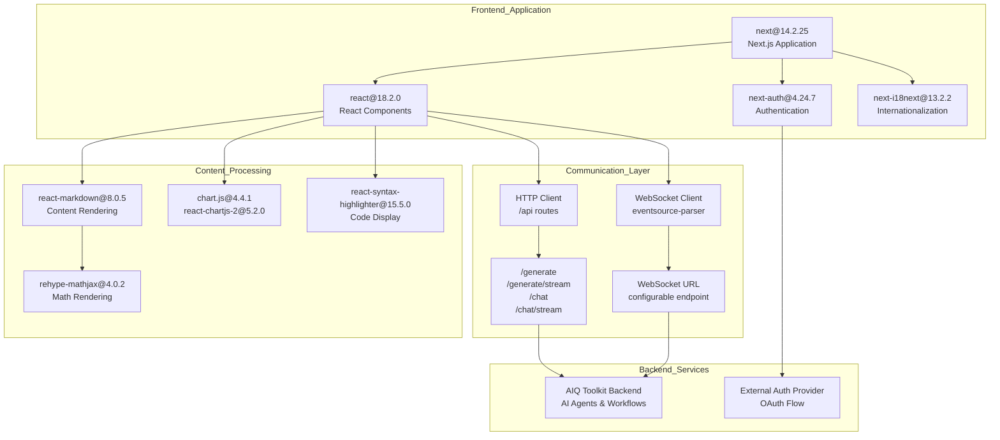
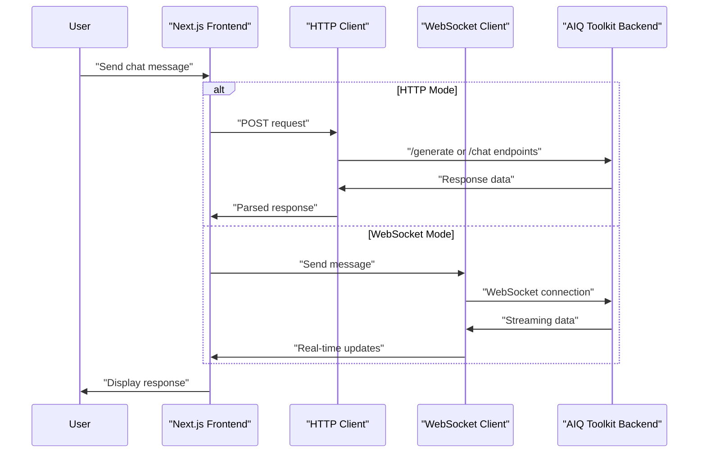
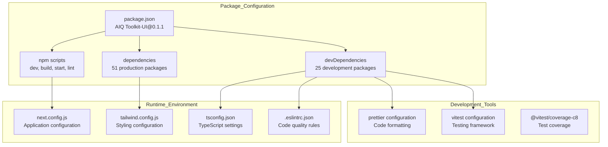

<!-- source: DeepWiki mcp.deepwiki.com · repo NVIDIA/NeMo-Agent-Toolkit-UI · page 1 Overview · fetched 2026-10-26 -->

# Overview

Relevant source files

The following files were used as context for generating this wiki page:

- [README.md](README.md)
- [package.json](package.json)

## Purpose and Scope

The AIQ Toolkit-UI is a Next.js-based web application that provides a chat interface for interacting with AI agents and workflows built using the AIQ Toolkit backend. This document covers the frontend application architecture, communication protocols, and key components that enable real-time conversations with AI agents through both HTTP APIs and WebSocket connections.

This overview focuses on the frontend user interface system. For detailed information about backend AI agent implementation, see the AIQ Toolkit main documentation. For specific chat interface components, see [Chat Interface Components](#3.1). For authentication details, see [Authentication](#4).

## System Architecture

The AIQ Toolkit-UI follows a modern React/Next.js architecture with dual communication modes for backend integration:

### High-Level System Architecture

Sources: [package.json:1-76](), [README.md:1-110]()

### Technology Stack Overview

The application is built on a comprehensive technology stack optimized for real-time chat interactions:

| Category | Technologies | Purpose |
|----------|-------------|---------|
| **Core Framework** | `next@14.2.25`, `react@18.2.0`, `typescript@4.9.5` | Application foundation |
| **Authentication** | `next-auth@4.24.7`, `jsonwebtoken@9.0.2`, `jwt-decode@4.0.0` | User authentication and session management |
| **Content Rendering** | `react-markdown@8.0.5`, `rehype-mathjax@4.0.2`, `react-syntax-highlighter@15.5.0` | Rich content display |
| **Data Visualization** | `chart.js@4.4.1`, `react-chartjs-2@5.2.0`, `recharts@2.12.7` | Charts and graphs |
| **Communication** | `eventsource-parser@0.1.0`, Built-in fetch API | HTTP and WebSocket communication |
| **Utilities** | `lodash@4.17.21`, `uuid@9.0.1`, `file-saver@2.0.5` | Helper functions and file processing |

Sources: [package.json:14-49]()

## Communication Architecture

The application supports dual communication modes with the AIQ Toolkit backend:

### API Communication Flow

### Endpoint Configuration

The application connects to the AIQ Toolkit backend through configurable endpoints:

| Endpoint | Purpose | Response Type |
|----------|---------|---------------|
| `/generate` | Single response generation | JSON response |
| `/generate/stream` | Streaming response generation | Server-sent events |
| `/chat` | Single response chat completion | JSON response |
| `/chat/stream` | Streaming chat completion | Server-sent events |
| WebSocket URL | Real-time bi-directional communication | WebSocket messages |

Sources: [README.md:70-79]()

## Key Application Components

The application architecture maps to specific code entities and file structures:

### Core Application Structure

Sources: [package.json:1-76]()

## Features Overview

The AIQ Toolkit-UI provides comprehensive chat interface capabilities:

### Core Features

- **Modern Responsive UI**: Built with React 18 and Next.js 14 for optimal performance
- **Real-time Streaming**: Support for streaming responses via Server-Sent Events
- **Dual Communication**: HTTP REST API and WebSocket protocol support
- **Human-in-the-Loop**: Interactive workflow support for agent collaboration
- **Theme Support**: Light/Dark theme switching capability
- **Content Rendering**: Rich markdown, mathematical equations, and code syntax highlighting
- **Data Visualization**: Charts and graphs rendering with Chart.js and Recharts
- **Authentication**: Secure user authentication with NextAuth.js
- **Internationalization**: Multi-language support via i18next
- **Docker Support**: Containerized deployment capability

### Technical Capabilities

- **File Processing**: Image compression and file handling utilities
- **Content Processing**: HTML sanitization and XSS prevention
- **Export Features**: PowerPoint generation via `pptxgenjs@3.12.0`
- **Monitoring**: DataDog RUM integration for performance tracking
- **Network Visualization**: Force graph rendering for complex data relationships

Sources: [README.md:12-18](), [package.json:14-49]()

## Development and Deployment

The application supports multiple deployment modes:

### Development Commands

| Command | Purpose |
|---------|---------|
| `npm run dev` | Start development server |
| `npm run build` | Build production bundle |
| `npm run start` | Start production server |
| `npm run lint` | Run ESLint checks |
| `npm run format` | Format code with Prettier |
| `npm run test` | Run Vitest test suite |
| `npm run coverage` | Generate test coverage report |

### Deployment Options

1. **Local Development**: `npm run dev` - Available at `http://localhost:3000`
2. **Docker Deployment**: Container-based deployment with environment variable support
3. **Production Build**: Next.js standalone mode for optimized performance

Sources: [package.json:5-12](), [README.md:41-58]()

---

