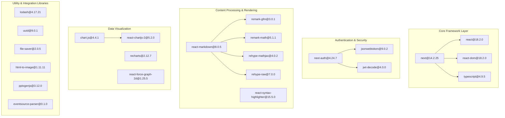
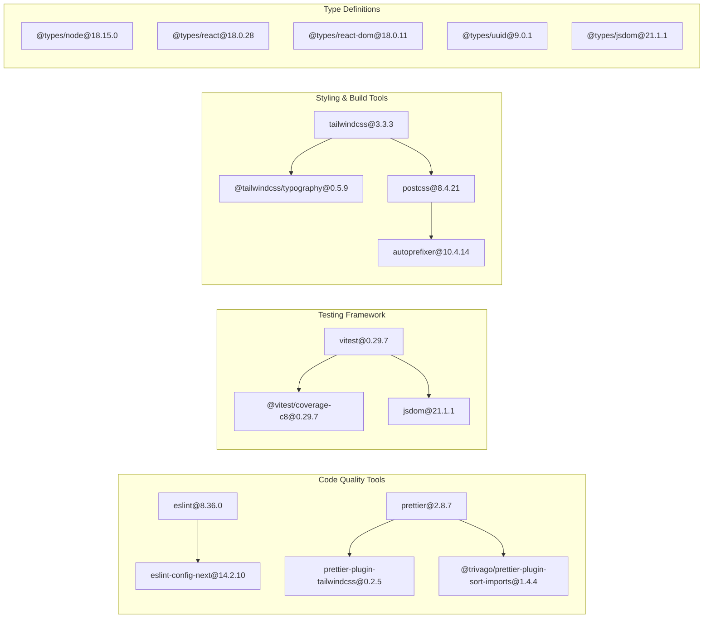
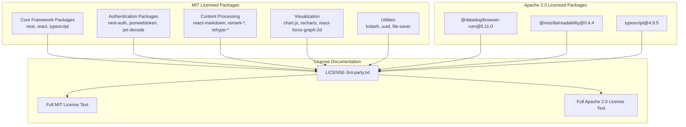

<!-- source: DeepWiki mcp.deepwiki.com · repo NVIDIA/NeMo-Agent-Toolkit-UI · page 1.1 Project Structure · fetched 2026-10-26 -->

# Project Structure

Relevant source files

The following files were used as context for generating this wiki page:

- [LICENSE-3rd-party.txt](LICENSE-3rd-party.txt)
- [package-lock.json](package-lock.json)
- [package.json](package.json)

This document provides a comprehensive overview of the AIQ Toolkit-UI project structure, including its technology stack, dependencies, and architectural organization. It covers the foundational elements that enable the chat interface functionality and integration with AI agents and workflows.

For information about specific chat system implementation details, see [Chat System](#2.1). For authentication mechanisms, see [Authentication Flow](#4.1). For development setup procedures, see [Setup and Installation](#5.1).

## Technology Stack Overview

The AIQ Toolkit-UI is built as a modern React application using Next.js 14.2.25 as the primary framework. The application leverages a comprehensive set of libraries to provide chat functionality, content rendering, data visualization, and authentication capabilities.

**Sources:** [package.json:1-76]()

## Primary Dependencies Analysis

The project's dependencies can be categorized into several functional groups that support the core chat interface and AI workflow integration capabilities.

| Category | Key Dependencies | Purpose |
|----------|------------------|---------|
| **Core Framework** | `next@14.2.25`, `react@18.2.0`, `typescript@4.9.5` | Base application framework and type safety |
| **Authentication** | `next-auth@4.24.7`, `jsonwebtoken@9.0.2`, `jwt-decode@4.0.0` | User authentication and session management |
| **Content Rendering** | `react-markdown@8.0.5`, `remark-gfm@3.0.1`, `rehype-mathjax@4.0.2` | Markdown processing and mathematical equation rendering |
| **Data Visualization** | `chart.js@4.4.1`, `recharts@2.12.7`, `react-force-graph-2d@1.25.5` | Chart generation and network graph visualization |
| **UI Components** | `@radix-ui/react-select@2.1.2`, `@tabler/icons-react@2.9.0`, `lucide-react@0.454.0` | User interface components and iconography |
| **Real-time Communication** | `eventsource-parser@0.1.0`, `react-query@3.39.3` | WebSocket and HTTP streaming support |
| **Internationalization** | `i18next@22.4.13`, `next-i18next@13.2.2`, `react-i18next@12.2.0` | Multi-language support |
| **File Processing** | `file-saver@2.0.5`, `html-to-image@1.11.11`, `pptxgenjs@3.12.0` | Export and file manipulation capabilities |
| **Monitoring** | `@datadog/browser-rum@5.11.0` | Real user monitoring and analytics |

**Sources:** [package.json:14-49](), [LICENSE-3rd-party.txt:15-50]()

## Development Toolchain

The project employs a comprehensive development toolchain focused on code quality, testing, and build optimization.

**Sources:** [package.json:51-75]()

## Build Scripts and Commands

The project defines a standard set of npm scripts for development, building, and maintenance tasks.

| Script | Command | Purpose |
|--------|---------|---------|
| `dev` | `next dev` | Start development server with hot reloading |
| `build` | `next build` | Create production build with optimizations |
| `start` | `next start` | Start production server from built assets |
| `lint` | `next lint` | Run ESLint code quality checks |
| `format` | `prettier --write .` | Format code using Prettier |
| `test` | `vitest` | Run test suite with Vitest |
| `coverage` | `vitest run --coverage` | Generate test coverage reports |

**Sources:** [package.json:5-12]()

## License Compliance Structure

The project maintains comprehensive third-party license tracking to ensure legal compliance across all dependencies. The license structure is organized by license type with detailed attribution.

**Sources:** [LICENSE-3rd-party.txt:1-163]()

## Package Version Management

The project uses specific version constraints to ensure stability and compatibility across the dependency tree. Key version strategies include:

- **Pinned Major Versions**: Core frameworks like `next@14.2.25` and `react@18.2.0` use exact or minor version constraints
- **Caret Ranges**: Most utility libraries use caret (`^`) ranges allowing patch and minor updates
- **Development Dependencies**: Build tools and type definitions follow similar versioning patterns with appropriate flexibility

The `package-lock.json` file (referenced but not shown) provides exact dependency resolution for reproducible builds across environments.

**Sources:** [package.json:14-75](), [LICENSE-3rd-party.txt:16-73]()

---

