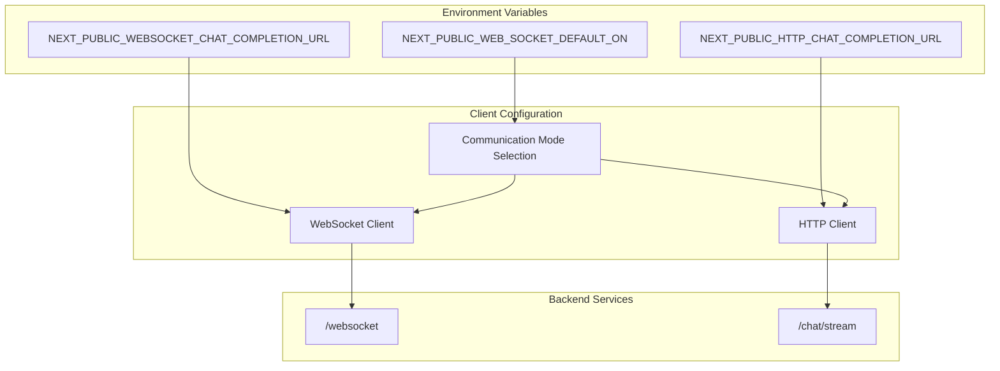
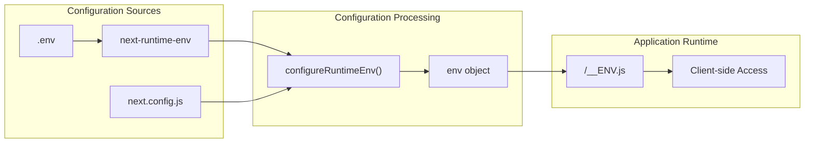
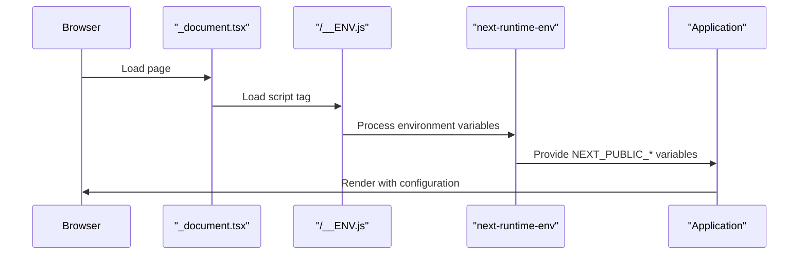
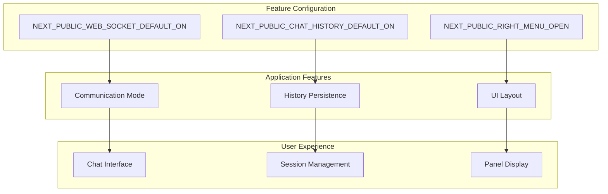

<!-- source: DeepWiki mcp.deepwiki.com · repo NVIDIA/NeMo-Agent-Toolkit-UI · page 1.2 Configuration · fetched 2026-10-26 -->

# Configuration

<details>
<summary>Relevant source files</summary>

The following files were used as context for generating this wiki page:

- [.env](.env)
- [next.config.js](next.config.js)
- [pages/_document.tsx](pages/_document.tsx)

</details>


This document covers the configuration system for the AIQ Toolkit-UI application, including environment variables, Next.js build configuration, runtime environment setup, and internationalization settings. The configuration system enables flexible deployment across different environments while maintaining security and performance standards.

For information about authentication configuration, see [Authentication](#4). For deployment and build processes, see [Build and Deployment](#5.3).

## Environment Variables

The application uses environment variables to configure backend endpoints, feature toggles, and application behavior. All client-side environment variables use the `NEXT_PUBLIC_` prefix to ensure they are available in the browser.

### Environment Variable Reference

| Variable | Default Value | Purpose |
|----------|---------------|---------|
| `NEXT_PUBLIC_WORKFLOW` | `AIQ Toolkit` | Application workflow identifier |
| `NEXT_PUBLIC_WEBSOCKET_CHAT_COMPLETION_URL` | `ws://127.0.0.1:8000/websocket` | WebSocket endpoint for real-time chat |
| `NEXT_PUBLIC_HTTP_CHAT_COMPLETION_URL` | `http://127.0.0.1:8000/chat/stream` | HTTP endpoint for chat streaming |
| `NEXT_PUBLIC_WEB_SOCKET_DEFAULT_ON` | `false` | Default communication mode toggle |
| `NEXT_PUBLIC_CHAT_HISTORY_DEFAULT_ON` | `false` | Chat history persistence toggle |
| `NEXT_PUBLIC_RIGHT_MENU_OPEN` | `false` | Default right panel state |

### Communication Endpoint Configuration

The application supports dual communication modes through configurable endpoints:



Sources: [.env:2-3](), [.env:4]()

## Next.js Configuration

The Next.js configuration in `next.config.js` defines build behavior, runtime environment integration, and webpack customizations.

### Core Configuration Options

#### Runtime Environment Integration
The application uses `next-runtime-env` to manage environment variables at runtime:



Sources: [next.config.js:1](), [next.config.js:4-6](), [pages/_document.tsx:15]()

#### Build and Deployment Configuration

| Configuration | Value | Purpose |
|---------------|-------|---------|
| `output` | `standalone` | Enables standalone deployment mode |
| `ignoreBuildErrors` | `true` | Allows production builds despite TypeScript errors |
| `bodySizeLimit` | `5mb` | Maximum server action payload size |

#### Webpack Configuration
The webpack configuration enables advanced features:

```javascript
// webpack configuration from next.config.js:20-27
config.experiments = {
  asyncWebAssembly: true,
  layers: true,
};
```

Sources: [next.config.js:7](), [next.config.js:13](), [next.config.js:16-18](), [next.config.js:20-27]()

## Runtime Environment System

The application implements a sophisticated runtime environment system that loads configuration dynamically in the browser.

### Environment Loading Flow



### Document Configuration
The custom document in `_document.tsx` integrates several configuration aspects:

- **Internationalization**: Uses `i18nextConfig.i18n.defaultLocale` for language settings
- **Mobile Configuration**: Sets Apple mobile web app metadata
- **Runtime Environment**: Loads the `/__ENV.js` script for dynamic configuration

Sources: [pages/_document.tsx:8-9](), [pages/_document.tsx:13-14](), [pages/_document.tsx:15]()

## Configuration Categories

### Feature Toggles
Environment variables control application behavior and feature availability:



Sources: [.env:4-6]()

### Endpoint Configuration
Backend service endpoints are configurable for different deployment environments:

- **WebSocket URL**: Real-time bidirectional communication
- **HTTP URL**: Traditional request-response with streaming support
- **Workflow Identifier**: Application context identification

Sources: [.env:1-3]()

## Development vs Production Configuration

The configuration system supports different behaviors between development and production environments:

### Development Configuration
- Local backend endpoints (`127.0.0.1:8000`)
- TypeScript errors allowed in builds
- Enhanced webpack experiments enabled

### Production Considerations
- Standalone output mode for containerized deployment
- Runtime environment variable injection
- Mobile web app optimization

Sources: [next.config.js:7](), [next.config.js:13](), [next.config.js:20-24]()

## Configuration Security

The application follows Next.js security best practices:

- Only `NEXT_PUBLIC_` prefixed variables are exposed to the client
- Server-side configuration remains private
- Runtime environment loading prevents build-time variable embedding

This configuration system provides flexibility for deployment across different environments while maintaining security boundaries between client and server configuration.

Sources: [.env:1-6](), [next.config.js:1-34](), [pages/_document.tsx:1-24]()

---

