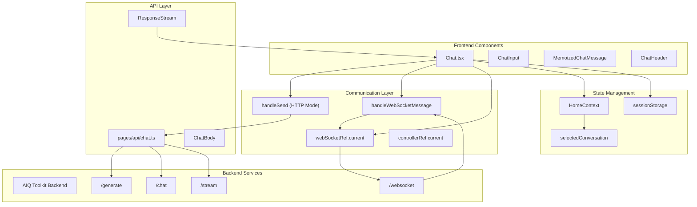
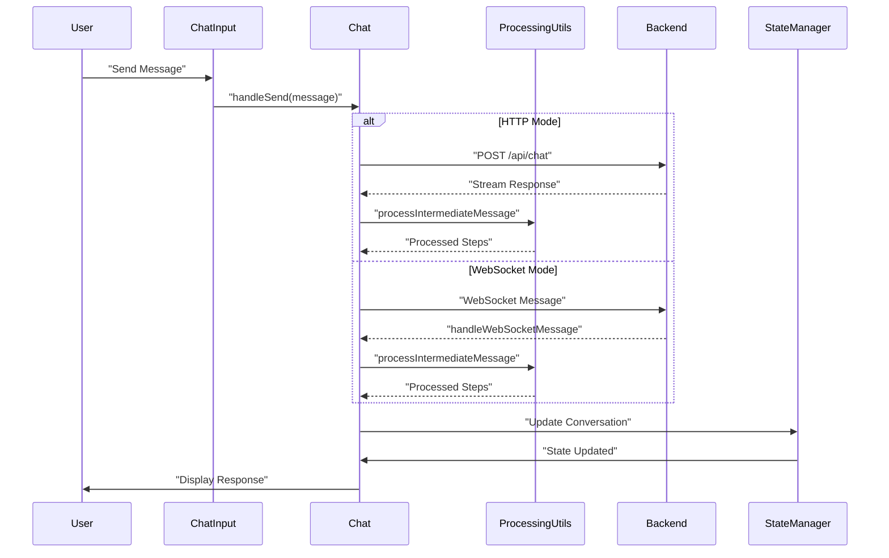
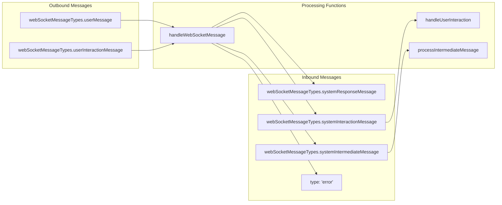
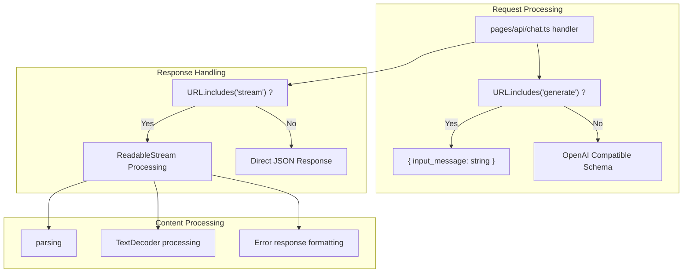

<!-- source: DeepWiki mcp.deepwiki.com · repo NVIDIA/NeMo-Agent-Toolkit-UI · page 2 Core Architecture · fetched 2026-10-26 -->

# Core Architecture

Relevant source files

The following files were used as context for generating this wiki page:

- [components/Chat/Chat.tsx](components/Chat/Chat.tsx)
- [pages/api/chat.ts](pages/api/chat.ts)
- [utils/app/helper.ts](utils/app/helper.ts)

This document details the main chat system architecture of the AIQ Toolkit-UI, focusing on the dual HTTP/WebSocket communication system, message processing pipeline, and content rendering architecture. This covers the foundational components that enable real-time communication with AI agents and workflows.

For specific chat interface components and user interactions, see [Chat System](#2.1). For authentication and user management, see [Authentication](#4). For development setup and deployment, see [Development](#5).

## Architecture Overview

The AIQ Toolkit-UI employs a dual-mode communication architecture that supports both traditional HTTP requests and real-time WebSocket connections for interacting with the AIQ Toolkit Backend. The system is built around a central `Chat` component that orchestrates message handling, state management, and content rendering.

### Core Communication Architecture

**Sources:** [components/Chat/Chat.tsx:35-936](), [pages/api/chat.ts:13-227]()

### Dual Communication Modes

The system operates in two distinct communication modes, determined by the `webSocketMode` configuration:

| Mode | Implementation | Use Case | Message Flow |
|------|---------------|----------|--------------|
| HTTP | `handleSend` function | Traditional request-response | Client → `/api/chat` → AIQ Backend |
| WebSocket | `connectWebSocket` + `handleWebSocketMessage` | Real-time streaming | Client ↔ WebSocket Server ↔ AIQ Backend |

The mode selection is controlled by `webSocketModeRef.current` and can be toggled through the settings interface.

**Sources:** [components/Chat/Chat.tsx:73-74](), [components/Chat/Chat.tsx:404-489]()

## Message Processing Pipeline

The message processing pipeline handles user input, processes responses, and manages intermediate steps and human-in-the-loop interactions.

### Message Flow Architecture

**Sources:** [components/Chat/Chat.tsx:365-751](), [utils/app/helper.ts:134-217]()

### Content Processing Functions

The system uses several key utility functions for processing different types of content:

- `compressImage`: Reduces image file sizes to under 200KB while maintaining quality
- `processIntermediateMessage`: Handles hierarchical intermediate step data structures
- `generateContentIntermediate`: Converts intermediate steps to HTML details/summary elements
- `fixMalformedHtml`: Sanitizes and repairs malformed HTML content

**Sources:** [utils/app/helper.ts:10-68](), [utils/app/helper.ts:134-217](), [utils/app/helper.ts:261-306](), [utils/app/helper.ts:330-364]()

## WebSocket Communication System

The WebSocket implementation provides real-time bidirectional communication with automatic reconnection and message type handling.

### WebSocket Message Types

**Sources:** [components/Chat/Chat.tsx:225-362](), [components/Chat/Chat.tsx:87-112](), [utils/app/const.ts]()

### Connection Management

The WebSocket connection lifecycle is managed through several key functions:

- `connectWebSocket`: Establishes connection with retry logic (max 3 attempts)
- `webSocketRef.current`: Maintains the active WebSocket connection reference
- `webSocketConnectedRef.current`: Tracks connection state for reliable message sending

**Sources:** [components/Chat/Chat.tsx:136-211](), [components/Chat/Chat.tsx:71-72]()

## HTTP Communication System

The HTTP mode uses a traditional request-response pattern with streaming support for real-time response delivery.

### HTTP Request Processing

The `/api/chat` endpoint handles different backend schemas:

**Sources:** [pages/api/chat.ts:24-51](), [pages/api/chat.ts:88-188](), [pages/api/chat.ts:190-218]()

## State Management Architecture

The application uses a combination of React Context API and sessionStorage for state persistence across page reloads.

### State Flow

| State Container | Purpose | Key Fields |
|----------------|---------|------------|
| `HomeContext` | Global application state | `selectedConversation`, `conversations`, `messageIsStreaming`, `webSocketConnected` |
| `sessionStorage` | Persistence layer | `selectedConversation`, `conversationsHistory`, `webSocketURL`, `chatCompletionURL` |
| Component State | Local UI state | `currentMessage`, `autoScrollEnabled`, `showSettings` |

The state synchronization ensures that conversation data persists across browser sessions while maintaining real-time updates during active conversations.

**Sources:** [components/Chat/Chat.tsx:37-55](), [components/Chat/Chat.tsx:260-361](), [utils/app/conversation.ts]()

## Content Rendering Pipeline

The system processes various content types including markdown, code blocks, mathematical equations, and interactive charts through a structured rendering pipeline.

### Intermediate Steps Processing

Intermediate steps are processed hierarchically using the `processIntermediateMessage` function, which supports:

- Parent-child relationship tracking via `parent_id` fields
- Step overriding when `intermediateStepOverride` is enabled
- Recursive tree structure for nested intermediate steps
- HTML details/summary element generation for collapsible display

**Sources:** [utils/app/helper.ts:134-217](), [utils/app/helper.ts:261-306]()

This architecture provides a robust foundation for real-time AI agent interactions while maintaining flexibility for different communication patterns and content types.

---

