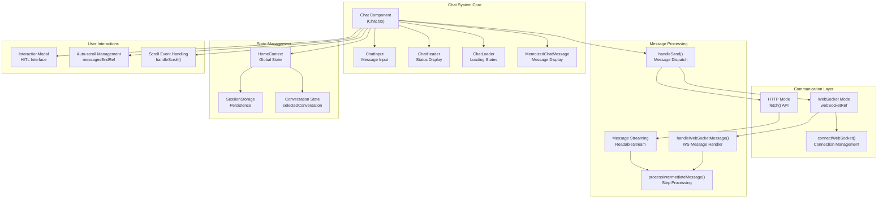
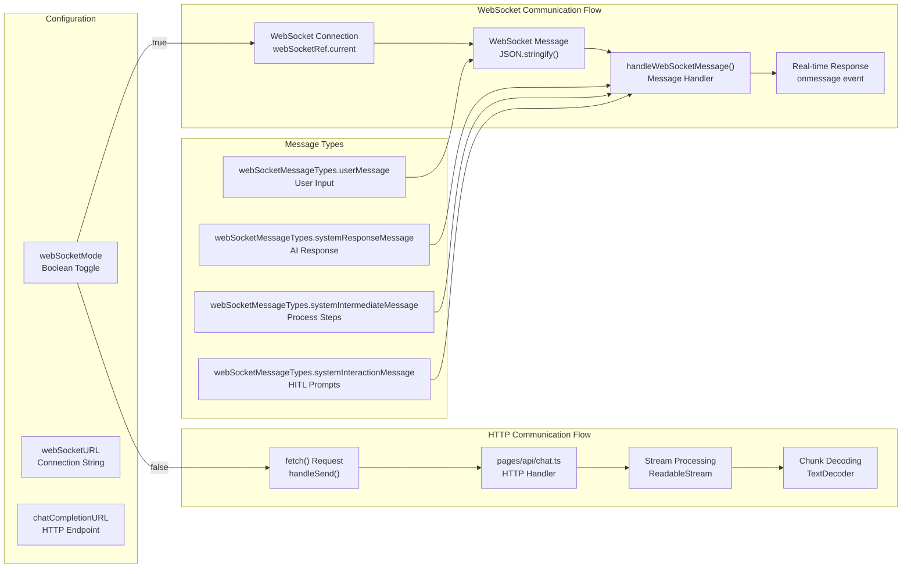
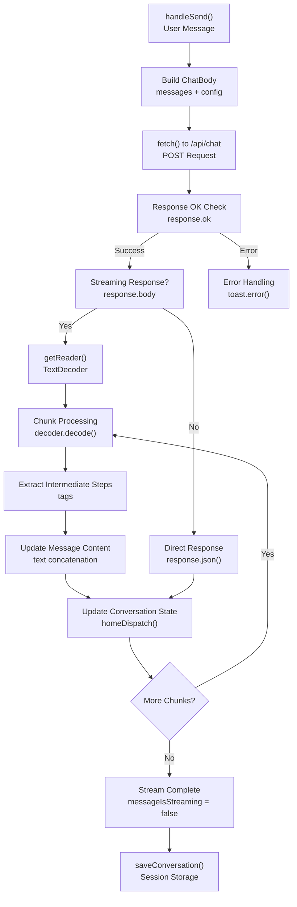
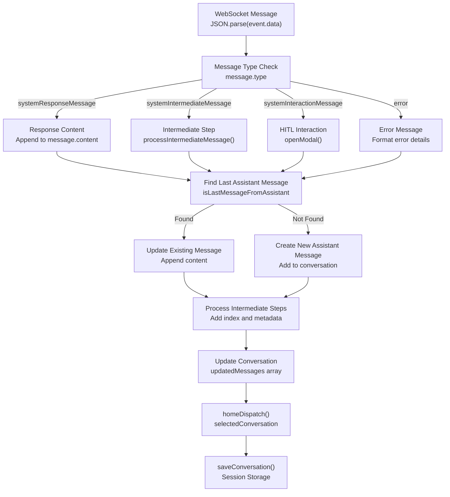
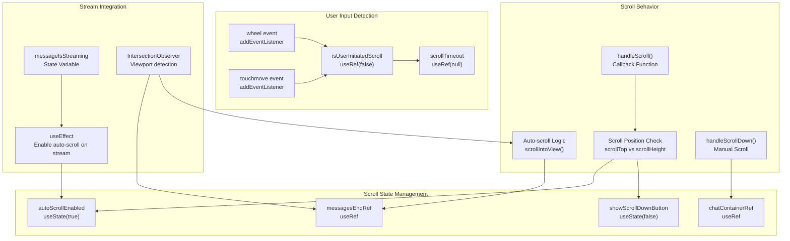
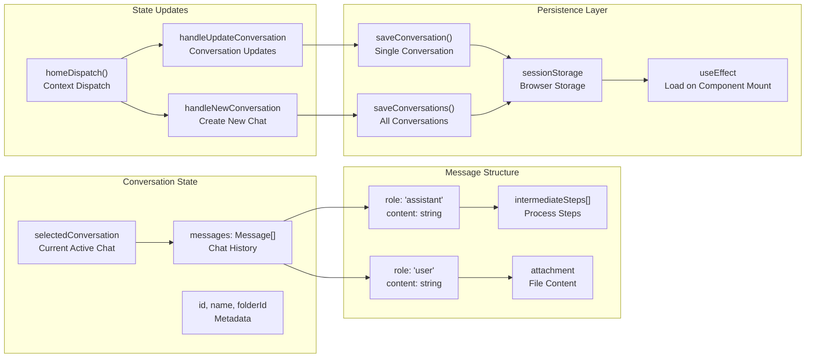

<!-- source: DeepWiki mcp.deepwiki.com · repo NVIDIA/NeMo-Agent-Toolkit-UI · page 2.1 Chat System · fetched 2026-10-26 -->

# Chat System

Relevant source files

The following files were used as context for generating this wiki page:

- [components/Chat/Chat.tsx](components/Chat/Chat.tsx)
- [pages/api/chat.ts](pages/api/chat.ts)
- [pages/api/home/home.state.tsx](pages/api/home/home.state.tsx)
- [pages/api/home/home.tsx](pages/api/home/home.tsx)

This document covers the core chat interface system that enables real-time communication with AI agents through both HTTP and WebSocket protocols. The chat system handles message streaming, intermediate step processing, human-in-the-loop interactions, and content rendering.

For information about communication protocols and API endpoints, see [Communication Protocols](#2.2). For details about content rendering and utility functions, see [Utility Functions](#2.3).

## Chat System Architecture

The chat system is built around the main `Chat` component which manages dual communication modes, message processing, and user interface interactions.

Sources: [components/Chat/Chat.tsx:35-936](), [pages/api/home/home.tsx:1-290](), [pages/api/home/home.state.tsx:1-57]()

## Communication Modes

The chat system supports dual communication modes that can be switched dynamically based on configuration and user preferences.

Sources: [components/Chat/Chat.tsx:365-751](), [components/Chat/Chat.tsx:136-211](), [components/Chat/Chat.tsx:225-362](), [pages/api/chat.ts:13-227]()

## Message Processing Pipeline

The message processing system handles both streaming and non-streaming responses, with support for intermediate steps and error handling.

### HTTP Message Processing

Sources: [components/Chat/Chat.tsx:516-751](), [pages/api/chat.ts:88-188]()

### WebSocket Message Processing

Sources: [components/Chat/Chat.tsx:225-362](), [utils/app/const.ts]()

## User Interface Management

The chat system manages complex UI interactions including auto-scrolling, user input handling, and visual feedback.

### Scroll Management System

Sources: [components/Chat/Chat.tsx:753-878](), [components/Chat/Chat.tsx:796-818](), [components/Chat/Chat.tsx:820-834]()

## State Management

The chat system integrates with the global application state through React Context and manages persistence through session storage.

### State Architecture

| State Field | Type | Purpose | Source |
|-------------|------|---------|---------|
| `selectedConversation` | `Conversation` | Currently active conversation | HomeContext |
| `conversations` | `Conversation[]` | All conversation history | HomeContext |
| `messageIsStreaming` | `boolean` | Streaming status indicator | HomeContext |
| `loading` | `boolean` | Loading state for UI | HomeContext |
| `webSocketConnected` | `boolean` | WebSocket connection status | HomeContext |
| `webSocketMode` | `boolean` | Communication mode toggle | HomeContext |
| `chatHistory` | `boolean` | Include full history in requests | HomeContext |
| `enableIntermediateSteps` | `boolean` | Show intermediate processing | HomeContext |
| `expandIntermediateSteps` | `boolean` | Expand steps by default | HomeContext |
| `autoScroll` | `boolean` | Auto-scroll during streaming | HomeContext |

Sources: [pages/api/home/home.state.tsx:6-56](), [components/Chat/Chat.tsx:37-55]()

### Conversation Management

Sources: [components/Chat/Chat.tsx:329-361](), [pages/api/home/home.tsx:122-159](), [utils/app/conversation.ts]()

---

