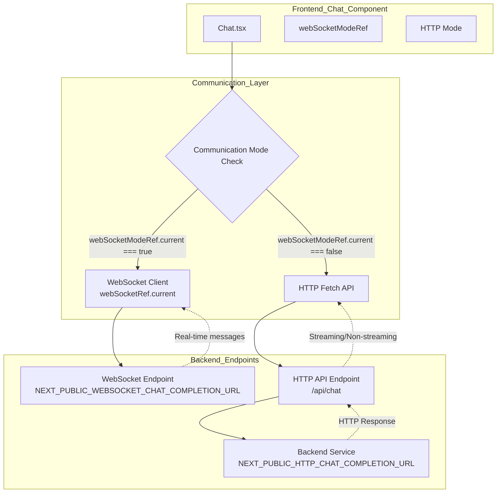
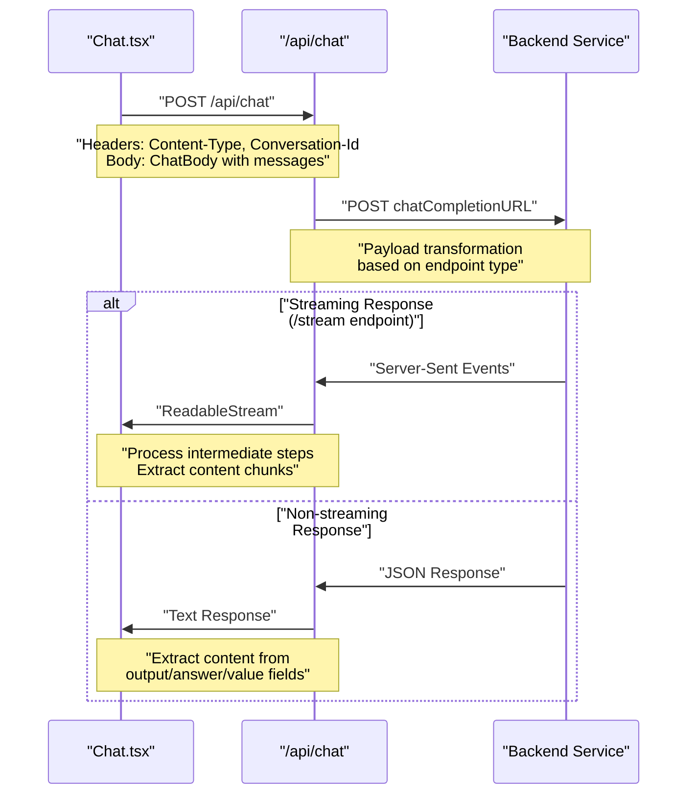
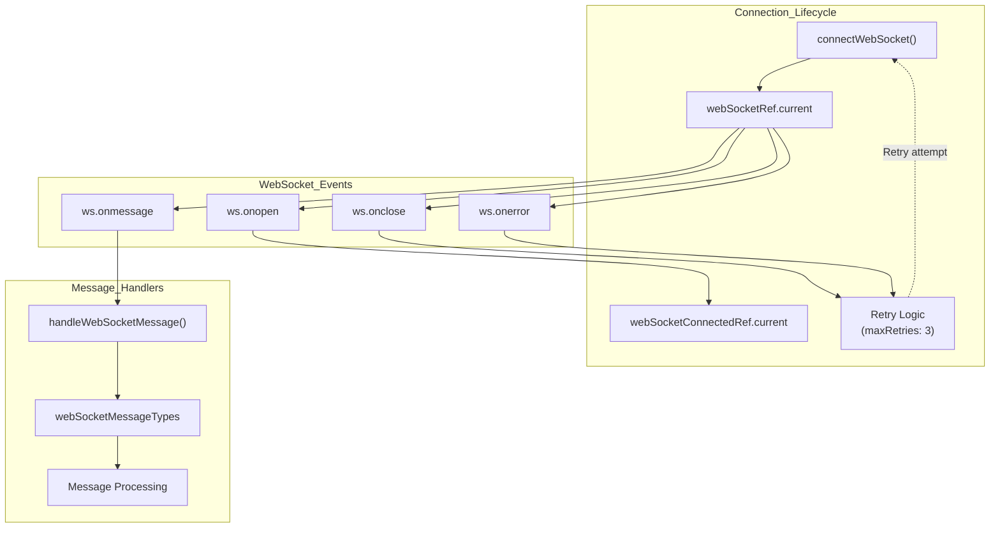
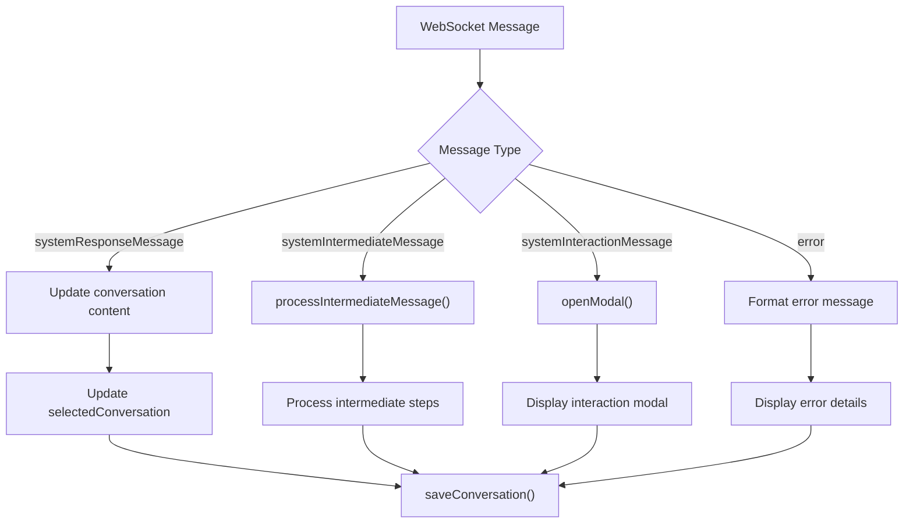

<!-- source: DeepWiki mcp.deepwiki.com · repo NVIDIA/NeMo-Agent-Toolkit-UI · page 2.2 Communication Protocols · fetched 2026-10-26 -->

# Communication Protocols

<details>
<summary>Relevant source files</summary>

The following files were used as context for generating this wiki page:

- [.env](.env)
- [components/Chat/Chat.tsx](components/Chat/Chat.tsx)
- [pages/api/chat.ts](pages/api/chat.ts)

</details>


This document covers the communication protocols used by the AIQ Toolkit-UI to interact with backend services. It details both HTTP API and WebSocket communication methods, message schemas, connection management, and error handling patterns.

For information about the Chat System user interface components, see [Chat System](#2.1). For authentication-related communication, see [Authentication Flow](#4.1).

## Overview

The AIQ Toolkit-UI implements a dual communication architecture supporting both HTTP and WebSocket protocols. The system allows users to switch between communication modes dynamically, with WebSocket providing real-time streaming capabilities and HTTP serving as a fallback for basic request-response patterns.



Sources: [components/Chat/Chat.tsx:73](), [components/Chat/Chat.tsx:404-489](), [.env:2-3]()

## HTTP API Communication

The HTTP communication protocol uses a Next.js API route that acts as a proxy between the frontend and backend services. The system supports both streaming and non-streaming responses with intermediate step processing.

### HTTP Request Flow



Sources: [components/Chat/Chat.tsx:517-525](), [pages/api/chat.ts:55-62](), [pages/api/chat.ts:89-188]()

### Message Processing

The HTTP API route in `pages/api/chat.ts` handles payload transformation based on the backend endpoint type:

- **Generate endpoints** (`/generate`): Transform to `{input_message: "user question"}` schema
- **Chat endpoints**: Use OpenAI-compatible message schema
- **Stream endpoints**: Process Server-Sent Events with intermediate step extraction

The system processes intermediate steps by parsing `<intermediatestep>` tags from streaming responses and converting them to structured message objects.

Sources: [pages/api/chat.ts:27-51](), [pages/api/chat.ts:127-173](), [components/Chat/Chat.tsx:574-599]()

## WebSocket Communication

WebSocket communication provides real-time bidirectional messaging with support for intermediate steps, human-in-the-loop interactions, and error handling. The system maintains persistent connections with automatic reconnection logic.

### WebSocket Connection Management



Sources: [components/Chat/Chat.tsx:136-211](), [components/Chat/Chat.tsx:225-362](), [utils/app/const.ts:webSocketMessageTypes]()

### WebSocket Message Types

The system defines specific message types in `webSocketMessageTypes` for different communication patterns:

| Message Type | Purpose | Direction |
|--------------|---------|-----------|
| `userMessage` | User input messages | Frontend → Backend |
| `userInteractionMessage` | Human-in-the-loop responses | Frontend → Backend |
| `systemResponseMessage` | AI assistant responses | Backend → Frontend |
| `systemIntermediateMessage` | Intermediate processing steps | Backend → Frontend |
| `systemInteractionMessage` | Human-in-the-loop prompts | Backend → Frontend |

Sources: [components/Chat/Chat.tsx:32](), [components/Chat/Chat.tsx:476-487](), [components/Chat/Chat.tsx:90-112]()

## Message Schema and Processing

### User Message Schema

User messages sent via WebSocket follow a structured schema:

```typescript
{
  type: webSocketMessageTypes.userMessage,
  schema_type: sessionStorage.getItem('webSocketSchema') || webSocketSchema,
  id: message?.id,
  conversation_id: selectedConversation.id,
  content: {
    messages: chatMessages
  },
  timestamp: new Date().toISOString()
}
```

Sources: [components/Chat/Chat.tsx:476-485]()

### System Message Processing

The `handleWebSocketMessage` function processes incoming messages based on their type:



Sources: [components/Chat/Chat.tsx:225-362](), [components/Chat/Chat.tsx:242-244](), [components/Chat/Chat.tsx:252-258]()

## Connection Management and Error Handling

### Automatic Reconnection

The WebSocket implementation includes robust reconnection logic with exponential backoff:

- Maximum of 3 retry attempts
- 1-second delay between retries
- Connection state tracking via `webSocketConnectedRef`
- Toast notifications for connection status

Sources: [components/Chat/Chat.tsx:136-211](), [components/Chat/Chat.tsx:176-199]()

### Error Handling Patterns

The system implements comprehensive error handling for both communication protocols:

**HTTP Error Handling:**
- Network request failures
- Server response errors (4xx, 5xx)
- HTML response detection and parsing
- Formatted error messages with expandable details

**WebSocket Error Handling:**
- Connection failures with retry logic
- Message parsing errors
- Graceful connection closure
- State management during errors

Sources: [pages/api/chat.ts:66-85](), [pages/api/chat.ts:220-224](), [components/Chat/Chat.tsx:202-210](), [components/Chat/Chat.tsx:726-736]()

## Configuration and Environment Variables

Communication endpoints are configured via environment variables:

| Variable | Purpose | Default |
|----------|---------|---------|
| `NEXT_PUBLIC_WEBSOCKET_CHAT_COMPLETION_URL` | WebSocket endpoint URL | `ws://127.0.0.1:8000/websocket` |
| `NEXT_PUBLIC_HTTP_CHAT_COMPLETION_URL` | HTTP endpoint URL | `http://127.0.0.1:8000/chat/stream` |
| `NEXT_PUBLIC_WEB_SOCKET_DEFAULT_ON` | Default WebSocket mode | `false` |

The system also supports runtime configuration through session storage, allowing users to override default endpoints in the settings interface.

Sources: [.env:2-4](), [components/Chat/Chat.tsx:141-147](), [components/Chat/Chat.tsx:478]()

---

