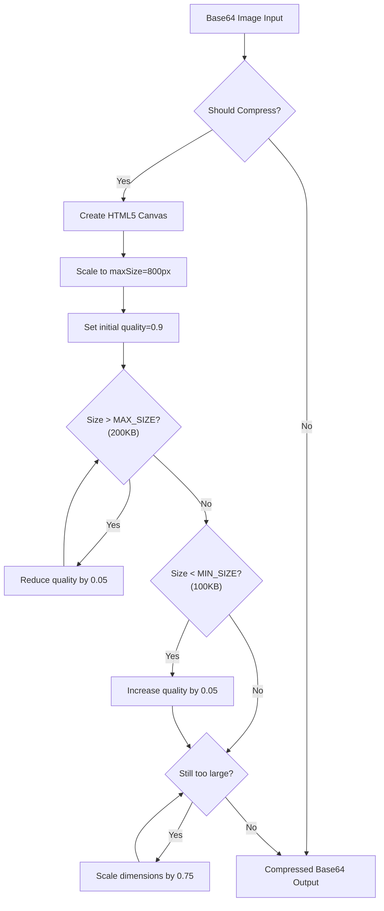
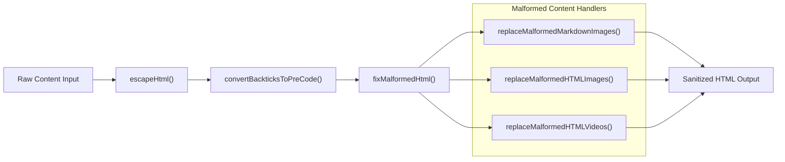
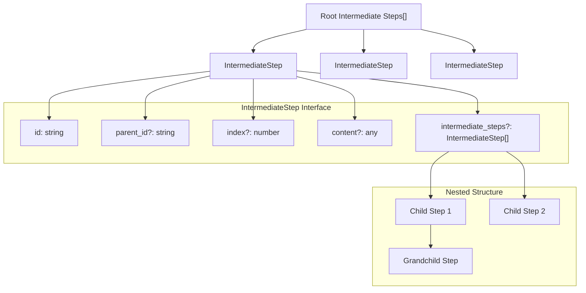
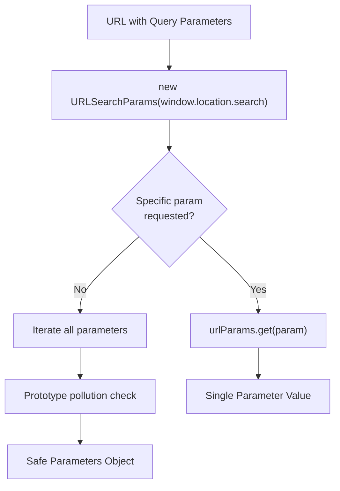
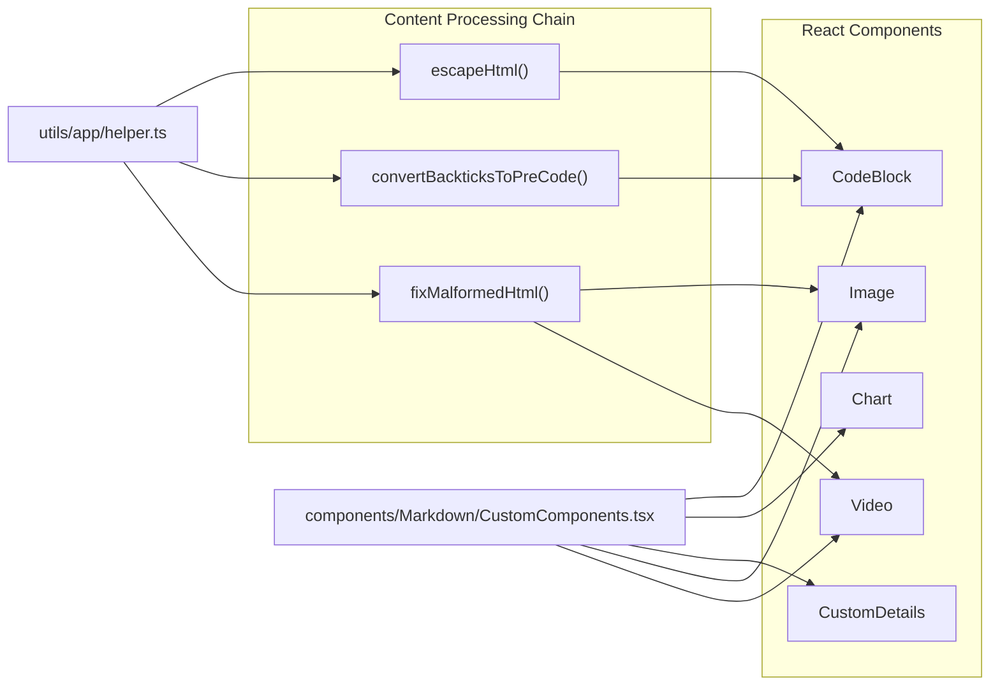

<!-- source: DeepWiki mcp.deepwiki.com · repo NVIDIA/NeMo-Agent-Toolkit-UI · page 2.3 Utility Functions · fetched 2026-10-26 -->

# Utility Functions

<details>
<summary>Relevant source files</summary>

The following files were used as context for generating this wiki page:

- [components/Markdown/CustomComponents.tsx](components/Markdown/CustomComponents.tsx)
- [utils/app/helper.ts](utils/app/helper.ts)

</details>


This document covers the core utility functions that provide essential services across the AIQ Toolkit-UI application. These functions handle image processing, content sanitization, intermediate steps processing, session management, and various other helper operations that support the chat interface and content rendering systems.

For information about the main chat interface components that use these utilities, see [Chat Interface Components](#3.1). For details about content rendering and markdown processing, see [Content Rendering](#3.2).

## Overview

The utility functions are primarily located in `utils/app/helper.ts` and serve multiple domains including image compression, HTML/markdown processing, session state management, and intermediate workflow step handling. These utilities form the foundation for content processing pipelines and user interaction features throughout the application.

## Function Categories and Architecture

```mermaid
graph TB
    subgraph "Image Processing"
        compressImage["compressImage()"]
        imageValidation["Image Validation"]
        canvasOperations["Canvas Operations"]
    end
    
    subgraph "Content Processing"
        escapeHtml["escapeHtml()"]
        convertBackticksToPreCode["convertBackticksToPreCode()"]
        fixMalformedHtml["fixMalformedHtml()"]
        replaceMalformed["Replace Malformed Content"]
    end
    
    subgraph "Intermediate Steps"
        processIntermediateMessage["processIntermediateMessage()"]
        generateContentIntermediate["generateContentIntermediate()"]
        hierarchicalProcessing["Hierarchical Processing"]
    end
    
    subgraph "Session & Environment"
        sessionError["Session Error Management"]
        isInsideIframe["isInsideIframe()"]
        urlParams["URL Parameter Handling"]
    end
    
    subgraph "Message Utilities"
        fetchLastMessage["fetchLastMessage()"]
        getInitials["getInitials()"]
        delay["delay()"]
    end
    
    compressImage --> imageValidation
    imageValidation --> canvasOperations
    
    escapeHtml --> convertBackticksToPreCode
    convertBackticksToPreCode --> fixMalformedHtml
    fixMalformedHtml --> replaceMalformed
    
    processIntermediateMessage --> hierarchicalProcessing
    hierarchicalProcessing --> generateContentIntermediate
    
    classDef processing fill:#f9f9f9
    classDef session fill:#f0f0f0
    classDef message fill:#e8e8e8
    
    class compressImage,escapeHtml,processIntermediateMessage processing
    class sessionError,isInsideIframe session
    class fetchLastMessage,getInitials,delay message
```



Sources: [utils/app/helper.ts:1-368]()

## Image Processing Pipeline

The image processing utilities provide comprehensive image compression and optimization capabilities for the chat interface, ensuring efficient handling of user-uploaded images.

### Image Compression Workflow



The `compressImage` function implements a sophisticated compression algorithm that balances file size and quality:

| Parameter | Value | Purpose |
|-----------|-------|---------|
| MAX_SIZE | 200KB | Maximum allowed file size |
| MIN_SIZE | 100KB | Minimum size to avoid over-compression |
| Initial Scale | 800px | Maximum dimension for initial scaling |
| Quality Range | 0.1 - 0.9 | JPEG quality compression range |

Sources: [utils/app/helper.ts:10-68]()

## Content Processing and Sanitization

The content processing utilities handle markdown-to-HTML conversion, HTML sanitization, and malformed content recovery. These functions are critical for secure content rendering in the chat interface.

### Content Processing Flow



### HTML Sanitization

The `escapeHtml` function provides XSS protection by escaping dangerous HTML characters:

```javascript
// Character mappings for HTML escaping
& → &amp;
< → &lt;
> → &gt;
" → &quot;
' → &#39;
```

The `convertBackticksToPreCode` function handles markdown code block conversion with language-specific syntax highlighting support.

Sources: [utils/app/helper.ts:219-259](), [utils/app/helper.ts:308-327](), [utils/app/helper.ts:330-364]()

## Intermediate Steps Processing

The intermediate steps processing system handles hierarchical workflow data structures, enabling the display of nested execution steps in the chat interface.

### Intermediate Steps Data Structure



### Processing Algorithm

The `processIntermediateMessage` function implements a tree-based message processing system:

1. **Message Replacement**: Updates existing messages with matching ID and content name
2. **Parent Discovery**: Recursively searches for parent steps using `parent_id`
3. **Hierarchical Insertion**: Adds new messages to appropriate parent or root level
4. **Index Preservation**: Maintains step ordering through index values

The `generateContentIntermediate` function converts the hierarchical data structure to HTML `<details>` and `<summary>` elements for collapsible display in the UI.

Sources: [utils/app/helper.ts:125-217](), [utils/app/helper.ts:261-306]()

## Session and Environment Management

### Session Error Handling

The session management utilities provide centralized error state handling using browser `sessionStorage`:

| Function | Purpose | Storage Keys |
|----------|---------|--------------|
| `setSessionError` | Sets error state with message | `error`, `errorMessage` |
| `removeSessionError` | Clears error state | Removes `error`, `errorMessage` |

### Environment Detection

The `isInsideIframe` function detects iframe embedding contexts, which is important for authentication flows and UI behavior:

```javascript
// Detection mechanism
window.self !== window.top  // Normal detection
// Fallback: catch security errors for cross-origin iframes
```

Sources: [utils/app/helper.ts:94-111]()

## URL and Configuration Utilities

### Query Parameter Processing

The `getURLQueryParam` function provides safe URL parameter extraction with prototype pollution protection:



### Workflow Configuration

The `getWorkflowName` function implements a configuration hierarchy for workflow identification:

1. URL query parameter `workflow`
2. Runtime environment variable `NEXT_PUBLIC_WORKFLOW`  
3. Process environment variable `NEXT_PUBLIC_WORKFLOW`
4. Default fallback: `'AIQ Toolkit'`

Sources: [utils/app/helper.ts:70-92]()

## Message Processing Utilities

### Message History Management

The `fetchLastMessage` function provides reverse chronological search through message arrays:

```javascript
// Search from end to beginning for specific role
for (let i = messages.length - 1; i >= 0; i--) {
    if (messages[i]?.role === role) {
        return messages[i];
    }
}
```

### Additional Utilities

| Function | Purpose | Return Type |
|----------|---------|-------------|
| `getInitials` | Extract initials from full name | `string` |
| `delay` | Promise-based timeout utility | `Promise<void>` |

Sources: [utils/app/helper.ts:3-9](), [utils/app/helper.ts:113-123]()

## Integration with Custom Components

The utility functions integrate closely with the custom markdown components system, particularly for content processing and rendering:



Sources: [utils/app/helper.ts:219-364](), [components/Markdown/CustomComponents.tsx:1-109]()

---

