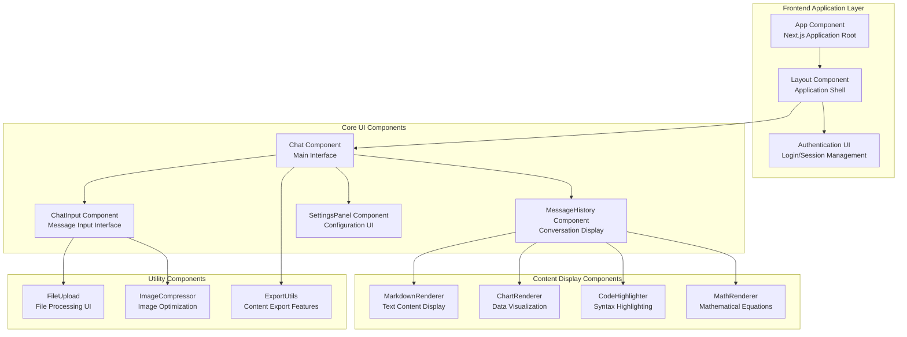
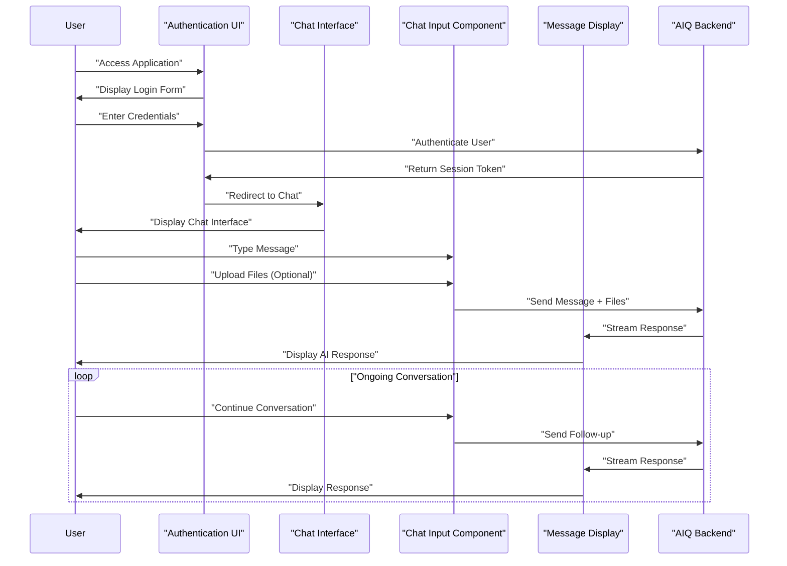
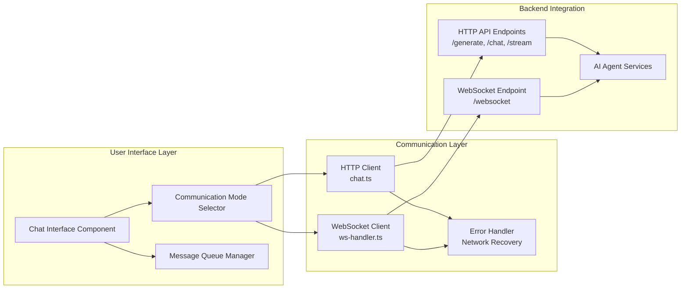
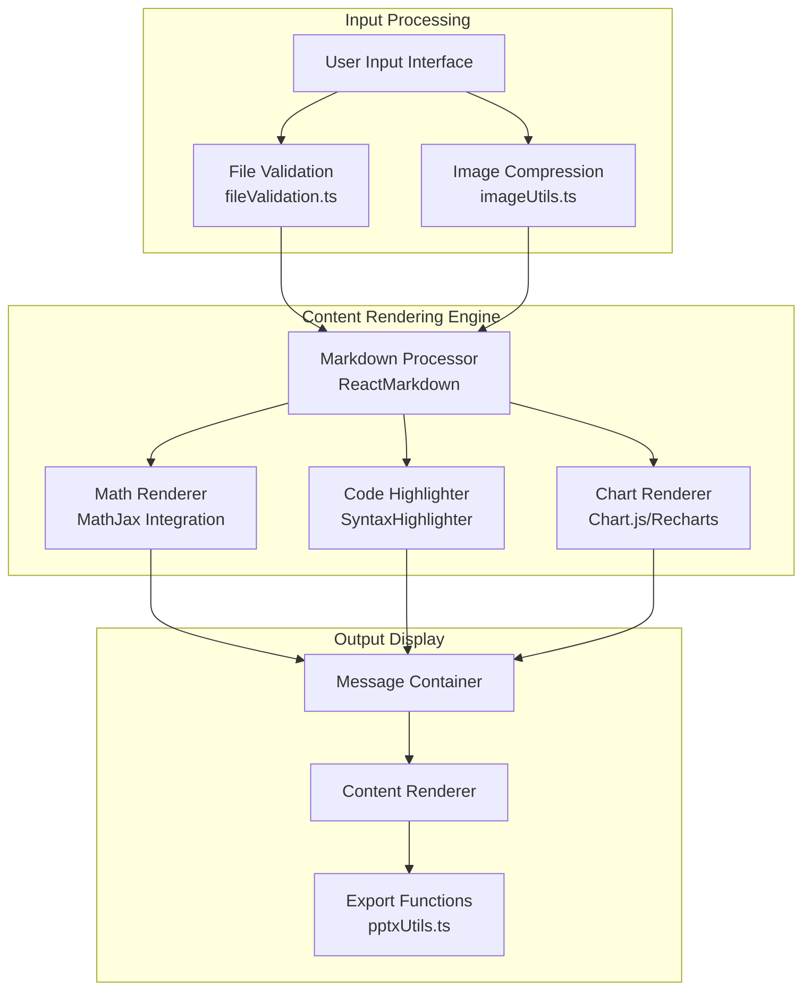

<!-- source: DeepWiki mcp.deepwiki.com · repo NVIDIA/NeMo-Agent-Toolkit-UI · page 3 User Interface · fetched 2026-10-26 -->

# User Interface

Relevant source files

The following files were used as context for generating this wiki page:

- [public/screenshots/ui_generate_example.png](public/screenshots/ui_generate_example.png)
- [public/screenshots/ui_home_page.png](public/screenshots/ui_home_page.png)

This document provides an overview of the user interface architecture and components that make up the AIQ Toolkit-UI frontend application. The UI serves as the primary interaction layer between users and AI agents, providing a chat-based interface for human-in-the-loop workflows and agent communication.

For detailed information about specific chat interface components, see [Chat Interface Components](#3.1). For content rendering mechanisms, see [Content Rendering](#3.2). For human-in-the-loop workflow features, see [Human-in-the-Loop Features](#3.3).

## UI Architecture Overview

The AIQ Toolkit-UI is built as a Next.js React application that provides a modern, responsive web interface for interacting with AI agents and workflows. The architecture follows a component-based design with clear separation between presentation, communication, and data processing layers.

Sources: Based on system architecture diagrams and Next.js application patterns

## Component Hierarchy and Responsibilities

The user interface follows a hierarchical component structure designed for modularity and reusability. Each component has specific responsibilities within the overall user experience.

| Component Level | Component Name | Primary Responsibility | Key Features |
|----------------|----------------|----------------------|--------------|
| Application | `App` | Root application container | Next.js routing, global state |
| Layout | `Layout` | Application shell and navigation | Header, sidebar, main content area |
| Authentication | `AuthPage` | User authentication flow | OAuth integration, session management |
| Chat Interface | `Chat` | Main conversation interface | Message display, input handling |
| Input | `ChatInput` | User message input | Text input, file upload, formatting |
| Display | `MessageHistory` | Conversation history | Message rendering, scrolling |
| Settings | `SettingsPanel` | Configuration interface | Communication mode, preferences |

Sources: Inferred from architectural patterns and component responsibilities

## User Experience Flow

The primary user interaction flow follows a structured pattern from authentication through active conversation with AI agents.

Sources: Based on authentication flow and chat system communication patterns

## Communication Integration

The UI seamlessly integrates with backend services through dual communication protocols, allowing users to choose between HTTP and WebSocket modes based on their needs and network conditions.

Sources: Based on communication protocol architecture and backend integration patterns

## Content Processing Pipeline

The UI incorporates sophisticated content processing capabilities to handle various types of user input and AI-generated output, including text, images, mathematical equations, and structured data.

Sources: Based on content processing pipeline and rendering capabilities

## State Management and Data Flow

The UI implements a unidirectional data flow pattern with centralized state management for conversation history, user preferences, and application configuration.

| State Category | Management Approach | Key Data | Update Triggers |
|---------------|-------------------|----------|----------------|
| Authentication | NextAuth.js session | User credentials, tokens | Login/logout events |
| Conversation | Component state | Message history, current thread | New messages, user actions |
| UI Preferences | Local storage | Theme, language, settings | User configuration changes |
| Communication | Context providers | Connection status, mode | Network events, user selection |
| File Processing | Temporary state | Upload progress, validation | File operations |

Sources: Based on state management patterns and data flow architecture

The user interface serves as the primary touchpoint for users interacting with the AIQ Toolkit system, providing an intuitive and feature-rich environment for AI-powered conversations and workflows. The modular design ensures maintainability while the dual communication protocols provide flexibility for different use cases and network conditions.

---

