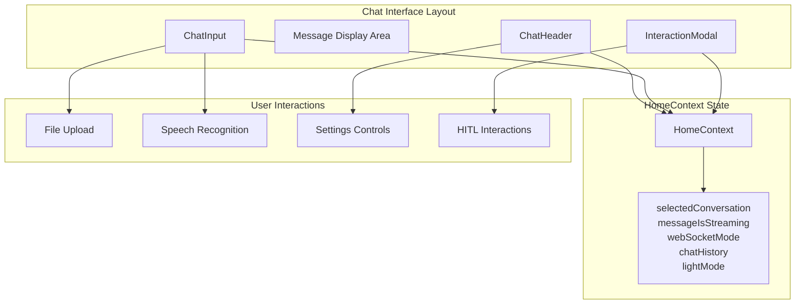
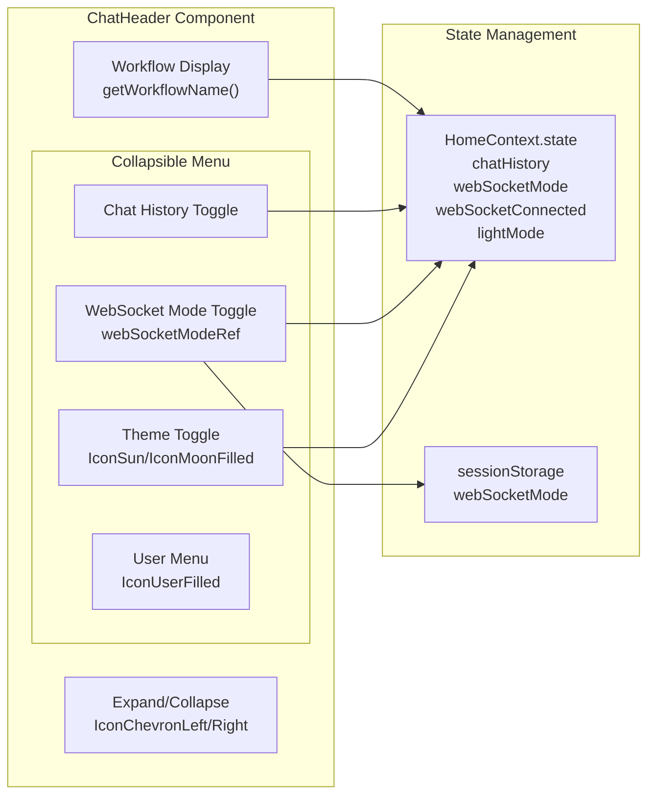
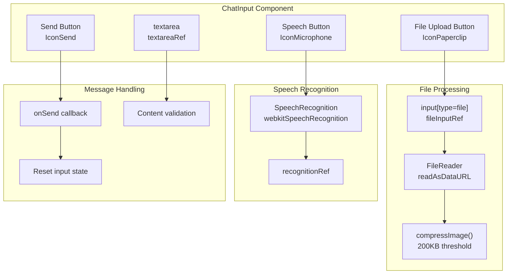
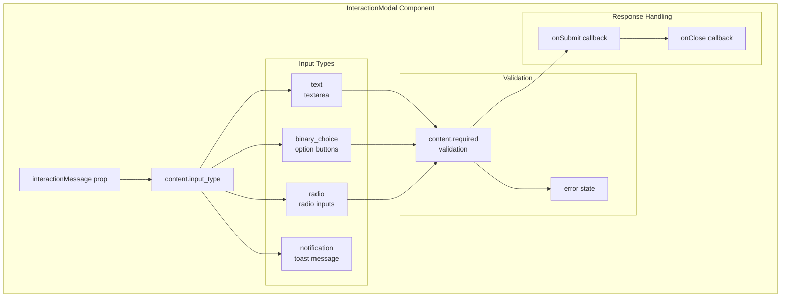
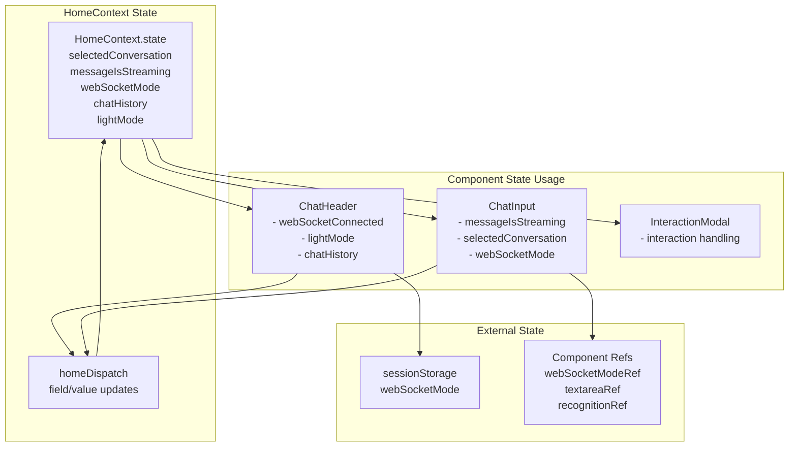
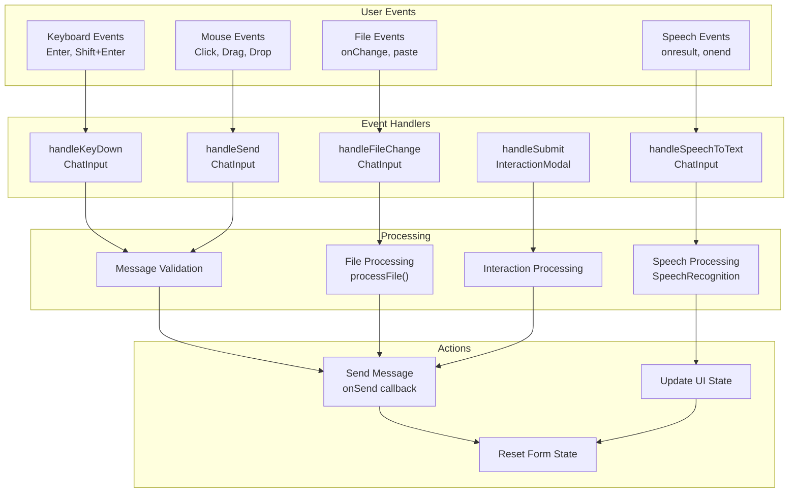

<!-- source: DeepWiki mcp.deepwiki.com · repo NVIDIA/NeMo-Agent-Toolkit-UI · page 3.1 Chat Interface Components · fetched 2026-10-26 -->

# Chat Interface Components

<details>
<summary>Relevant source files</summary>

The following files were used as context for generating this wiki page:

- [components/Chat/ChatHeader.tsx](components/Chat/ChatHeader.tsx)
- [components/Chat/ChatInput.tsx](components/Chat/ChatInput.tsx)
- [components/Chat/ChatInteractionMessage.tsx](components/Chat/ChatInteractionMessage.tsx)

</details>


This document covers the user interface components that make up the chat interface, including the header, input field, and interaction modals. These components handle user input, display workflow information, and provide controls for chat settings and features.

For information about the underlying chat system architecture, see [Chat System](#2.1). For details about content rendering within messages, see [Content Rendering](#3.2). For human-in-the-loop workflow features, see [Human-in-the-Loop Features](#3.3).

## Component Architecture Overview

The chat interface consists of three main components that work together to provide the user experience:

**Chat Interface Component Hierarchy**


Sources: [components/Chat/ChatHeader.tsx:1-180](), [components/Chat/ChatInput.tsx:1-498](), [components/Chat/ChatInteractionMessage.tsx:1-151]()

## Chat Header Component

The `ChatHeader` component provides the top navigation bar with workflow branding and user controls.

**Header Component Structure**


### Key Features

| Feature | Implementation | State Management |
|---------|---------------|------------------|
| Workflow Display | `getWorkflowName()` utility | Read-only display |
| Chat History Toggle | Toggle switch UI | `homeDispatch({field: 'chatHistory', value})` |
| WebSocket Mode | Toggle with connection indicator | `webSocketModeRef` + `sessionStorage` |
| Theme Toggle | Light/Dark mode switcher | `homeDispatch({field: 'lightMode', value})` |
| Menu Expansion | Collapsible right-side menu | Local state `isExpanded` |

The header shows different layouts based on conversation state:
- Empty conversation: Centered greeting with workflow name
- Active conversation: Sticky header with workflow name and controls

Sources: [components/Chat/ChatHeader.tsx:18-180](), [components/Chat/ChatHeader.tsx:54-69]()

## Chat Input Component

The `ChatInput` component handles user message input with support for text, files, and speech-to-text.

**Input Component Architecture**


### Input Modes and Features

| Mode | Trigger | Processing | State Variables |
|------|---------|------------|-----------------|
| Text Input | Keyboard typing | Direct content setting | `content` |
| File Upload | Click/Drag/Paste | `processFile()` function | `inputFile`, `inputFileContent` |
| Speech Input | Microphone button | `SpeechRecognition` API | `isRecording`, `recognitionRef` |

### File Upload Implementation

The component supports multiple file input methods:

```typescript
// File upload handlers
handleFileChange    // File picker
handleDragOver     // Drag and drop
handleDrop         // Drop event
handlePaste        // Clipboard paste
```

File processing includes validation and compression:
- Supports image files only
- 2MB size limit
- Automatic compression for files > 200KB using `compressImage()`

Sources: [components/Chat/ChatInput.tsx:44-51](), [components/Chat/ChatInput.tsx:85-97](), [components/Chat/ChatInput.tsx:190-223]()

## Interaction Modal Component

The `InteractionModal` component handles human-in-the-loop interactions during AI workflows.

**Interaction Modal Flow**


### Interaction Types

| Type | UI Component | Validation | Response Format |
|------|-------------|------------|-----------------|
| `text` | `textarea` | Required field check | `{interactionMessage, userResponse: string}` |
| `binary_choice` | Button group | Required selection | `{interactionMessage, userResponse: option.value}` |
| `radio` | Radio button group | Required selection | `{interactionMessage, userResponse: option.value}` |
| `notification` | Toast message | None | Auto-dismiss |

### Notification Handling

Notifications use the `react-hot-toast` library and are displayed as persistent toasts:

```typescript
toast.custom((t) => (
  <div className="flex gap-2 items-center...">
    <IconInfoCircle size={16} />
    <span>{content?.text}</span>
    <button onClick={() => toast.dismiss(t.id)}>
      <IconX size={12} />
    </button>
  </div>
), {
  position: 'top-right',
  duration: Infinity,
  id: 'notification-toast'
})
```

Sources: [components/Chat/ChatInteractionMessage.tsx:6-151](), [components/Chat/ChatInteractionMessage.tsx:46-66]()

## State Management Integration

All chat interface components integrate with the `HomeContext` for centralized state management.

**State Flow Between Components**


### State Update Patterns

Components follow consistent patterns for state updates:

```typescript
// Dispatch pattern used across components
homeDispatch({
  field: 'fieldName',
  value: newValue
});

// Local state with sessionStorage persistence
sessionStorage.setItem('webSocketMode', String(newValue));
webSocketModeRef.current = newValue;
```

Sources: [components/Chat/ChatHeader.tsx:25-34](), [components/Chat/ChatInput.tsx:54-57](), [components/Chat/ChatHeader.tsx:115-123]()

## Event Handling Flow

The chat interface components handle various user events and coordinate responses.

**Event Processing Flow**


### Key Event Handlers

| Handler | Component | Trigger | Action |
|---------|-----------|---------|---------|
| `handleKeyDown` | ChatInput | Enter key | Validate and send message |
| `handleSend` | ChatInput | Send button click | Process content and attachments |
| `handleFileChange` | ChatInput | File selection | Validate, compress, and store file |
| `handleSpeechToText` | ChatInput | Microphone button | Start/stop speech recognition |
| `handleSubmit` | InteractionModal | Form submission | Process HITL response |

Sources: [components/Chat/ChatInput.tsx:152-159](), [components/Chat/ChatInput.tsx:105-150](), [components/Chat/ChatInput.tsx:326-360](), [components/Chat/ChatInteractionMessage.tsx:14-44]()

---

