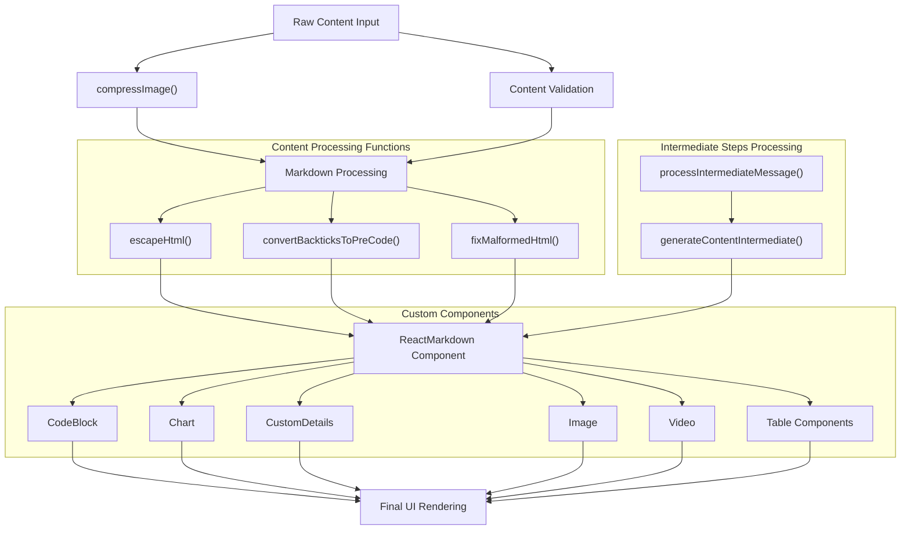
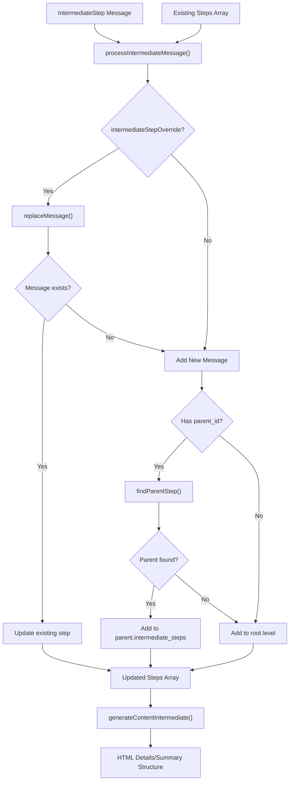
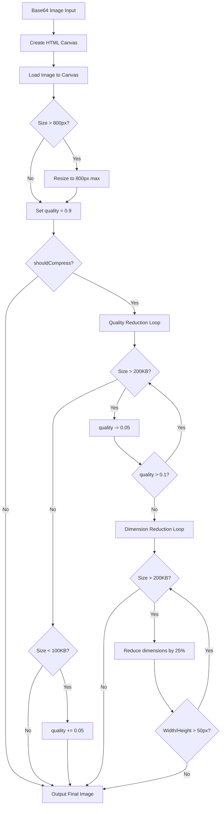

<!-- source: DeepWiki mcp.deepwiki.com · repo NVIDIA/NeMo-Agent-Toolkit-UI · page 3.2 Content Rendering · fetched 2026-10-26 -->

# Content Rendering

<details>
<summary>Relevant source files</summary>

The following files were used as context for generating this wiki page:

- [components/Markdown/CustomComponents.tsx](components/Markdown/CustomComponents.tsx)
- [utils/app/helper.ts](utils/app/helper.ts)

</details>


This document describes the content rendering system in the AIQ Toolkit-UI, which transforms raw content from AI agents into formatted, interactive UI elements. The system handles multiple content types including markdown, code blocks, charts, images, videos, and hierarchical intermediate steps. 

For information about the overall chat interface components, see [Chat Interface Components](#3.1). For details about user interaction patterns and workflows, see [Human-in-the-Loop Features](#3.3).

## Content Processing Pipeline

The content rendering system follows a multi-stage pipeline that processes raw content through various transformations before final display.

**Content Processing Flow**



Sources: [utils/app/helper.ts:10-68](), [utils/app/helper.ts:219-259](), [utils/app/helper.ts:330-364](), [components/Markdown/CustomComponents.tsx:12-108]()

## Markdown Rendering System

The system uses `ReactMarkdown` with custom component overrides to handle specialized content types and maintain consistent styling.

**Custom Component Architecture**

```mermaid
graph TB
    subgraph "getReactMarkDownCustomComponents()"
        MarkdownProcessor["ReactMarkdown Processor"]
        
        subgraph "Text Components"
            CodeComponent["code component"]
            PComponent["p component"] 
            AComponent["a component"]
            SupComponent["sup component"]
            LiComponent["li component"]
        end
        
        subgraph "Media Components"
            ImgComponent["img -> Image"]
            VideoComponent["video -> Video"]
        end
        
        subgraph "Data Components"
            ChartComponent["chart -> Chart"]
            TableComponent["table component"]
            ThComponent["th component"]
            TdComponent["td component"]
        end
        
        subgraph "Interactive Components"
            DetailsComponent["details -> CustomDetails"]
            SummaryComponent["summary -> CustomSummary"]
        end
    end
    
    MarkdownProcessor --> CodeComponent
    MarkdownProcessor --> ChartComponent
    MarkdownProcessor --> ImgComponent
    MarkdownProcessor --> VideoComponent
    MarkdownProcessor --> DetailsComponent
    
    CodeComponent --> CodeBlock["CodeBlock Component"]
    ChartComponent --> ChartRender["Chart Component"]
    ImgComponent --> ImageRender["Image Component"]
    VideoComponent --> VideoRender["Video Component"]
    DetailsComponent --> DetailsRender["CustomDetails Component"]
```



Sources: [components/Markdown/CustomComponents.tsx:12-108]()

### Component Specifications

| Component | Purpose | Key Features |
|-----------|---------|--------------|
| `code` | Code syntax highlighting | Language detection, CodeBlock integration |
| `chart` | Data visualization | JSON payload parsing, Chart component rendering |
| `table`, `th`, `td` | Table formatting | Consistent border styling, responsive design |
| `img` | Image display | Custom Image component with error handling |
| `video` | Video playback | Custom Video component with controls |
| `details`/`summary` | Collapsible content | Interactive expansion for intermediate steps |
| `a` | Link styling | Branded color scheme, hover effects |
| `sup` | Superscript formatting | Citation-style formatting with background |

Sources: [components/Markdown/CustomComponents.tsx:14-106]()

## Intermediate Steps Processing

The system processes hierarchical intermediate steps from AI agents into collapsible HTML structures using a tree-based data model.

**Intermediate Steps Data Flow**



Sources: [utils/app/helper.ts:125-217](), [utils/app/helper.ts:261-306]()

### Intermediate Step Structure

The `IntermediateStep` interface defines the hierarchical data model:

```typescript
interface IntermediateStep {
    id: string;
    parent_id?: string;
    index?: number;
    content?: any;
    intermediate_steps?: IntermediateStep[];
    [key: string]: any;
}
```

The `generateContentIntermediate()` function converts this structure into nested HTML `<details>`/`<summary>` elements for interactive display.

Sources: [utils/app/helper.ts:125-132](), [utils/app/helper.ts:261-306]()

## Image and Media Handling

The system includes robust image compression and media processing capabilities to optimize performance while maintaining quality.

### Image Compression Algorithm

The `compressImage()` function implements a multi-stage compression strategy:

| Stage | Target | Method |
|-------|--------|--------|
| Initial Resize | 800px max dimension | Proportional scaling |
| Quality Reduction | 200KB target size | Iterative quality reduction (0.9 to 0.1) |
| Dimension Reduction | Further size reduction | 75% scaling iterations |
| Quality Recovery | 100KB minimum size | Slight quality increase if over-compressed |

**Compression Flow**



Sources: [utils/app/helper.ts:10-68]()

### Malformed Content Handling

The system includes specific handlers for incomplete or malformed media content:

- `replaceMalformedMarkdownImages()` - Handles incomplete markdown image syntax
- `replaceMalformedHTMLImages()` - Handles incomplete HTML image tags  
- `replaceMalformedHTMLVideos()` - Handles incomplete HTML video tags
- `fixMalformedHtml()` - Orchestrates all malformed content fixes

Sources: [utils/app/helper.ts:308-327](), [utils/app/helper.ts:330-364]()

## HTML Sanitization and Security

Content security is maintained through HTML escaping and malformed markup handling to prevent XSS attacks and display issues.

### Security Processing Functions

| Function | Purpose | Implementation |
|----------|---------|----------------|
| `escapeHtml()` | HTML entity encoding | Escapes `&`, `<`, `>`, `"`, `'` characters |
| `convertBackticksToPreCode()` | Code block conversion | Converts markdown code blocks to HTML `<pre><code>` |
| `fixMalformedHtml()` | Malformed content cleanup | Handles incomplete tags and syntax |

The `escapeHtml()` function provides basic XSS protection by converting potentially dangerous characters to HTML entities:

```typescript
// Character mappings applied by escapeHtml()
& → &amp;
< → &lt;
> → &gt;
" → &quot;
' → &#39;
```

Sources: [utils/app/helper.ts:219-233](), [utils/app/helper.ts:235-259]()

## Chart and Data Visualization

Charts are rendered through a custom `chart` component that parses JSON payloads and renders visualizations using the Chart component.

The chart rendering process:

1. JSON payload extraction from markdown
2. Payload parsing and validation  
3. Chart component instantiation with parsed data
4. Error handling for invalid payloads

```typescript
// Chart component implementation pattern
chart: memo(({ children }) => {
  try {
    const payload = JSON.parse(children[0].replaceAll("\n", ""));
    return payload ? <Chart payload={payload} /> : null;
  } catch (error) {
    console.error(error);
    return null;
  }
})
```

Sources: [components/Markdown/CustomComponents.tsx:37-45]()

---

