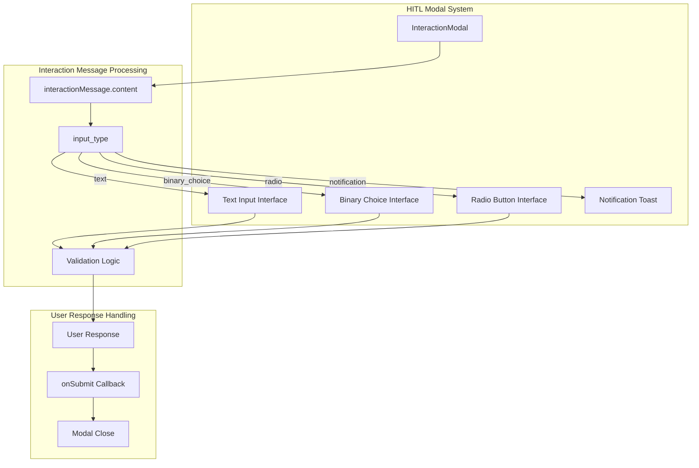
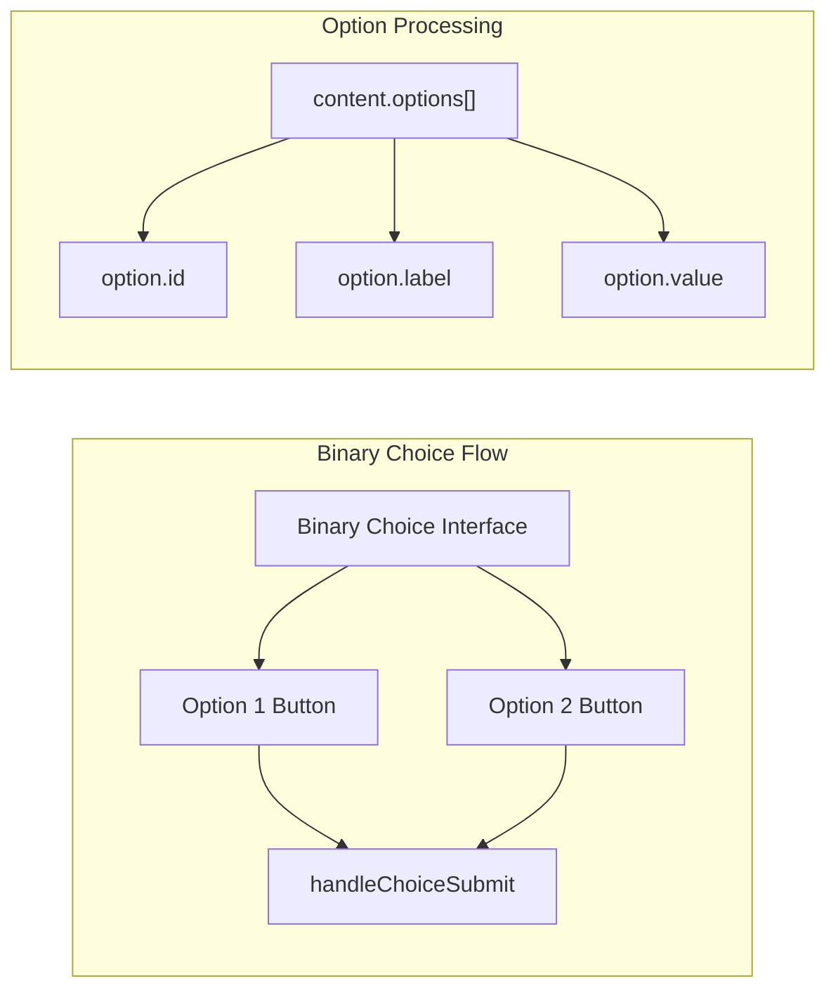
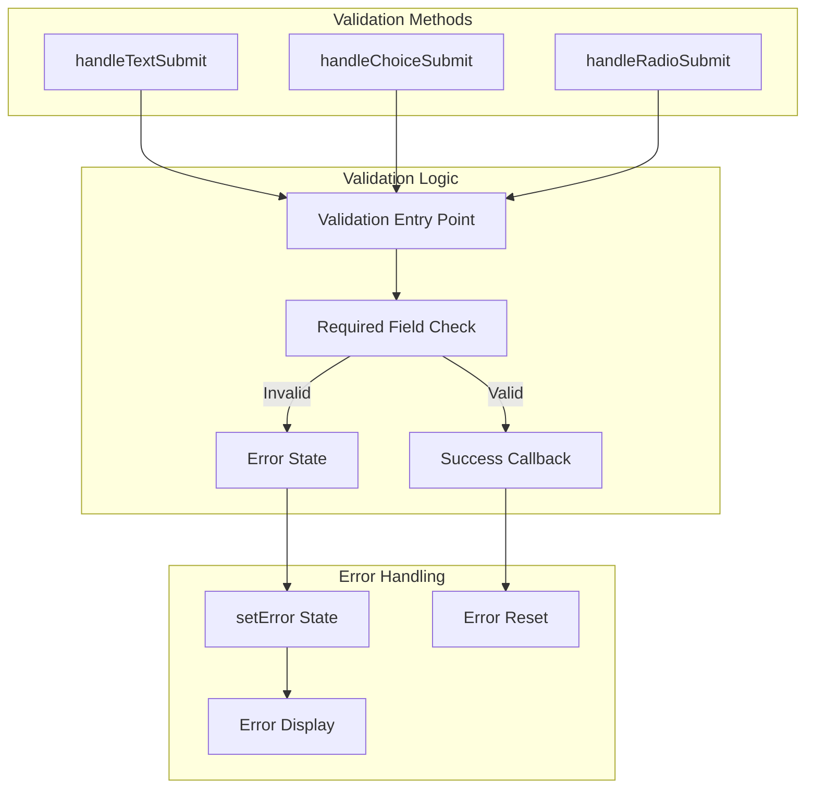
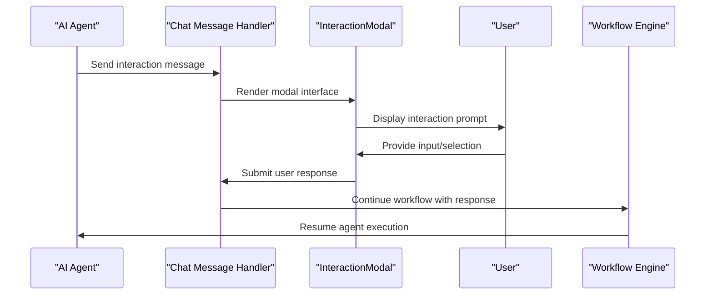

<!-- source: DeepWiki mcp.deepwiki.com · repo NVIDIA/NeMo-Agent-Toolkit-UI · page 3.3 Human-in-the-Loop Features · fetched 2026-10-26 -->

# Human-in-the-Loop Features

Relevant source files

The following files were used as context for generating this wiki page:

- [components/Chat/ChatInteractionMessage.tsx](components/Chat/ChatInteractionMessage.tsx)
- [public/screenshots/hitl_prompt.png](public/screenshots/hitl_prompt.png)
- [public/screenshots/hitl_settings.png](public/screenshots/hitl_settings.png)
- [public/screenshots/ui_generate_example_settings.png](public/screenshots/ui_generate_example_settings.png)

This document covers the Human-in-the-Loop (HITL) functionality that enables AI agents to pause workflows and request user input through interactive modal dialogs. These features allow for dynamic user engagement during AI agent execution, supporting various input types including text entry, binary choices, and radio button selections.

For information about the broader chat interface architecture, see [Chat Interface Components](#3.1). For details on how HITL interactions integrate with backend communication, see [Chat System](#2.1).

## Overview

The HITL system provides a mechanism for AI agents to interrupt their execution flow and solicit user feedback through modal interfaces. This enables more sophisticated workflows where human judgment or additional information is required at specific decision points.

## Interaction Modal System

The core HITL functionality is implemented through the `InteractionModal` component, which renders different types of user interaction interfaces based on the interaction message content.

**Sources:** [components/Chat/ChatInteractionMessage.tsx:1-151]()

## Interaction Types

The HITL system supports four distinct interaction types, each rendered with specific UI components:

### Text Input Interactions

Text input interactions present users with a textarea for free-form text entry. The interface includes placeholder text support and validation for required fields.

| Component | Purpose | Validation |
|-----------|---------|------------|
| `textarea` | Free-form text input | Required field validation |
| `placeholder` | User guidance text | Sourced from `content.placeholder` |
| Error display | Validation feedback | Shows "This field is required." |

### Binary Choice Interactions

Binary choice interactions present two distinct options, typically for yes/no or continue/cancel decisions. Each option is rendered as a button with configurable styling.

### Radio Button Interactions

Radio button interactions allow users to select from multiple mutually exclusive options. Each option includes a label and optional description text.

### Notification Interactions

Notification interactions display informational messages as toast notifications without requiring user input, providing feedback or status updates during workflow execution.

**Sources:** [components/Chat/ChatInteractionMessage.tsx:46-66](), [components/Chat/ChatInteractionMessage.tsx:73-147]()

## Input Validation System

The HITL system implements comprehensive validation for user inputs to ensure data quality and workflow integrity.

The validation system checks for:
- Required field completion for text inputs
- Option selection for binary choices
- Radio button selection for radio interactions

**Sources:** [components/Chat/ChatInteractionMessage.tsx:14-44]()

## Response Processing

When users complete interactions, the system processes responses through a standardized callback mechanism that integrates with the broader chat workflow.

| Function | Purpose | Parameters |
|----------|---------|------------|
| `onSubmit` | Process user response | `{interactionMessage, userResponse}` |
| `onClose` | Close modal interface | None |
| `setUserInput` | Update input state | User input value |
| `setError` | Display validation errors | Error message string |

The response processing ensures that user inputs are properly formatted and transmitted back to the AI agent workflow for continued execution.

## Integration with Chat System

HITL interactions are seamlessly integrated into the chat message flow, appearing as modal overlays that pause the conversation until user input is provided.

This integration allows for dynamic, context-aware user engagement without disrupting the conversational flow of the chat interface.

**Sources:** [components/Chat/ChatInteractionMessage.tsx:6-10](), [components/Chat/ChatInteractionMessage.tsx:20-33]()

## Visual Styling and Accessibility

The modal interfaces implement consistent styling and accessibility features:

- Modal overlay with semi-transparent background (`bg-black bg-opacity-50`)
- Responsive sizing (`sm:w-[75%] md:w-1/3`)
- Semantic color coding (green `#76b900` for primary actions)
- Keyboard navigation support
- Screen reader compatible markup

**Sources:** [components/Chat/ChatInteractionMessage.tsx:69-70](), [components/Chat/ChatInteractionMessage.tsx:86-87]()

---

