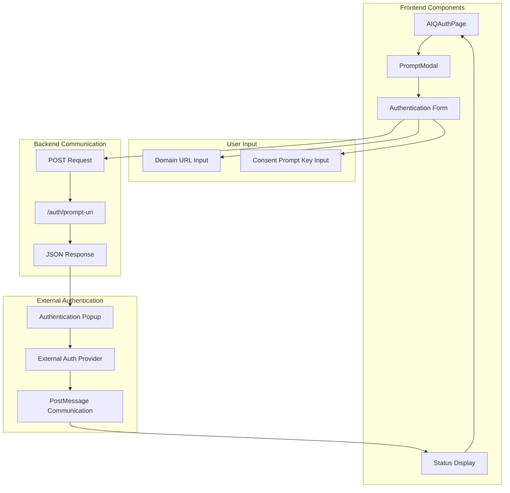
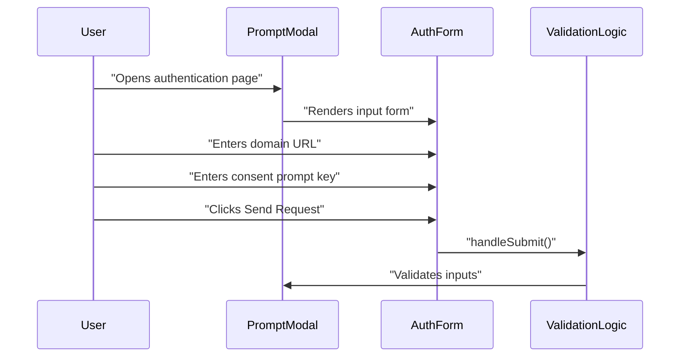
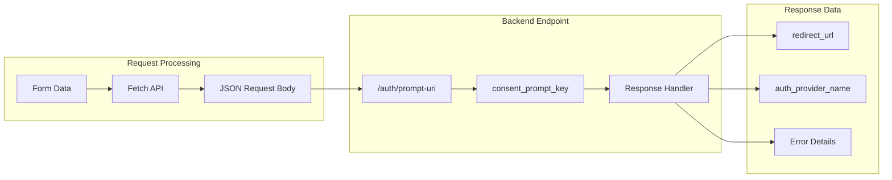
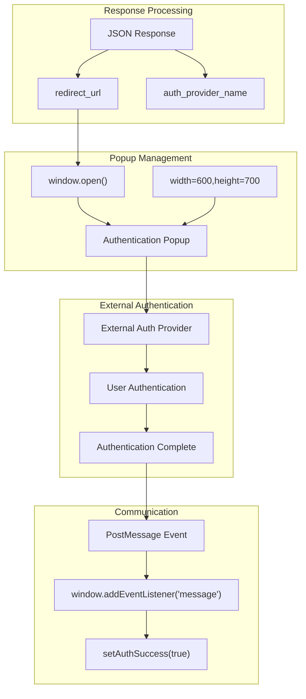
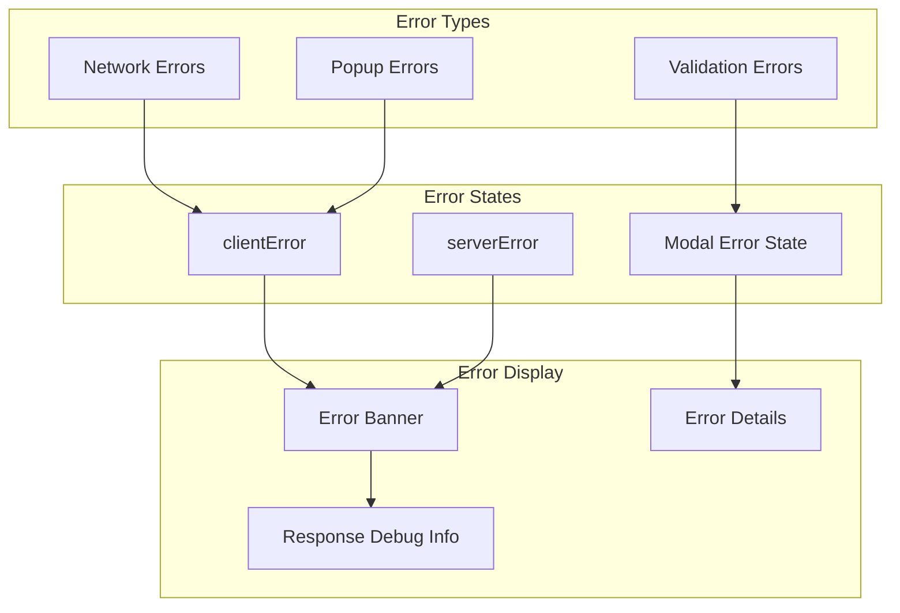
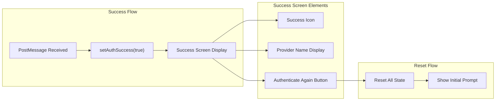

<!-- source: DeepWiki mcp.deepwiki.com · repo NVIDIA/NeMo-Agent-Toolkit-UI · page 4 Authentication · fetched 2026-10-26 -->

# Authentication

<details>
<summary>Relevant source files</summary>

The following files were used as context for generating this wiki page:

- [.gitignore](.gitignore)
- [LICENSE-3rd-party.txt](LICENSE-3rd-party.txt)
- [pages/aiq-auth.tsx](pages/aiq-auth.tsx)

</details>


This document explains the AIQ Toolkit-UI authentication system, including the authentication flow, components, and integration with external authentication providers. The authentication system enables users to authenticate with AIQ Toolkit backend services through a popup-based OAuth-style flow.

For information about the overall chat system architecture, see [Core Architecture](#2). For user interface components, see [User Interface](#3).

## Authentication System Overview

The AIQ Toolkit-UI implements a standalone authentication page that handles user authentication through external providers. The system is designed to work with AIQ Toolkit backend services that require OAuth-style authentication flows.

### Key Components

The authentication system consists of two main React components:

| Component | Purpose | Location |
|-----------|---------|----------|
| `AIQAuthPage` | Main authentication page container | [pages/aiq-auth.tsx:111-254]() |
| `PromptModal` | Modal form for entering authentication details | [pages/aiq-auth.tsx:13-109]() |

### Authentication Flow Architecture



Sources: [pages/aiq-auth.tsx:1-255]()

## Authentication Flow Process

### Step 1: User Input Collection

The authentication process begins with the `PromptModal` component collecting two required pieces of information:

- **Domain URL**: The backend service endpoint (default: `http://localhost:8000`)
- **Consent Prompt Key**: A unique key for the authentication session



Sources: [pages/aiq-auth.tsx:33-67](), [pages/aiq-auth.tsx:19-27]()

### Step 2: Backend Authentication Request

The system makes a POST request to the `/auth/prompt-uri` endpoint with the consent prompt key:



The request structure follows this pattern:
- **Method**: POST
- **Endpoint**: `${domain}/auth/prompt-uri`
- **Headers**: `Content-Type: application/json`
- **Body**: `{"consent_prompt_key": key}`

Sources: [pages/aiq-auth.tsx:150-156](), [pages/aiq-auth.tsx:160-183]()

### Step 3: Popup Window Authentication

Upon successful backend response, the system opens a popup window for external authentication:



Sources: [pages/aiq-auth.tsx:173-182](), [pages/aiq-auth.tsx:122-139]()

## State Management

The `AIQAuthPage` component manages several state variables to control the authentication flow:

| State Variable | Type | Purpose |
|----------------|------|---------|
| `showPrompt` | boolean | Controls modal visibility |
| `isProcessing` | boolean | Indicates request in progress |
| `authSuccess` | boolean | Tracks successful authentication |
| `currentPopup` | Window \| null | Reference to authentication popup |
| `authProviderName` | string \| null | Name of authentication provider |
| `error` | string \| null | Client-side error messages |
| `responseError` | string \| null | Server-side error messages |
| `responseData` | any | Raw response data for debugging |

Sources: [pages/aiq-auth.tsx:112-121]()

## Error Handling

The authentication system implements comprehensive error handling at multiple levels:

### Client-Side Error Handling



### Server Response Error Handling

The system processes different types of server responses:

- **JSON Responses**: Parsed and displayed with detailed error information
- **Non-JSON Responses**: Handled as HTTP status errors
- **Network Failures**: Caught and displayed as client errors

Sources: [pages/aiq-auth.tsx:160-198](), [pages/aiq-auth.tsx:70-91]()

## Success State Management

Upon successful authentication, the system displays a success screen with the following features:

- **Success Icon**: Visual confirmation of successful authentication
- **Provider Name**: Display of the authentication provider used
- **Reset Option**: Button to restart the authentication process



Sources: [pages/aiq-auth.tsx:221-252](), [pages/aiq-auth.tsx:236-248]()

## Integration Points

The authentication system integrates with external services through well-defined interfaces:

### Backend API Integration

- **Endpoint**: `/auth/prompt-uri`
- **Method**: POST
- **Content-Type**: `application/json`
- **Request Body**: `{"consent_prompt_key": string}`

### Response Format

Expected JSON response structure:
```typescript
{
  redirect_url: string,
  auth_provider_name: string
}
```

### Cross-Window Communication

The system uses the `postMessage` API for communication between the main window and the authentication popup, enabling secure cross-origin communication during the OAuth flow.

Sources: [pages/aiq-auth.tsx:150-184](), [pages/aiq-auth.tsx:122-139]()

---

