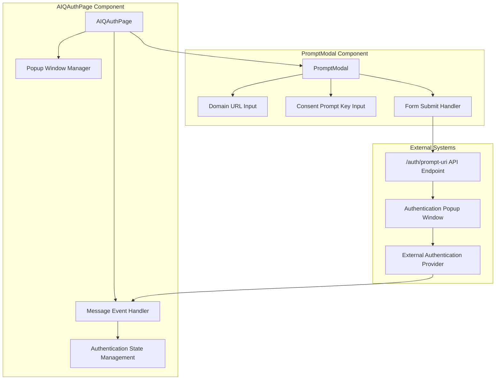
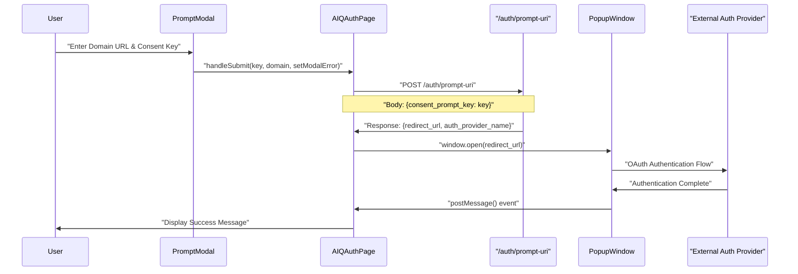
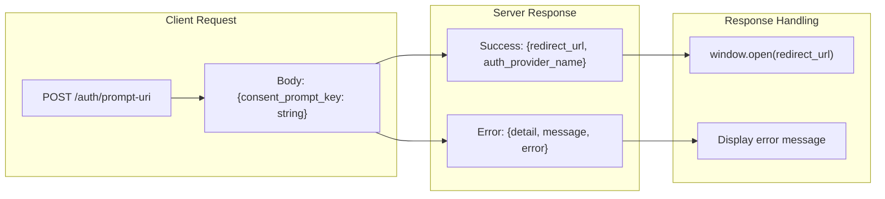
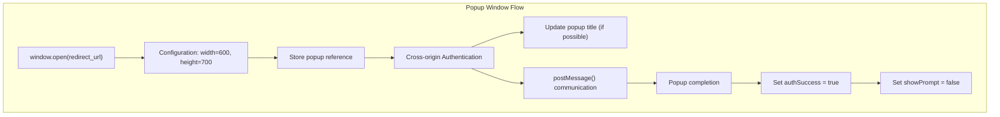

<!-- source: DeepWiki mcp.deepwiki.com · repo NVIDIA/NeMo-Agent-Toolkit-UI · page 4.1 Authentication Flow · fetched 2026-10-26 -->

# Authentication Flow

Relevant source files

The following files were used as context for generating this wiki page:

- [.gitignore](.gitignore)
- [pages/aiq-auth.tsx](pages/aiq-auth.tsx)

This document describes the authentication flow implementation in the AIQ Toolkit-UI, specifically covering the consent-based authentication process that enables users to authenticate with external providers through a popup-based OAuth flow. The authentication system is implemented as a standalone page that handles user consent prompts and external provider integration.

For general authentication concepts and configuration, see [Authentication](#4). For user interface components related to authentication, see [User Interface](#3).

## Overview

The authentication flow in AIQ Toolkit-UI implements a consent-based authentication system that allows users to authenticate with external providers. The system uses a two-step process: first collecting user credentials and domain information, then opening a popup window to complete the OAuth flow with the external authentication provider.

## Authentication Architecture

The authentication system consists of two main React components that work together to handle the complete authentication flow:

**Sources:** [pages/aiq-auth.tsx:111-254]()

## Step-by-Step Authentication Process

The authentication flow follows a structured sequence that handles both user input validation and external provider communication:

**Sources:** [pages/aiq-auth.tsx:141-199](), [pages/aiq-auth.tsx:122-139]()

## Component Implementation Details

### PromptModal Component

The `PromptModal` component handles user input collection and form submission:

| Field | Type | Purpose |
|-------|------|---------|
| `domain` | string | Backend API domain URL |
| `value` | string | Consent prompt key |
| `error` | string | Local validation errors |
| `isSubmitting` | boolean | Form submission state |

Key implementation details:
- Form validation with client-side error handling [pages/aiq-auth.tsx:19-27]()
- Controlled input components for domain and consent key [pages/aiq-auth.tsx:38-61]()
- Error display for both client and server errors [pages/aiq-auth.tsx:62-82]()

**Sources:** [pages/aiq-auth.tsx:4-109]()

### AIQAuthPage Component

The main page component manages the overall authentication state and popup communication:

| State Variable | Type | Purpose |
|----------------|------|---------|
| `showPrompt` | boolean | Controls modal visibility |
| `isProcessing` | boolean | Tracks request processing |
| `authSuccess` | boolean | Authentication completion status |
| `currentPopup` | Window | Reference to auth popup |
| `authProviderName` | string | Name of auth provider |

**Sources:** [pages/aiq-auth.tsx:111-121]()

## API Communication

The authentication system communicates with the backend through a single API endpoint:

The API request implementation handles multiple response scenarios:
- JSON response parsing with content-type validation [pages/aiq-auth.tsx:158-161]()
- Error response handling with detailed error messages [pages/aiq-auth.tsx:163-169]()
- Successful response processing with popup window creation [pages/aiq-auth.tsx:173-183]()

**Sources:** [pages/aiq-auth.tsx:149-199]()

## Popup Window Management

The authentication flow uses a popup window to handle external provider authentication while maintaining security through cross-origin communication:

Key implementation aspects:
- Popup window creation with specific dimensions [pages/aiq-auth.tsx:175-180]()
- Message event listener for cross-origin communication [pages/aiq-auth.tsx:123-139]()
- Popup title update with cross-origin error handling [pages/aiq-auth.tsx:125-130]()

**Sources:** [pages/aiq-auth.tsx:175-180](), [pages/aiq-auth.tsx:122-139]()

## Error Handling Strategy

The authentication system implements comprehensive error handling across multiple layers:

| Error Type | Handling Method | Display Location |
|------------|----------------|------------------|
| Client-side validation | Local state management | PromptModal error section |
| Network errors | Try-catch with error parsing | Modal error display |
| Server errors | Response status checking | Server error section |
| Cross-origin errors | Console logging | Browser console |

Error handling implementation:
- Client error state management [pages/aiq-auth.tsx:114-116]()
- Server error parsing from response [pages/aiq-auth.tsx:164-166]()
- Network exception handling [pages/aiq-auth.tsx:193-196]()

**Sources:** [pages/aiq-auth.tsx:70-82](), [pages/aiq-auth.tsx:193-199]()

## Success State Management

Upon successful authentication, the system displays a confirmation interface:

- Success state rendering with checkmark icon [pages/aiq-auth.tsx:221-252]()
- Provider name display in success message [pages/aiq-auth.tsx:231-233]()
- Option to restart authentication process [pages/aiq-auth.tsx:236-248]()

The success state includes cleanup of authentication data and provides user options for re-authentication.

**Sources:** [pages/aiq-auth.tsx:221-252]()

## Security Considerations

The authentication implementation includes several security measures:

1. **Cross-Origin Communication**: Uses `postMessage()` API for secure popup communication
2. **Input Validation**: Client-side validation of domain URLs and consent keys
3. **Error Information**: Limited error exposure to prevent information leakage
4. **Popup Isolation**: Authentication occurs in isolated popup window

The system avoids storing sensitive authentication data in the main application state, relying on the external provider's secure authentication flow.

**Sources:** [pages/aiq-auth.tsx:122-139](), [pages/aiq-auth.tsx:193-199]()

---

