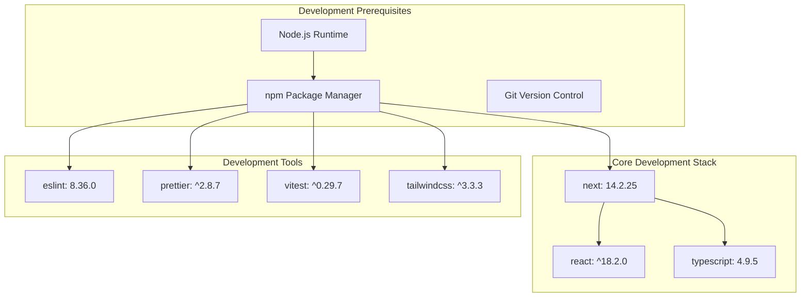
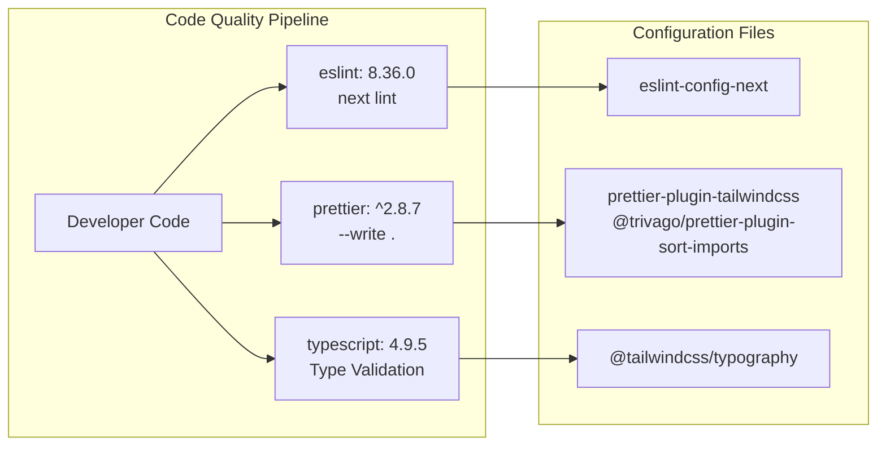
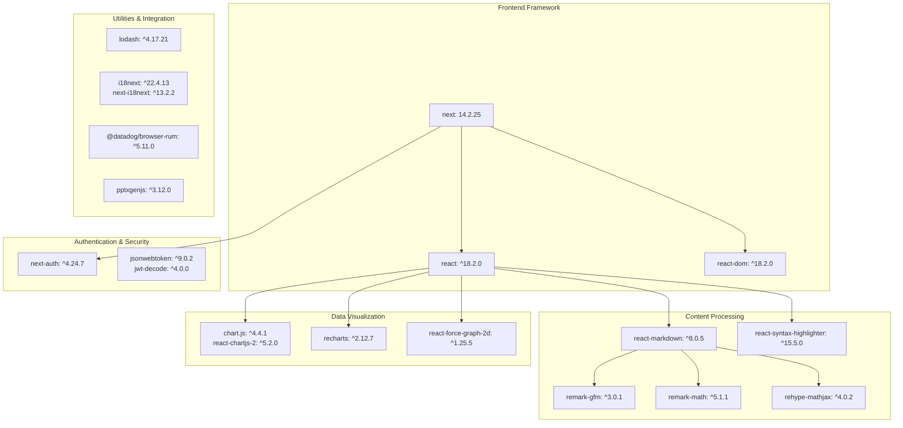
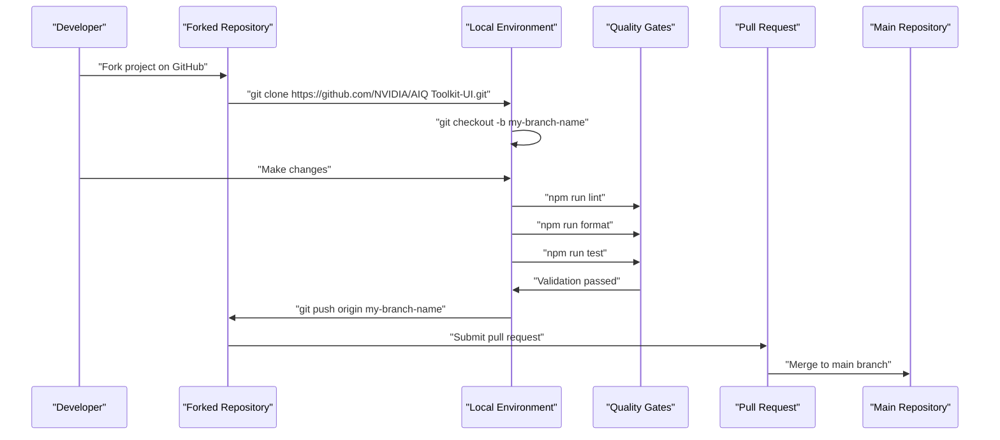
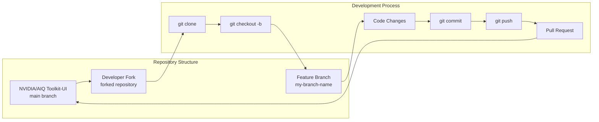
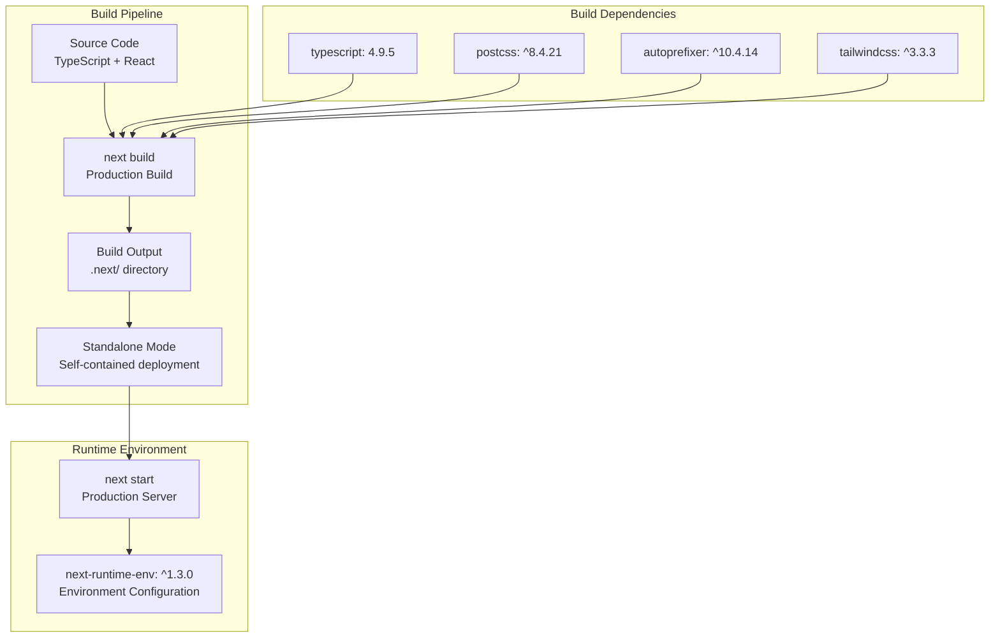

<!-- source: DeepWiki mcp.deepwiki.com · repo NVIDIA/NeMo-Agent-Toolkit-UI · page 5 Development · fetched 2026-10-26 -->

# Development

Relevant source files

The following files were used as context for generating this wiki page:

- [CONTRIBUTING.md](CONTRIBUTING.md)
- [package.json](package.json)

This document provides comprehensive guidance for developers working on the AIQ Toolkit-UI project. It covers development environment setup, coding standards, testing procedures, and deployment processes. For information about the overall system architecture, see [Core Architecture](#2). For authentication-specific development details, see [Authentication](#4).

## Overview

The AIQ Toolkit-UI is a Next.js-based React application that provides a chat interface for AI agents and workflows. The development environment supports TypeScript, modern React patterns, and includes comprehensive tooling for code quality, testing, and deployment.

## Development Environment Setup

### Prerequisites and Installation

The project requires Node.js and npm for package management. The development stack is built around Next.js 14 with React 18 and TypeScript.

**Development Environment Architecture**

Sources: [package.json:1-76]()

### Package Scripts and Development Workflow

The project provides several npm scripts for different development tasks:

| Script | Command | Purpose |
|--------|---------|---------|
| `dev` | `next dev` | Start development server with hot reload |
| `build` | `next build` | Create production build |
| `start` | `next start` | Start production server |
| `lint` | `next lint` | Run ESLint code quality checks |
| `format` | `prettier --write .` | Format code using Prettier |
| `test` | `vitest` | Run test suite |
| `coverage` | `vitest run --coverage` | Generate test coverage report |

Sources: [package.json:5-12]()

## Code Quality and Testing Framework

### Linting and Formatting Pipeline

**Code Quality Enforcement Architecture**

Sources: [package.json:51-75]()

### Testing Infrastructure

The project uses Vitest as the primary testing framework with coverage reporting capabilities:

- **Test Runner**: `vitest: ^0.29.7`
- **Coverage**: `@vitest/coverage-c8: ^0.29.7`
- **DOM Testing**: `jsdom: ^21.1.1` with `@types/jsdom: ^21.1.1`
- **Additional Testing Utilities**: `@mozilla/readability: ^0.4.4`, `endent: ^2.1.0`

Sources: [package.json:52-75]()

## Dependency Management

### Production Dependencies Architecture

**Production Dependencies Hierarchy**

Sources: [package.json:14-49]()

### Key Development Dependencies

| Category | Packages | Purpose |
|----------|----------|---------|
| **Type Definitions** | `@types/node`, `@types/react`, `@types/react-dom`, `@types/uuid` | TypeScript type definitions |
| **Build Tools** | `autoprefixer`, `postcss`, `tailwindcss` | CSS processing and styling |
| **Code Quality** | `eslint-config-next`, `prettier-plugin-tailwindcss` | Linting and formatting |
| **Testing** | `@vitest/coverage-c8`, `jsdom` | Test execution and coverage |

Sources: [package.json:51-75]()

## Contributing Workflow

### Pull Request Process

The project follows a structured contribution workflow as defined in the contributing guidelines:

**Contribution Workflow Sequence**

Sources: [CONTRIBUTING.md:1-42]()

### Contribution Types

The project welcomes the following types of contributions:

- **Bug fixes**: Resolving identified issues
- **New features**: Adding functionality 
- **Documentation improvements**: Enhancing project documentation
- **Code optimizations**: Performance and maintainability improvements
- **Translations**: Internationalization support
- **Tests**: Expanding test coverage

Sources: [CONTRIBUTING.md:9-18]()

### Branch Management

**Git Workflow for Contributions**

Sources: [CONTRIBUTING.md:22-41]()

## Build and Deployment

### Build Process Architecture

The application uses Next.js build system with support for standalone deployment:

**Build and Deployment Architecture**

Sources: [package.json:7-8](), [package.json:74]()

### Development vs Production Modes

| Mode | Command | Purpose | Key Features |
|------|---------|---------|--------------|
| **Development** | `npm run dev` | Local development | Hot reload, source maps, development logging |
| **Production** | `npm run build && npm run start` | Production deployment | Optimized bundles, minification, performance optimizations |

The build process compiles TypeScript, processes CSS through PostCSS and Tailwind, and creates optimized bundles for production deployment.

Sources: [package.json:6-8]()

---

