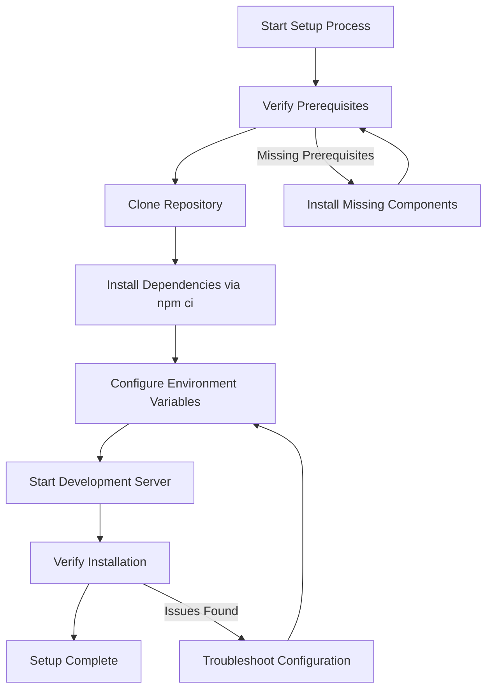
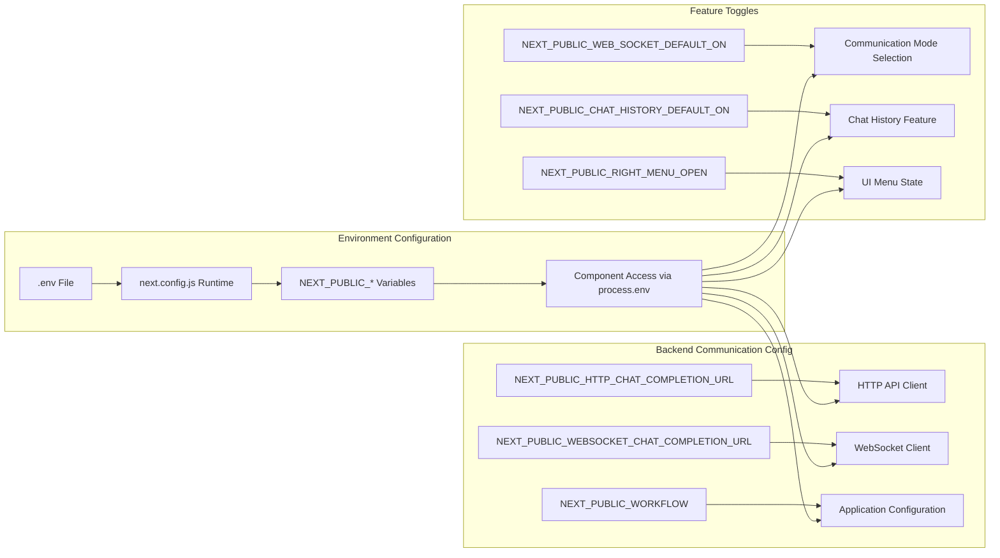

<!-- source: DeepWiki mcp.deepwiki.com · repo NVIDIA/NeMo-Agent-Toolkit-UI · page 5.1 Setup and Installation · fetched 2026-10-26 -->

# Setup and Installation

<details>
<summary>Relevant source files</summary>

The following files were used as context for generating this wiki page:

- [.env](.env)
- [README.md](README.md)
- [package.json](package.json)

</details>


This document provides comprehensive instructions for setting up the AIQ Toolkit-UI development environment. It covers prerequisite requirements, installation procedures, environment configuration, and verification steps needed to run the application locally.

For information about building and deploying the application for production, see [Build and Deployment](#5.3). For details about the contribution workflow, see [Contributing Guidelines](#5.2).

## Prerequisites

The AIQ Toolkit-UI requires specific software dependencies and system configurations to function properly.

### System Requirements

| Component | Version | Purpose |
|-----------|---------|---------|
| Node.js | 18+ | JavaScript runtime for Next.js framework |
| npm | Latest | Package management and script execution |
| Git | Latest | Version control and repository cloning |
| AIQ Toolkit Backend | Latest | Backend service for AI agent communication |

### Backend Service Dependency

The UI application requires a running AIQ Toolkit backend service to function. The backend provides the AI agent workflows and handles both HTTP API requests and WebSocket connections.

#### Setup Process Flow



Sources: [README.md:22-27](), [package.json:1-76]()

## Installation Process

### Repository Setup

Clone the repository and navigate to the project directory:

```bash
git clone git@github.com:NVIDIA/AIQToolkit.git
cd AIQToolkit
```

### Dependency Installation

Install all required dependencies using npm's clean install command:

```bash
npm ci
```

The `npm ci` command ensures reproducible builds by installing dependencies exactly as specified in `package-lock.json`. This is preferred over `npm install` for development setup.

#### Package Installation Architecture

```mermaid
graph TB
    subgraph "Core Framework Dependencies"
        NextJS["next@14.2.25"] --> React["react@18.2.0"]
        NextJS --> ReactDOM["react-dom@18.2.0"]
    end
    
    subgraph "Authentication & Security"
        NextAuth["next-auth@4.24.7"] --> JWT["jsonwebtoken@9.0.2"]
        JWTDecode["jwt-decode@4.0.0"] --> NextAuth
    end
    
    subgraph "Content Processing"
        ReactMarkdown["react-markdown@8.0.5"] --> RemarkGFM["remark-gfm@3.0.1"]
        ReactMarkdown --> RemarkMath["remark-math@5.1.1"]
        ReactMarkdown --> RehypeMathjax["rehype-mathjax@4.0.2"]
        ReactSyntax["react-syntax-highlighter@15.5.0"] --> ReactMarkdown
    end
    
    subgraph "Data Visualization"
        ChartJS["chart.js@4.4.1"] --> ReactChartJS["react-chartjs-2@5.2.0"]
        Recharts["recharts@2.12.7"] --> ChartJS
        ForceGraph["react-force-graph-2d@1.25.5"] --> Recharts
    end
    
    subgraph "Development Tools"
        TypeScript["typescript@4.9.5"] --> ESLint["eslint@8.36.0"]
        Prettier["prettier@2.8.7"] --> TailwindCSS["tailwindcss@3.3.3"]
        Vitest["vitest@0.29.7"] --> TypeScript
    end
```



Sources: [package.json:14-49](), [package.json:51-75]()

## Environment Configuration

### Environment Variables Setup

Create and configure the `.env` file for local development. The application uses several environment variables to control backend communication and feature toggles.

#### Default Configuration Values

| Variable | Default Value | Purpose |
|----------|---------------|---------|
| `NEXT_PUBLIC_WORKFLOW` | `"AIQ Toolkit"` | Workflow identification |
| `NEXT_PUBLIC_WEBSOCKET_CHAT_COMPLETION_URL` | `"ws://127.0.0.1:8000/websocket"` | WebSocket endpoint |
| `NEXT_PUBLIC_HTTP_CHAT_COMPLETION_URL` | `"http://127.0.0.1:8000/chat/stream"` | HTTP API endpoint |
| `NEXT_PUBLIC_WEB_SOCKET_DEFAULT_ON` | `false` | WebSocket mode toggle |
| `NEXT_PUBLIC_CHAT_HISTORY_DEFAULT_ON` | `false` | Chat history feature |
| `NEXT_PUBLIC_RIGHT_MENU_OPEN` | `false` | UI menu state |

#### Configuration Architecture



Sources: [.env:1-6](), [README.md:62-80]()

## Development Server

### Starting the Development Environment

Launch the development server using the npm script:

```bash
npm run dev
```

This command executes `next dev` which starts the Next.js development server with hot reloading enabled. The application will be accessible at `http://localhost:3000`.

### Available Development Scripts

The `package.json` defines several scripts for development workflow:

| Script | Command | Purpose |
|--------|---------|---------|
| `dev` | `next dev` | Start development server with hot reload |
| `build` | `next build` | Create production build |
| `start` | `next start` | Start production server |
| `lint` | `next lint` | Run ESLint code quality checks |
| `format` | `prettier --write .` | Format code with Prettier |
| `test` | `vitest` | Run test suite |
| `coverage` | `vitest run --coverage` | Generate test coverage report |

Sources: [package.json:5-12](), [README.md:43-47]()

## Verification and Testing

### Installation Verification

After completing the setup, verify the installation by checking these components:

1. **Development Server Access**: Navigate to `http://localhost:3000` and confirm the UI loads
2. **Backend Connectivity**: Verify the AIQ Toolkit backend is running and accessible
3. **WebSocket Connection**: Test WebSocket communication if enabled
4. **Environment Variables**: Confirm all required environment variables are set

### Development Tools Verification

Run the development tools to ensure proper setup:

```bash
# Check code formatting
npm run format

# Run linting checks  
npm run lint

# Execute test suite
npm run test
```

### Troubleshooting Common Issues

| Issue | Symptom | Solution |
|-------|---------|----------|
| Port 3000 in use | `EADDRINUSE` error | Change port with `PORT=3001 npm run dev` |
| Backend connection failed | API request errors | Verify AIQ Toolkit backend is running |
| Environment variables missing | Configuration errors | Check `.env` file exists and contains required variables |
| Dependency conflicts | Build/runtime errors | Delete `node_modules` and run `npm ci` again |

Sources: [README.md:43-58](), [package.json:5-12]()

## Docker Development Setup

### Docker Container Configuration

For containerized development, the application supports Docker deployment with environment variable injection:

```bash
# Build Docker image
docker build -t AIQ Toolkit-UI .

# Run with environment file
docker run --env-file .env -p 3000:3000 AIQ Toolkit-UI
```

The Docker setup allows for consistent development environments across different systems and simplified deployment workflows.

Sources: [README.md:49-58]()

---

