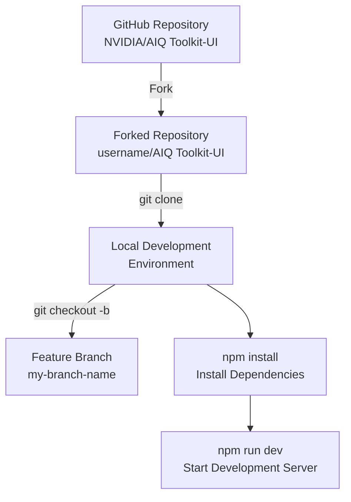
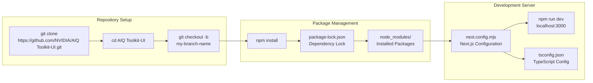
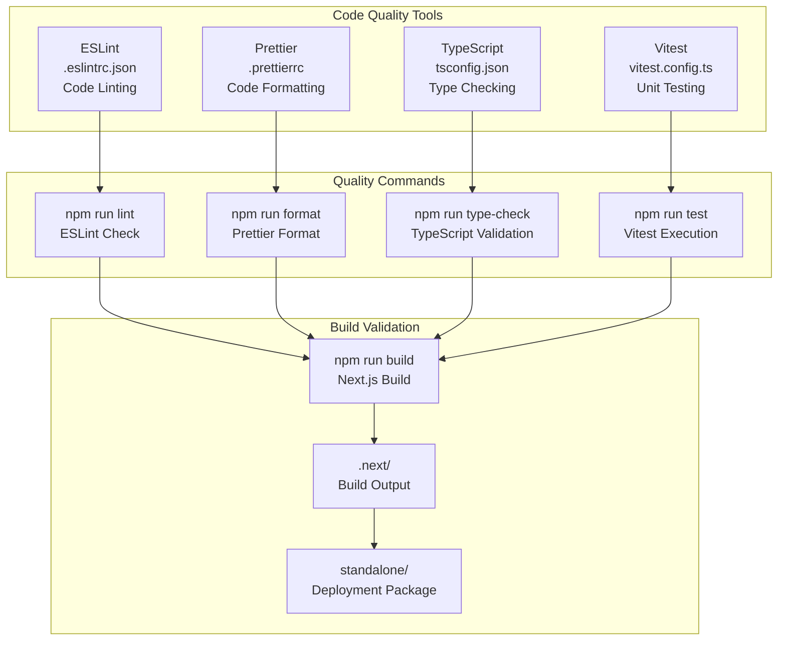
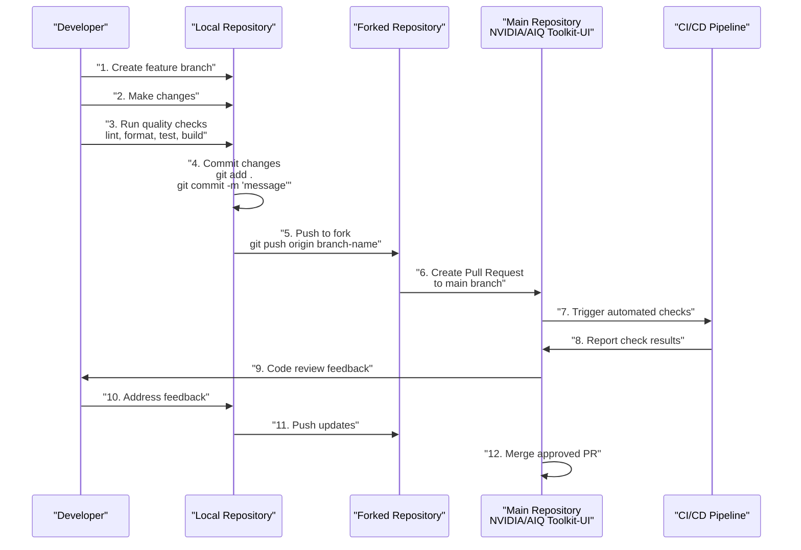
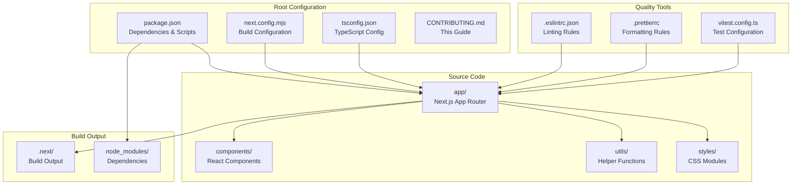

<!-- source: DeepWiki mcp.deepwiki.com · repo NVIDIA/NeMo-Agent-Toolkit-UI · page 5.2 Contributing Guidelines · fetched 2026-10-26 -->

# Contributing Guidelines

Relevant source files

The following files were used as context for generating this wiki page:

- [CONTRIBUTING.md](CONTRIBUTING.md)
- [package-lock.json](package-lock.json)

This document outlines the process for contributing code to the AIQ Toolkit-UI project, including development setup, code quality requirements, and pull request workflow. For information about setting up the development environment, see [Setup and Installation](#5.1). For build and deployment processes, see [Build and Deployment](#5.3).

## Purpose and Scope

This guide covers the complete contribution workflow from initial project setup through pull request submission. It documents the specific tools, processes, and quality gates required for contributing to the AIQ Toolkit-UI codebase.

## Contribution Types

The project welcomes several types of contributions as outlined in [CONTRIBUTING.md:11-18]():

| Contribution Type | Description | Primary Focus Areas |
|------------------|-------------|-------------------|
| Bug fixes | Resolving issues in existing functionality | Chat interface, authentication, content rendering |
| New features | Adding new capabilities | UI components, communication protocols, utility functions |
| Documentation improvements | Enhancing code documentation and wikis | API documentation, setup guides, architecture docs |
| Code optimizations | Performance and efficiency improvements | Bundle size, rendering performance, memory usage |
| Translations | Internationalization support | i18next configuration, locale files |
| Tests | Adding or improving test coverage | Vitest test suites, component testing |

Sources: [CONTRIBUTING.md:11-18]()

## Development Workflow

### Fork and Clone Process

The contribution process begins with forking the repository and setting up a local development environment as specified in [CONTRIBUTING.md:22-28]():

**Development Workflow with Code Entities**

Sources: [CONTRIBUTING.md:22-28]()

## Code Quality Requirements

### Quality Gates and Tools

Before submitting contributions, code must pass several automated quality gates as mentioned in [CONTRIBUTING.md:30]():

Sources: [CONTRIBUTING.md:30]()

### Configuration Files

The project uses several configuration files that contributors should be aware of:

| Configuration File | Purpose | Key Settings |
|-------------------|---------|--------------|
| `package.json` | Dependencies and scripts | ESLint, Prettier, TypeScript, Vitest configurations |
| `next.config.mjs` | Next.js build configuration | Output mode, experimental features |
| `tsconfig.json` | TypeScript compiler settings | Strict mode, module resolution |
| `vitest.config.ts` | Testing framework configuration | Test environment, coverage settings |
| `.eslintrc.json` | ESLint rules and plugins | Code quality rules, React hooks |
| `.prettierrc` | Code formatting rules | Indentation, quotes, line endings |

## Pull Request Process

### Complete PR Workflow

The pull request process follows the steps outlined in [CONTRIBUTING.md:32-41]():

### Pre-submission Checklist

Before submitting a pull request, ensure the following requirements are met:

- [ ] Code passes `npm run lint` without errors
- [ ] Code is formatted with `npm run format`
- [ ] TypeScript compilation succeeds with `npm run type-check`
- [ ] All tests pass with `npm run test`
- [ ] Application builds successfully with `npm run build`
- [ ] Changes are committed with descriptive commit messages
- [ ] Feature branch is up-to-date with main branch

Sources: [CONTRIBUTING.md:32-41]()

## File Structure for Contributors

### Key Files and Directories

Contributors should familiarize themselves with the project structure:

Sources: [CONTRIBUTING.md:1-42]()

## Development Commands Reference

| Command | Purpose | Configuration File |
|---------|---------|-------------------|
| `npm install` | Install dependencies | `package.json`, `package-lock.json` |
| `npm run dev` | Start development server | `next.config.mjs` |
| `npm run build` | Build for production | `next.config.mjs` |
| `npm run start` | Start production server | `next.config.mjs` |
| `npm run lint` | Run ESLint checks | `.eslintrc.json` |
| `npm run format` | Format code with Prettier | `.prettierrc` |
| `npm run type-check` | Validate TypeScript | `tsconfig.json` |
| `npm run test` | Run unit tests | `vitest.config.ts` |

This comprehensive guide ensures that all contributions maintain the project's code quality standards and follow consistent development practices.

---

