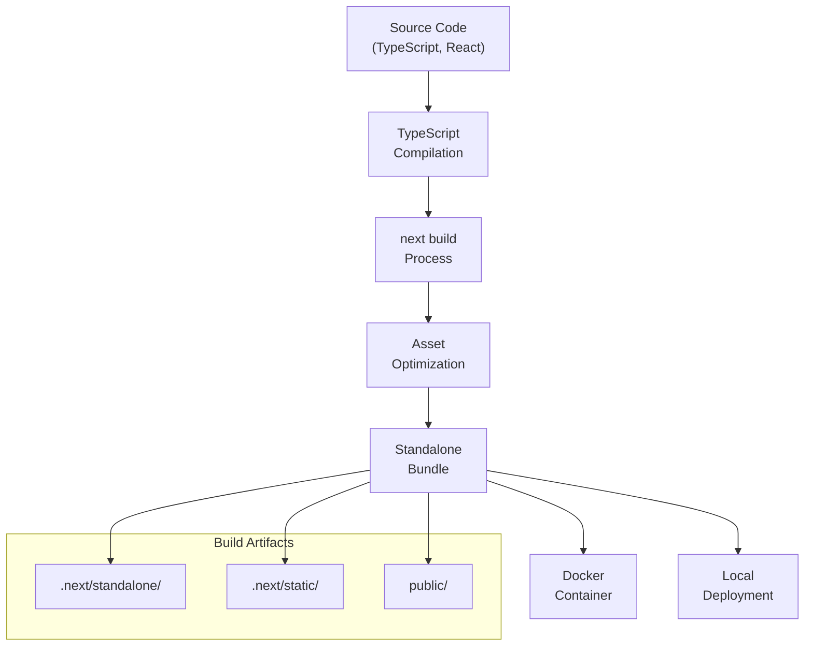
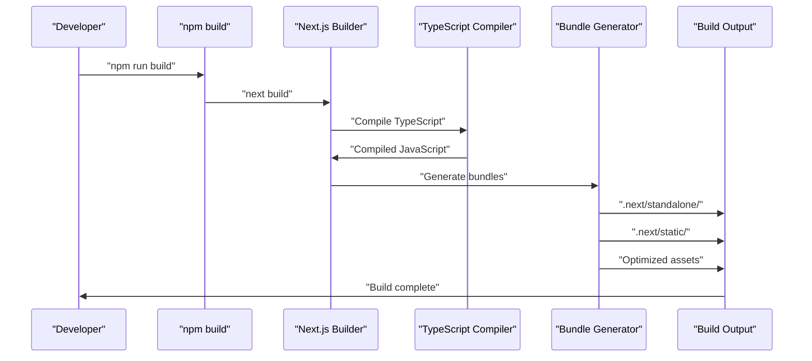
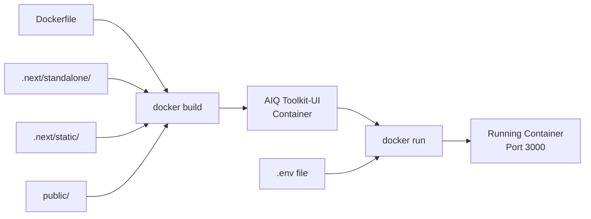

<!-- source: DeepWiki mcp.deepwiki.com · repo NVIDIA/NeMo-Agent-Toolkit-UI · page 5.3 Build and Deployment · fetched 2026-10-26 -->

# Build and Deployment

<details>
<summary>Relevant source files</summary>

The following files were used as context for generating this wiki page:

- [README.md](README.md)
- [next.config.js](next.config.js)
- [package.json](package.json)

</details>


This document covers the build and deployment process for the AIQ Toolkit-UI application. It explains how to create production builds, configure deployment settings, and deploy the application using various methods including Docker containerization.

For development environment setup, see [Setup and Installation](#5.1). For contributing and development workflow, see [Contributing Guidelines](#5.2).

## Build System Overview

The AIQ Toolkit-UI uses Next.js as its build system with a standalone output configuration optimized for containerized deployments. The build process compiles TypeScript, optimizes assets, and creates a self-contained application bundle.

### Build Pipeline Flow



**Sources:** [package.json:7](), [next.config.js:7]()

## Build Configuration

### Next.js Configuration

The application is configured for standalone deployment mode, which creates a self-contained server that includes all necessary dependencies.

Key configuration settings in `next.config.js`:

| Setting | Value | Purpose |
|---------|-------|---------|
| `output` | `'standalone'` | Creates self-contained deployment bundle |
| `typescript.ignoreBuildErrors` | `true` | Allows builds with TypeScript errors |
| `serverActions.bodySizeLimit` | `'5mb'` | Supports larger file uploads |
| `experiments.asyncWebAssembly` | `true` | Enables WebAssembly support |

**Sources:** [next.config.js:7, 13, 17, 22]()

### Environment Configuration

The build system uses `next-runtime-env` for runtime environment variable configuration, allowing environment variables to be set at container runtime rather than build time.

**Sources:** [next.config.js:1, 5](), [package.json:74]()

## Build Scripts and Commands

### Available Build Commands

The following npm scripts are available for building and running the application:

```bash
# Development server
npm run dev

# Production build
npm run build  

# Start production server
npm run start

# Code quality checks
npm run lint
npm run format

# Testing
npm run test
npm run coverage
```

**Sources:** [package.json:5-12]()

### Build Process Details



**Sources:** [package.json:7](), [next.config.js:7]()

## Deployment Options

### Local Production Deployment

For local production deployment, build and start the application:

```bash
npm run build
npm run start
```

The application will be available at `http://localhost:3000`.

**Sources:** [README.md:44-47]()

### Docker Deployment

#### Docker Build Process



**Sources:** [README.md:49-58]()

#### Docker Commands

Build the Docker image:
```bash
docker build -t AIQ Toolkit-UI .
```

Run the container with environment variables:
```bash
docker run --env-file .env -p 3000:3000 AIQ Toolkit-UI
```

Run without environment file (using defaults):
```bash
docker run -p 3000:3000 AIQ Toolkit-UI
```

**Sources:** [README.md:51-57]()

## Build Artifacts and Output Structure

### Standalone Mode Output

The standalone build mode creates a self-contained application structure:

```
.next/
├── standalone/           # Self-contained server and dependencies
│   ├── server.js        # Production server entry point
│   ├── package.json     # Runtime dependencies
│   └── node_modules/    # Required dependencies
├── static/              # Static assets with hashing
│   ├── css/            # Compiled stylesheets
│   ├── js/             # JavaScript bundles
│   └── media/          # Media assets
└── build-manifest.json  # Build metadata
```

**Sources:** [next.config.js:7]()

### Asset Optimization

The build process includes several optimization steps:

- **JavaScript bundling** with code splitting
- **CSS optimization** and minification  
- **Image optimization** for supported formats
- **Static asset hashing** for cache invalidation
- **Tree shaking** to remove unused code

**Sources:** [next.config.js:20-27]()

## Production Considerations

### TypeScript Error Handling

The build configuration allows production builds to complete even with TypeScript errors (`ignoreBuildErrors: true`). This setting should be used cautiously in production environments.

**Sources:** [next.config.js:13]()

### WebAssembly Support

The build system includes experimental WebAssembly support for advanced processing capabilities:

```javascript
config.experiments = {
  asyncWebAssembly: true,
  layers: true,
};
```

**Sources:** [next.config.js:21-24]()

### Server Actions Configuration

The build supports large file uploads through server actions with a 5MB body size limit, enabling image and document processing features.

**Sources:** [next.config.js:16-18]()