# Page: Overview

# Overview

<details>
<summary>Relevant source files</summary>

The following files were used as context for generating this wiki page:

- [README.md](README.md)
- [package.json](package.json)

</details>


## Purpose and Scope

The AIQ Toolkit-UI is a Next.js-based web application that provides a chat interface for interacting with AI agents and workflows built using the AIQ Toolkit backend. This document covers the frontend application architecture, communication protocols, and key components that enable real-time conversations with AI agents through both HTTP APIs and WebSocket connections.

This overview focuses on the frontend user interface system. For detailed information about backend AI agent implementation, see the AIQ Toolkit main documentation. For specific chat interface components, see [Chat Interface Components](#3.1). For authentication details, see [Authentication](#4).

## System Architecture

The AIQ Toolkit-UI follows a modern React/Next.js architecture with dual communication modes for backend integration:

### High-Level System Architecture

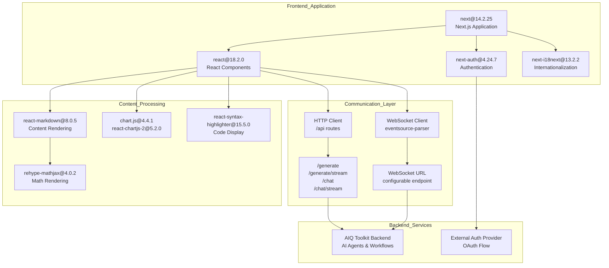

Sources: [package.json:1-76](), [README.md:1-110]()

### Technology Stack Overview

The application is built on a comprehensive technology stack optimized for real-time chat interactions:

| Category | Technologies | Purpose |
|----------|-------------|---------|
| **Core Framework** | `next@14.2.25`, `react@18.2.0`, `typescript@4.9.5` | Application foundation |
| **Authentication** | `next-auth@4.24.7`, `jsonwebtoken@9.0.2`, `jwt-decode@4.0.0` | User authentication and session management |
| **Content Rendering** | `react-markdown@8.0.5`, `rehype-mathjax@4.0.2`, `react-syntax-highlighter@15.5.0` | Rich content display |
| **Data Visualization** | `chart.js@4.4.1`, `react-chartjs-2@5.2.0`, `recharts@2.12.7` | Charts and graphs |
| **Communication** | `eventsource-parser@0.1.0`, Built-in fetch API | HTTP and WebSocket communication |
| **Utilities** | `lodash@4.17.21`, `uuid@9.0.1`, `file-saver@2.0.5` | Helper functions and file processing |

Sources: [package.json:14-49]()

## Communication Architecture

The application supports dual communication modes with the AIQ Toolkit backend:

### API Communication Flow

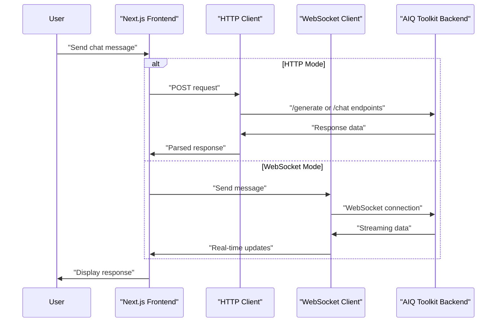

### Endpoint Configuration

The application connects to the AIQ Toolkit backend through configurable endpoints:

| Endpoint | Purpose | Response Type |
|----------|---------|---------------|
| `/generate` | Single response generation | JSON response |
| `/generate/stream` | Streaming response generation | Server-sent events |
| `/chat` | Single response chat completion | JSON response |
| `/chat/stream` | Streaming chat completion | Server-sent events |
| WebSocket URL | Real-time bi-directional communication | WebSocket messages |

Sources: [README.md:70-79]()

## Key Application Components

The application architecture maps to specific code entities and file structures:

### Core Application Structure

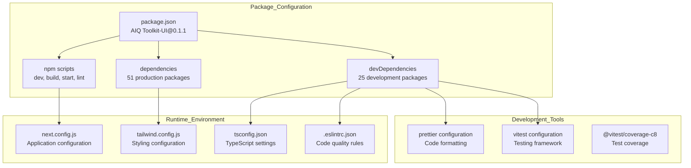

Sources: [package.json:1-76]()

## Features Overview

The AIQ Toolkit-UI provides comprehensive chat interface capabilities:

### Core Features

- **Modern Responsive UI**: Built with React 18 and Next.js 14 for optimal performance
- **Real-time Streaming**: Support for streaming responses via Server-Sent Events
- **Dual Communication**: HTTP REST API and WebSocket protocol support
- **Human-in-the-Loop**: Interactive workflow support for agent collaboration
- **Theme Support**: Light/Dark theme switching capability
- **Content Rendering**: Rich markdown, mathematical equations, and code syntax highlighting
- **Data Visualization**: Charts and graphs rendering with Chart.js and Recharts
- **Authentication**: Secure user authentication with NextAuth.js
- **Internationalization**: Multi-language support via i18next
- **Docker Support**: Containerized deployment capability

### Technical Capabilities

- **File Processing**: Image compression and file handling utilities
- **Content Processing**: HTML sanitization and XSS prevention
- **Export Features**: PowerPoint generation via `pptxgenjs@3.12.0`
- **Monitoring**: DataDog RUM integration for performance tracking
- **Network Visualization**: Force graph rendering for complex data relationships

Sources: [README.md:12-18](), [package.json:14-49]()

## Development and Deployment

The application supports multiple deployment modes:

### Development Commands

| Command | Purpose |
|---------|---------|
| `npm run dev` | Start development server |
| `npm run build` | Build production bundle |
| `npm run start` | Start production server |
| `npm run lint` | Run ESLint checks |
| `npm run format` | Format code with Prettier |
| `npm run test` | Run Vitest test suite |
| `npm run coverage` | Generate test coverage report |

### Deployment Options

1. **Local Development**: `npm run dev` - Available at `http://localhost:3000`
2. **Docker Deployment**: Container-based deployment with environment variable support
3. **Production Build**: Next.js standalone mode for optimized performance

Sources: [package.json:5-12](), [README.md:41-58]()

---

# Page: Project Structure

# Project Structure

<details>
<summary>Relevant source files</summary>

The following files were used as context for generating this wiki page:

- [LICENSE-3rd-party.txt](LICENSE-3rd-party.txt)
- [package-lock.json](package-lock.json)
- [package.json](package.json)

</details>


This document provides a comprehensive overview of the AIQ Toolkit-UI project structure, including its technology stack, dependencies, and architectural organization. It covers the foundational elements that enable the chat interface functionality and integration with AI agents and workflows.

For information about specific chat system implementation details, see [Chat System](#2.1). For authentication mechanisms, see [Authentication Flow](#4.1). For development setup procedures, see [Setup and Installation](#5.1).

## Technology Stack Overview

The AIQ Toolkit-UI is built as a modern React application using Next.js 14.2.25 as the primary framework. The application leverages a comprehensive set of libraries to provide chat functionality, content rendering, data visualization, and authentication capabilities.

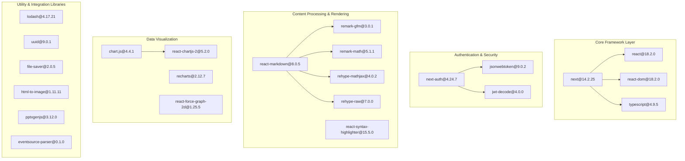

**Sources:** [package.json:1-76]()

## Primary Dependencies Analysis

The project's dependencies can be categorized into several functional groups that support the core chat interface and AI workflow integration capabilities.

| Category | Key Dependencies | Purpose |
|----------|------------------|---------|
| **Core Framework** | `next@14.2.25`, `react@18.2.0`, `typescript@4.9.5` | Base application framework and type safety |
| **Authentication** | `next-auth@4.24.7`, `jsonwebtoken@9.0.2`, `jwt-decode@4.0.0` | User authentication and session management |
| **Content Rendering** | `react-markdown@8.0.5`, `remark-gfm@3.0.1`, `rehype-mathjax@4.0.2` | Markdown processing and mathematical equation rendering |
| **Data Visualization** | `chart.js@4.4.1`, `recharts@2.12.7`, `react-force-graph-2d@1.25.5` | Chart generation and network graph visualization |
| **UI Components** | `@radix-ui/react-select@2.1.2`, `@tabler/icons-react@2.9.0`, `lucide-react@0.454.0` | User interface components and iconography |
| **Real-time Communication** | `eventsource-parser@0.1.0`, `react-query@3.39.3` | WebSocket and HTTP streaming support |
| **Internationalization** | `i18next@22.4.13`, `next-i18next@13.2.2`, `react-i18next@12.2.0` | Multi-language support |
| **File Processing** | `file-saver@2.0.5`, `html-to-image@1.11.11`, `pptxgenjs@3.12.0` | Export and file manipulation capabilities |
| **Monitoring** | `@datadog/browser-rum@5.11.0` | Real user monitoring and analytics |

**Sources:** [package.json:14-49](), [LICENSE-3rd-party.txt:15-50]()

## Development Toolchain

The project employs a comprehensive development toolchain focused on code quality, testing, and build optimization.

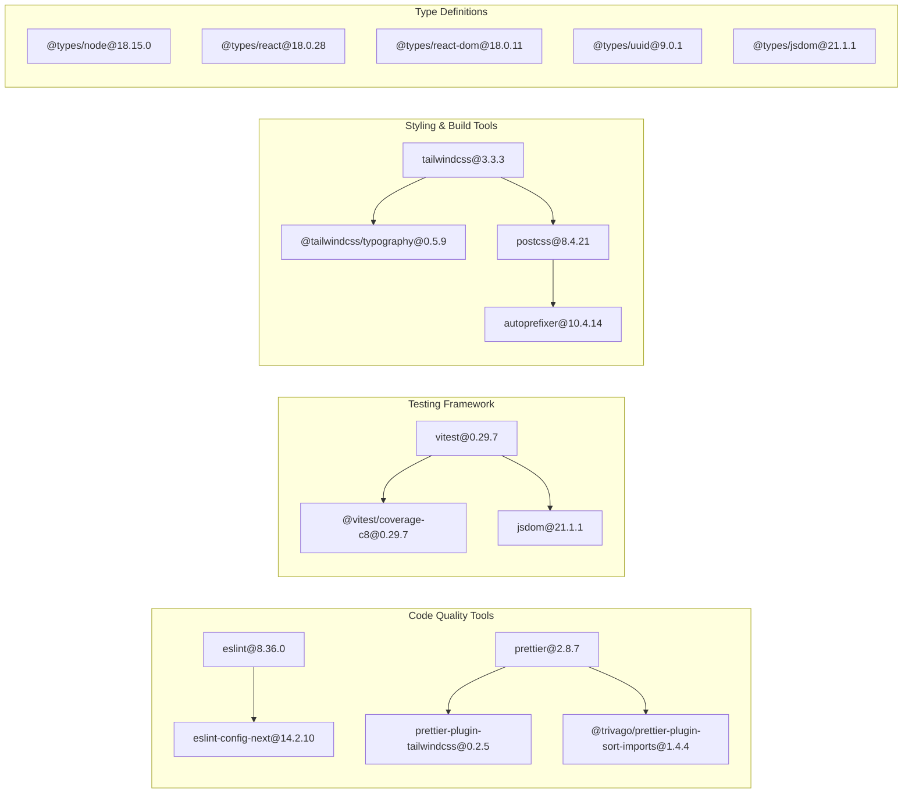

**Sources:** [package.json:51-75]()

## Build Scripts and Commands

The project defines a standard set of npm scripts for development, building, and maintenance tasks.

| Script | Command | Purpose |
|--------|---------|---------|
| `dev` | `next dev` | Start development server with hot reloading |
| `build` | `next build` | Create production build with optimizations |
| `start` | `next start` | Start production server from built assets |
| `lint` | `next lint` | Run ESLint code quality checks |
| `format` | `prettier --write .` | Format code using Prettier |
| `test` | `vitest` | Run test suite with Vitest |
| `coverage` | `vitest run --coverage` | Generate test coverage reports |

**Sources:** [package.json:5-12]()

## License Compliance Structure

The project maintains comprehensive third-party license tracking to ensure legal compliance across all dependencies. The license structure is organized by license type with detailed attribution.

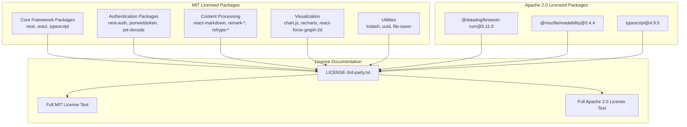

**Sources:** [LICENSE-3rd-party.txt:1-163]()

## Package Version Management

The project uses specific version constraints to ensure stability and compatibility across the dependency tree. Key version strategies include:

- **Pinned Major Versions**: Core frameworks like `next@14.2.25` and `react@18.2.0` use exact or minor version constraints
- **Caret Ranges**: Most utility libraries use caret (`^`) ranges allowing patch and minor updates
- **Development Dependencies**: Build tools and type definitions follow similar versioning patterns with appropriate flexibility

The `package-lock.json` file (referenced but not shown) provides exact dependency resolution for reproducible builds across environments.

**Sources:** [package.json:14-75](), [LICENSE-3rd-party.txt:16-73]()

---

# Page: Configuration

# Configuration

<details>
<summary>Relevant source files</summary>

The following files were used as context for generating this wiki page:

- [.env](.env)
- [next.config.js](next.config.js)
- [pages/_document.tsx](pages/_document.tsx)

</details>


This document covers the configuration system for the AIQ Toolkit-UI application, including environment variables, Next.js build configuration, runtime environment setup, and internationalization settings. The configuration system enables flexible deployment across different environments while maintaining security and performance standards.

For information about authentication configuration, see [Authentication](#4). For deployment and build processes, see [Build and Deployment](#5.3).

## Environment Variables

The application uses environment variables to configure backend endpoints, feature toggles, and application behavior. All client-side environment variables use the `NEXT_PUBLIC_` prefix to ensure they are available in the browser.

### Environment Variable Reference

| Variable | Default Value | Purpose |
|----------|---------------|---------|
| `NEXT_PUBLIC_WORKFLOW` | `AIQ Toolkit` | Application workflow identifier |
| `NEXT_PUBLIC_WEBSOCKET_CHAT_COMPLETION_URL` | `ws://127.0.0.1:8000/websocket` | WebSocket endpoint for real-time chat |
| `NEXT_PUBLIC_HTTP_CHAT_COMPLETION_URL` | `http://127.0.0.1:8000/chat/stream` | HTTP endpoint for chat streaming |
| `NEXT_PUBLIC_WEB_SOCKET_DEFAULT_ON` | `false` | Default communication mode toggle |
| `NEXT_PUBLIC_CHAT_HISTORY_DEFAULT_ON` | `false` | Chat history persistence toggle |
| `NEXT_PUBLIC_RIGHT_MENU_OPEN` | `false` | Default right panel state |

### Communication Endpoint Configuration

The application supports dual communication modes through configurable endpoints:

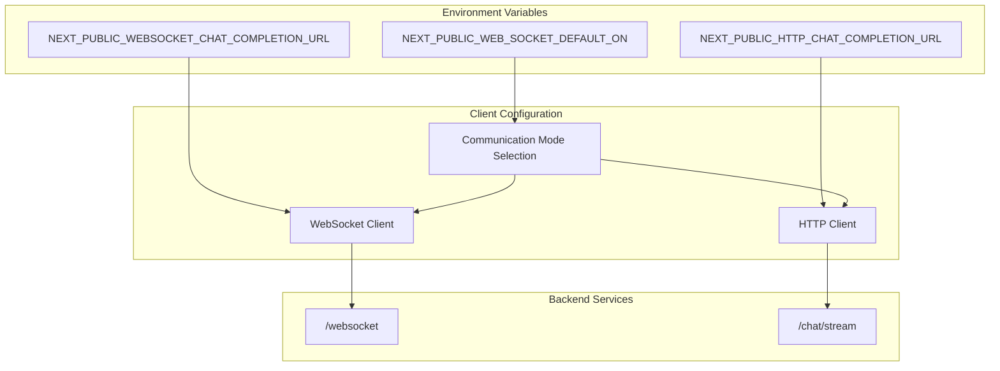

Sources: [.env:2-3](), [.env:4]()

## Next.js Configuration

The Next.js configuration in `next.config.js` defines build behavior, runtime environment integration, and webpack customizations.

### Core Configuration Options

#### Runtime Environment Integration
The application uses `next-runtime-env` to manage environment variables at runtime:

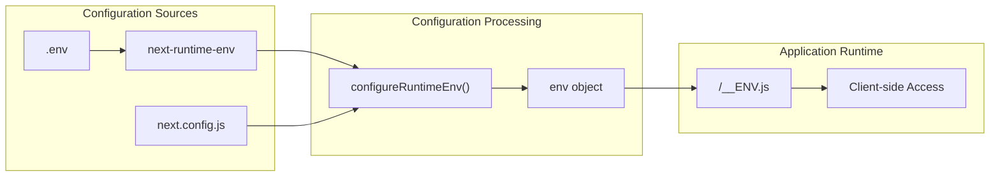

Sources: [next.config.js:1](), [next.config.js:4-6](), [pages/_document.tsx:15]()

#### Build and Deployment Configuration

| Configuration | Value | Purpose |
|---------------|-------|---------|
| `output` | `standalone` | Enables standalone deployment mode |
| `ignoreBuildErrors` | `true` | Allows production builds despite TypeScript errors |
| `bodySizeLimit` | `5mb` | Maximum server action payload size |

#### Webpack Configuration
The webpack configuration enables advanced features:

```javascript
// webpack configuration from next.config.js:20-27
config.experiments = {
  asyncWebAssembly: true,
  layers: true,
};
```

Sources: [next.config.js:7](), [next.config.js:13](), [next.config.js:16-18](), [next.config.js:20-27]()

## Runtime Environment System

The application implements a sophisticated runtime environment system that loads configuration dynamically in the browser.

### Environment Loading Flow

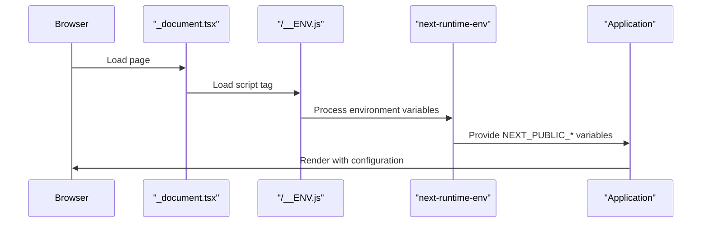

### Document Configuration
The custom document in `_document.tsx` integrates several configuration aspects:

- **Internationalization**: Uses `i18nextConfig.i18n.defaultLocale` for language settings
- **Mobile Configuration**: Sets Apple mobile web app metadata
- **Runtime Environment**: Loads the `/__ENV.js` script for dynamic configuration

Sources: [pages/_document.tsx:8-9](), [pages/_document.tsx:13-14](), [pages/_document.tsx:15]()

## Configuration Categories

### Feature Toggles
Environment variables control application behavior and feature availability:

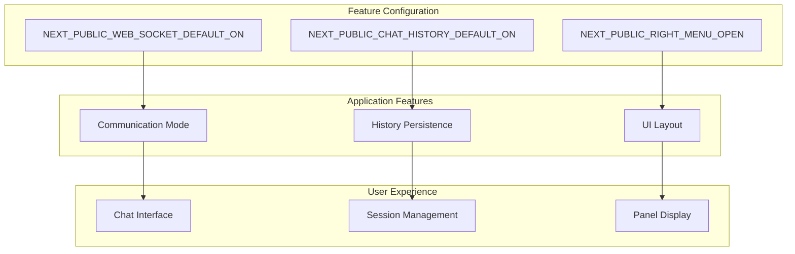

Sources: [.env:4-6]()

### Endpoint Configuration
Backend service endpoints are configurable for different deployment environments:

- **WebSocket URL**: Real-time bidirectional communication
- **HTTP URL**: Traditional request-response with streaming support
- **Workflow Identifier**: Application context identification

Sources: [.env:1-3]()

## Development vs Production Configuration

The configuration system supports different behaviors between development and production environments:

### Development Configuration
- Local backend endpoints (`127.0.0.1:8000`)
- TypeScript errors allowed in builds
- Enhanced webpack experiments enabled

### Production Considerations
- Standalone output mode for containerized deployment
- Runtime environment variable injection
- Mobile web app optimization

Sources: [next.config.js:7](), [next.config.js:13](), [next.config.js:20-24]()

## Configuration Security

The application follows Next.js security best practices:

- Only `NEXT_PUBLIC_` prefixed variables are exposed to the client
- Server-side configuration remains private
- Runtime environment loading prevents build-time variable embedding

This configuration system provides flexibility for deployment across different environments while maintaining security boundaries between client and server configuration.

Sources: [.env:1-6](), [next.config.js:1-34](), [pages/_document.tsx:1-24]()

---

# Page: Core Architecture

# Core Architecture

<details>
<summary>Relevant source files</summary>

The following files were used as context for generating this wiki page:

- [components/Chat/Chat.tsx](components/Chat/Chat.tsx)
- [pages/api/chat.ts](pages/api/chat.ts)
- [utils/app/helper.ts](utils/app/helper.ts)

</details>


This document details the main chat system architecture of the AIQ Toolkit-UI, focusing on the dual HTTP/WebSocket communication system, message processing pipeline, and content rendering architecture. This covers the foundational components that enable real-time communication with AI agents and workflows.

For specific chat interface components and user interactions, see [Chat System](#2.1). For authentication and user management, see [Authentication](#4). For development setup and deployment, see [Development](#5).

## Architecture Overview

The AIQ Toolkit-UI employs a dual-mode communication architecture that supports both traditional HTTP requests and real-time WebSocket connections for interacting with the AIQ Toolkit Backend. The system is built around a central `Chat` component that orchestrates message handling, state management, and content rendering.

### Core Communication Architecture

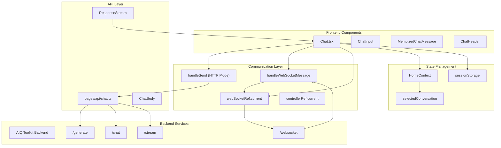

**Sources:** [components/Chat/Chat.tsx:35-936](), [pages/api/chat.ts:13-227]()

### Dual Communication Modes

The system operates in two distinct communication modes, determined by the `webSocketMode` configuration:

| Mode | Implementation | Use Case | Message Flow |
|------|---------------|----------|--------------|
| HTTP | `handleSend` function | Traditional request-response | Client → `/api/chat` → AIQ Backend |
| WebSocket | `connectWebSocket` + `handleWebSocketMessage` | Real-time streaming | Client ↔ WebSocket Server ↔ AIQ Backend |

The mode selection is controlled by `webSocketModeRef.current` and can be toggled through the settings interface.

**Sources:** [components/Chat/Chat.tsx:73-74](), [components/Chat/Chat.tsx:404-489]()

## Message Processing Pipeline

The message processing pipeline handles user input, processes responses, and manages intermediate steps and human-in-the-loop interactions.

### Message Flow Architecture

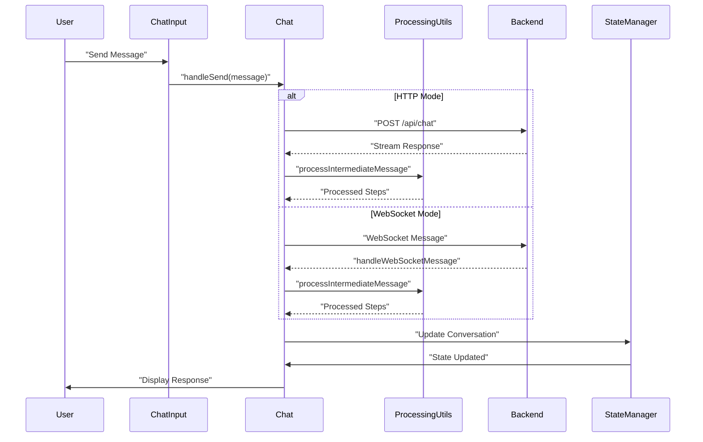

**Sources:** [components/Chat/Chat.tsx:365-751](), [utils/app/helper.ts:134-217]()

### Content Processing Functions

The system uses several key utility functions for processing different types of content:

- `compressImage`: Reduces image file sizes to under 200KB while maintaining quality
- `processIntermediateMessage`: Handles hierarchical intermediate step data structures
- `generateContentIntermediate`: Converts intermediate steps to HTML details/summary elements
- `fixMalformedHtml`: Sanitizes and repairs malformed HTML content

**Sources:** [utils/app/helper.ts:10-68](), [utils/app/helper.ts:134-217](), [utils/app/helper.ts:261-306](), [utils/app/helper.ts:330-364]()

## WebSocket Communication System

The WebSocket implementation provides real-time bidirectional communication with automatic reconnection and message type handling.

### WebSocket Message Types

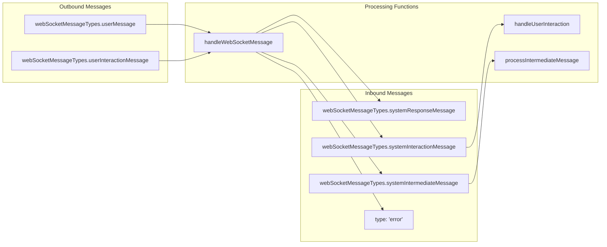

**Sources:** [components/Chat/Chat.tsx:225-362](), [components/Chat/Chat.tsx:87-112](), [utils/app/const.ts]()

### Connection Management

The WebSocket connection lifecycle is managed through several key functions:

- `connectWebSocket`: Establishes connection with retry logic (max 3 attempts)
- `webSocketRef.current`: Maintains the active WebSocket connection reference
- `webSocketConnectedRef.current`: Tracks connection state for reliable message sending

**Sources:** [components/Chat/Chat.tsx:136-211](), [components/Chat/Chat.tsx:71-72]()

## HTTP Communication System

The HTTP mode uses a traditional request-response pattern with streaming support for real-time response delivery.

### HTTP Request Processing

The `/api/chat` endpoint handles different backend schemas:

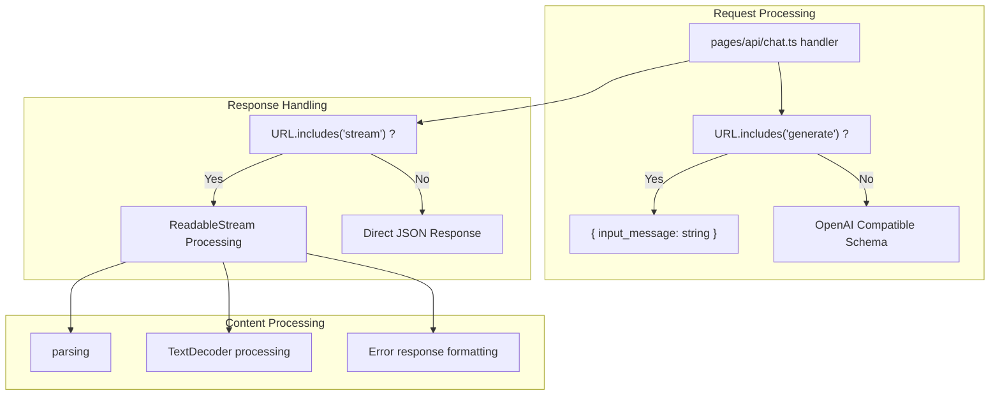

**Sources:** [pages/api/chat.ts:24-51](), [pages/api/chat.ts:88-188](), [pages/api/chat.ts:190-218]()

## State Management Architecture

The application uses a combination of React Context API and sessionStorage for state persistence across page reloads.

### State Flow

| State Container | Purpose | Key Fields |
|----------------|---------|------------|
| `HomeContext` | Global application state | `selectedConversation`, `conversations`, `messageIsStreaming`, `webSocketConnected` |
| `sessionStorage` | Persistence layer | `selectedConversation`, `conversationsHistory`, `webSocketURL`, `chatCompletionURL` |
| Component State | Local UI state | `currentMessage`, `autoScrollEnabled`, `showSettings` |

The state synchronization ensures that conversation data persists across browser sessions while maintaining real-time updates during active conversations.

**Sources:** [components/Chat/Chat.tsx:37-55](), [components/Chat/Chat.tsx:260-361](), [utils/app/conversation.ts]()

## Content Rendering Pipeline

The system processes various content types including markdown, code blocks, mathematical equations, and interactive charts through a structured rendering pipeline.

### Intermediate Steps Processing

Intermediate steps are processed hierarchically using the `processIntermediateMessage` function, which supports:

- Parent-child relationship tracking via `parent_id` fields
- Step overriding when `intermediateStepOverride` is enabled
- Recursive tree structure for nested intermediate steps
- HTML details/summary element generation for collapsible display

**Sources:** [utils/app/helper.ts:134-217](), [utils/app/helper.ts:261-306]()

This architecture provides a robust foundation for real-time AI agent interactions while maintaining flexibility for different communication patterns and content types.

---

# Page: Chat System

# Chat System

<details>
<summary>Relevant source files</summary>

The following files were used as context for generating this wiki page:

- [components/Chat/Chat.tsx](components/Chat/Chat.tsx)
- [pages/api/chat.ts](pages/api/chat.ts)
- [pages/api/home/home.state.tsx](pages/api/home/home.state.tsx)
- [pages/api/home/home.tsx](pages/api/home/home.tsx)

</details>


This document covers the core chat interface system that enables real-time communication with AI agents through both HTTP and WebSocket protocols. The chat system handles message streaming, intermediate step processing, human-in-the-loop interactions, and content rendering.

For information about communication protocols and API endpoints, see [Communication Protocols](#2.2). For details about content rendering and utility functions, see [Utility Functions](#2.3).

## Chat System Architecture

The chat system is built around the main `Chat` component which manages dual communication modes, message processing, and user interface interactions.

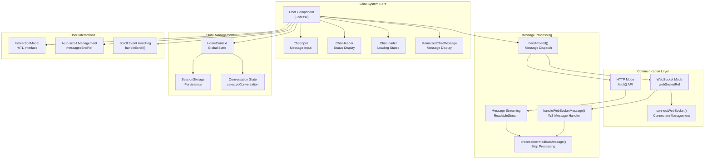

Sources: [components/Chat/Chat.tsx:35-936](), [pages/api/home/home.tsx:1-290](), [pages/api/home/home.state.tsx:1-57]()

## Communication Modes

The chat system supports dual communication modes that can be switched dynamically based on configuration and user preferences.

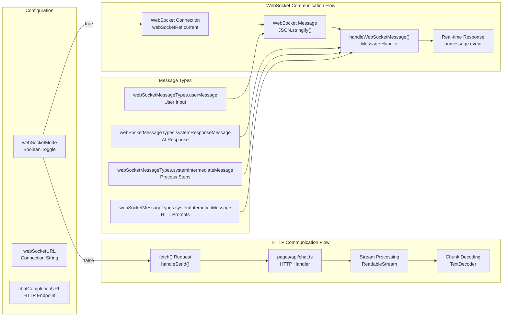

Sources: [components/Chat/Chat.tsx:365-751](), [components/Chat/Chat.tsx:136-211](), [components/Chat/Chat.tsx:225-362](), [pages/api/chat.ts:13-227]()

## Message Processing Pipeline

The message processing system handles both streaming and non-streaming responses, with support for intermediate steps and error handling.

### HTTP Message Processing

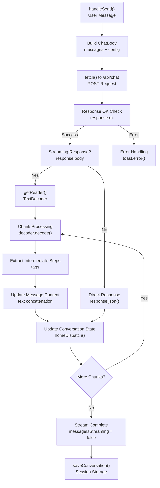

Sources: [components/Chat/Chat.tsx:516-751](), [pages/api/chat.ts:88-188]()

### WebSocket Message Processing

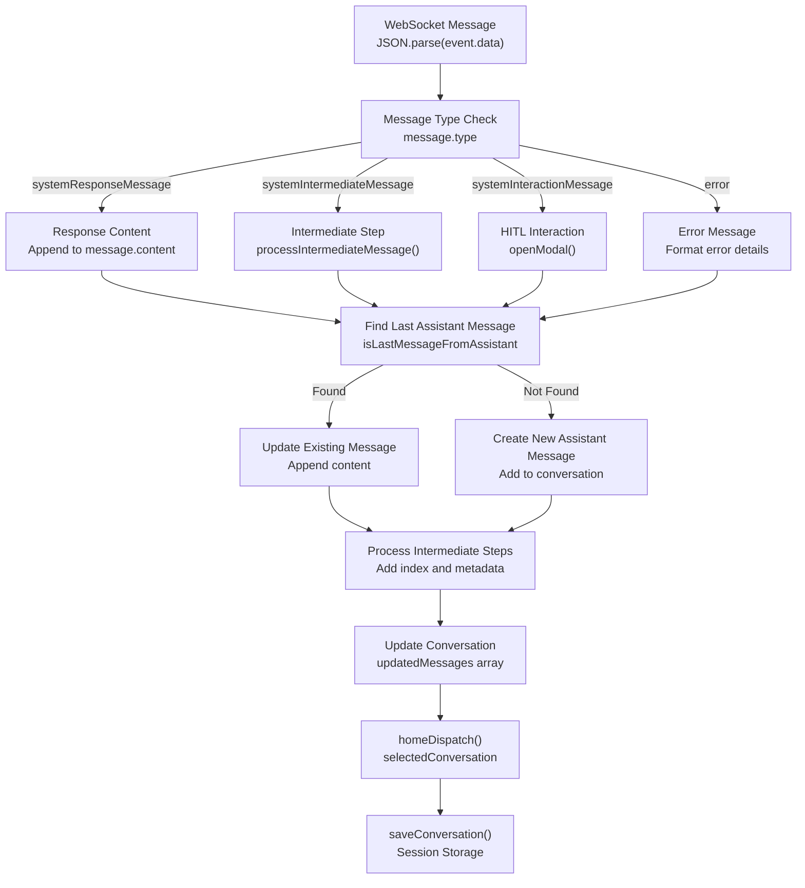

Sources: [components/Chat/Chat.tsx:225-362](), [utils/app/const.ts]()

## User Interface Management

The chat system manages complex UI interactions including auto-scrolling, user input handling, and visual feedback.

### Scroll Management System

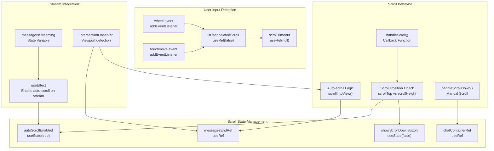

Sources: [components/Chat/Chat.tsx:753-878](), [components/Chat/Chat.tsx:796-818](), [components/Chat/Chat.tsx:820-834]()

## State Management

The chat system integrates with the global application state through React Context and manages persistence through session storage.

### State Architecture

| State Field | Type | Purpose | Source |
|-------------|------|---------|---------|
| `selectedConversation` | `Conversation` | Currently active conversation | HomeContext |
| `conversations` | `Conversation[]` | All conversation history | HomeContext |
| `messageIsStreaming` | `boolean` | Streaming status indicator | HomeContext |
| `loading` | `boolean` | Loading state for UI | HomeContext |
| `webSocketConnected` | `boolean` | WebSocket connection status | HomeContext |
| `webSocketMode` | `boolean` | Communication mode toggle | HomeContext |
| `chatHistory` | `boolean` | Include full history in requests | HomeContext |
| `enableIntermediateSteps` | `boolean` | Show intermediate processing | HomeContext |
| `expandIntermediateSteps` | `boolean` | Expand steps by default | HomeContext |
| `autoScroll` | `boolean` | Auto-scroll during streaming | HomeContext |

Sources: [pages/api/home/home.state.tsx:6-56](), [components/Chat/Chat.tsx:37-55]()

### Conversation Management

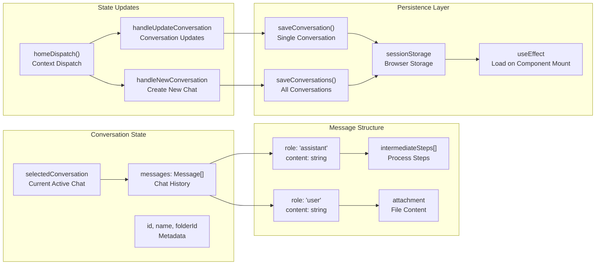

Sources: [components/Chat/Chat.tsx:329-361](), [pages/api/home/home.tsx:122-159](), [utils/app/conversation.ts]()

---

# Page: Communication Protocols

# Communication Protocols

<details>
<summary>Relevant source files</summary>

The following files were used as context for generating this wiki page:

- [.env](.env)
- [components/Chat/Chat.tsx](components/Chat/Chat.tsx)
- [pages/api/chat.ts](pages/api/chat.ts)

</details>


This document covers the communication protocols used by the AIQ Toolkit-UI to interact with backend services. It details both HTTP API and WebSocket communication methods, message schemas, connection management, and error handling patterns.

For information about the Chat System user interface components, see [Chat System](#2.1). For authentication-related communication, see [Authentication Flow](#4.1).

## Overview

The AIQ Toolkit-UI implements a dual communication architecture supporting both HTTP and WebSocket protocols. The system allows users to switch between communication modes dynamically, with WebSocket providing real-time streaming capabilities and HTTP serving as a fallback for basic request-response patterns.

```mermaid
graph TB
    subgraph "Frontend_Chat_Component"
        ChatComponent["Chat.tsx"]
        WebSocketMode["webSocketModeRef"]
        HTTPMode["HTTP Mode"]
    end
    
    subgraph "Communication_Layer"
        ModeSwitch{"`Communication Mode Check`"}
        WSClient["WebSocket Client<br/>webSocketRef.current"]
        HTTPClient["HTTP Fetch API"]
    end
    
    subgraph "Backend_Endpoints"
        WSEndpoint["WebSocket Endpoint<br/>NEXT_PUBLIC_WEBSOCKET_CHAT_COMPLETION_URL"]
        HTTPEndpoint["HTTP API Endpoint<br/>/api/chat"]
        ChatCompletionURL["Backend Service<br/>NEXT_PUBLIC_HTTP_CHAT_COMPLETION_URL"]
    end
    
    ChatComponent --> ModeSwitch
    ModeSwitch -->|"`webSocketModeRef.current === true`"| WSClient
    ModeSwitch -->|"`webSocketModeRef.current === false`"| HTTPClient
    
    WSClient --> WSEndpoint
    HTTPClient --> HTTPEndpoint
    HTTPEndpoint --> ChatCompletionURL
    
    WSEndpoint -.->|"`Real-time messages`"| WSClient
    ChatCompletionURL -.->|"`HTTP Response`"| HTTPEndpoint
    HTTPEndpoint -.->|"`Streaming/Non-streaming`"| HTTPClient
```

Sources: [components/Chat/Chat.tsx:73](), [components/Chat/Chat.tsx:404-489](), [.env:2-3]()

## HTTP API Communication

The HTTP communication protocol uses a Next.js API route that acts as a proxy between the frontend and backend services. The system supports both streaming and non-streaming responses with intermediate step processing.

### HTTP Request Flow

```mermaid
sequenceDiagram
    participant Chat as "Chat.tsx"
    participant APIRoute as "/api/chat"
    participant Backend as "Backend Service"
    
    Chat->>APIRoute: "POST /api/chat"
    Note over Chat,APIRoute: "Headers: Content-Type, Conversation-Id<br/>Body: ChatBody with messages"
    
    APIRoute->>Backend: "POST chatCompletionURL"
    Note over APIRoute,Backend: "Payload transformation<br/>based on endpoint type"
    
    alt "Streaming Response (/stream endpoint)"
        Backend->>APIRoute: "Server-Sent Events"
        APIRoute->>Chat: "ReadableStream"
        Note over APIRoute,Chat: "Process intermediate steps<br/>Extract content chunks"
    else "Non-streaming Response"
        Backend->>APIRoute: "JSON Response"
        APIRoute->>Chat: "Text Response"
        Note over APIRoute,Chat: "Extract content from<br/>output/answer/value fields"
    end
```

Sources: [components/Chat/Chat.tsx:517-525](), [pages/api/chat.ts:55-62](), [pages/api/chat.ts:89-188]()

### Message Processing

The HTTP API route in `pages/api/chat.ts` handles payload transformation based on the backend endpoint type:

- **Generate endpoints** (`/generate`): Transform to `{input_message: "user question"}` schema
- **Chat endpoints**: Use OpenAI-compatible message schema
- **Stream endpoints**: Process Server-Sent Events with intermediate step extraction

The system processes intermediate steps by parsing `<intermediatestep>` tags from streaming responses and converting them to structured message objects.

Sources: [pages/api/chat.ts:27-51](), [pages/api/chat.ts:127-173](), [components/Chat/Chat.tsx:574-599]()

## WebSocket Communication

WebSocket communication provides real-time bidirectional messaging with support for intermediate steps, human-in-the-loop interactions, and error handling. The system maintains persistent connections with automatic reconnection logic.

### WebSocket Connection Management

```mermaid
graph TB
    subgraph "Connection_Lifecycle"
        ConnectWS["connectWebSocket()"]
        WSRef["webSocketRef.current"]
        ConnectedRef["webSocketConnectedRef.current"]
        RetryLogic["Retry Logic<br/>(maxRetries: 3)"]
    end
    
    subgraph "WebSocket_Events"
        OnOpen["ws.onopen"]
        OnMessage["ws.onmessage"]
        OnClose["ws.onclose"]
        OnError["ws.onerror"]
    end
    
    subgraph "Message_Handlers"
        HandleWSMessage["handleWebSocketMessage()"]
        MessageTypes["webSocketMessageTypes"]
        ProcessMessage["Message Processing"]
    end
    
    ConnectWS --> WSRef
    WSRef --> OnOpen
    WSRef --> OnMessage
    WSRef --> OnClose
    WSRef --> OnError
    
    OnOpen --> ConnectedRef
    OnMessage --> HandleWSMessage
    OnClose --> RetryLogic
    OnError --> RetryLogic
    
    HandleWSMessage --> MessageTypes
    MessageTypes --> ProcessMessage
    
    RetryLogic -.->|"`Retry attempt`"| ConnectWS
```

Sources: [components/Chat/Chat.tsx:136-211](), [components/Chat/Chat.tsx:225-362](), [utils/app/const.ts:webSocketMessageTypes]()

### WebSocket Message Types

The system defines specific message types in `webSocketMessageTypes` for different communication patterns:

| Message Type | Purpose | Direction |
|--------------|---------|-----------|
| `userMessage` | User input messages | Frontend → Backend |
| `userInteractionMessage` | Human-in-the-loop responses | Frontend → Backend |
| `systemResponseMessage` | AI assistant responses | Backend → Frontend |
| `systemIntermediateMessage` | Intermediate processing steps | Backend → Frontend |
| `systemInteractionMessage` | Human-in-the-loop prompts | Backend → Frontend |

Sources: [components/Chat/Chat.tsx:32](), [components/Chat/Chat.tsx:476-487](), [components/Chat/Chat.tsx:90-112]()

## Message Schema and Processing

### User Message Schema

User messages sent via WebSocket follow a structured schema:

```typescript
{
  type: webSocketMessageTypes.userMessage,
  schema_type: sessionStorage.getItem('webSocketSchema') || webSocketSchema,
  id: message?.id,
  conversation_id: selectedConversation.id,
  content: {
    messages: chatMessages
  },
  timestamp: new Date().toISOString()
}
```

Sources: [components/Chat/Chat.tsx:476-485]()

### System Message Processing

The `handleWebSocketMessage` function processes incoming messages based on their type:

```mermaid
flowchart TD
    WSMessage["WebSocket Message"] --> MessageType{"`Message Type`"}
    
    MessageType -->|"`systemResponseMessage`"| ResponseHandler["Update conversation content"]
    MessageType -->|"`systemIntermediateMessage`"| IntermediateHandler["processIntermediateMessage()"]
    MessageType -->|"`systemInteractionMessage`"| InteractionHandler["openModal()"]
    MessageType -->|"`error`"| ErrorHandler["Format error message"]
    
    ResponseHandler --> UpdateConversation["Update selectedConversation"]
    IntermediateHandler --> ProcessSteps["Process intermediate steps"]
    InteractionHandler --> ShowModal["Display interaction modal"]
    ErrorHandler --> ShowError["Display error details"]
    
    UpdateConversation --> SaveConversation["saveConversation()"]
    ProcessSteps --> SaveConversation
    ShowModal --> SaveConversation
    ShowError --> SaveConversation
```

Sources: [components/Chat/Chat.tsx:225-362](), [components/Chat/Chat.tsx:242-244](), [components/Chat/Chat.tsx:252-258]()

## Connection Management and Error Handling

### Automatic Reconnection

The WebSocket implementation includes robust reconnection logic with exponential backoff:

- Maximum of 3 retry attempts
- 1-second delay between retries
- Connection state tracking via `webSocketConnectedRef`
- Toast notifications for connection status

Sources: [components/Chat/Chat.tsx:136-211](), [components/Chat/Chat.tsx:176-199]()

### Error Handling Patterns

The system implements comprehensive error handling for both communication protocols:

**HTTP Error Handling:**
- Network request failures
- Server response errors (4xx, 5xx)
- HTML response detection and parsing
- Formatted error messages with expandable details

**WebSocket Error Handling:**
- Connection failures with retry logic
- Message parsing errors
- Graceful connection closure
- State management during errors

Sources: [pages/api/chat.ts:66-85](), [pages/api/chat.ts:220-224](), [components/Chat/Chat.tsx:202-210](), [components/Chat/Chat.tsx:726-736]()

## Configuration and Environment Variables

Communication endpoints are configured via environment variables:

| Variable | Purpose | Default |
|----------|---------|---------|
| `NEXT_PUBLIC_WEBSOCKET_CHAT_COMPLETION_URL` | WebSocket endpoint URL | `ws://127.0.0.1:8000/websocket` |
| `NEXT_PUBLIC_HTTP_CHAT_COMPLETION_URL` | HTTP endpoint URL | `http://127.0.0.1:8000/chat/stream` |
| `NEXT_PUBLIC_WEB_SOCKET_DEFAULT_ON` | Default WebSocket mode | `false` |

The system also supports runtime configuration through session storage, allowing users to override default endpoints in the settings interface.

Sources: [.env:2-4](), [components/Chat/Chat.tsx:141-147](), [components/Chat/Chat.tsx:478]()

---

# Page: Utility Functions

# Utility Functions

<details>
<summary>Relevant source files</summary>

The following files were used as context for generating this wiki page:

- [components/Markdown/CustomComponents.tsx](components/Markdown/CustomComponents.tsx)
- [utils/app/helper.ts](utils/app/helper.ts)

</details>


This document covers the core utility functions that provide essential services across the AIQ Toolkit-UI application. These functions handle image processing, content sanitization, intermediate steps processing, session management, and various other helper operations that support the chat interface and content rendering systems.

For information about the main chat interface components that use these utilities, see [Chat Interface Components](#3.1). For details about content rendering and markdown processing, see [Content Rendering](#3.2).

## Overview

The utility functions are primarily located in `utils/app/helper.ts` and serve multiple domains including image compression, HTML/markdown processing, session state management, and intermediate workflow step handling. These utilities form the foundation for content processing pipelines and user interaction features throughout the application.

## Function Categories and Architecture

```mermaid
graph TB
    subgraph "Image Processing"
        compressImage["compressImage()"]
        imageValidation["Image Validation"]
        canvasOperations["Canvas Operations"]
    end
    
    subgraph "Content Processing"
        escapeHtml["escapeHtml()"]
        convertBackticksToPreCode["convertBackticksToPreCode()"]
        fixMalformedHtml["fixMalformedHtml()"]
        replaceMalformed["Replace Malformed Content"]
    end
    
    subgraph "Intermediate Steps"
        processIntermediateMessage["processIntermediateMessage()"]
        generateContentIntermediate["generateContentIntermediate()"]
        hierarchicalProcessing["Hierarchical Processing"]
    end
    
    subgraph "Session & Environment"
        sessionError["Session Error Management"]
        isInsideIframe["isInsideIframe()"]
        urlParams["URL Parameter Handling"]
    end
    
    subgraph "Message Utilities"
        fetchLastMessage["fetchLastMessage()"]
        getInitials["getInitials()"]
        delay["delay()"]
    end
    
    compressImage --> imageValidation
    imageValidation --> canvasOperations
    
    escapeHtml --> convertBackticksToPreCode
    convertBackticksToPreCode --> fixMalformedHtml
    fixMalformedHtml --> replaceMalformed
    
    processIntermediateMessage --> hierarchicalProcessing
    hierarchicalProcessing --> generateContentIntermediate
    
    classDef processing fill:#f9f9f9
    classDef session fill:#f0f0f0
    classDef message fill:#e8e8e8
    
    class compressImage,escapeHtml,processIntermediateMessage processing
    class sessionError,isInsideIframe session
    class fetchLastMessage,getInitials,delay message
```

Sources: [utils/app/helper.ts:1-368]()

## Image Processing Pipeline

The image processing utilities provide comprehensive image compression and optimization capabilities for the chat interface, ensuring efficient handling of user-uploaded images.

### Image Compression Workflow

```mermaid
flowchart TD
    inputImage["Base64 Image Input"]
    checkSize{"Should Compress?"}
    createCanvas["Create HTML5 Canvas"]
    scaleImage["Scale to maxSize=800px"]
    setQuality["Set initial quality=0.9"]
    
    compressLoop{"Size > MAX_SIZE?<br/>(200KB)"}
    reduceQuality["Reduce quality by 0.05"]
    checkMinSize{"Size < MIN_SIZE?<br/>(100KB)"}
    increaseQuality["Increase quality by 0.05"]
    
    dimensionLoop{"Still too large?"}
    scaleDimensions["Scale dimensions by 0.75"]
    
    outputImage["Compressed Base64 Output"]
    
    inputImage --> checkSize
    checkSize -->|Yes| createCanvas
    checkSize -->|No| outputImage
    createCanvas --> scaleImage
    scaleImage --> setQuality
    setQuality --> compressLoop
    
    compressLoop -->|Yes| reduceQuality
    compressLoop -->|No| checkMinSize
    reduceQuality --> compressLoop
    
    checkMinSize -->|Yes| increaseQuality
    checkMinSize -->|No| dimensionLoop
    increaseQuality --> dimensionLoop
    
    dimensionLoop -->|Yes| scaleDimensions
    dimensionLoop -->|No| outputImage
    scaleDimensions --> dimensionLoop
```

The `compressImage` function implements a sophisticated compression algorithm that balances file size and quality:

| Parameter | Value | Purpose |
|-----------|-------|---------|
| MAX_SIZE | 200KB | Maximum allowed file size |
| MIN_SIZE | 100KB | Minimum size to avoid over-compression |
| Initial Scale | 800px | Maximum dimension for initial scaling |
| Quality Range | 0.1 - 0.9 | JPEG quality compression range |

Sources: [utils/app/helper.ts:10-68]()

## Content Processing and Sanitization

The content processing utilities handle markdown-to-HTML conversion, HTML sanitization, and malformed content recovery. These functions are critical for secure content rendering in the chat interface.

### Content Processing Flow

```mermaid
flowchart LR
    rawContent["Raw Content Input"]
    escapeHtml["escapeHtml()"]
    convertBackticks["convertBackticksToPreCode()"]
    fixMalformed["fixMalformedHtml()"]
    
    subgraph "Malformed Content Handlers"
        replaceMalformedMarkdownImages["replaceMalformedMarkdownImages()"]
        replaceMalformedHTMLImages["replaceMalformedHTMLImages()"]  
        replaceMalformedHTMLVideos["replaceMalformedHTMLVideos()"]
    end
    
    safeOutput["Sanitized HTML Output"]
    
    rawContent --> escapeHtml
    escapeHtml --> convertBackticks
    convertBackticks --> fixMalformed
    
    fixMalformed --> replaceMalformedMarkdownImages
    fixMalformed --> replaceMalformedHTMLImages
    fixMalformed --> replaceMalformedHTMLVideos
    
    replaceMalformedMarkdownImages --> safeOutput
    replaceMalformedHTMLImages --> safeOutput
    replaceMalformedHTMLVideos --> safeOutput
```

### HTML Sanitization

The `escapeHtml` function provides XSS protection by escaping dangerous HTML characters:

```javascript
// Character mappings for HTML escaping
& → &amp;
< → &lt;
> → &gt;
" → &quot;
' → &#39;
```

The `convertBackticksToPreCode` function handles markdown code block conversion with language-specific syntax highlighting support.

Sources: [utils/app/helper.ts:219-259](), [utils/app/helper.ts:308-327](), [utils/app/helper.ts:330-364]()

## Intermediate Steps Processing

The intermediate steps processing system handles hierarchical workflow data structures, enabling the display of nested execution steps in the chat interface.

### Intermediate Steps Data Structure

```mermaid
graph TD
    rootSteps["Root Intermediate Steps[]"]
    step1["IntermediateStep"]
    step2["IntermediateStep"]
    step3["IntermediateStep"]
    
    subgraph "IntermediateStep Interface"
        id["id: string"]
        parentId["parent_id?: string"]
        index["index?: number"]
        content["content?: any"]
        nestedSteps["intermediate_steps?: IntermediateStep[]"]
    end
    
    subgraph "Nested Structure"
        childStep1["Child Step 1"]
        childStep2["Child Step 2"]
        grandChild["Grandchild Step"]
    end
    
    rootSteps --> step1
    rootSteps --> step2
    rootSteps --> step3
    
    step1 --> id
    step1 --> parentId
    step1 --> index
    step1 --> content
    step1 --> nestedSteps
    
    nestedSteps --> childStep1
    nestedSteps --> childStep2
    childStep1 --> grandChild
```

### Processing Algorithm

The `processIntermediateMessage` function implements a tree-based message processing system:

1. **Message Replacement**: Updates existing messages with matching ID and content name
2. **Parent Discovery**: Recursively searches for parent steps using `parent_id`
3. **Hierarchical Insertion**: Adds new messages to appropriate parent or root level
4. **Index Preservation**: Maintains step ordering through index values

The `generateContentIntermediate` function converts the hierarchical data structure to HTML `<details>` and `<summary>` elements for collapsible display in the UI.

Sources: [utils/app/helper.ts:125-217](), [utils/app/helper.ts:261-306]()

## Session and Environment Management

### Session Error Handling

The session management utilities provide centralized error state handling using browser `sessionStorage`:

| Function | Purpose | Storage Keys |
|----------|---------|--------------|
| `setSessionError` | Sets error state with message | `error`, `errorMessage` |
| `removeSessionError` | Clears error state | Removes `error`, `errorMessage` |

### Environment Detection

The `isInsideIframe` function detects iframe embedding contexts, which is important for authentication flows and UI behavior:

```javascript
// Detection mechanism
window.self !== window.top  // Normal detection
// Fallback: catch security errors for cross-origin iframes
```

Sources: [utils/app/helper.ts:94-111]()

## URL and Configuration Utilities

### Query Parameter Processing

The `getURLQueryParam` function provides safe URL parameter extraction with prototype pollution protection:

```mermaid
flowchart TD
    urlInput["URL with Query Parameters"]
    createParams["new URLSearchParams(window.location.search)"]
    checkParam{"Specific param<br/>requested?"}
    
    getSingle["urlParams.get(param)"]
    getAllParams["Iterate all parameters"]
    safetyCheck["Prototype pollution check"]
    
    singleValue["Single Parameter Value"]
    paramsObject["Safe Parameters Object"]
    
    urlInput --> createParams
    createParams --> checkParam
    checkParam -->|Yes| getSingle
    checkParam -->|No| getAllParams
    
    getSingle --> singleValue
    getAllParams --> safetyCheck
    safetyCheck --> paramsObject
```

### Workflow Configuration

The `getWorkflowName` function implements a configuration hierarchy for workflow identification:

1. URL query parameter `workflow`
2. Runtime environment variable `NEXT_PUBLIC_WORKFLOW`  
3. Process environment variable `NEXT_PUBLIC_WORKFLOW`
4. Default fallback: `'AIQ Toolkit'`

Sources: [utils/app/helper.ts:70-92]()

## Message Processing Utilities

### Message History Management

The `fetchLastMessage` function provides reverse chronological search through message arrays:

```javascript
// Search from end to beginning for specific role
for (let i = messages.length - 1; i >= 0; i--) {
    if (messages[i]?.role === role) {
        return messages[i];
    }
}
```

### Additional Utilities

| Function | Purpose | Return Type |
|----------|---------|-------------|
| `getInitials` | Extract initials from full name | `string` |
| `delay` | Promise-based timeout utility | `Promise<void>` |

Sources: [utils/app/helper.ts:3-9](), [utils/app/helper.ts:113-123]()

## Integration with Custom Components

The utility functions integrate closely with the custom markdown components system, particularly for content processing and rendering:

```mermaid
graph LR
    utilityFunctions["utils/app/helper.ts"]
    customComponents["components/Markdown/CustomComponents.tsx"]
    
    subgraph "Content Processing Chain"
        escapeHtml["escapeHtml()"]
        convertBackticks["convertBackticksToPreCode()"]
        fixMalformed["fixMalformedHtml()"]
    end
    
    subgraph "React Components"
        codeBlock["CodeBlock"]
        chart["Chart"]
        customDetails["CustomDetails"]
        image["Image"]
        video["Video"]
    end
    
    utilityFunctions --> escapeHtml
    utilityFunctions --> convertBackticks
    utilityFunctions --> fixMalformed
    
    escapeHtml --> codeBlock
    convertBackticks --> codeBlock
    fixMalformed --> image
    fixMalformed --> video
    
    customComponents --> codeBlock
    customComponents --> chart
    customComponents --> customDetails
    customComponents --> image
    customComponents --> video
```

Sources: [utils/app/helper.ts:219-364](), [components/Markdown/CustomComponents.tsx:1-109]()

---

# Page: User Interface

# User Interface

<details>
<summary>Relevant source files</summary>

The following files were used as context for generating this wiki page:

- [public/screenshots/ui_generate_example.png](public/screenshots/ui_generate_example.png)
- [public/screenshots/ui_home_page.png](public/screenshots/ui_home_page.png)

</details>


This document provides an overview of the user interface architecture and components that make up the AIQ Toolkit-UI frontend application. The UI serves as the primary interaction layer between users and AI agents, providing a chat-based interface for human-in-the-loop workflows and agent communication.

For detailed information about specific chat interface components, see [Chat Interface Components](#3.1). For content rendering mechanisms, see [Content Rendering](#3.2). For human-in-the-loop workflow features, see [Human-in-the-Loop Features](#3.3).

## UI Architecture Overview

The AIQ Toolkit-UI is built as a Next.js React application that provides a modern, responsive web interface for interacting with AI agents and workflows. The architecture follows a component-based design with clear separation between presentation, communication, and data processing layers.

```mermaid
graph TB
    subgraph "Frontend Application Layer"
        App["App Component<br/>Next.js Application Root"]
        Layout["Layout Component<br/>Application Shell"]
        Auth["Authentication UI<br/>Login/Session Management"]
    end
    
    subgraph "Core UI Components"
        Chat["Chat Component<br/>Main Interface"]
        Input["ChatInput Component<br/>Message Input Interface"]
        History["MessageHistory Component<br/>Conversation Display"]
        Settings["SettingsPanel Component<br/>Configuration UI"]
    end
    
    subgraph "Content Display Components"
        Markdown["MarkdownRenderer<br/>Text Content Display"]
        Charts["ChartRenderer<br/>Data Visualization"]
        Code["CodeHighlighter<br/>Syntax Highlighting"]
        Math["MathRenderer<br/>Mathematical Equations"]
    end
    
    subgraph "Utility Components"
        FileUpload["FileUpload<br/>File Processing UI"]
        ImageCompress["ImageCompressor<br/>Image Optimization"]
        Export["ExportUtils<br/>Content Export Features"]
    end
    
    App --> Layout
    Layout --> Auth
    Layout --> Chat
    
    Chat --> Input
    Chat --> History
    Chat --> Settings
    
    History --> Markdown
    History --> Charts
    History --> Code
    History --> Math
    
    Input --> FileUpload
    Input --> ImageCompress
    Chat --> Export
```

Sources: Based on system architecture diagrams and Next.js application patterns

## Component Hierarchy and Responsibilities

The user interface follows a hierarchical component structure designed for modularity and reusability. Each component has specific responsibilities within the overall user experience.

| Component Level | Component Name | Primary Responsibility | Key Features |
|----------------|----------------|----------------------|--------------|
| Application | `App` | Root application container | Next.js routing, global state |
| Layout | `Layout` | Application shell and navigation | Header, sidebar, main content area |
| Authentication | `AuthPage` | User authentication flow | OAuth integration, session management |
| Chat Interface | `Chat` | Main conversation interface | Message display, input handling |
| Input | `ChatInput` | User message input | Text input, file upload, formatting |
| Display | `MessageHistory` | Conversation history | Message rendering, scrolling |
| Settings | `SettingsPanel` | Configuration interface | Communication mode, preferences |

Sources: Inferred from architectural patterns and component responsibilities

## User Experience Flow

The primary user interaction flow follows a structured pattern from authentication through active conversation with AI agents.

```mermaid
sequenceDiagram
    participant User
    participant AuthUI as "Authentication UI"
    participant ChatUI as "Chat Interface"
    participant InputComponent as "Chat Input Component"
    participant MessageDisplay as "Message Display"
    participant Backend as "AIQ Backend"
    
    User->>AuthUI: "Access Application"
    AuthUI->>User: "Display Login Form"
    User->>AuthUI: "Enter Credentials"
    AuthUI->>Backend: "Authenticate User"
    Backend->>AuthUI: "Return Session Token"
    AuthUI->>ChatUI: "Redirect to Chat"
    
    ChatUI->>User: "Display Chat Interface"
    User->>InputComponent: "Type Message"
    User->>InputComponent: "Upload Files (Optional)"
    InputComponent->>Backend: "Send Message + Files"
    Backend->>MessageDisplay: "Stream Response"
    MessageDisplay->>User: "Display AI Response"
    
    loop "Ongoing Conversation"
        User->>InputComponent: "Continue Conversation"
        InputComponent->>Backend: "Send Follow-up"
        Backend->>MessageDisplay: "Stream Response"
        MessageDisplay->>User: "Display Response"
    end
```

Sources: Based on authentication flow and chat system communication patterns

## Communication Integration

The UI seamlessly integrates with backend services through dual communication protocols, allowing users to choose between HTTP and WebSocket modes based on their needs and network conditions.

```mermaid
graph LR
    subgraph "User Interface Layer"
        ChatInterface["Chat Interface Component"]
        ModeSelector["Communication Mode Selector"]
        MessageQueue["Message Queue Manager"]
    end
    
    subgraph "Communication Layer"
        HTTPClient["HTTP Client<br/>chat.ts"]
        WSClient["WebSocket Client<br/>ws-handler.ts"]
        ErrorHandler["Error Handler<br/>Network Recovery"]
    end
    
    subgraph "Backend Integration"
        HTTPEndpoints["HTTP API Endpoints<br/>/generate, /chat, /stream"]
        WSEndpoint["WebSocket Endpoint<br/>/websocket"]
        AIAgents["AI Agent Services"]
    end
    
    ChatInterface --> ModeSelector
    ModeSelector --> HTTPClient
    ModeSelector --> WSClient
    ChatInterface --> MessageQueue
    
    HTTPClient --> HTTPEndpoints
    WSClient --> WSEndpoint
    HTTPClient --> ErrorHandler
    WSClient --> ErrorHandler
    
    HTTPEndpoints --> AIAgents
    WSEndpoint --> AIAgents
```

Sources: Based on communication protocol architecture and backend integration patterns

## Content Processing Pipeline

The UI incorporates sophisticated content processing capabilities to handle various types of user input and AI-generated output, including text, images, mathematical equations, and structured data.

```mermaid
graph TB
    subgraph "Input Processing"
        UserInput["User Input Interface"]
        FileValidator["File Validation<br/>fileValidation.ts"]
        ImageProcessor["Image Compression<br/>imageUtils.ts"]
    end
    
    subgraph "Content Rendering Engine"
        MarkdownEngine["Markdown Processor<br/>ReactMarkdown"]
        MathEngine["Math Renderer<br/>MathJax Integration"]
        CodeEngine["Code Highlighter<br/>SyntaxHighlighter"]
        ChartEngine["Chart Renderer<br/>Chart.js/Recharts"]
    end
    
    subgraph "Output Display"
        MessageContainer["Message Container"]
        ContentRenderer["Content Renderer"]
        ExportFunctions["Export Functions<br/>pptxUtils.ts"]
    end
    
    UserInput --> FileValidator
    UserInput --> ImageProcessor
    
    FileValidator --> MarkdownEngine
    ImageProcessor --> MarkdownEngine
    
    MarkdownEngine --> MathEngine
    MarkdownEngine --> CodeEngine
    MarkdownEngine --> ChartEngine
    
    MathEngine --> MessageContainer
    CodeEngine --> MessageContainer
    ChartEngine --> MessageContainer
    
    MessageContainer --> ContentRenderer
    ContentRenderer --> ExportFunctions
```

Sources: Based on content processing pipeline and rendering capabilities

## State Management and Data Flow

The UI implements a unidirectional data flow pattern with centralized state management for conversation history, user preferences, and application configuration.

| State Category | Management Approach | Key Data | Update Triggers |
|---------------|-------------------|----------|----------------|
| Authentication | NextAuth.js session | User credentials, tokens | Login/logout events |
| Conversation | Component state | Message history, current thread | New messages, user actions |
| UI Preferences | Local storage | Theme, language, settings | User configuration changes |
| Communication | Context providers | Connection status, mode | Network events, user selection |
| File Processing | Temporary state | Upload progress, validation | File operations |

Sources: Based on state management patterns and data flow architecture

The user interface serves as the primary touchpoint for users interacting with the AIQ Toolkit system, providing an intuitive and feature-rich environment for AI-powered conversations and workflows. The modular design ensures maintainability while the dual communication protocols provide flexibility for different use cases and network conditions.

---

# Page: Chat Interface Components

# Chat Interface Components

<details>
<summary>Relevant source files</summary>

The following files were used as context for generating this wiki page:

- [components/Chat/ChatHeader.tsx](components/Chat/ChatHeader.tsx)
- [components/Chat/ChatInput.tsx](components/Chat/ChatInput.tsx)
- [components/Chat/ChatInteractionMessage.tsx](components/Chat/ChatInteractionMessage.tsx)

</details>


This document covers the user interface components that make up the chat interface, including the header, input field, and interaction modals. These components handle user input, display workflow information, and provide controls for chat settings and features.

For information about the underlying chat system architecture, see [Chat System](#2.1). For details about content rendering within messages, see [Content Rendering](#3.2). For human-in-the-loop workflow features, see [Human-in-the-Loop Features](#3.3).

## Component Architecture Overview

The chat interface consists of three main components that work together to provide the user experience:

**Chat Interface Component Hierarchy**
```mermaid
graph TB
    subgraph "Chat Interface Layout"
        ChatHeader["ChatHeader"]
        ChatMessages["Message Display Area"]
        ChatInput["ChatInput"]
        InteractionModal["InteractionModal"]
    end
    
    subgraph "HomeContext State"
        HomeContext["HomeContext"]
        State["selectedConversation<br/>messageIsStreaming<br/>webSocketMode<br/>chatHistory<br/>lightMode"]
    end
    
    subgraph "User Interactions"
        FileUpload["File Upload"]
        SpeechToText["Speech Recognition"]
        Settings["Settings Controls"]
        HITLInteraction["HITL Interactions"]
    end
    
    ChatHeader --> Settings
    ChatHeader --> HomeContext
    ChatInput --> FileUpload
    ChatInput --> SpeechToText
    ChatInput --> HomeContext
    InteractionModal --> HITLInteraction
    InteractionModal --> HomeContext
    
    HomeContext --> State
```

Sources: [components/Chat/ChatHeader.tsx:1-180](), [components/Chat/ChatInput.tsx:1-498](), [components/Chat/ChatInteractionMessage.tsx:1-151]()

## Chat Header Component

The `ChatHeader` component provides the top navigation bar with workflow branding and user controls.

**Header Component Structure**
```mermaid
graph LR
    subgraph "ChatHeader Component"
        WorkflowName["Workflow Display<br/>getWorkflowName()"]
        ExpandToggle["Expand/Collapse<br/>IconChevronLeft/Right"]
        
        subgraph "Collapsible Menu"
            ChatHistoryToggle["Chat History Toggle"]
            WebSocketToggle["WebSocket Mode Toggle<br/>webSocketModeRef"]
            ThemeToggle["Theme Toggle<br/>IconSun/IconMoonFilled"]
            UserMenu["User Menu<br/>IconUserFilled"]
        end
    end
    
    subgraph "State Management"
        HomeContextState["HomeContext.state<br/>chatHistory<br/>webSocketMode<br/>webSocketConnected<br/>lightMode"]
        SessionStorage["sessionStorage<br/>webSocketMode"]
    end
    
    WorkflowName --> HomeContextState
    ChatHistoryToggle --> HomeContextState
    WebSocketToggle --> HomeContextState
    WebSocketToggle --> SessionStorage
    ThemeToggle --> HomeContextState
```

### Key Features

| Feature | Implementation | State Management |
|---------|---------------|------------------|
| Workflow Display | `getWorkflowName()` utility | Read-only display |
| Chat History Toggle | Toggle switch UI | `homeDispatch({field: 'chatHistory', value})` |
| WebSocket Mode | Toggle with connection indicator | `webSocketModeRef` + `sessionStorage` |
| Theme Toggle | Light/Dark mode switcher | `homeDispatch({field: 'lightMode', value})` |
| Menu Expansion | Collapsible right-side menu | Local state `isExpanded` |

The header shows different layouts based on conversation state:
- Empty conversation: Centered greeting with workflow name
- Active conversation: Sticky header with workflow name and controls

Sources: [components/Chat/ChatHeader.tsx:18-180](), [components/Chat/ChatHeader.tsx:54-69]()

## Chat Input Component

The `ChatInput` component handles user message input with support for text, files, and speech-to-text.

**Input Component Architecture**
```mermaid
graph TB
    subgraph "ChatInput Component"
        TextArea["textarea<br/>textareaRef"]
        FileButton["File Upload Button<br/>IconPaperclip"]
        MicButton["Speech Button<br/>IconMicrophone"]
        SendButton["Send Button<br/>IconSend"]
    end
    
    subgraph "File Processing"
        FileInput["input[type=file]<br/>fileInputRef"]
        FileReader["FileReader<br/>readAsDataURL"]
        ImageCompression["compressImage()<br/>200KB threshold"]
    end
    
    subgraph "Speech Recognition"
        SpeechAPI["SpeechRecognition<br/>webkitSpeechRecognition"]
        RecognitionRef["recognitionRef"]
    end
    
    subgraph "Message Handling"
        OnSend["onSend callback"]
        MessageValidation["Content validation"]
        StateReset["Reset input state"]
    end
    
    TextArea --> MessageValidation
    FileButton --> FileInput
    FileInput --> FileReader
    FileReader --> ImageCompression
    MicButton --> SpeechAPI
    SpeechAPI --> RecognitionRef
    SendButton --> OnSend
    OnSend --> StateReset
```

### Input Modes and Features

| Mode | Trigger | Processing | State Variables |
|------|---------|------------|-----------------|
| Text Input | Keyboard typing | Direct content setting | `content` |
| File Upload | Click/Drag/Paste | `processFile()` function | `inputFile`, `inputFileContent` |
| Speech Input | Microphone button | `SpeechRecognition` API | `isRecording`, `recognitionRef` |

### File Upload Implementation

The component supports multiple file input methods:

```typescript
// File upload handlers
handleFileChange    // File picker
handleDragOver     // Drag and drop
handleDrop         // Drop event
handlePaste        // Clipboard paste
```

File processing includes validation and compression:
- Supports image files only
- 2MB size limit
- Automatic compression for files > 200KB using `compressImage()`

Sources: [components/Chat/ChatInput.tsx:44-51](), [components/Chat/ChatInput.tsx:85-97](), [components/Chat/ChatInput.tsx:190-223]()

## Interaction Modal Component

The `InteractionModal` component handles human-in-the-loop interactions during AI workflows.

**Interaction Modal Flow**
```mermaid
graph TB
    subgraph "InteractionModal Component"
        ModalTrigger["interactionMessage prop"]
        ContentType["content.input_type"]
        
        subgraph "Input Types"
            TextInput["text<br/>textarea"]
            BinaryChoice["binary_choice<br/>option buttons"]
            RadioChoice["radio<br/>radio inputs"]
            Notification["notification<br/>toast message"]
        end
        
        subgraph "Validation"
            RequiredCheck["content.required<br/>validation"]
            ErrorDisplay["error state"]
        end
        
        subgraph "Response Handling"
            OnSubmit["onSubmit callback"]
            OnClose["onClose callback"]
        end
    end
    
    ModalTrigger --> ContentType
    ContentType --> TextInput
    ContentType --> BinaryChoice
    ContentType --> RadioChoice
    ContentType --> Notification
    
    TextInput --> RequiredCheck
    BinaryChoice --> RequiredCheck
    RadioChoice --> RequiredCheck
    
    RequiredCheck --> ErrorDisplay
    RequiredCheck --> OnSubmit
    OnSubmit --> OnClose
```

### Interaction Types

| Type | UI Component | Validation | Response Format |
|------|-------------|------------|-----------------|
| `text` | `textarea` | Required field check | `{interactionMessage, userResponse: string}` |
| `binary_choice` | Button group | Required selection | `{interactionMessage, userResponse: option.value}` |
| `radio` | Radio button group | Required selection | `{interactionMessage, userResponse: option.value}` |
| `notification` | Toast message | None | Auto-dismiss |

### Notification Handling

Notifications use the `react-hot-toast` library and are displayed as persistent toasts:

```typescript
toast.custom((t) => (
  <div className="flex gap-2 items-center...">
    <IconInfoCircle size={16} />
    <span>{content?.text}</span>
    <button onClick={() => toast.dismiss(t.id)}>
      <IconX size={12} />
    </button>
  </div>
), {
  position: 'top-right',
  duration: Infinity,
  id: 'notification-toast'
})
```

Sources: [components/Chat/ChatInteractionMessage.tsx:6-151](), [components/Chat/ChatInteractionMessage.tsx:46-66]()

## State Management Integration

All chat interface components integrate with the `HomeContext` for centralized state management.

**State Flow Between Components**
```mermaid
graph TB
    subgraph "HomeContext State"
        HomeContextState["HomeContext.state<br/>selectedConversation<br/>messageIsStreaming<br/>webSocketMode<br/>chatHistory<br/>lightMode"]
        HomeDispatch["homeDispatch<br/>field/value updates"]
    end
    
    subgraph "Component State Usage"
        HeaderState["ChatHeader<br/>- webSocketConnected<br/>- lightMode<br/>- chatHistory"]
        InputState["ChatInput<br/>- messageIsStreaming<br/>- selectedConversation<br/>- webSocketMode"]
        ModalState["InteractionModal<br/>- interaction handling"]
    end
    
    subgraph "External State"
        SessionStorage["sessionStorage<br/>webSocketMode"]
        LocalRefs["Component Refs<br/>webSocketModeRef<br/>textareaRef<br/>recognitionRef"]
    end
    
    HomeContextState --> HeaderState
    HomeContextState --> InputState
    HomeContextState --> ModalState
    
    HeaderState --> HomeDispatch
    InputState --> HomeDispatch
    
    HomeDispatch --> HomeContextState
    
    HeaderState --> SessionStorage
    InputState --> LocalRefs
```

### State Update Patterns

Components follow consistent patterns for state updates:

```typescript
// Dispatch pattern used across components
homeDispatch({
  field: 'fieldName',
  value: newValue
});

// Local state with sessionStorage persistence
sessionStorage.setItem('webSocketMode', String(newValue));
webSocketModeRef.current = newValue;
```

Sources: [components/Chat/ChatHeader.tsx:25-34](), [components/Chat/ChatInput.tsx:54-57](), [components/Chat/ChatHeader.tsx:115-123]()

## Event Handling Flow

The chat interface components handle various user events and coordinate responses.

**Event Processing Flow**
```mermaid
graph TB
    subgraph "User Events"
        KeyboardEvents["Keyboard Events<br/>Enter, Shift+Enter"]
        MouseEvents["Mouse Events<br/>Click, Drag, Drop"]
        SpeechEvents["Speech Events<br/>onresult, onend"]
        FileEvents["File Events<br/>onChange, paste"]
    end
    
    subgraph "Event Handlers"
        HandleKeyDown["handleKeyDown<br/>ChatInput"]
        HandleSend["handleSend<br/>ChatInput"]
        HandleFileChange["handleFileChange<br/>ChatInput"]
        HandleSpeechToText["handleSpeechToText<br/>ChatInput"]
        HandleSubmit["handleSubmit<br/>InteractionModal"]
    end
    
    subgraph "Processing"
        MessageValidation["Message Validation"]
        FileProcessing["File Processing<br/>processFile()"]
        SpeechProcessing["Speech Processing<br/>SpeechRecognition"]
        InteractionProcessing["Interaction Processing"]
    end
    
    subgraph "Actions"
        SendMessage["Send Message<br/>onSend callback"]
        UpdateUI["Update UI State"]
        ResetForm["Reset Form State"]
    end
    
    KeyboardEvents --> HandleKeyDown
    MouseEvents --> HandleSend
    FileEvents --> HandleFileChange
    SpeechEvents --> HandleSpeechToText
    
    HandleKeyDown --> MessageValidation
    HandleSend --> MessageValidation
    HandleFileChange --> FileProcessing
    HandleSpeechToText --> SpeechProcessing
    HandleSubmit --> InteractionProcessing
    
    MessageValidation --> SendMessage
    FileProcessing --> SendMessage
    SpeechProcessing --> UpdateUI
    InteractionProcessing --> SendMessage
    
    SendMessage --> ResetForm
    UpdateUI --> ResetForm
```

### Key Event Handlers

| Handler | Component | Trigger | Action |
|---------|-----------|---------|---------|
| `handleKeyDown` | ChatInput | Enter key | Validate and send message |
| `handleSend` | ChatInput | Send button click | Process content and attachments |
| `handleFileChange` | ChatInput | File selection | Validate, compress, and store file |
| `handleSpeechToText` | ChatInput | Microphone button | Start/stop speech recognition |
| `handleSubmit` | InteractionModal | Form submission | Process HITL response |

Sources: [components/Chat/ChatInput.tsx:152-159](), [components/Chat/ChatInput.tsx:105-150](), [components/Chat/ChatInput.tsx:326-360](), [components/Chat/ChatInteractionMessage.tsx:14-44]()

---

# Page: Content Rendering

# Content Rendering

<details>
<summary>Relevant source files</summary>

The following files were used as context for generating this wiki page:

- [components/Markdown/CustomComponents.tsx](components/Markdown/CustomComponents.tsx)
- [utils/app/helper.ts](utils/app/helper.ts)

</details>


This document describes the content rendering system in the AIQ Toolkit-UI, which transforms raw content from AI agents into formatted, interactive UI elements. The system handles multiple content types including markdown, code blocks, charts, images, videos, and hierarchical intermediate steps. 

For information about the overall chat interface components, see [Chat Interface Components](#3.1). For details about user interaction patterns and workflows, see [Human-in-the-Loop Features](#3.3).

## Content Processing Pipeline

The content rendering system follows a multi-stage pipeline that processes raw content through various transformations before final display.

**Content Processing Flow**

```mermaid
graph TD
    RawContent["Raw Content Input"] --> ImageCompress["compressImage()"]
    RawContent --> ContentValidation["Content Validation"]
    
    ImageCompress --> MarkdownProcessor["Markdown Processing"]
    ContentValidation --> MarkdownProcessor
    
    subgraph "Content Processing Functions"
        MarkdownProcessor --> EscapeHtml["escapeHtml()"]
        MarkdownProcessor --> ConvertBackticks["convertBackticksToPreCode()"]
        MarkdownProcessor --> FixMalformed["fixMalformedHtml()"]
    end
    
    subgraph "Intermediate Steps Processing"
        ProcessIntermediate["processIntermediateMessage()"]
        GenerateContent["generateContentIntermediate()"]
        ProcessIntermediate --> GenerateContent
    end
    
    EscapeHtml --> ReactMarkdown["ReactMarkdown Component"]
    ConvertBackticks --> ReactMarkdown
    FixMalformed --> ReactMarkdown
    GenerateContent --> ReactMarkdown
    
    subgraph "Custom Components"
        ReactMarkdown --> CodeBlock["CodeBlock"]
        ReactMarkdown --> Chart["Chart"]
        ReactMarkdown --> CustomDetails["CustomDetails"]
        ReactMarkdown --> Image["Image"]
        ReactMarkdown --> Video["Video"]
        ReactMarkdown --> Table["Table Components"]
    end
    
    CodeBlock --> FinalRender["Final UI Rendering"]
    Chart --> FinalRender
    CustomDetails --> FinalRender
    Image --> FinalRender
    Video --> FinalRender
    Table --> FinalRender
```

Sources: [utils/app/helper.ts:10-68](), [utils/app/helper.ts:219-259](), [utils/app/helper.ts:330-364](), [components/Markdown/CustomComponents.tsx:12-108]()

## Markdown Rendering System

The system uses `ReactMarkdown` with custom component overrides to handle specialized content types and maintain consistent styling.

**Custom Component Architecture**

```mermaid
graph TB
    subgraph "getReactMarkDownCustomComponents()"
        MarkdownProcessor["ReactMarkdown Processor"]
        
        subgraph "Text Components"
            CodeComponent["code component"]
            PComponent["p component"] 
            AComponent["a component"]
            SupComponent["sup component"]
            LiComponent["li component"]
        end
        
        subgraph "Media Components"
            ImgComponent["img -> Image"]
            VideoComponent["video -> Video"]
        end
        
        subgraph "Data Components"
            ChartComponent["chart -> Chart"]
            TableComponent["table component"]
            ThComponent["th component"]
            TdComponent["td component"]
        end
        
        subgraph "Interactive Components"
            DetailsComponent["details -> CustomDetails"]
            SummaryComponent["summary -> CustomSummary"]
        end
    end
    
    MarkdownProcessor --> CodeComponent
    MarkdownProcessor --> ChartComponent
    MarkdownProcessor --> ImgComponent
    MarkdownProcessor --> VideoComponent
    MarkdownProcessor --> DetailsComponent
    
    CodeComponent --> CodeBlock["CodeBlock Component"]
    ChartComponent --> ChartRender["Chart Component"]
    ImgComponent --> ImageRender["Image Component"]
    VideoComponent --> VideoRender["Video Component"]
    DetailsComponent --> DetailsRender["CustomDetails Component"]
```

Sources: [components/Markdown/CustomComponents.tsx:12-108]()

### Component Specifications

| Component | Purpose | Key Features |
|-----------|---------|--------------|
| `code` | Code syntax highlighting | Language detection, CodeBlock integration |
| `chart` | Data visualization | JSON payload parsing, Chart component rendering |
| `table`, `th`, `td` | Table formatting | Consistent border styling, responsive design |
| `img` | Image display | Custom Image component with error handling |
| `video` | Video playback | Custom Video component with controls |
| `details`/`summary` | Collapsible content | Interactive expansion for intermediate steps |
| `a` | Link styling | Branded color scheme, hover effects |
| `sup` | Superscript formatting | Citation-style formatting with background |

Sources: [components/Markdown/CustomComponents.tsx:14-106]()

## Intermediate Steps Processing

The system processes hierarchical intermediate steps from AI agents into collapsible HTML structures using a tree-based data model.

**Intermediate Steps Data Flow**

```mermaid
graph TD    
    NewMessage["IntermediateStep Message"] --> ProcessMessage["processIntermediateMessage()"]
    ExistingSteps["Existing Steps Array"] --> ProcessMessage
    
    ProcessMessage --> CheckOverride{"intermediateStepOverride?"}
    
    CheckOverride -->|Yes| ReplaceMessage["replaceMessage()"]
    CheckOverride -->|No| AddMessage["Add New Message"]
    
    ReplaceMessage --> FindExisting{"Message exists?"}
    FindExisting -->|Yes| UpdateStep["Update existing step"]
    FindExisting -->|No| AddMessage
    
    AddMessage --> CheckParent{"Has parent_id?"}
    CheckParent -->|Yes| FindParent["findParentStep()"]
    CheckParent -->|No| AddRoot["Add to root level"]
    
    FindParent --> ParentExists{"Parent found?"}
    ParentExists -->|Yes| AddToParent["Add to parent.intermediate_steps"]
    ParentExists -->|No| AddRoot
    
    UpdateStep --> ProcessedSteps["Updated Steps Array"]
    AddToParent --> ProcessedSteps
    AddRoot --> ProcessedSteps
    
    ProcessedSteps --> GenerateHTML["generateContentIntermediate()"]
    GenerateHTML --> HTMLOutput["HTML Details/Summary Structure"]
```

Sources: [utils/app/helper.ts:125-217](), [utils/app/helper.ts:261-306]()

### Intermediate Step Structure

The `IntermediateStep` interface defines the hierarchical data model:

```typescript
interface IntermediateStep {
    id: string;
    parent_id?: string;
    index?: number;
    content?: any;
    intermediate_steps?: IntermediateStep[];
    [key: string]: any;
}
```

The `generateContentIntermediate()` function converts this structure into nested HTML `<details>`/`<summary>` elements for interactive display.

Sources: [utils/app/helper.ts:125-132](), [utils/app/helper.ts:261-306]()

## Image and Media Handling

The system includes robust image compression and media processing capabilities to optimize performance while maintaining quality.

### Image Compression Algorithm

The `compressImage()` function implements a multi-stage compression strategy:

| Stage | Target | Method |
|-------|--------|--------|
| Initial Resize | 800px max dimension | Proportional scaling |
| Quality Reduction | 200KB target size | Iterative quality reduction (0.9 to 0.1) |
| Dimension Reduction | Further size reduction | 75% scaling iterations |
| Quality Recovery | 100KB minimum size | Slight quality increase if over-compressed |

**Compression Flow**

```mermaid
graph TD
    Base64Input["Base64 Image Input"] --> CreateCanvas["Create HTML Canvas"]
    CreateCanvas --> LoadImage["Load Image to Canvas"]
    
    LoadImage --> CheckSize{"Size > 800px?"}
    CheckSize -->|Yes| InitialResize["Resize to 800px max"]
    CheckSize -->|No| SetQuality["Set quality = 0.9"]
    InitialResize --> SetQuality
    
    SetQuality --> CompressCheck{"shouldCompress?"}
    CompressCheck -->|No| OutputImage["Output Final Image"]
    CompressCheck -->|Yes| QualityLoop["Quality Reduction Loop"]
    
    QualityLoop --> SizeCheck{"Size > 200KB?"}
    SizeCheck -->|Yes| ReduceQuality["quality -= 0.05"]
    SizeCheck -->|No| MinSizeCheck{"Size < 100KB?"}
    
    ReduceQuality --> QualityCheck{"quality > 0.1?"}
    QualityCheck -->|Yes| SizeCheck
    QualityCheck -->|No| DimensionLoop["Dimension Reduction Loop"]
    
    MinSizeCheck -->|Yes| IncreaseQuality["quality += 0.05"]
    MinSizeCheck -->|No| OutputImage
    
    IncreaseQuality --> OutputImage
    
    DimensionLoop --> DimSizeCheck{"Size > 200KB?"}
    DimSizeCheck -->|Yes| ReduceDimensions["Reduce dimensions by 25%"]
    DimSizeCheck -->|No| OutputImage
    
    ReduceDimensions --> DimCheck{"Width/Height > 50px?"}
    DimCheck -->|Yes| DimSizeCheck
    DimCheck -->|No| OutputImage
```

Sources: [utils/app/helper.ts:10-68]()

### Malformed Content Handling

The system includes specific handlers for incomplete or malformed media content:

- `replaceMalformedMarkdownImages()` - Handles incomplete markdown image syntax
- `replaceMalformedHTMLImages()` - Handles incomplete HTML image tags  
- `replaceMalformedHTMLVideos()` - Handles incomplete HTML video tags
- `fixMalformedHtml()` - Orchestrates all malformed content fixes

Sources: [utils/app/helper.ts:308-327](), [utils/app/helper.ts:330-364]()

## HTML Sanitization and Security

Content security is maintained through HTML escaping and malformed markup handling to prevent XSS attacks and display issues.

### Security Processing Functions

| Function | Purpose | Implementation |
|----------|---------|----------------|
| `escapeHtml()` | HTML entity encoding | Escapes `&`, `<`, `>`, `"`, `'` characters |
| `convertBackticksToPreCode()` | Code block conversion | Converts markdown code blocks to HTML `<pre><code>` |
| `fixMalformedHtml()` | Malformed content cleanup | Handles incomplete tags and syntax |

The `escapeHtml()` function provides basic XSS protection by converting potentially dangerous characters to HTML entities:

```typescript
// Character mappings applied by escapeHtml()
& → &amp;
< → &lt;
> → &gt;
" → &quot;
' → &#39;
```

Sources: [utils/app/helper.ts:219-233](), [utils/app/helper.ts:235-259]()

## Chart and Data Visualization

Charts are rendered through a custom `chart` component that parses JSON payloads and renders visualizations using the Chart component.

The chart rendering process:

1. JSON payload extraction from markdown
2. Payload parsing and validation  
3. Chart component instantiation with parsed data
4. Error handling for invalid payloads

```typescript
// Chart component implementation pattern
chart: memo(({ children }) => {
  try {
    const payload = JSON.parse(children[0].replaceAll("\n", ""));
    return payload ? <Chart payload={payload} /> : null;
  } catch (error) {
    console.error(error);
    return null;
  }
})
```

Sources: [components/Markdown/CustomComponents.tsx:37-45]()

---

# Page: Human-in-the-Loop Features

# Human-in-the-Loop Features

<details>
<summary>Relevant source files</summary>

The following files were used as context for generating this wiki page:

- [components/Chat/ChatInteractionMessage.tsx](components/Chat/ChatInteractionMessage.tsx)
- [public/screenshots/hitl_prompt.png](public/screenshots/hitl_prompt.png)
- [public/screenshots/hitl_settings.png](public/screenshots/hitl_settings.png)
- [public/screenshots/ui_generate_example_settings.png](public/screenshots/ui_generate_example_settings.png)

</details>


This document covers the Human-in-the-Loop (HITL) functionality that enables AI agents to pause workflows and request user input through interactive modal dialogs. These features allow for dynamic user engagement during AI agent execution, supporting various input types including text entry, binary choices, and radio button selections.

For information about the broader chat interface architecture, see [Chat Interface Components](#3.1). For details on how HITL interactions integrate with backend communication, see [Chat System](#2.1).

## Overview

The HITL system provides a mechanism for AI agents to interrupt their execution flow and solicit user feedback through modal interfaces. This enables more sophisticated workflows where human judgment or additional information is required at specific decision points.

## Interaction Modal System

The core HITL functionality is implemented through the `InteractionModal` component, which renders different types of user interaction interfaces based on the interaction message content.

```mermaid
graph TB
    subgraph "HITL Modal System"
        IM["InteractionModal"]
        TI["Text Input Interface"]
        BC["Binary Choice Interface"] 
        RI["Radio Button Interface"]
        NF["Notification Toast"]
    end
    
    subgraph "Interaction Message Processing"
        CM["interactionMessage.content"]
        IT["input_type"]
        VL["Validation Logic"]
    end
    
    subgraph "User Response Handling"
        US["User Response"]
        OS["onSubmit Callback"]
        CL["Modal Close"]
    end
    
    IM --> CM
    CM --> IT
    IT -->|"text"| TI
    IT -->|"binary_choice"| BC
    IT -->|"radio"| RI
    IT -->|"notification"| NF
    
    TI --> VL
    BC --> VL
    RI --> VL
    
    VL --> US
    US --> OS
    OS --> CL
```

**Sources:** [components/Chat/ChatInteractionMessage.tsx:1-151]()

## Interaction Types

The HITL system supports four distinct interaction types, each rendered with specific UI components:

### Text Input Interactions

Text input interactions present users with a textarea for free-form text entry. The interface includes placeholder text support and validation for required fields.

| Component | Purpose | Validation |
|-----------|---------|------------|
| `textarea` | Free-form text input | Required field validation |
| `placeholder` | User guidance text | Sourced from `content.placeholder` |
| Error display | Validation feedback | Shows "This field is required." |

### Binary Choice Interactions

Binary choice interactions present two distinct options, typically for yes/no or continue/cancel decisions. Each option is rendered as a button with configurable styling.

```mermaid
graph LR
    subgraph "Binary Choice Flow"
        BCI["Binary Choice Interface"]
        OP1["Option 1 Button"]
        OP2["Option 2 Button"]
        HSC["handleChoiceSubmit"]
    end
    
    subgraph "Option Processing"
        OPT["content.options[]"]
        OID["option.id"]
        OLB["option.label"] 
        OVL["option.value"]
    end
    
    BCI --> OP1
    BCI --> OP2
    OP1 --> HSC
    OP2 --> HSC
    
    OPT --> OID
    OPT --> OLB
    OPT --> OVL
```

### Radio Button Interactions

Radio button interactions allow users to select from multiple mutually exclusive options. Each option includes a label and optional description text.

### Notification Interactions

Notification interactions display informational messages as toast notifications without requiring user input, providing feedback or status updates during workflow execution.

**Sources:** [components/Chat/ChatInteractionMessage.tsx:46-66](), [components/Chat/ChatInteractionMessage.tsx:73-147]()

## Input Validation System

The HITL system implements comprehensive validation for user inputs to ensure data quality and workflow integrity.

```mermaid
graph TD
    subgraph "Validation Logic"
        VE["Validation Entry Point"]
        RF["Required Field Check"]
        EC["Error State"]
        SC["Success Callback"]
    end
    
    subgraph "Validation Methods"
        HTS["handleTextSubmit"]
        HCS["handleChoiceSubmit"] 
        HRS["handleRadioSubmit"]
    end
    
    subgraph "Error Handling"
        SE["setError State"]
        ED["Error Display"]
        ER["Error Reset"]
    end
    
    HTS --> VE
    HCS --> VE
    HRS --> VE
    
    VE --> RF
    RF -->|"Invalid"| EC
    RF -->|"Valid"| SC
    
    EC --> SE
    SE --> ED
    SC --> ER
```

The validation system checks for:
- Required field completion for text inputs
- Option selection for binary choices
- Radio button selection for radio interactions

**Sources:** [components/Chat/ChatInteractionMessage.tsx:14-44]()

## Response Processing

When users complete interactions, the system processes responses through a standardized callback mechanism that integrates with the broader chat workflow.

| Function | Purpose | Parameters |
|----------|---------|------------|
| `onSubmit` | Process user response | `{interactionMessage, userResponse}` |
| `onClose` | Close modal interface | None |
| `setUserInput` | Update input state | User input value |
| `setError` | Display validation errors | Error message string |

The response processing ensures that user inputs are properly formatted and transmitted back to the AI agent workflow for continued execution.

## Integration with Chat System

HITL interactions are seamlessly integrated into the chat message flow, appearing as modal overlays that pause the conversation until user input is provided.

```mermaid
sequenceDiagram
    participant AI as "AI Agent"
    participant CM as "Chat Message Handler" 
    participant IM as "InteractionModal"
    participant U as "User"
    participant WF as "Workflow Engine"
    
    AI->>CM: Send interaction message
    CM->>IM: Render modal interface
    IM->>U: Display interaction prompt
    U->>IM: Provide input/selection
    IM->>CM: Submit user response
    CM->>WF: Continue workflow with response
    WF->>AI: Resume agent execution
```

This integration allows for dynamic, context-aware user engagement without disrupting the conversational flow of the chat interface.

**Sources:** [components/Chat/ChatInteractionMessage.tsx:6-10](), [components/Chat/ChatInteractionMessage.tsx:20-33]()

## Visual Styling and Accessibility

The modal interfaces implement consistent styling and accessibility features:

- Modal overlay with semi-transparent background (`bg-black bg-opacity-50`)
- Responsive sizing (`sm:w-[75%] md:w-1/3`)
- Semantic color coding (green `#76b900` for primary actions)
- Keyboard navigation support
- Screen reader compatible markup

**Sources:** [components/Chat/ChatInteractionMessage.tsx:69-70](), [components/Chat/ChatInteractionMessage.tsx:86-87]()

---

# Page: Authentication

# Authentication

<details>
<summary>Relevant source files</summary>

The following files were used as context for generating this wiki page:

- [.gitignore](.gitignore)
- [LICENSE-3rd-party.txt](LICENSE-3rd-party.txt)
- [pages/aiq-auth.tsx](pages/aiq-auth.tsx)

</details>


This document explains the AIQ Toolkit-UI authentication system, including the authentication flow, components, and integration with external authentication providers. The authentication system enables users to authenticate with AIQ Toolkit backend services through a popup-based OAuth-style flow.

For information about the overall chat system architecture, see [Core Architecture](#2). For user interface components, see [User Interface](#3).

## Authentication System Overview

The AIQ Toolkit-UI implements a standalone authentication page that handles user authentication through external providers. The system is designed to work with AIQ Toolkit backend services that require OAuth-style authentication flows.

### Key Components

The authentication system consists of two main React components:

| Component | Purpose | Location |
|-----------|---------|----------|
| `AIQAuthPage` | Main authentication page container | [pages/aiq-auth.tsx:111-254]() |
| `PromptModal` | Modal form for entering authentication details | [pages/aiq-auth.tsx:13-109]() |

### Authentication Flow Architecture

```mermaid
graph TB
    subgraph "Frontend Components"
        AIQAuthPage["AIQAuthPage"]
        PromptModal["PromptModal"]
        AuthForm["Authentication Form"]
        StatusDisplay["Status Display"]
    end
    
    subgraph "User Input"
        DomainInput["Domain URL Input"]
        ConsentKey["Consent Prompt Key Input"]
    end
    
    subgraph "Backend Communication"
        AuthEndpoint["/auth/prompt-uri"]
        HTTPRequest["POST Request"]
        JSONResponse["JSON Response"]
    end
    
    subgraph "External Authentication"
        AuthPopup["Authentication Popup"]
        AuthProvider["External Auth Provider"]
        PostMessage["PostMessage Communication"]
    end
    
    AIQAuthPage --> PromptModal
    PromptModal --> AuthForm
    AuthForm --> DomainInput
    AuthForm --> ConsentKey
    
    AuthForm --> HTTPRequest
    HTTPRequest --> AuthEndpoint
    AuthEndpoint --> JSONResponse
    
    JSONResponse --> AuthPopup
    AuthPopup --> AuthProvider
    AuthProvider --> PostMessage
    PostMessage --> StatusDisplay
    
    StatusDisplay --> AIQAuthPage
```

Sources: [pages/aiq-auth.tsx:1-255]()

## Authentication Flow Process

### Step 1: User Input Collection

The authentication process begins with the `PromptModal` component collecting two required pieces of information:

- **Domain URL**: The backend service endpoint (default: `http://localhost:8000`)
- **Consent Prompt Key**: A unique key for the authentication session

```mermaid
sequenceDiagram
    participant User
    participant PromptModal
    participant AuthForm
    participant ValidationLogic
    
    User->>PromptModal: "Opens authentication page"
    PromptModal->>AuthForm: "Renders input form"
    User->>AuthForm: "Enters domain URL"
    User->>AuthForm: "Enters consent prompt key"
    User->>AuthForm: "Clicks Send Request"
    AuthForm->>ValidationLogic: "handleSubmit()"
    ValidationLogic->>PromptModal: "Validates inputs"
```

Sources: [pages/aiq-auth.tsx:33-67](), [pages/aiq-auth.tsx:19-27]()

### Step 2: Backend Authentication Request

The system makes a POST request to the `/auth/prompt-uri` endpoint with the consent prompt key:

```mermaid
graph LR
    subgraph "Request Processing"
        FormData["Form Data"]
        HTTPClient["Fetch API"]
        RequestBody["JSON Request Body"]
    end
    
    subgraph "Backend Endpoint"
        AuthEndpoint["/auth/prompt-uri"]
        ConsentKey["consent_prompt_key"]
        ResponseHandler["Response Handler"]
    end
    
    subgraph "Response Data"
        RedirectURL["redirect_url"]
        ProviderName["auth_provider_name"]
        ErrorData["Error Details"]
    end
    
    FormData --> HTTPClient
    HTTPClient --> RequestBody
    RequestBody --> AuthEndpoint
    AuthEndpoint --> ConsentKey
    ConsentKey --> ResponseHandler
    
    ResponseHandler --> RedirectURL
    ResponseHandler --> ProviderName
    ResponseHandler --> ErrorData
```

The request structure follows this pattern:
- **Method**: POST
- **Endpoint**: `${domain}/auth/prompt-uri`
- **Headers**: `Content-Type: application/json`
- **Body**: `{"consent_prompt_key": key}`

Sources: [pages/aiq-auth.tsx:150-156](), [pages/aiq-auth.tsx:160-183]()

### Step 3: Popup Window Authentication

Upon successful backend response, the system opens a popup window for external authentication:

```mermaid
graph TB
    subgraph "Response Processing"
        JSONResponse["JSON Response"]
        RedirectURL["redirect_url"]
        ProviderName["auth_provider_name"]
    end
    
    subgraph "Popup Management"
        WindowOpen["window.open()"]
        PopupWindow["Authentication Popup"]
        PopupSpecs["width=600,height=700"]
    end
    
    subgraph "External Authentication"
        AuthProvider["External Auth Provider"]
        UserConsent["User Authentication"]
        AuthComplete["Authentication Complete"]
    end
    
    subgraph "Communication"
        PostMessage["PostMessage Event"]
        MessageListener["window.addEventListener('message')"]
        AuthSuccess["setAuthSuccess(true)"]
    end
    
    JSONResponse --> RedirectURL
    JSONResponse --> ProviderName
    RedirectURL --> WindowOpen
    WindowOpen --> PopupWindow
    PopupSpecs --> PopupWindow
    
    PopupWindow --> AuthProvider
    AuthProvider --> UserConsent
    UserConsent --> AuthComplete
    
    AuthComplete --> PostMessage
    PostMessage --> MessageListener
    MessageListener --> AuthSuccess
```

Sources: [pages/aiq-auth.tsx:173-182](), [pages/aiq-auth.tsx:122-139]()

## State Management

The `AIQAuthPage` component manages several state variables to control the authentication flow:

| State Variable | Type | Purpose |
|----------------|------|---------|
| `showPrompt` | boolean | Controls modal visibility |
| `isProcessing` | boolean | Indicates request in progress |
| `authSuccess` | boolean | Tracks successful authentication |
| `currentPopup` | Window \| null | Reference to authentication popup |
| `authProviderName` | string \| null | Name of authentication provider |
| `error` | string \| null | Client-side error messages |
| `responseError` | string \| null | Server-side error messages |
| `responseData` | any | Raw response data for debugging |

Sources: [pages/aiq-auth.tsx:112-121]()

## Error Handling

The authentication system implements comprehensive error handling at multiple levels:

### Client-Side Error Handling

```mermaid
graph TD
    subgraph "Error Types"
        NetworkError["Network Errors"]
        ValidationError["Validation Errors"]
        PopupError["Popup Errors"]
    end
    
    subgraph "Error States"
        ClientError["clientError"]
        ServerError["serverError"]
        ModalError["Modal Error State"]
    end
    
    subgraph "Error Display"
        ErrorBanner["Error Banner"]
        ErrorDetails["Error Details"]
        ResponseDebug["Response Debug Info"]
    end
    
    NetworkError --> ClientError
    ValidationError --> ModalError
    PopupError --> ClientError
    
    ClientError --> ErrorBanner
    ServerError --> ErrorBanner
    ModalError --> ErrorDetails
    
    ErrorBanner --> ResponseDebug
```

### Server Response Error Handling

The system processes different types of server responses:

- **JSON Responses**: Parsed and displayed with detailed error information
- **Non-JSON Responses**: Handled as HTTP status errors
- **Network Failures**: Caught and displayed as client errors

Sources: [pages/aiq-auth.tsx:160-198](), [pages/aiq-auth.tsx:70-91]()

## Success State Management

Upon successful authentication, the system displays a success screen with the following features:

- **Success Icon**: Visual confirmation of successful authentication
- **Provider Name**: Display of the authentication provider used
- **Reset Option**: Button to restart the authentication process

```mermaid
graph LR
    subgraph "Success Flow"
        PostMessage["PostMessage Received"]
        AuthSuccess["setAuthSuccess(true)"]
        SuccessScreen["Success Screen Display"]
    end
    
    subgraph "Success Screen Elements"
        CheckIcon["Success Icon"]
        ProviderDisplay["Provider Name Display"]
        ResetButton["Authenticate Again Button"]
    end
    
    subgraph "Reset Flow"
        ResetState["Reset All State"]
        ShowPrompt["Show Initial Prompt"]
    end
    
    PostMessage --> AuthSuccess
    AuthSuccess --> SuccessScreen
    
    SuccessScreen --> CheckIcon
    SuccessScreen --> ProviderDisplay
    SuccessScreen --> ResetButton
    
    ResetButton --> ResetState
    ResetState --> ShowPrompt
```

Sources: [pages/aiq-auth.tsx:221-252](), [pages/aiq-auth.tsx:236-248]()

## Integration Points

The authentication system integrates with external services through well-defined interfaces:

### Backend API Integration

- **Endpoint**: `/auth/prompt-uri`
- **Method**: POST
- **Content-Type**: `application/json`
- **Request Body**: `{"consent_prompt_key": string}`

### Response Format

Expected JSON response structure:
```typescript
{
  redirect_url: string,
  auth_provider_name: string
}
```

### Cross-Window Communication

The system uses the `postMessage` API for communication between the main window and the authentication popup, enabling secure cross-origin communication during the OAuth flow.

Sources: [pages/aiq-auth.tsx:150-184](), [pages/aiq-auth.tsx:122-139]()

---

# Page: Authentication Flow

# Authentication Flow

<details>
<summary>Relevant source files</summary>

The following files were used as context for generating this wiki page:

- [.gitignore](.gitignore)
- [pages/aiq-auth.tsx](pages/aiq-auth.tsx)

</details>


This document describes the authentication flow implementation in the AIQ Toolkit-UI, specifically covering the consent-based authentication process that enables users to authenticate with external providers through a popup-based OAuth flow. The authentication system is implemented as a standalone page that handles user consent prompts and external provider integration.

For general authentication concepts and configuration, see [Authentication](#4). For user interface components related to authentication, see [User Interface](#3).

## Overview

The authentication flow in AIQ Toolkit-UI implements a consent-based authentication system that allows users to authenticate with external providers. The system uses a two-step process: first collecting user credentials and domain information, then opening a popup window to complete the OAuth flow with the external authentication provider.

## Authentication Architecture

The authentication system consists of two main React components that work together to handle the complete authentication flow:

```mermaid
graph TB
    subgraph "AIQAuthPage Component"
        AuthPage["AIQAuthPage"]
        AuthState["Authentication State Management"]
        MessageHandler["Message Event Handler"]
        PopupManager["Popup Window Manager"]
    end
    
    subgraph "PromptModal Component"
        PromptModal["PromptModal"]
        DomainInput["Domain URL Input"]
        ConsentInput["Consent Prompt Key Input"]
        SubmitHandler["Form Submit Handler"]
    end
    
    subgraph "External Systems"
        AuthEndpoint["/auth/prompt-uri API Endpoint"]
        AuthProvider["External Authentication Provider"]
        PopupWindow["Authentication Popup Window"]
    end
    
    AuthPage --> PromptModal
    AuthPage --> MessageHandler
    AuthPage --> PopupManager
    
    PromptModal --> DomainInput
    PromptModal --> ConsentInput
    PromptModal --> SubmitHandler
    
    SubmitHandler --> AuthEndpoint
    AuthEndpoint --> PopupWindow
    PopupWindow --> AuthProvider
    AuthProvider --> MessageHandler
    
    MessageHandler --> AuthState
```

**Sources:** [pages/aiq-auth.tsx:111-254]()

## Step-by-Step Authentication Process

The authentication flow follows a structured sequence that handles both user input validation and external provider communication:

```mermaid
sequenceDiagram
    participant User
    participant PromptModal
    participant AIQAuthPage
    participant AuthAPI as "/auth/prompt-uri"
    participant PopupWindow
    participant AuthProvider as "External Auth Provider"
    
    User->>PromptModal: "Enter Domain URL & Consent Key"
    PromptModal->>AIQAuthPage: "handleSubmit(key, domain, setModalError)"
    AIQAuthPage->>AuthAPI: "POST /auth/prompt-uri"
    Note over AIQAuthPage,AuthAPI: "Body: {consent_prompt_key: key}"
    
    AuthAPI->>AIQAuthPage: "Response: {redirect_url, auth_provider_name}"
    AIQAuthPage->>PopupWindow: "window.open(redirect_url)"
    PopupWindow->>AuthProvider: "OAuth Authentication Flow"
    AuthProvider->>PopupWindow: "Authentication Complete"
    PopupWindow->>AIQAuthPage: "postMessage() event"
    AIQAuthPage->>User: "Display Success Message"
```

**Sources:** [pages/aiq-auth.tsx:141-199](), [pages/aiq-auth.tsx:122-139]()

## Component Implementation Details

### PromptModal Component

The `PromptModal` component handles user input collection and form submission:

| Field | Type | Purpose |
|-------|------|---------|
| `domain` | string | Backend API domain URL |
| `value` | string | Consent prompt key |
| `error` | string | Local validation errors |
| `isSubmitting` | boolean | Form submission state |

Key implementation details:
- Form validation with client-side error handling [pages/aiq-auth.tsx:19-27]()
- Controlled input components for domain and consent key [pages/aiq-auth.tsx:38-61]()
- Error display for both client and server errors [pages/aiq-auth.tsx:62-82]()

**Sources:** [pages/aiq-auth.tsx:4-109]()

### AIQAuthPage Component

The main page component manages the overall authentication state and popup communication:

| State Variable | Type | Purpose |
|----------------|------|---------|
| `showPrompt` | boolean | Controls modal visibility |
| `isProcessing` | boolean | Tracks request processing |
| `authSuccess` | boolean | Authentication completion status |
| `currentPopup` | Window | Reference to auth popup |
| `authProviderName` | string | Name of auth provider |

**Sources:** [pages/aiq-auth.tsx:111-121]()

## API Communication

The authentication system communicates with the backend through a single API endpoint:

```mermaid
graph LR
    subgraph "Client Request"
        RequestData["POST /auth/prompt-uri"]
        RequestBody["Body: {consent_prompt_key: string}"]
    end
    
    subgraph "Server Response"
        SuccessResponse["Success: {redirect_url, auth_provider_name}"]
        ErrorResponse["Error: {detail, message, error}"]
    end
    
    subgraph "Response Handling"
        PopupLaunch["window.open(redirect_url)"]
        ErrorDisplay["Display error message"]
    end
    
    RequestData --> RequestBody
    RequestBody --> SuccessResponse
    RequestBody --> ErrorResponse
    
    SuccessResponse --> PopupLaunch
    ErrorResponse --> ErrorDisplay
```

The API request implementation handles multiple response scenarios:
- JSON response parsing with content-type validation [pages/aiq-auth.tsx:158-161]()
- Error response handling with detailed error messages [pages/aiq-auth.tsx:163-169]()
- Successful response processing with popup window creation [pages/aiq-auth.tsx:173-183]()

**Sources:** [pages/aiq-auth.tsx:149-199]()

## Popup Window Management

The authentication flow uses a popup window to handle external provider authentication while maintaining security through cross-origin communication:

```mermaid
graph TB
    subgraph "Popup Window Flow"
        CreatePopup["window.open(redirect_url)"]
        PopupConfig["Configuration: width=600, height=700"]
        PopupRef["Store popup reference"]
        
        CrossOrigin["Cross-origin Authentication"]
        TitleUpdate["Update popup title (if possible)"]
        MessageEvent["postMessage() communication"]
        
        ClosePopup["Popup completion"]
        AuthSuccess["Set authSuccess = true"]
        HideModal["Set showPrompt = false"]
    end
    
    CreatePopup --> PopupConfig
    PopupConfig --> PopupRef
    PopupRef --> CrossOrigin
    
    CrossOrigin --> TitleUpdate
    CrossOrigin --> MessageEvent
    
    MessageEvent --> ClosePopup
    ClosePopup --> AuthSuccess
    AuthSuccess --> HideModal
```

Key implementation aspects:
- Popup window creation with specific dimensions [pages/aiq-auth.tsx:175-180]()
- Message event listener for cross-origin communication [pages/aiq-auth.tsx:123-139]()
- Popup title update with cross-origin error handling [pages/aiq-auth.tsx:125-130]()

**Sources:** [pages/aiq-auth.tsx:175-180](), [pages/aiq-auth.tsx:122-139]()

## Error Handling Strategy

The authentication system implements comprehensive error handling across multiple layers:

| Error Type | Handling Method | Display Location |
|------------|----------------|------------------|
| Client-side validation | Local state management | PromptModal error section |
| Network errors | Try-catch with error parsing | Modal error display |
| Server errors | Response status checking | Server error section |
| Cross-origin errors | Console logging | Browser console |

Error handling implementation:
- Client error state management [pages/aiq-auth.tsx:114-116]()
- Server error parsing from response [pages/aiq-auth.tsx:164-166]()
- Network exception handling [pages/aiq-auth.tsx:193-196]()

**Sources:** [pages/aiq-auth.tsx:70-82](), [pages/aiq-auth.tsx:193-199]()

## Success State Management

Upon successful authentication, the system displays a confirmation interface:

- Success state rendering with checkmark icon [pages/aiq-auth.tsx:221-252]()
- Provider name display in success message [pages/aiq-auth.tsx:231-233]()
- Option to restart authentication process [pages/aiq-auth.tsx:236-248]()

The success state includes cleanup of authentication data and provides user options for re-authentication.

**Sources:** [pages/aiq-auth.tsx:221-252]()

## Security Considerations

The authentication implementation includes several security measures:

1. **Cross-Origin Communication**: Uses `postMessage()` API for secure popup communication
2. **Input Validation**: Client-side validation of domain URLs and consent keys
3. **Error Information**: Limited error exposure to prevent information leakage
4. **Popup Isolation**: Authentication occurs in isolated popup window

The system avoids storing sensitive authentication data in the main application state, relying on the external provider's secure authentication flow.

**Sources:** [pages/aiq-auth.tsx:122-139](), [pages/aiq-auth.tsx:193-199]()

---

# Page: Development

# Development

<details>
<summary>Relevant source files</summary>

The following files were used as context for generating this wiki page:

- [CONTRIBUTING.md](CONTRIBUTING.md)
- [package.json](package.json)

</details>


This document provides comprehensive guidance for developers working on the AIQ Toolkit-UI project. It covers development environment setup, coding standards, testing procedures, and deployment processes. For information about the overall system architecture, see [Core Architecture](#2). For authentication-specific development details, see [Authentication](#4).

## Overview

The AIQ Toolkit-UI is a Next.js-based React application that provides a chat interface for AI agents and workflows. The development environment supports TypeScript, modern React patterns, and includes comprehensive tooling for code quality, testing, and deployment.

## Development Environment Setup

### Prerequisites and Installation

The project requires Node.js and npm for package management. The development stack is built around Next.js 14 with React 18 and TypeScript.

```mermaid
graph TB
    subgraph "Development Prerequisites"
        NodeJS["Node.js Runtime"]
        NPM["npm Package Manager"]
        Git["Git Version Control"]
    end
    
    subgraph "Core Development Stack"
        NextJS["next: 14.2.25"]
        React["react: ^18.2.0"]
        TypeScript["typescript: 4.9.5"]
    end
    
    subgraph "Development Tools"
        ESLint["eslint: 8.36.0"]
        Prettier["prettier: ^2.8.7"]
        Vitest["vitest: ^0.29.7"]
        Tailwind["tailwindcss: ^3.3.3"]
    end
    
    NodeJS --> NPM
    NPM --> NextJS
    NextJS --> React
    NextJS --> TypeScript
    
    NPM --> ESLint
    NPM --> Prettier
    NPM --> Vitest
    NPM --> Tailwind
```

**Development Environment Architecture**

Sources: [package.json:1-76]()

### Package Scripts and Development Workflow

The project provides several npm scripts for different development tasks:

| Script | Command | Purpose |
|--------|---------|---------|
| `dev` | `next dev` | Start development server with hot reload |
| `build` | `next build` | Create production build |
| `start` | `next start` | Start production server |
| `lint` | `next lint` | Run ESLint code quality checks |
| `format` | `prettier --write .` | Format code using Prettier |
| `test` | `vitest` | Run test suite |
| `coverage` | `vitest run --coverage` | Generate test coverage report |

Sources: [package.json:5-12]()

## Code Quality and Testing Framework

### Linting and Formatting Pipeline

```mermaid
graph LR
    subgraph "Code Quality Pipeline"
        Developer["Developer Code"]
        ESLintCheck["eslint: 8.36.0<br/>next lint"]
        PrettierFormat["prettier: ^2.8.7<br/>--write ."]
        TypeCheck["typescript: 4.9.5<br/>Type Validation"]
    end
    
    subgraph "Configuration Files"
        ESLintConfig["eslint-config-next"]
        PrettierConfig["prettier-plugin-tailwindcss<br/>@trivago/prettier-plugin-sort-imports"]
        TailwindConfig["@tailwindcss/typography"]
    end
    
    Developer --> ESLintCheck
    Developer --> PrettierFormat  
    Developer --> TypeCheck
    
    ESLintCheck --> ESLintConfig
    PrettierFormat --> PrettierConfig
    TypeCheck --> TailwindConfig
```

**Code Quality Enforcement Architecture**

Sources: [package.json:51-75]()

### Testing Infrastructure

The project uses Vitest as the primary testing framework with coverage reporting capabilities:

- **Test Runner**: `vitest: ^0.29.7`
- **Coverage**: `@vitest/coverage-c8: ^0.29.7`
- **DOM Testing**: `jsdom: ^21.1.1` with `@types/jsdom: ^21.1.1`
- **Additional Testing Utilities**: `@mozilla/readability: ^0.4.4`, `endent: ^2.1.0`

Sources: [package.json:52-75]()

## Dependency Management

### Production Dependencies Architecture

```mermaid
graph TB
    subgraph "Frontend Framework"
        NextJS["next: 14.2.25"]
        React["react: ^18.2.0"]
        ReactDOM["react-dom: ^18.2.0"]
    end
    
    subgraph "Authentication & Security"
        NextAuth["next-auth: ^4.24.7"]
        JWT["jsonwebtoken: ^9.0.2<br/>jwt-decode: ^4.0.0"]
    end
    
    subgraph "Content Processing"
        ReactMarkdown["react-markdown: ^8.0.5"]
        RemarkGFM["remark-gfm: ^3.0.1"]
        RemarkMath["remark-math: ^5.1.1"]
        RehypeMathjax["rehype-mathjax: ^4.0.2"]
        SyntaxHighlighter["react-syntax-highlighter: ^15.5.0"]
    end
    
    subgraph "Data Visualization"
        ChartJS["chart.js: ^4.4.1<br/>react-chartjs-2: ^5.2.0"]
        Recharts["recharts: ^2.12.7"]
        ForceGraph["react-force-graph-2d: ^1.25.5"]
    end
    
    subgraph "Utilities & Integration"
        Lodash["lodash: ^4.17.21"]
        I18Next["i18next: ^22.4.13<br/>next-i18next: ^13.2.2"]
        DatadogRUM["@datadog/browser-rum: ^5.11.0"]
        PPTXGen["pptxgenjs: ^3.12.0"]
    end
    
    NextJS --> React
    NextJS --> ReactDOM
    NextJS --> NextAuth
    
    React --> ReactMarkdown
    ReactMarkdown --> RemarkGFM
    ReactMarkdown --> RemarkMath
    ReactMarkdown --> RehypeMathjax
    React --> SyntaxHighlighter
    
    React --> ChartJS
    React --> Recharts
    React --> ForceGraph
```

**Production Dependencies Hierarchy**

Sources: [package.json:14-49]()

### Key Development Dependencies

| Category | Packages | Purpose |
|----------|----------|---------|
| **Type Definitions** | `@types/node`, `@types/react`, `@types/react-dom`, `@types/uuid` | TypeScript type definitions |
| **Build Tools** | `autoprefixer`, `postcss`, `tailwindcss` | CSS processing and styling |
| **Code Quality** | `eslint-config-next`, `prettier-plugin-tailwindcss` | Linting and formatting |
| **Testing** | `@vitest/coverage-c8`, `jsdom` | Test execution and coverage |

Sources: [package.json:51-75]()

## Contributing Workflow

### Pull Request Process

The project follows a structured contribution workflow as defined in the contributing guidelines:

```mermaid
sequenceDiagram
    participant Dev as "Developer"
    participant Fork as "Forked Repository"
    participant Local as "Local Environment"
    participant QualityGates as "Quality Gates"
    participant PR as "Pull Request"
    participant Main as "Main Repository"
    
    Dev->>Fork: "Fork project on GitHub"
    Fork->>Local: "git clone https://github.com/NVIDIA/AIQ Toolkit-UI.git"
    Local->>Local: "git checkout -b my-branch-name"
    
    Dev->>Local: "Make changes"
    Local->>QualityGates: "npm run lint"
    Local->>QualityGates: "npm run format"
    Local->>QualityGates: "npm run test"
    
    QualityGates->>Local: "Validation passed"
    Local->>Fork: "git push origin my-branch-name"
    Fork->>PR: "Submit pull request"
    PR->>Main: "Merge to main branch"
```

**Contribution Workflow Sequence**

Sources: [CONTRIBUTING.md:1-42]()

### Contribution Types

The project welcomes the following types of contributions:

- **Bug fixes**: Resolving identified issues
- **New features**: Adding functionality 
- **Documentation improvements**: Enhancing project documentation
- **Code optimizations**: Performance and maintainability improvements
- **Translations**: Internationalization support
- **Tests**: Expanding test coverage

Sources: [CONTRIBUTING.md:9-18]()

### Branch Management

```mermaid
graph LR
    subgraph "Repository Structure"
        MainRepo["NVIDIA/AIQ Toolkit-UI<br/>main branch"]
        Fork["Developer Fork<br/>forked repository"]
        FeatureBranch["Feature Branch<br/>my-branch-name"]
    end
    
    subgraph "Development Process"
        Clone["git clone"]
        Checkout["git checkout -b"]
        Changes["Code Changes"]
        Commit["git commit"]
        Push["git push"]
        PullRequest["Pull Request"]
    end
    
    MainRepo --> Fork
    Fork --> Clone
    Clone --> Checkout
    Checkout --> FeatureBranch
    FeatureBranch --> Changes
    Changes --> Commit
    Commit --> Push
    Push --> PullRequest
    PullRequest --> MainRepo
```

**Git Workflow for Contributions**

Sources: [CONTRIBUTING.md:22-41]()

## Build and Deployment

### Build Process Architecture

The application uses Next.js build system with support for standalone deployment:

```mermaid
graph TB
    subgraph "Build Pipeline"
        SourceCode["Source Code<br/>TypeScript + React"]
        NextBuild["next build<br/>Production Build"]
        OutputBundle["Build Output<br/>.next/ directory"]
        StandaloneMode["Standalone Mode<br/>Self-contained deployment"]
    end
    
    subgraph "Build Dependencies"
        TypeScriptCompiler["typescript: 4.9.5"]
        PostCSS["postcss: ^8.4.21"]
        Autoprefixer["autoprefixer: ^10.4.14"]
        TailwindCSS["tailwindcss: ^3.3.3"]
    end
    
    subgraph "Runtime Environment"
        NextStart["next start<br/>Production Server"]
        RuntimeEnv["next-runtime-env: ^1.3.0<br/>Environment Configuration"]
    end
    
    SourceCode --> NextBuild
    NextBuild --> OutputBundle
    OutputBundle --> StandaloneMode
    
    TypeScriptCompiler --> NextBuild
    PostCSS --> NextBuild
    Autoprefixer --> NextBuild
    TailwindCSS --> NextBuild
    
    StandaloneMode --> NextStart
    NextStart --> RuntimeEnv
```

**Build and Deployment Architecture**

Sources: [package.json:7-8](), [package.json:74]()

### Development vs Production Modes

| Mode | Command | Purpose | Key Features |
|------|---------|---------|--------------|
| **Development** | `npm run dev` | Local development | Hot reload, source maps, development logging |
| **Production** | `npm run build && npm run start` | Production deployment | Optimized bundles, minification, performance optimizations |

The build process compiles TypeScript, processes CSS through PostCSS and Tailwind, and creates optimized bundles for production deployment.

Sources: [package.json:6-8]()

---

# Page: Setup and Installation

# Setup and Installation

<details>
<summary>Relevant source files</summary>

The following files were used as context for generating this wiki page:

- [.env](.env)
- [README.md](README.md)
- [package.json](package.json)

</details>


This document provides comprehensive instructions for setting up the AIQ Toolkit-UI development environment. It covers prerequisite requirements, installation procedures, environment configuration, and verification steps needed to run the application locally.

For information about building and deploying the application for production, see [Build and Deployment](#5.3). For details about the contribution workflow, see [Contributing Guidelines](#5.2).

## Prerequisites

The AIQ Toolkit-UI requires specific software dependencies and system configurations to function properly.

### System Requirements

| Component | Version | Purpose |
|-----------|---------|---------|
| Node.js | 18+ | JavaScript runtime for Next.js framework |
| npm | Latest | Package management and script execution |
| Git | Latest | Version control and repository cloning |
| AIQ Toolkit Backend | Latest | Backend service for AI agent communication |

### Backend Service Dependency

The UI application requires a running AIQ Toolkit backend service to function. The backend provides the AI agent workflows and handles both HTTP API requests and WebSocket connections.

#### Setup Process Flow

```mermaid
graph TD
    Start["Start Setup Process"] --> CheckPrereq["Verify Prerequisites"]
    CheckPrereq --> CloneRepo["Clone Repository"]
    CloneRepo --> InstallDeps["Install Dependencies via npm ci"]
    InstallDeps --> ConfigEnv["Configure Environment Variables"]
    ConfigEnv --> StartDev["Start Development Server"]
    StartDev --> VerifySetup["Verify Installation"]
    VerifySetup --> Complete["Setup Complete"]
    
    CheckPrereq --> |"Missing Prerequisites"| InstallPrereq["Install Missing Components"]
    InstallPrereq --> CheckPrereq
    
    VerifySetup --> |"Issues Found"| Troubleshoot["Troubleshoot Configuration"]
    Troubleshoot --> ConfigEnv
```

Sources: [README.md:22-27](), [package.json:1-76]()

## Installation Process

### Repository Setup

Clone the repository and navigate to the project directory:

```bash
git clone git@github.com:NVIDIA/AIQToolkit.git
cd AIQToolkit
```

### Dependency Installation

Install all required dependencies using npm's clean install command:

```bash
npm ci
```

The `npm ci` command ensures reproducible builds by installing dependencies exactly as specified in `package-lock.json`. This is preferred over `npm install` for development setup.

#### Package Installation Architecture

```mermaid
graph TB
    subgraph "Core Framework Dependencies"
        NextJS["next@14.2.25"] --> React["react@18.2.0"]
        NextJS --> ReactDOM["react-dom@18.2.0"]
    end
    
    subgraph "Authentication & Security"
        NextAuth["next-auth@4.24.7"] --> JWT["jsonwebtoken@9.0.2"]
        JWTDecode["jwt-decode@4.0.0"] --> NextAuth
    end
    
    subgraph "Content Processing"
        ReactMarkdown["react-markdown@8.0.5"] --> RemarkGFM["remark-gfm@3.0.1"]
        ReactMarkdown --> RemarkMath["remark-math@5.1.1"]
        ReactMarkdown --> RehypeMathjax["rehype-mathjax@4.0.2"]
        ReactSyntax["react-syntax-highlighter@15.5.0"] --> ReactMarkdown
    end
    
    subgraph "Data Visualization"
        ChartJS["chart.js@4.4.1"] --> ReactChartJS["react-chartjs-2@5.2.0"]
        Recharts["recharts@2.12.7"] --> ChartJS
        ForceGraph["react-force-graph-2d@1.25.5"] --> Recharts
    end
    
    subgraph "Development Tools"
        TypeScript["typescript@4.9.5"] --> ESLint["eslint@8.36.0"]
        Prettier["prettier@2.8.7"] --> TailwindCSS["tailwindcss@3.3.3"]
        Vitest["vitest@0.29.7"] --> TypeScript
    end
```

Sources: [package.json:14-49](), [package.json:51-75]()

## Environment Configuration

### Environment Variables Setup

Create and configure the `.env` file for local development. The application uses several environment variables to control backend communication and feature toggles.

#### Default Configuration Values

| Variable | Default Value | Purpose |
|----------|---------------|---------|
| `NEXT_PUBLIC_WORKFLOW` | `"AIQ Toolkit"` | Workflow identification |
| `NEXT_PUBLIC_WEBSOCKET_CHAT_COMPLETION_URL` | `"ws://127.0.0.1:8000/websocket"` | WebSocket endpoint |
| `NEXT_PUBLIC_HTTP_CHAT_COMPLETION_URL` | `"http://127.0.0.1:8000/chat/stream"` | HTTP API endpoint |
| `NEXT_PUBLIC_WEB_SOCKET_DEFAULT_ON` | `false` | WebSocket mode toggle |
| `NEXT_PUBLIC_CHAT_HISTORY_DEFAULT_ON` | `false` | Chat history feature |
| `NEXT_PUBLIC_RIGHT_MENU_OPEN` | `false` | UI menu state |

#### Configuration Architecture

```mermaid
graph LR
    subgraph "Environment Configuration"
        EnvFile[".env File"] --> NextConfig["next.config.js Runtime"]
        NextConfig --> PublicVars["NEXT_PUBLIC_* Variables"]
        PublicVars --> ComponentAccess["Component Access via process.env"]
    end
    
    subgraph "Backend Communication Config"
        HTTPEndpoint["NEXT_PUBLIC_HTTP_CHAT_COMPLETION_URL"] --> HTTPClient["HTTP API Client"]
        WSEndpoint["NEXT_PUBLIC_WEBSOCKET_CHAT_COMPLETION_URL"] --> WSClient["WebSocket Client"]
        WorkflowVar["NEXT_PUBLIC_WORKFLOW"] --> AppConfig["Application Configuration"]
    end
    
    subgraph "Feature Toggles"
        WSDefault["NEXT_PUBLIC_WEB_SOCKET_DEFAULT_ON"] --> CommMode["Communication Mode Selection"]
        ChatHistory["NEXT_PUBLIC_CHAT_HISTORY_DEFAULT_ON"] --> HistoryFeature["Chat History Feature"]
        MenuState["NEXT_PUBLIC_RIGHT_MENU_OPEN"] --> UIState["UI Menu State"]
    end
    
    ComponentAccess --> HTTPClient
    ComponentAccess --> WSClient
    ComponentAccess --> AppConfig
    ComponentAccess --> CommMode
    ComponentAccess --> HistoryFeature
    ComponentAccess --> UIState
```

Sources: [.env:1-6](), [README.md:62-80]()

## Development Server

### Starting the Development Environment

Launch the development server using the npm script:

```bash
npm run dev
```

This command executes `next dev` which starts the Next.js development server with hot reloading enabled. The application will be accessible at `http://localhost:3000`.

### Available Development Scripts

The `package.json` defines several scripts for development workflow:

| Script | Command | Purpose |
|--------|---------|---------|
| `dev` | `next dev` | Start development server with hot reload |
| `build` | `next build` | Create production build |
| `start` | `next start` | Start production server |
| `lint` | `next lint` | Run ESLint code quality checks |
| `format` | `prettier --write .` | Format code with Prettier |
| `test` | `vitest` | Run test suite |
| `coverage` | `vitest run --coverage` | Generate test coverage report |

Sources: [package.json:5-12](), [README.md:43-47]()

## Verification and Testing

### Installation Verification

After completing the setup, verify the installation by checking these components:

1. **Development Server Access**: Navigate to `http://localhost:3000` and confirm the UI loads
2. **Backend Connectivity**: Verify the AIQ Toolkit backend is running and accessible
3. **WebSocket Connection**: Test WebSocket communication if enabled
4. **Environment Variables**: Confirm all required environment variables are set

### Development Tools Verification

Run the development tools to ensure proper setup:

```bash
# Check code formatting
npm run format

# Run linting checks  
npm run lint

# Execute test suite
npm run test
```

### Troubleshooting Common Issues

| Issue | Symptom | Solution |
|-------|---------|----------|
| Port 3000 in use | `EADDRINUSE` error | Change port with `PORT=3001 npm run dev` |
| Backend connection failed | API request errors | Verify AIQ Toolkit backend is running |
| Environment variables missing | Configuration errors | Check `.env` file exists and contains required variables |
| Dependency conflicts | Build/runtime errors | Delete `node_modules` and run `npm ci` again |

Sources: [README.md:43-58](), [package.json:5-12]()

## Docker Development Setup

### Docker Container Configuration

For containerized development, the application supports Docker deployment with environment variable injection:

```bash
# Build Docker image
docker build -t AIQ Toolkit-UI .

# Run with environment file
docker run --env-file .env -p 3000:3000 AIQ Toolkit-UI
```

The Docker setup allows for consistent development environments across different systems and simplified deployment workflows.

Sources: [README.md:49-58]()

---

# Page: Contributing Guidelines

# Contributing Guidelines

<details>
<summary>Relevant source files</summary>

The following files were used as context for generating this wiki page:

- [CONTRIBUTING.md](CONTRIBUTING.md)
- [package-lock.json](package-lock.json)

</details>


This document outlines the process for contributing code to the AIQ Toolkit-UI project, including development setup, code quality requirements, and pull request workflow. For information about setting up the development environment, see [Setup and Installation](#5.1). For build and deployment processes, see [Build and Deployment](#5.3).

## Purpose and Scope

This guide covers the complete contribution workflow from initial project setup through pull request submission. It documents the specific tools, processes, and quality gates required for contributing to the AIQ Toolkit-UI codebase.

## Contribution Types

The project welcomes several types of contributions as outlined in [CONTRIBUTING.md:11-18]():

| Contribution Type | Description | Primary Focus Areas |
|------------------|-------------|-------------------|
| Bug fixes | Resolving issues in existing functionality | Chat interface, authentication, content rendering |
| New features | Adding new capabilities | UI components, communication protocols, utility functions |
| Documentation improvements | Enhancing code documentation and wikis | API documentation, setup guides, architecture docs |
| Code optimizations | Performance and efficiency improvements | Bundle size, rendering performance, memory usage |
| Translations | Internationalization support | i18next configuration, locale files |
| Tests | Adding or improving test coverage | Vitest test suites, component testing |

Sources: [CONTRIBUTING.md:11-18]()

## Development Workflow

### Fork and Clone Process

The contribution process begins with forking the repository and setting up a local development environment as specified in [CONTRIBUTING.md:22-28]():

```mermaid
graph TD
    GitHub["GitHub Repository<br/>NVIDIA/AIQ Toolkit-UI"]
    Fork["Forked Repository<br/>username/AIQ Toolkit-UI"]
    Local["Local Development<br/>Environment"]
    Branch["Feature Branch<br/>my-branch-name"]
    
    GitHub -->|"Fork"| Fork
    Fork -->|"git clone"| Local
    Local -->|"git checkout -b"| Branch
    
    Local --> PackageInstall["npm install<br/>Install Dependencies"]
    PackageInstall --> DevServer["npm run dev<br/>Start Development Server"]
```

**Development Workflow with Code Entities**
```mermaid
graph LR
    subgraph "Repository Setup"
        CloneCmd["git clone<br/>https://github.com/NVIDIA/AIQ Toolkit-UI.git"]
        CdCmd["cd AIQ Toolkit-UI"]
        BranchCmd["git checkout -b<br/>my-branch-name"]
    end
    
    subgraph "Package Management"
        PackageLock["package-lock.json<br/>Dependency Lock"]
        NodeModules["node_modules/<br/>Installed Packages"]
        InstallCmd["npm install"]
    end
    
    subgraph "Development Server"
        NextConfig["next.config.mjs<br/>Next.js Configuration"]
        DevCmd["npm run dev<br/>localhost:3000"]
        TsConfig["tsconfig.json<br/>TypeScript Config"]
    end
    
    CloneCmd --> CdCmd
    CdCmd --> BranchCmd
    BranchCmd --> InstallCmd
    
    InstallCmd --> PackageLock
    PackageLock --> NodeModules
    
    NodeModules --> NextConfig
    NextConfig --> DevCmd
    NextConfig --> TsConfig
```

Sources: [CONTRIBUTING.md:22-28]()

## Code Quality Requirements

### Quality Gates and Tools

Before submitting contributions, code must pass several automated quality gates as mentioned in [CONTRIBUTING.md:30]():

```mermaid
graph TD
    subgraph "Code Quality Tools"
        ESLint["ESLint<br/>.eslintrc.json<br/>Code Linting"]
        Prettier["Prettier<br/>.prettierrc<br/>Code Formatting"]
        TypeScript["TypeScript<br/>tsconfig.json<br/>Type Checking"]
        Vitest["Vitest<br/>vitest.config.ts<br/>Unit Testing"]
    end
    
    subgraph "Quality Commands"
        LintCmd["npm run lint<br/>ESLint Check"]
        FormatCmd["npm run format<br/>Prettier Format"]
        TypeCheckCmd["npm run type-check<br/>TypeScript Validation"]
        TestCmd["npm run test<br/>Vitest Execution"]
    end
    
    subgraph "Build Validation"
        BuildCmd["npm run build<br/>Next.js Build"]
        OutputDir[".next/<br/>Build Output"]
        Standalone["standalone/<br/>Deployment Package"]
    end
    
    ESLint --> LintCmd
    Prettier --> FormatCmd
    TypeScript --> TypeCheckCmd
    Vitest --> TestCmd
    
    LintCmd --> BuildCmd
    FormatCmd --> BuildCmd
    TypeCheckCmd --> BuildCmd
    TestCmd --> BuildCmd
    
    BuildCmd --> OutputDir
    OutputDir --> Standalone
```

Sources: [CONTRIBUTING.md:30]()

### Configuration Files

The project uses several configuration files that contributors should be aware of:

| Configuration File | Purpose | Key Settings |
|-------------------|---------|--------------|
| `package.json` | Dependencies and scripts | ESLint, Prettier, TypeScript, Vitest configurations |
| `next.config.mjs` | Next.js build configuration | Output mode, experimental features |
| `tsconfig.json` | TypeScript compiler settings | Strict mode, module resolution |
| `vitest.config.ts` | Testing framework configuration | Test environment, coverage settings |
| `.eslintrc.json` | ESLint rules and plugins | Code quality rules, React hooks |
| `.prettierrc` | Code formatting rules | Indentation, quotes, line endings |

## Pull Request Process

### Complete PR Workflow

The pull request process follows the steps outlined in [CONTRIBUTING.md:32-41]():

```mermaid
sequenceDiagram
    participant Dev as "Developer"
    participant Local as "Local Repository"
    participant Fork as "Forked Repository"
    participant Main as "Main Repository<br/>NVIDIA/AIQ Toolkit-UI"
    participant CI as "CI/CD Pipeline"
    
    Dev->>Local: "1. Create feature branch"
    Dev->>Local: "2. Make changes"
    Dev->>Local: "3. Run quality checks<br/>lint, format, test, build"
    
    Local->>Local: "4. Commit changes<br/>git add .<br/>git commit -m 'message'"
    Local->>Fork: "5. Push to fork<br/>git push origin branch-name"
    
    Fork->>Main: "6. Create Pull Request<br/>to main branch"
    Main->>CI: "7. Trigger automated checks"
    CI->>Main: "8. Report check results"
    
    Main->>Dev: "9. Code review feedback"
    Dev->>Local: "10. Address feedback"
    Local->>Fork: "11. Push updates"
    
    Main->>Main: "12. Merge approved PR"
```

### Pre-submission Checklist

Before submitting a pull request, ensure the following requirements are met:

- [ ] Code passes `npm run lint` without errors
- [ ] Code is formatted with `npm run format`
- [ ] TypeScript compilation succeeds with `npm run type-check`
- [ ] All tests pass with `npm run test`
- [ ] Application builds successfully with `npm run build`
- [ ] Changes are committed with descriptive commit messages
- [ ] Feature branch is up-to-date with main branch

Sources: [CONTRIBUTING.md:32-41]()

## File Structure for Contributors

### Key Files and Directories

Contributors should familiarize themselves with the project structure:

```mermaid
graph TD
    subgraph "Root Configuration"
        PackageJson["package.json<br/>Dependencies & Scripts"]
        NextConfig["next.config.mjs<br/>Build Configuration"]
        TsConfig["tsconfig.json<br/>TypeScript Config"]
        Contributing["CONTRIBUTING.md<br/>This Guide"]
    end
    
    subgraph "Source Code"
        App["app/<br/>Next.js App Router"]
        Components["components/<br/>React Components"]
        Utils["utils/<br/>Helper Functions"]
        Styles["styles/<br/>CSS Modules"]
    end
    
    subgraph "Quality Tools"
        ESLintConfig[".eslintrc.json<br/>Linting Rules"]
        PrettierConfig[".prettierrc<br/>Formatting Rules"]
        VitestConfig["vitest.config.ts<br/>Test Configuration"]
    end
    
    subgraph "Build Output"
        NextDir[".next/<br/>Build Output"]
        NodeModules["node_modules/<br/>Dependencies"]
    end
    
    PackageJson --> App
    NextConfig --> App
    TsConfig --> App
    
    App --> Components
    App --> Utils
    App --> Styles
    
    ESLintConfig --> App
    PrettierConfig --> App
    VitestConfig --> App
    
    App --> NextDir
    PackageJson --> NodeModules
```

Sources: [CONTRIBUTING.md:1-42]()

## Development Commands Reference

| Command | Purpose | Configuration File |
|---------|---------|-------------------|
| `npm install` | Install dependencies | `package.json`, `package-lock.json` |
| `npm run dev` | Start development server | `next.config.mjs` |
| `npm run build` | Build for production | `next.config.mjs` |
| `npm run start` | Start production server | `next.config.mjs` |
| `npm run lint` | Run ESLint checks | `.eslintrc.json` |
| `npm run format` | Format code with Prettier | `.prettierrc` |
| `npm run type-check` | Validate TypeScript | `tsconfig.json` |
| `npm run test` | Run unit tests | `vitest.config.ts` |

This comprehensive guide ensures that all contributions maintain the project's code quality standards and follow consistent development practices.

---

# Page: Build and Deployment

# Build and Deployment

<details>
<summary>Relevant source files</summary>

The following files were used as context for generating this wiki page:

- [README.md](README.md)
- [next.config.js](next.config.js)
- [package.json](package.json)

</details>


This document covers the build and deployment process for the AIQ Toolkit-UI application. It explains how to create production builds, configure deployment settings, and deploy the application using various methods including Docker containerization.

For development environment setup, see [Setup and Installation](#5.1). For contributing and development workflow, see [Contributing Guidelines](#5.2).

## Build System Overview

The AIQ Toolkit-UI uses Next.js as its build system with a standalone output configuration optimized for containerized deployments. The build process compiles TypeScript, optimizes assets, and creates a self-contained application bundle.

### Build Pipeline Flow

```mermaid
graph TD
    Source["Source Code<br/>(TypeScript, React)"] --> TypeCheck["TypeScript<br/>Compilation"]
    TypeCheck --> NextBuild["next build<br/>Process"]
    NextBuild --> Optimize["Asset<br/>Optimization"]
    Optimize --> Bundle["Standalone<br/>Bundle"]
    Bundle --> Docker["Docker<br/>Container"]
    Bundle --> Local["Local<br/>Deployment"]
    
    subgraph "Build Artifacts"
        StandaloneDir[".next/standalone/"]
        StaticDir[".next/static/"]
        PublicDir["public/"]
    end
    
    Bundle --> StandaloneDir
    Bundle --> StaticDir  
    Bundle --> PublicDir
```

**Sources:** [package.json:7](), [next.config.js:7]()

## Build Configuration

### Next.js Configuration

The application is configured for standalone deployment mode, which creates a self-contained server that includes all necessary dependencies.

Key configuration settings in `next.config.js`:

| Setting | Value | Purpose |
|---------|-------|---------|
| `output` | `'standalone'` | Creates self-contained deployment bundle |
| `typescript.ignoreBuildErrors` | `true` | Allows builds with TypeScript errors |
| `serverActions.bodySizeLimit` | `'5mb'` | Supports larger file uploads |
| `experiments.asyncWebAssembly` | `true` | Enables WebAssembly support |

**Sources:** [next.config.js:7, 13, 17, 22]()

### Environment Configuration

The build system uses `next-runtime-env` for runtime environment variable configuration, allowing environment variables to be set at container runtime rather than build time.

**Sources:** [next.config.js:1, 5](), [package.json:74]()

## Build Scripts and Commands

### Available Build Commands

The following npm scripts are available for building and running the application:

```bash
# Development server
npm run dev

# Production build
npm run build  

# Start production server
npm run start

# Code quality checks
npm run lint
npm run format

# Testing
npm run test
npm run coverage
```

**Sources:** [package.json:5-12]()

### Build Process Details

```mermaid
sequenceDiagram
    participant Dev as "Developer"
    participant NPM as "npm build"
    participant Next as "Next.js Builder"
    participant TS as "TypeScript Compiler"
    participant Bundle as "Bundle Generator"
    participant Output as "Build Output"
    
    Dev->>NPM: "npm run build"
    NPM->>Next: "next build"
    Next->>TS: "Compile TypeScript"
    TS->>Next: "Compiled JavaScript"
    Next->>Bundle: "Generate bundles"
    Bundle->>Output: ".next/standalone/"
    Bundle->>Output: ".next/static/"
    Bundle->>Output: "Optimized assets"
    Output->>Dev: "Build complete"
```

**Sources:** [package.json:7](), [next.config.js:7]()

## Deployment Options

### Local Production Deployment

For local production deployment, build and start the application:

```bash
npm run build
npm run start
```

The application will be available at `http://localhost:3000`.

**Sources:** [README.md:44-47]()

### Docker Deployment

#### Docker Build Process

```mermaid
graph LR
    Dockerfile["Dockerfile"] --> DockerBuild["docker build"]
    StandaloneBundle[".next/standalone/"] --> DockerBuild
    StaticAssets[".next/static/"] --> DockerBuild
    PublicAssets["public/"] --> DockerBuild
    DockerBuild --> ContainerImage["AIQ Toolkit-UI<br/>Container"]
    ContainerImage --> DockerRun["docker run"]
    EnvFile[".env file"] --> DockerRun
    DockerRun --> RunningContainer["Running Container<br/>Port 3000"]
```

**Sources:** [README.md:49-58]()

#### Docker Commands

Build the Docker image:
```bash
docker build -t AIQ Toolkit-UI .
```

Run the container with environment variables:
```bash
docker run --env-file .env -p 3000:3000 AIQ Toolkit-UI
```

Run without environment file (using defaults):
```bash
docker run -p 3000:3000 AIQ Toolkit-UI
```

**Sources:** [README.md:51-57]()

## Build Artifacts and Output Structure

### Standalone Mode Output

The standalone build mode creates a self-contained application structure:

```
.next/
├── standalone/           # Self-contained server and dependencies
│   ├── server.js        # Production server entry point
│   ├── package.json     # Runtime dependencies
│   └── node_modules/    # Required dependencies
├── static/              # Static assets with hashing
│   ├── css/            # Compiled stylesheets
│   ├── js/             # JavaScript bundles
│   └── media/          # Media assets
└── build-manifest.json  # Build metadata
```

**Sources:** [next.config.js:7]()

### Asset Optimization

The build process includes several optimization steps:

- **JavaScript bundling** with code splitting
- **CSS optimization** and minification  
- **Image optimization** for supported formats
- **Static asset hashing** for cache invalidation
- **Tree shaking** to remove unused code

**Sources:** [next.config.js:20-27]()

## Production Considerations

### TypeScript Error Handling

The build configuration allows production builds to complete even with TypeScript errors (`ignoreBuildErrors: true`). This setting should be used cautiously in production environments.

**Sources:** [next.config.js:13]()

### WebAssembly Support

The build system includes experimental WebAssembly support for advanced processing capabilities:

```javascript
config.experiments = {
  asyncWebAssembly: true,
  layers: true,
};
```

**Sources:** [next.config.js:21-24]()

### Server Actions Configuration

The build supports large file uploads through server actions with a 5MB body size limit, enabling image and document processing features.

**Sources:** [next.config.js:16-18]()