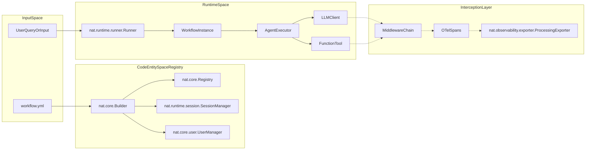

<!-- source: DeepWiki mcp.deepwiki.com · repo NVIDIA/NeMo-Agent-Toolkit · page 1 Overview · fetched 2026-10-26 -->

# Overview

Relevant source files

The following files were used as context for generating this wiki page:

- [README.md](README.md)
- [ci/markdown-link-check-config.json](ci/markdown-link-check-config.json)
- [ci/scripts/path_checks.py](ci/scripts/path_checks.py)
- [ci/vale/styles/config/vocabularies/nat/accept.txt](ci/vale/styles/config/vocabularies/nat/accept.txt)
- [docs/Makefile](docs/Makefile)
- [docs/source/build-workflows/memory.md](docs/source/build-workflows/memory.md)
- [docs/source/components/agents/auto-memory-wrapper/auto-memory-wrapper.md](docs/source/components/agents/auto-memory-wrapper/auto-memory-wrapper.md)
- [docs/source/components/integrations/index.md](docs/source/components/integrations/index.md)
- [docs/source/components/integrations/integrating-oci-generative-ai-models.md](docs/source/components/integrations/integrating-oci-generative-ai-models.md)
- [docs/source/conf.py](docs/source/conf.py)
- [docs/source/index.md](docs/source/index.md)
- [examples/README.md](examples/README.md)
- [examples/agents/auto_memory_wrapper/README.md](examples/agents/auto_memory_wrapper/README.md)
- [examples/dynamo_integration/react_benchmark_agent/uv.lock](examples/dynamo_integration/react_benchmark_agent/uv.lock)
- [examples/frameworks/agno_personal_finance/pyproject.toml](examples/frameworks/agno_personal_finance/pyproject.toml)
- [examples/frameworks/haystack_deep_research_agent/pyproject.toml](examples/frameworks/haystack_deep_research_agent/pyproject.toml)
- [examples/frameworks/multi_frameworks/pyproject.toml](examples/frameworks/multi_frameworks/pyproject.toml)
- [examples/memory/memanto/README.md](examples/memory/memanto/README.md)
- [examples/safety_and_security/retail_agent/uv.lock](examples/safety_and_security/retail_agent/uv.lock)
- [packages/nvidia_nat_agno/pyproject.toml](packages/nvidia_nat_agno/pyproject.toml)
- [packages/nvidia_nat_langchain/pyproject.toml](packages/nvidia_nat_langchain/pyproject.toml)
- [packages/nvidia_nat_langchain/src/nat/plugins/langchain/agent/auto_memory_wrapper/agent.py](packages/nvidia_nat_langchain/src/nat/plugins/langchain/agent/auto_memory_wrapper/agent.py)
- [packages/nvidia_nat_llama_index/pyproject.toml](packages/nvidia_nat_llama_index/pyproject.toml)
- [packages/nvidia_nat_weave/pyproject.toml](packages/nvidia_nat_weave/pyproject.toml)
- [pyproject.toml](pyproject.toml)
- [uv.lock](uv.lock)

The NVIDIA NeMo Agent Toolkit (NAT) is a comprehensive framework designed to build, deploy, evaluate, and optimize AI agents. It serves as a unifying library that connects existing enterprise agents to data sources and tools across multiple frameworks, including LangChain, LlamaIndex, CrewAI, Agno, and Microsoft Semantic Kernel [pyproject.toml:25-89](). NAT provides enterprise-grade instrumentation, profiling capabilities, and facilities for continuous improvement through automated evaluation and hyperparameter optimization [README.md:36-38]().

This overview introduces the core architecture and execution flow of the toolkit. For installation, setup, API key configuration, and your first workflow creation, see [Getting Started](#1.1). For an in-depth explanation of fundamental concepts such as workflows, agents, tools, functions, LLMs, middleware, and the Builder pattern, see [Core Concepts](#1.2).

Sources: [pyproject.toml:25-89](), [README.md:36-38]()

---

## Package Architecture

NAT employs a modular "meta-package" design. The `nvidia-nat` package centrally aggregates core functionality (`nvidia-nat-core`) and multiple optional integration and extension packages [pyproject.toml:25-89](). This modularity allows users to install only the dependencies required for their specific framework or use case (e.g., `uv pip install "nvidia-nat[langchain]"`). The toolkit decouples specialized capabilities like evaluation, profiling, and optimization into dedicated sub-packages to maintain a lightweight core [pyproject.toml:50-88]().

### Package Organization Diagram

```mermaid
graph TB
    subgraph "DistributionPackages"
        NAT["nvidia-nat"] -- "depends on" --> CORE["nvidia-nat-core"]
    end

    subgraph "FrameworkIntegrations"
        CORE --> LC["nvidia-nat-langchain"]
        CORE --> LI["nvidia-nat-llama-index"]
        CORE --> CA["nvidia-nat-crewai"]
        CORE --> SK["nvidia-nat-semantic-kernel"]
        CORE --> AGNO["nvidia-nat-agno"]
        CORE --> A365["nvidia-nat-a365"]
        CORE --> AUTOGEN["nvidia-nat-autogen"]
        CORE --> ADK["nvidia-nat-adk"]
        CORE --> STRANDS["nvidia-nat-strands"]
    end

    subgraph "ObservabilityAndEvaluation"
        CORE --> OTEL["nvidia-nat-opentelemetry"]
        CORE --> EVAL["nvidia-nat-eval"]
        CORE --> PROF["nvidia-nat-profiler"]
        CORE --> WEAVE["nvidia-nat-weave"]
        CORE --> PHOENIX["nvidia-nat-phoenix"]
        CORE --> ATIF["nvidia-nat-atif"]
        CORE --> RAGAS["nvidia-nat-ragas"]
        CORE --> DATA_FLYWHEEL["nvidia-nat-data-flywheel"]
        CORE --> CONFIG_OPTIMIZER["nvidia-nat-config-optimizer"]
        CORE --> NEMO_CUSTOMIZER["nvidia-nat-nemo-customizer"]
        CORE --> OPENPIPE_ART["nvidia-nat-openpipe-art"]
    end
    
    subgraph "ProtocolAndServing"
        CORE --> MCP["nvidia-nat-mcp"]
        CORE --> FASTMCP["nvidia-nat-fastmcp"]
        CORE --> A2A["nvidia-nat-a2a"]
        CORE --> APP["nvidia-nat-app"]
    end
    
    subgraph "StorageAndMemory"
        CORE --> REDIS["nvidia-nat-redis"]
        CORE --> MYSQL["nvidia-nat-mysql"]
        CORE --> S3["nvidia-nat-s3"]
        CORE --> MEM0["nvidia-nat-mem0ai"]
        CORE --> ZEP["nvidia-nat-zep-cloud"]
        CORE --> MM["nvidia-nat-memmachine"]
    end

    subgraph "Security"
        CORE --> SECURITY["nvidia-nat-security"]
    end
```

**Description:** This diagram illustrates the relationship between the meta-package (`nvidia-nat`), the foundational core (`nvidia-nat-core`), and specialized sub-packages for frameworks, observability, protocols, and storage/memory backends.

Sources: [pyproject.toml:50-88](), [README.md:46-48]()

---

## Core System Components

The toolkit is built around several high-level abstractions that bridge natural language requirements to executable code entities. For detailed explanations of fundamental concepts like workflows, agents, tools, functions, LLMs, middleware, and the Builder pattern, refer to [Core Concepts](#1.2).

| Component Category | Description | Key Code Entities |
| :--- | :--- | :--- |
| **Workflow Engine** | Orchestrates agent logic and execution patterns | `react_agent`, `rewoo_agent`, `tool_calling_agent`, `router_agent`, `sequential_executor`, `auto_memory_agent` |
| **Builder System** | Registry and factory for component instantiation | `nat.core.Builder`, `@register_function`, `@register_llm_client` |
| **LLM Abstraction** | Unified interface for multiple model providers | `NIMModelConfig`, `OpenAIModelConfig`, `DynamoModelConfig` |
| **Middleware** | Interceptors for augmenting function and LLM calls | `TimeoutMiddleware`, `LoggingMiddleware`, `PIIDefenseMiddleware`, `NeMoGuardrailsMiddleware`, `HITLMiddleware`, `CircuitBreakerMiddleware` |
| **Telemetry** | OpenTelemetry-based tracing and profiling | `ATIF`, `ATOF`, `ProcessingExporter`, `Profiler` |

Sources: [pyproject.toml:88-91](), [docs/source/build-workflows/memory.md:86-123]()

---

## Execution Architecture

NAT workflows can be executed via the `nat` CLI, served as a FastAPI-based web service, or embedded directly into Python applications.

### Execution Flow and Entity Mapping

**Description:** This diagram bridges natural language configuration and inputs to runtime code entities. The `nat.core.Builder` uses the registry, session manager (`nat.runtime.session.SessionManager`), and centralized user manager (`nat.core.user.UserManager`) to instantiate the workflow. The `nat.runtime.runner.Runner` handles input execution. Execution of `LLMClient` and `FunctionTool` components is intercepted by the `MiddlewareChain` to generate `OTelSpans` processed by the `ProcessingExporter`.

Sources: [docs/source/index.md:139-144](), [pyproject.toml:50-88]()

---

## Core Capabilities

### Framework-Agnostic Integration
NAT works side-by-side with existing frameworks. It provides wrappers that allow LangChain, LlamaIndex, and other agents to benefit from NAT's instrumentation and optimization without requiring a full rewrite of the agent logic [README.md:51-54]().

### Observability and Profiling
The toolkit includes a specialized `Profiler` that tracks execution down to individual tokens and tool calls [README.md:56-58](). It integrates natively with platforms like **LangSmith**, **Arize Phoenix**, **W&B Weave**, and **Langfuse**, plus compatibility with OpenTelemetry-based systems [README.md:44-46](), [docs/source/index.md:62](). Standardized trajectory formats include **ATIF** (Agentic Trajectory Interchange Format) and **ATOF** (Agentic Trajectory Observability Format) [docs/source/index.md:62]().

### Performance and Optimization
* **Agent Performance Primitives (APP):** Accelerates graph-based frameworks (LangChain, CrewAI, Agno) using parallel execution, speculative branching, and node-level priority routing [README.md:43-44]().
* **Dynamo Runtime Intelligence:** Uses runtime hints for cache control and load-aware routing to improve inference performance at scale [README.md:42-43]().
* **Optimizer:** Automatically tunes prompts and hyperparameters using genetic algorithms and Optuna [README.md:60-62]().

### Protocol and Third-Party Support
* **Model Context Protocol (MCP):** Acts as both an MCP client (consuming tools) and an MCP server (publishing workflows) [docs/source/index.md:68](). FastMCP support allows publishing NAT workflows as MCP-native services [README.md:47-48]().
* **Agent-to-Agent (A2A):** Enables distributed agent teams to communicate and delegate tasks securely using the `a2a-sdk` [uv.lock:30-40]().
* **Third-Party Plugins:** Supports provider-managed integrations such as **Tavily**, **Redis**, **ATR**, and **Memanto** via a public Plugin API [README.md:45]().

### Security and Safety
NAT integrates **NeMo Guardrails** for enforcing input/output policies at function boundaries via defense middleware [pyproject.toml:81-83](). It also provides a Red Teaming framework to test agent resilience against injection attacks [docs/source/index.md:20-22]().

### AI Coding Agent Skills
The toolkit includes focused NeMo Agent Toolkit skills for coding agents to provide task-specific guidance for building, evaluating, and observing workflows [README.md:41-42]().

Sources: [README.md:36-71](), [pyproject.toml:25-89](), [docs/source/index.md:54-70](), [uv.lock:30-40]()

---

## Next Steps

For detailed guides and deep dives into specific subsystems, explore the child pages:
* [Getting Started](#1.1) — Installation, basic setup, API key configuration, and first workflow creation.
* [Core Concepts](#1.2) — Detailed look at workflows, agents, tools, functions, LLMs, middleware, and the Builder pattern.

Sources: [README.md:36-71]()

---

