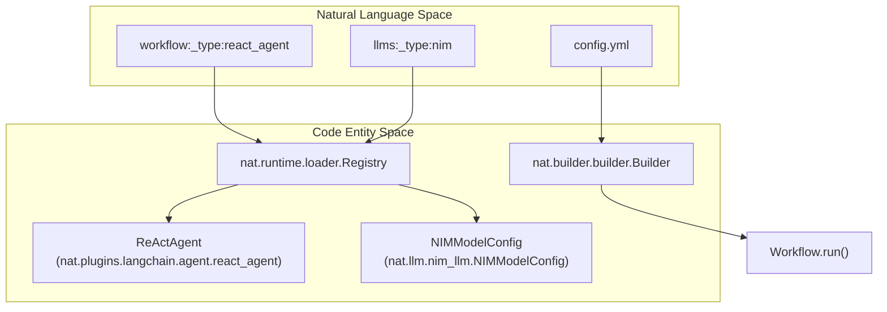
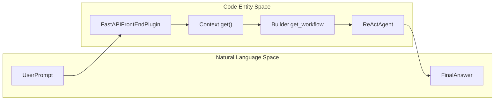

<!-- source: DeepWiki mcp.deepwiki.com · repo NVIDIA/NeMo-Agent-Toolkit · page 1.1 Getting Started · fetched 2026-10-26 -->

# Getting Started

<details>
<summary>Relevant source files</summary>

The following files were used as context for generating this wiki page:

- [.pre-commit-config.yaml](.pre-commit-config.yaml)
- [ci/release/update-version.sh](ci/release/update-version.sh)
- [docs/README.md](docs/README.md)
- [docs/source/versions1.json](docs/source/versions1.json)
- [examples/HITL/por_to_jiratickets/src/nat_por_to_jiratickets/configs/config.yml](examples/HITL/por_to_jiratickets/src/nat_por_to_jiratickets/configs/config.yml)
- [examples/HITL/por_to_jiratickets/src/nat_por_to_jiratickets/extract_por_tool.py](examples/HITL/por_to_jiratickets/src/nat_por_to_jiratickets/extract_por_tool.py)
- [examples/HITL/por_to_jiratickets/src/nat_por_to_jiratickets/hitl_approval_tool.py](examples/HITL/por_to_jiratickets/src/nat_por_to_jiratickets/hitl_approval_tool.py)
- [examples/HITL/por_to_jiratickets/src/nat_por_to_jiratickets/jira_tickets_tool.py](examples/HITL/por_to_jiratickets/src/nat_por_to_jiratickets/jira_tickets_tool.py)
- [examples/getting_started/simple_calculator/src/nat_simple_calculator/configs/config-reasoning.yml](examples/getting_started/simple_calculator/src/nat_simple_calculator/configs/config-reasoning.yml)
- [examples/notebooks/getting_started_with_nat.ipynb](examples/notebooks/getting_started_with_nat.ipynb)
- [examples/notebooks/launchables/GPU_Cluster_Sizing_with_NeMo_Agent_Toolkit.ipynb](examples/notebooks/launchables/GPU_Cluster_Sizing_with_NeMo_Agent_Toolkit.ipynb)
- [examples/notebooks/observability_evaluation_and_profiling.ipynb](examples/notebooks/observability_evaluation_and_profiling.ipynb)
- [examples/observability/simple_calculator_observability/configs/config-otel-file.yml](examples/observability/simple_calculator_observability/configs/config-otel-file.yml)
- [packages/nvidia_nat_core/src/nat/meta/pypi.md](packages/nvidia_nat_core/src/nat/meta/pypi.md)
- [packages/nvidia_nat_langchain/src/nat/plugins/langchain/agent/reasoning_agent/reasoning_agent.py](packages/nvidia_nat_langchain/src/nat/plugins/langchain/agent/reasoning_agent/reasoning_agent.py)

</details>


## Purpose and Scope
This page guides users through environment setup, package installation, API key configuration, and the creation and execution of your first workflow using the NVIDIA NeMo Agent Toolkit (`nat`). It bridges declarative configuration specifications to underlying code entities to help developers rapidly bootstrap agent applications.

---

## Prerequisites

Before installing the toolkit, ensure your development environment satisfies the required system specifications:

| Requirement | Specification | Sources |
|---|---|---|
| Python Version | 3.11, 3.12, or 3.13 | [examples/notebooks/getting_started_with_nat.ipynb:60-65]() |
| Package Manager | `uv` (recommended for parallel downloads) or `pip` | [examples/notebooks/getting_started_with_nat.ipynb:132-136]() |
| OS Support | Linux, macOS, or Windows (WSL2) | [examples/notebooks/getting_started_with_nat.ipynb:60-65]() |
| API Keys | Required LLM provider keys (e.g., NVIDIA Build API Key) | [examples/notebooks/getting_started_with_nat.ipynb:82-87]() |

Sources: [examples/notebooks/getting_started_with_nat.ipynb:60-87]()

---

## Installation and Packages

The toolkit is distributed via the PyPI meta-package `nvidia-nat`. To maximize performance and dependency resolution speed, installation via `uv` is recommended [examples/notebooks/getting_started_with_nat.ipynb:132-136]().

### Installing Core and Framework Extras

To install the core package alongside framework integrations such as LangChain, use:

```bash
uv pip install "nvidia-nat[langchain]"
```

Alternatively, using standard `pip`:

```bash
pip install "nvidia-nat[langchain]"
```

Sources: [examples/notebooks/getting_started_with_nat.ipynb:132-177]()

---

## API Key Configuration

Workflow execution requires authenticating with LLM providers. Set your provider keys in the environment before invoking workflows:

```bash
export NVIDIA_API_KEY="nvapi-..."
```

For tutorial runs or automated scripting, telemetry can also be optionally controlled via environment variables:

```bash
export NAT_TELEMETRY_ENABLED="false"
```

Sources: [examples/notebooks/getting_started_with_nat.ipynb:95-124]()

---

## Creating and Running Your First Workflow

Workflows are specified via YAML files that configure agents, tools, and underlying LLM models [examples/notebooks/getting_started_with_nat.ipynb:190-208]().

### Configuration to Code Mapping

The toolkit parses declarative configurations and instantiates concrete Python classes via the plugin registry and `Builder` pattern.

Title: Configuration to Code Entity Mapping

Sources: [examples/getting_started/simple_calculator/src/nat_simple_calculator/configs/config-reasoning.yml:34-60](), [packages/nvidia_nat_langchain/src/nat/plugins/langchain/agent/reasoning_agent/reasoning_agent.py:33-71]()

### Executing via CLI, Server, or Embedded Python

Workflows can be executed through multiple interfaces:

1. **Direct CLI Execution**:
   ```bash
   nat run --config_file config.yml --input "Calculate 2 + 2"
   ```
2. **Server Mode (FastAPI)**:
   ```bash
   nat start fastapi --config_file config.yml --port 8000
   ```
3. **Embedded Python**:
   ```python
   from nat.builder.builder import Builder
   # Load and execute workflow programmatically within python applications
   ```

Sources: [examples/notebooks/getting_started_with_nat.ipynb:1-200](), [examples/HITL/por_to_jiratickets/src/nat_por_to_jiratickets/configs/config.yml:17-24]()

---

## System Execution Flow

Requests processed by front-end interfaces pass through session managers and load loaders to invoke the core agent workflow implementation.

Title: User Request to Agent Execution Flow

Sources: [examples/HITL/por_to_jiratickets/src/nat_por_to_jiratickets/configs/config.yml:17-72](), [examples/HITL/por_to_jiratickets/src/nat_por_to_jiratickets/hitl_approval_tool.py:53-72]()

---

