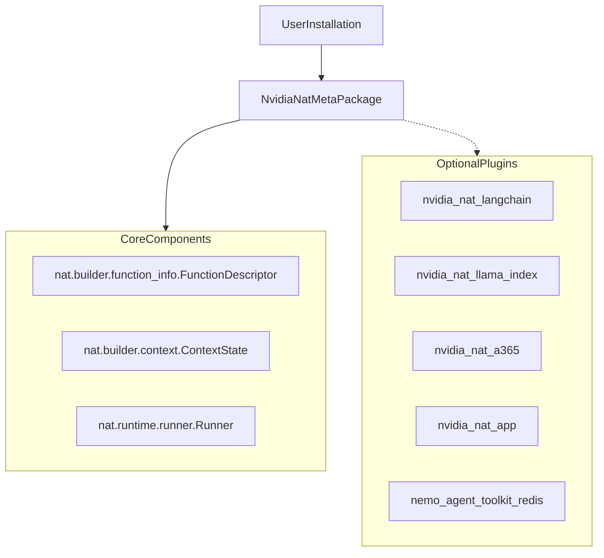
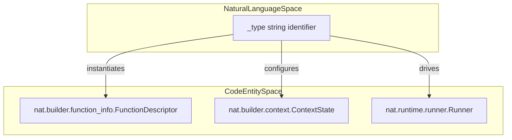
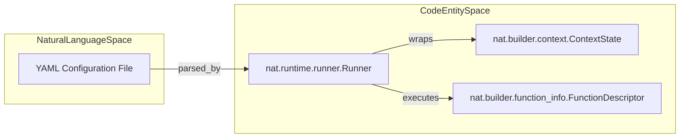

<!-- source: DeepWiki mcp.deepwiki.com · repo NVIDIA/NeMo-Agent-Toolkit · page 1.2 Core Concepts · fetched 2026-10-26 -->

# Core Concepts

Relevant source files

The following files were used as context for generating this wiki page:

- [packages/nvidia_nat_core/src/nat/builder/context.py](packages/nvidia_nat_core/src/nat/builder/context.py)
- [packages/nvidia_nat_core/src/nat/builder/function_info.py](packages/nvidia_nat_core/src/nat/builder/function_info.py)
- [packages/nvidia_nat_core/src/nat/builder/intermediate_step_manager.py](packages/nvidia_nat_core/src/nat/builder/intermediate_step_manager.py)
- [packages/nvidia_nat_core/src/nat/builder/user_interaction_manager.py](packages/nvidia_nat_core/src/nat/builder/user_interaction_manager.py)
- [packages/nvidia_nat_core/src/nat/runtime/runner.py](packages/nvidia_nat_core/src/nat/runtime/runner.py)
- [packages/nvidia_nat_core/src/nat/utils/providers.py](packages/nvidia_nat_core/src/nat/utils/providers.py)
- [packages/nvidia_nat_core/tests/nat/builder/test_function_info.py](packages/nvidia_nat_core/tests/nat/builder/test_function_info.py)
- [packages/nvidia_nat_core/tests/nat/builder/test_function_info_future_annotations.py](packages/nvidia_nat_core/tests/nat/builder/test_function_info_future_annotations.py)
- [packages/nvidia_nat_core/tests/nat/builder/test_interactive.py](packages/nvidia_nat_core/tests/nat/builder/test_interactive.py)
- [packages/nvidia_nat_core/tests/nat/builder/test_intermediate_step_manager.py](packages/nvidia_nat_core/tests/nat/builder/test_intermediate_step_manager.py)
- [packages/nvidia_nat_core/tests/nat/runtime/test_runner.py](packages/nvidia_nat_core/tests/nat/runtime/test_runner.py)
- [packages/nvidia_nat_core/tests/nat/runtime/test_runner_trace_ids.py](packages/nvidia_nat_core/tests/nat/runtime/test_runner_trace_ids.py)
- [packages/nvidia_nat_core/tests/nat/utils/test_providers.py](packages/nvidia_nat_core/tests/nat/utils/test_providers.py)

## Purpose and Scope

This page defines the foundational vocabulary, architectural patterns, and runtime abstractions used throughout the NVIDIA NeMo Agent Toolkit (NAT). It covers the component model, plugin discovery system, YAML configuration structure, type registry, and the Builder pattern that together enable a modular, framework-agnostic agent architecture.

Sources: [docs/source/conf.py:30-88](), [packages/nvidia_nat_core/src/nat/builder/context.py:42-143]()

## Foundational Vocabulary

| Term | Definition |
|------|-----------|
| **Workflow** | The executable entry point defined in a configuration file specifying how agents, models, and tools are composed. |
| **Agent** | A specialized function/workflow driven by an LLM reasoning loop (e.g., ReAct, ReWOO). |
| **Function** | A callable unit (tool) registered with the toolkit via registration decorators. NAT handles schema generation, type conversion, and middleware attachment [packages/nvidia_nat_core/src/nat/builder/function_info.py:118-182](). |
| **Function Group** | A named collection of related functions registered together, allowing for modular tool management. |
| **LLM Provider** | A configuration schema and client adapter for an LLM backend (e.g., NIM, OpenAI, vLLM). |
| **Builder** | The central factory system that resolves `_type` fields in configuration files to live component instances. |
| **Registry** | The global mapping from `_type` strings to registered factory functions and classes, enabling the toolkit's extensibility. |
| **Plugin** | A Python package that registers components via entry points or decorators [docs/source/conf.py:74-88](). |
| **Middleware** | Interceptors that wrap function or LLM calls to provide cross-cutting concerns like logging, timeout handling, circuit breaking, or human-in-the-loop (HITL) validation. |
| **Memory** | Plugins used to store and retrieve conversation history and facts from databases (e.g., Redis, Zep, Mem0). |

Sources: [packages/nvidia_nat_core/src/nat/builder/function_info.py:118-182](), [docs/source/conf.py:74-88]()

## Package Architecture

NVIDIA NeMo Agent Toolkit uses a **meta-package architecture**. The meta-package coordinates core logic and framework-specific integrations as optional extras (e.g., `nvidia-nat[langchain]`) [docs/source/conf.py:74-88]().

### Meta-Package Structure

Title: "Meta-Package Dependency Graph"

Sources: [docs/source/conf.py:74-88](), [packages/nvidia_nat_core/src/nat/runtime/runner.py:52-80]()

## Component Type System and Registry

NAT organizes functionality into **components** instantiated through a type-based configuration system. Each component defines a unique `_type` identifier that maps to a Pydantic configuration model and a factory function registered in the global type registry.

### Component Mapping to Code Entities

This diagram bridges natural language/configuration types to their corresponding code entities in the codebase.

Title: "Component Mapping to Code Entities"

| Component Category | Purpose | Example Implementation |
|--------------------|---------|------------------------|
| **Function** | Tools and executable agents | `FunctionDescriptor`, `FunctionInfo` [packages/nvidia_nat_core/src/nat/builder/function_info.py:118-182]() |
| **LLM** | Language model backends | NIM, OpenAI, vLLM integrations |
| **Embedder** | Text embedding providers | Vector embedder configurations |
| **Memory** | State persistence backends | Redis, Mem0, Zep integrations |

Sources: [packages/nvidia_nat_core/src/nat/builder/function_info.py:118-182](), [packages/nvidia_nat_core/src/nat/builder/context.py:67-141]()

## The Builder Pattern

The toolkit employs the Builder pattern to transform static configurations into fully initialized, interconnected Python execution graphs. Configuration objects inherit from Pydantic `BaseModel` classes, ensuring strict validation before instantiation [packages/nvidia_nat_core/src/nat/builder/function_info.py:26-30]().

### YAML to Code Entity Resolution

This diagram illustrates how declarative workflow files are parsed and resolved into runtime builder components.

Title: "YAML to Code Entity Resolution"

Sources: [packages/nvidia_nat_core/src/nat/runtime/runner.py:52-101](), [packages/nvidia_nat_core/src/nat/builder/function_info.py:118-182]()

## Runtime, Context State, and Provider Hooks

Execution is managed by runner abstractions and task-local context variables to handle concurrent invocations safely.

- **Runner Lifecycle:** `Runner` handles input/output conversion, state initialization, and execution context management [packages/nvidia_nat_core/src/nat/runtime/runner.py:52-101]().
- **Context State:** `ContextState` maintains task-local context variables (`ContextVar`) such as `conversation_id`, `user_id`, `workflow_run_id`, and `observability_trace_id` [packages/nvidia_nat_core/src/nat/builder/context.py:67-100]().
- **Provider Hooks:** NAT utilizes process-wide provider hooks (`set_id_provider`, `set_time_provider`) defined in `nat.utils.providers` for deterministic ID generation and timestamp tracking [packages/nvidia_nat_core/src/nat/utils/providers.py:55-101]().
- **User Interaction Manager:** `UserInteractionManager` manages human-in-the-loop interaction prompts and responses [packages/nvidia_nat_core/src/nat/builder/user_interaction_manager.py:30-75]().

Sources: [packages/nvidia_nat_core/src/nat/runtime/runner.py:52-101](), [packages/nvidia_nat_core/src/nat/builder/context.py:67-100](), [packages/nvidia_nat_core/src/nat/utils/providers.py:55-101](), [packages/nvidia_nat_core/src/nat/builder/user_interaction_manager.py:30-75]()

## Middleware System and Interception

Middleware components wrap function execution and LLM invocations to inject cross-cutting behaviors.

- **Interception Phases:** Middleware intercepts pre-invoke and post-invoke steps, allowing inspection, caching, timeout enforcement, circuit breaking, or human-in-the-loop approvals.
- **Event Streams and Intermediate Steps:** `IntermediateStepManager` and `IntermediateStepPayload` capture runtime events (`IntermediateStepType`, `IntermediateStepState`) for tracking and observability [packages/nvidia_nat_core/src/nat/builder/intermediate_step_manager.py:48-92]().

Sources: [packages/nvidia_nat_core/src/nat/builder/intermediate_step_manager.py:48-92]()

---

