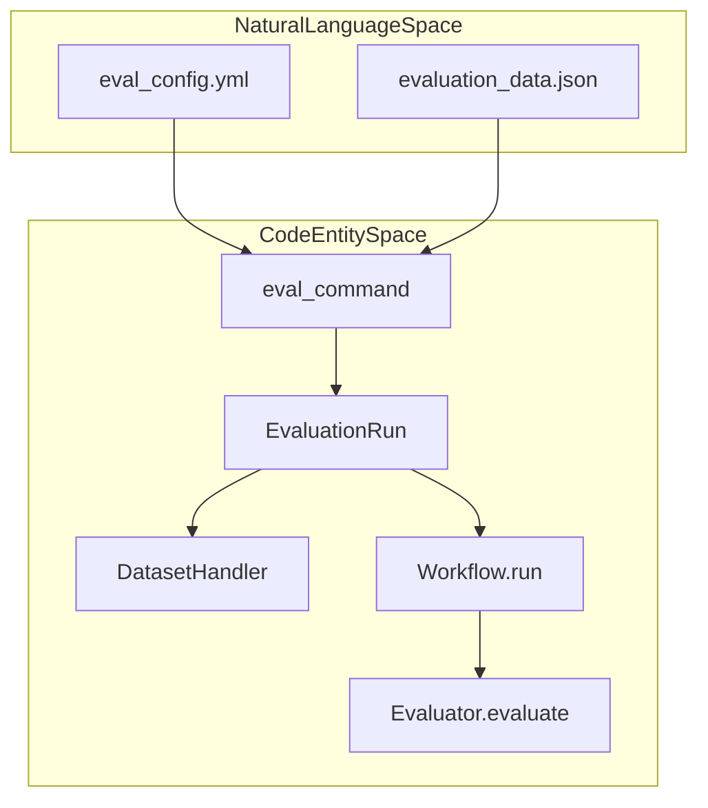
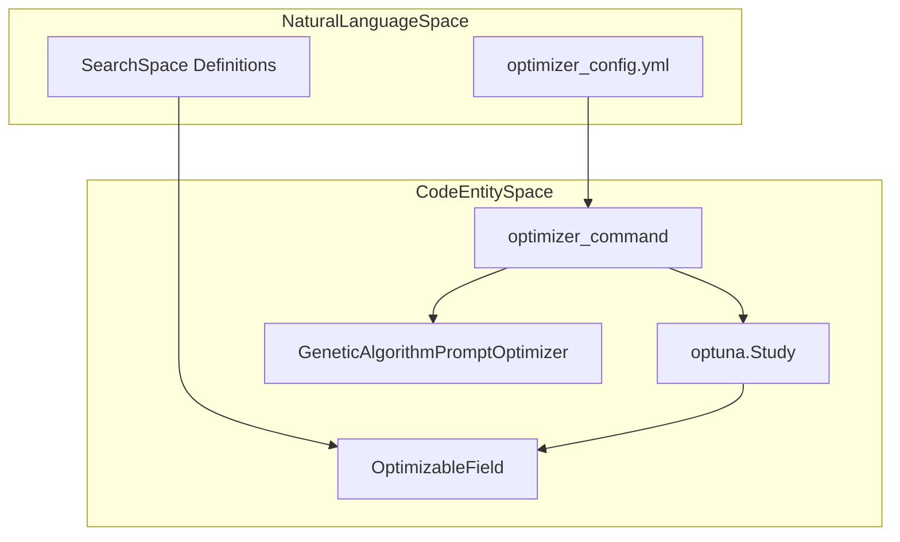

<!-- source: DeepWiki mcp.deepwiki.com · repo NVIDIA/NeMo-Agent-Toolkit · page 10 Evaluation and Optimization · fetched 2026-10-26 -->

# Evaluation and Optimization

Relevant source files

The following files were used as context for generating this wiki page:

- [docs/source/improve-workflows/about-improving-workflows.md](docs/source/improve-workflows/about-improving-workflows.md)
- [docs/source/improve-workflows/evaluate.md](docs/source/improve-workflows/evaluate.md)
- [docs/source/improve-workflows/finetuning/index.md](docs/source/improve-workflows/finetuning/index.md)
- [docs/source/improve-workflows/finetuning/rl_with_openpipe.md](docs/source/improve-workflows/finetuning/rl_with_openpipe.md)

This page provides a high-level overview of the evaluation and optimization capabilities in the NVIDIA NeMo Agent Toolkit. These systems enable systematic measurement of workflow quality, hyperparameter tuning, prompt optimization, test-time compute scaling, and in-situ reinforcement learning.

**Scope:** This page serves as a parent guide introducing the evaluation, optimization, custom evaluator development, and test-time compute subsystems. For detailed technical implementation, refer to the child pages:

| Page | Title | Coverage |
|------|-------|----------|
| 10.1 | [Evaluation Framework](#10.1) | Evaluation harness, dataset loading, remote evaluation, and execution flow [docs/source/improve-workflows/about-improving-workflows.md:22-22]() |
| 10.2 | [Evaluators and Metrics](#10.2) | Built-in evaluators (TSQ, Accuracy, Runtime, Latency, RAGAS) and ATIF trajectory evaluation [docs/source/improve-workflows/evaluate.md:20-22]() |
| 10.3 | [Optimizer](#10.3) | Hyperparameter optimization using genetic algorithms and Optuna, prompt optimization, and config-optimizer [docs/source/improve-workflows/optimizer.md:45-51]() |
| 10.4 | [Custom Evaluator Development](#10.4) | Guide for creating custom evaluators with registration and implementation patterns [docs/source/improve-workflows/evaluate.md:22-22]() |
| 10.5 | [Test-Time Compute](#10.5) | TTC framework featuring Search, Editing, Scoring, and Selection strategy pipeline [docs/source/improve-workflows/about-improving-workflows.md:26-26]() |

---

## Workflow Improvement Lifecycle

The evaluation and optimization systems form an iterative development loop. The `nat eval` command measures workflow quality against datasets [packages/nvidia_nat_eval/src/nat/plugins/eval/cli/evaluate.py:52-117](), while `nat optimize` uses those metrics to tune parameters and prompts [docs/source/improve-workflows/optimizer.md:73-79](). Additionally, the Finetuning Harness supports reinforcement learning through experience [docs/source/improve-workflows/finetuning/index.md:21-27]().

### Diagram: Evaluation Pipeline Mapping

Sources: [packages/nvidia_nat_eval/src/nat/plugins/eval/runtime/evaluate.py:88-143](), [packages/nvidia_nat_eval/src/nat/plugins/eval/cli/evaluate.py:52-117]()

---

## 10.1 Evaluation Framework

The evaluation framework executes workflows on curated test data and measures quality using quantitative metrics [docs/source/improve-workflows/evaluate.md:18-20](). It handles dataset loading across formats like JSON, JSONL, CSV, XLS, and Parquet, manages concurrency, and outputs structured artifacts including workflow outputs, configuration metadata, and usage statistics [docs/source/improve-workflows/evaluate.md:127-149]().

For details, see [Evaluation Framework](#10.1).

Sources: [docs/source/improve-workflows/evaluate.md:18-149]()

---

## 10.2 Evaluators and Metrics

The toolkit provides built-in evaluators to measure answer accuracy, faithfulness, runtime, and token latency [docs/source/improve-workflows/evaluate.md:20-22](). It supports RAGAS metrics (e.g., `AnswerAccuracy`) and ATIF trajectory evaluations to assess intermediate steps and reasoning traces [docs/source/improve-workflows/evaluate.md:131-135]().

For details, see [Evaluators and Metrics](#10.2).

Sources: [docs/source/improve-workflows/evaluate.md:20-135]()

---

## 10.3 Optimizer

The optimization system (`nvidia-nat-config-optimizer`) automatically discovers ideal hyperparameters and prompts [docs/source/improve-workflows/optimizer.md:23-28](). It integrates [Optuna](https://optuna.org/) for numerical hyperparameter search and custom genetic algorithms (GA) for prompt evolution over multiple generations [docs/source/improve-workflows/optimizer.md:75-79]().

### Diagram: Optimizer and Search Space Mapping

Sources: [docs/source/improve-workflows/optimizer.md:73-79]()

For details, see [Optimizer](#10.3).

Sources: [docs/source/improve-workflows/optimizer.md:23-79]()

---

## 10.4 Custom Evaluator Development

Developers can extend the evaluation harness by writing custom evaluators using the framework's registration decorators and plugin hooks [docs/source/improve-workflows/evaluate.md:22-22](). Custom evaluators plug directly into the configuration-driven execution pipeline alongside built-in metrics [docs/source/improve-workflows/evaluate.md:120-135]().

For details, see [Custom Evaluator Development](#10.4).

Sources: [docs/source/improve-workflows/evaluate.md:20-135]()

---

## 10.5 Test-Time Compute

The Test-Time Compute (TTC) framework scales agent execution performance at runtime using a composable pipeline of Search, Editing, Scoring, and Selection strategies [docs/source/improve-workflows/about-improving-workflows.md:26-26]().

For details, see [Test-Time Compute](#10.5).

Sources: [docs/source/improve-workflows/about-improving-workflows.md:26-26]()

---

## Finetuning and Reinforcement Learning Integration

The NeMo Agent Toolkit features a finetuning harness for in-situ reinforcement learning of agentic workflows [docs/source/improve-workflows/finetuning/index.md:21-27]().

- **Decoupled Architecture**: Separates training logic from backends like OpenPipe ART [docs/source/improve-workflows/finetuning/index.md:31-35]().
- **GRPO Training**: Implements Group Relative Policy Optimization to evaluate multiple responses per prompt without a separate value function [docs/source/improve-workflows/finetuning/rl_with_openpipe.md:28-29]().
- **Pluggable Components**: Utilizes `TrajectoryBuilder`, `TrainerAdapter`, and `Trainer` components to collect episodes and compute reward signals [docs/source/improve-workflows/finetuning/index.md:38-38]().

Sources: [docs/source/improve-workflows/finetuning/index.md:21-40](), [docs/source/improve-workflows/finetuning/rl_with_openpipe.md:28-74]()

---

