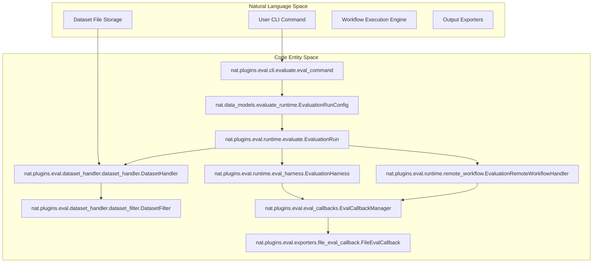

<!-- source: DeepWiki mcp.deepwiki.com · repo NVIDIA/NeMo-Agent-Toolkit · page 10.1 Evaluation Framework · fetched 2026-10-26 -->

# Evaluation Framework

<details>
<summary>Relevant source files</summary>

The following files were used as context for generating this wiki page:

- [packages/nvidia_nat_core/src/nat/data_models/dataset_handler.py](packages/nvidia_nat_core/src/nat/data_models/dataset_handler.py)
- [packages/nvidia_nat_eval/src/nat/plugins/eval/cli/evaluate.py](packages/nvidia_nat_eval/src/nat/plugins/eval/cli/evaluate.py)
- [packages/nvidia_nat_eval/src/nat/plugins/eval/dataset_handler/dataset_filter.py](packages/nvidia_nat_eval/src/nat/plugins/eval/dataset_handler/dataset_filter.py)
- [packages/nvidia_nat_eval/src/nat/plugins/eval/eval_callbacks.py](packages/nvidia_nat_eval/src/nat/plugins/eval/eval_callbacks.py)
- [packages/nvidia_nat_eval/src/nat/plugins/eval/exporters/__init__.py](packages/nvidia_nat_eval/src/nat/plugins/eval/exporters/__init__.py)
- [packages/nvidia_nat_eval/src/nat/plugins/eval/exporters/file_eval_callback.py](packages/nvidia_nat_eval/src/nat/plugins/eval/exporters/file_eval_callback.py)
- [packages/nvidia_nat_eval/src/nat/plugins/eval/runtime/evaluate.py](packages/nvidia_nat_eval/src/nat/plugins/eval/runtime/evaluate.py)
- [packages/nvidia_nat_eval/src/nat/plugins/eval/runtime/remote_workflow.py](packages/nvidia_nat_eval/src/nat/plugins/eval/runtime/remote_workflow.py)
- [packages/nvidia_nat_eval/tests/eval/dataset_handler/test_dataset_filter.py](packages/nvidia_nat_eval/tests/eval/dataset_handler/test_dataset_filter.py)
- [packages/nvidia_nat_eval/tests/eval/dataset_handler/test_dataset_handler.py](packages/nvidia_nat_eval/tests/eval/dataset_handler/test_dataset_handler.py)
- [packages/nvidia_nat_eval/tests/eval/test_evaluate.py](packages/nvidia_nat_eval/tests/eval/test_evaluate.py)
- [packages/nvidia_nat_eval/tests/eval/test_file_eval_callback.py](packages/nvidia_nat_eval/tests/eval/test_file_eval_callback.py)
- [packages/nvidia_nat_eval/tests/eval/test_remote_evaluate.py](packages/nvidia_nat_eval/tests/eval/test_remote_evaluate.py)

</details>


## Purpose and Scope

The Evaluation Framework provides a systematic approach to measuring agent workflow performance through offline batch evaluation. It orchestrates the execution of workflows against curated test data and measures quality using quantitative metrics such as accuracy, reliability, and latency. Each of these metrics is produced by a specialized evaluator, such as the `AtifEvaluator` for trajectory analysis or the `LegacyEvaluator` for standard scoring `[packages/nvidia_nat_eval/src/nat/plugins/eval/runtime/evaluate.py:38-40]()`.

The framework supports repetition-based evaluation, concurrent execution, remote endpoint testing via `EvaluationRemoteWorkflowHandler`, dataset filtering via `DatasetFilter`, and deep integration with telemetry systems for trace linking. It produces detailed artifacts including workflow trajectories in Agentic Trajectory Interchange Format (ATIF), effective configurations, and performance summaries `[packages/nvidia_nat_eval/src/nat/plugins/eval/runtime/evaluate.py:88-95]()`, `[packages/nvidia_nat_eval/src/nat/plugins/eval/cli/evaluate.py:122-138]()`, `[packages/nvidia_nat_eval/src/nat/plugins/eval/runtime/remote_workflow.py:39-44]()`, `[packages/nvidia_nat_eval/src/nat/plugins/eval/dataset_handler/dataset_filter.py:23-34]()`.

Sources: `[packages/nvidia_nat_eval/src/nat/plugins/eval/runtime/evaluate.py:38-40]()`, `[packages/nvidia_nat_eval/src/nat/plugins/eval/runtime/evaluate.py:88-95]()`, `[packages/nvidia_nat_eval/src/nat/plugins/eval/cli/evaluate.py:122-138]()`, `[packages/nvidia_nat_eval/src/nat/plugins/eval/runtime/remote_workflow.py:39-44]()`, `[packages/nvidia_nat_eval/src/nat/plugins/eval/dataset_handler/dataset_filter.py:23-34]()`

## Core Components

### EvaluationRun Class
The `EvaluationRun` class is the primary orchestrator for evaluation execution. It is instantiated for each evaluation run and manages the lifecycle of dataset processing, workflow execution, and result aggregation `[packages/nvidia_nat_eval/src/nat/plugins/eval/runtime/evaluate.py:88-141]()`.

* **Key Class**: `nat.plugins.eval.runtime.evaluate.EvaluationRun` `[packages/nvidia_nat_eval/src/nat/plugins/eval/runtime/evaluate.py:88-88]()`
* **Primary Methods**:
  * `_compute_usage_stats()`: Processes trajectory data to calculate token usage and latency metrics by inspecting `LLM_END` events within the `IntermediateStep` trajectory `[packages/nvidia_nat_eval/src/nat/plugins/eval/runtime/evaluate.py:144-161]()`.
* **Attributes**:
  * `callback_manager`: An `EvalCallbackManager` instance that dispatches lifecycle events to exporters such as `FileEvalCallback` `[packages/nvidia_nat_eval/src/nat/plugins/eval/runtime/evaluate.py:105-110]()`.
  * `evaluation_harness`: An `EvaluationHarness` helper for executing the workflow logic, supporting both local execution and remote HTTP endpoint testing `[packages/nvidia_nat_eval/src/nat/plugins/eval/runtime/evaluate.py:118-118]()`.
  * `atif_adapter`: An `EvalAtifAdapter` that adapts internal `IntermediateStep` structures to the ATIF standard for trajectory evaluation `[packages/nvidia_nat_eval/src/nat/plugins/eval/runtime/evaluate.py:116-117]()`.

Sources: `[packages/nvidia_nat_eval/src/nat/plugins/eval/runtime/evaluate.py:88-161]()`

### EvaluationRunConfig Class
The `EvaluationRunConfig` class defines runtime parameters for evaluation execution, typically populated from CLI arguments `[packages/nvidia_nat_eval/src/nat/plugins/eval/cli/evaluate.py:33-35]()`, `[packages/nvidia_nat_eval/src/nat/plugins/eval/cli/evaluate.py:52-117]()`.

* **Key Class**: `nat.data_models.evaluate_runtime.EvaluationRunConfig` `[packages/nvidia_nat_eval/src/nat/plugins/eval/cli/evaluate.py:33-33]()`

| Field | Type | Description |
|-------|------|-------------|
| `config_file` | `Path` | Path to the YAML/JSON configuration file `[packages/nvidia_nat_eval/src/nat/plugins/eval/cli/evaluate.py:53-58]()`. |
| `dataset` | `Path` | Optional override for the dataset file path `[packages/nvidia_nat_eval/src/nat/plugins/eval/cli/evaluate.py:59-64]()`. |
| `reps` | `int` | Number of repetitions for each dataset entry `[packages/nvidia_nat_eval/src/nat/plugins/eval/cli/evaluate.py:98-103]()`. |
| `endpoint` | `str` | URL for remote workflow execution (e.g., `http://localhost:8000/generate`) `[packages/nvidia_nat_eval/src/nat/plugins/eval/cli/evaluate.py:87-91]()`. |
| `skip_workflow` | `bool` | Skip execution and evaluate existing results in a dataset containing `generated_` columns `[packages/nvidia_nat_eval/src/nat/plugins/eval/cli/evaluate.py:74-79]()`. |
| `user_id` | `str` | User ID to use for the workflow session context `[packages/nvidia_nat_eval/src/nat/plugins/eval/cli/evaluate.py:110-115]()`. |

Sources: `[packages/nvidia_nat_eval/src/nat/plugins/eval/cli/evaluate.py:33-117]()`

### Dataset Filtering and Handling
* `DatasetFilter`: Applies allowlist and denylist filters to dataset DataFrames based on column matches, supporting Unix shell-style wildcards (`*`, `?`, `[seq]`) `[packages/nvidia_nat_eval/src/nat/plugins/eval/dataset_handler/dataset_filter.py:23-34]()`.
* `DatasetHandler`: Manages loading and preprocessing of structured and unstructured evaluation datasets `[packages/nvidia_nat_core/src/nat/data_models/dataset_handler.py:31-86]()`, `[packages/nvidia_nat_eval/tests/eval/dataset_handler/test_dataset_handler.py:53-58]()`.

Sources: `[packages/nvidia_nat_eval/src/nat/plugins/eval/dataset_handler/dataset_filter.py:23-84]()`, `[packages/nvidia_nat_core/src/nat/data_models/dataset_handler.py:31-86]()`

## Evaluation Execution Flow

The framework coordinates the flow from CLI input to dataset processing, execution, and final metric export, mapping natural language user intents to concrete Python code entities.

Title: "NAT Evaluation Runtime Data Flow and Code Mapping"

Sources: `[packages/nvidia_nat_eval/src/nat/plugins/eval/runtime/evaluate.py:36-211]()`, `[packages/nvidia_nat_eval/src/nat/plugins/eval/cli/evaluate.py:52-117]()`, `[packages/nvidia_nat_eval/src/nat/plugins/eval/eval_callbacks.py:130-162]()`, `[packages/nvidia_nat_eval/src/nat/plugins/eval/dataset_handler/dataset_filter.py:66-84]()`, `[packages/nvidia_nat_eval/src/nat/plugins/eval/runtime/remote_workflow.py:132-139]()`

**Execution Sequence**:
1. **Initialization**: `EvaluationRun` is initialized with an `EvaluationRunConfig`. It registers a `FileEvalCallback` by default if output writing is enabled `[packages/nvidia_nat_eval/src/nat/plugins/eval/runtime/evaluate.py:106-110]()`, `[packages/nvidia_nat_eval/tests/eval/test_evaluate.py:100-103]()`.
2. **Dataset Loading & Filtering**: The `DatasetHandler` loads the dataset, and `DatasetFilter` applies allowlist/denylist criteria `[packages/nvidia_nat_core/src/nat/data_models/dataset_handler.py:31-86]()`, `[packages/nvidia_nat_eval/src/nat/plugins/eval/dataset_handler/dataset_filter.py:66-84]()`.
3. **Execution**: The workflow is invoked for each item. If an `endpoint` is provided, `EvaluationRemoteWorkflowHandler` streams requests via HTTP; otherwise, local execution proceeds through `EvaluationHarness` `[packages/nvidia_nat_eval/src/nat/plugins/eval/cli/evaluate.py:87-97]()`, `[packages/nvidia_nat_eval/src/nat/plugins/eval/runtime/evaluate.py:118-118]()`, `[packages/nvidia_nat_eval/src/nat/plugins/eval/runtime/remote_workflow.py:132-139]()`.
4. **Metrics Calculation**: Usage statistics (tokens, runtime) are computed from the `IntermediateStep` trajectory stored in `EvalInputItem` `[packages/nvidia_nat_eval/src/nat/plugins/eval/runtime/evaluate.py:144-161]()`.
5. **Finalization**: `EvalCallbackManager` triggers `on_eval_complete`, causing registered exporters to write evaluation output files `[packages/nvidia_nat_eval/src/nat/plugins/eval/eval_callbacks.py:130-136]()`, `[packages/nvidia_nat_eval/tests/eval/test_evaluate.py:100-103]()`.

Sources: `[packages/nvidia_nat_eval/src/nat/plugins/eval/runtime/evaluate.py:36-211]()`, `[packages/nvidia_nat_eval/src/nat/plugins/eval/cli/evaluate.py:52-117]()`, `[packages/nvidia_nat_eval/src/nat/plugins/eval/eval_callbacks.py:130-162]()`, `[packages/nvidia_nat_eval/src/nat/plugins/eval/dataset_handler/dataset_filter.py:66-84]()`, `[packages/nvidia_nat_eval/src/nat/plugins/eval/runtime/remote_workflow.py:132-139]()`

## Output Artifacts

Running `nat eval` generates artifacts in the designated output directory to support offline analysis.

### Workflow and Configuration Outputs
* `workflow_output.json`: Per-sample execution results containing input questions, expected answers, generated answers, and intermediate steps `[packages/nvidia_nat_eval/src/nat/plugins/eval/cli/evaluate.py:128-129]()`.
* `workflow_output_atif.json`: Standardized trajectory output formatted for the ATIF evaluation system `[packages/nvidia_nat_eval/src/nat/plugins/eval/cli/evaluate.py:130-132]()`.
* `config_original.yml`: The initial configuration file supplied by the user `[packages/nvidia_nat_eval/src/nat/plugins/eval/runtime/evaluate.py:137-137]()`.
* `config_effective.yml`: The resolved configuration containing all applied command-line overrides `[packages/nvidia_nat_eval/src/nat/plugins/eval/runtime/evaluate.py:138-138]()`.
* `config_metadata.json`: Run metadata, including arguments and execution timestamps `[packages/nvidia_nat_eval/src/nat/plugins/eval/runtime/evaluate.py:139-139]()`.

### Evaluator Outputs
Each evaluator generates an output file (such as `<evaluator-name>_output.json`) holding detailed scores and reasoning notes for every dataset sample `[packages/nvidia_nat_eval/src/nat/plugins/eval/cli/evaluate.py:171-175]()`.

Sources: `[packages/nvidia_nat_eval/src/nat/plugins/eval/cli/evaluate.py:122-183]()`, `[packages/nvidia_nat_eval/src/nat/plugins/eval/runtime/evaluate.py:130-140]()`

## Callback and Registry System

The evaluation framework uses an extensible callback architecture to integrate with storage backends and telemetry platforms, bridging natural language requests to internal Python classes.

Title: "Evaluation Event Dispatch System and Code Mapping"

```mermaid
graph LR
    subgraph NaturalLanguageSpace ["Natural Language Space"]
        RegistryConcept["Type Registry Configuration"]
        OutputConfig["Output Configuration"]
        EventCallbacks["Event Notification Bus"]
        RemoteStorage["Remote S3 Storage"]
    end

    subgraph CodeEntitySpace ["Code Entity Space"]
        GlobalTypeRegistry["nat.cli.type_registry.GlobalTypeRegistry"]
        EvalOutputConfig["nat.data_models.evaluate_config.EvalOutputConfig"]
        EvalCallbackManager["nat.plugins.eval.eval_callbacks.EvalCallbackManager"]
        FileEvalCallback["nat.plugins.eval.exporters.file_eval_callback.FileEvalCallback"]
        OutputUploader["nat.plugins.eval.utils.output_uploader.OutputUploader"]
    end

    RegistryConcept --> GlobalTypeRegistry
    GlobalTypeRegistry --> EvalOutputConfig
    OutputConfig --> EvalOutputConfig
    EvalOutputConfig --> EvalCallbackManager
    EventCallbacks --> EvalCallbackManager
    EvalCallbackManager --> FileEvalCallback
    FileEvalCallback --> OutputUploader
    OutputUploader --> RemoteStorage
```

Sources: `[packages/nvidia_nat_eval/src/nat/plugins/eval/eval_callbacks.py:162-201]()`, `[packages/nvidia_nat_eval/src/nat/plugins/eval/exporters/file_eval_callback.py:38-113]()`, `[packages/nvidia_nat_eval/src/nat/plugins/eval/runtime/evaluate.py:52-115]()`

* **Key Callback Components**:
  * `EvalCallbackManager`: Dispatches lifecycle hooks such as `on_dataset_loaded`, `on_eval_started`, and `on_eval_complete` `[packages/nvidia_nat_eval/src/nat/plugins/eval/eval_callbacks.py:130-162]()`.
  * `FileEvalCallback`: Implements the `EvalCallback` protocol to serialize evaluation results to disk and manage config exports `[packages/nvidia_nat_eval/src/nat/plugins/eval/exporters/file_eval_callback.py:38-68]()`.
  * `OutputUploader`: Handles pushing evaluation artifacts to remote S3-compatible storage when configured under `eval.general.output.s3` `[packages/nvidia_nat_eval/src/nat/plugins/eval/runtime/evaluate.py:52-55]()`.

Sources: `[packages/nvidia_nat_eval/src/nat/plugins/eval/eval_callbacks.py:162-201]()`, `[packages/nvidia_nat_eval/src/nat/plugins/eval/exporters/file_eval_callback.py:38-113]()`, `[packages/nvidia_nat_eval/src/nat/plugins/eval/runtime/evaluate.py:52-55]()`

## Remote Endpoint Evaluation

The framework supports testing workflows deployed as remote microservices using `EvaluationRemoteWorkflowHandler`. Passing the `--endpoint` flag directs the harness to send execution requests to an external URL rather than running locally `[packages/nvidia_nat_eval/src/nat/plugins/eval/cli/evaluate.py:87-91]()`, `[packages/nvidia_nat_eval/src/nat/plugins/eval/runtime/remote_workflow.py:39-44]()`.

* **Endpoint Target**: Typically a FastAPI server hosting a NAT workflow endpoint at `/generate/full`, supporting streaming chunks (`data:`) and intermediate step events (`intermediate_data:`) `[packages/nvidia_nat_eval/src/nat/plugins/eval/cli/evaluate.py:90-90]()`, `[packages/nvidia_nat_eval/src/nat/plugins/eval/runtime/remote_workflow.py:58-109]()`.
* **Timeout**: Controlled via `--endpoint_timeout` (default 300 seconds) via `aiohttp.ClientTimeout` `[packages/nvidia_nat_eval/src/nat/plugins/eval/cli/evaluate.py:93-97]()`, `[packages/nvidia_nat_eval/src/nat/plugins/eval/runtime/remote_workflow.py:136-136]()`.
* **Repetitions**: Configurable via `--reps` to measure variance and reliability over repeated calls `[packages/nvidia_nat_eval/src/nat/plugins/eval/cli/evaluate.py:98-103]()`.

Sources: `[packages/nvidia_nat_eval/src/nat/plugins/eval/cli/evaluate.py:87-103]`, `[packages/nvidia_nat_eval/src/nat/plugins/eval/runtime/remote_workflow.py:39-139]()`

## Usage Example: CLI Evaluation

```bash
# Basic evaluation of a local workflow
nat eval --config_file examples/evaluation_and_profiling/simple_web_query_eval/configs/eval_config.yml

# Evaluation-only mode (skip execution, use existing results)
nat eval --skip_workflow \
    --config_file examples/evaluation_and_profiling/simple_web_query_eval/configs/eval_config.yml \
    --dataset ./.tmp/nat/examples/evaluation_and_profiling/simple_web_query_eval/eval/workflow_output.json

# Override concurrency to avoid rate limits
nat eval --config_file eval_config.yml --override eval.general.max_concurrency 1
```

Sources: `[packages/nvidia_nat_eval/src/nat/plugins/eval/cli/evaluate.py:52-117]()`

---

