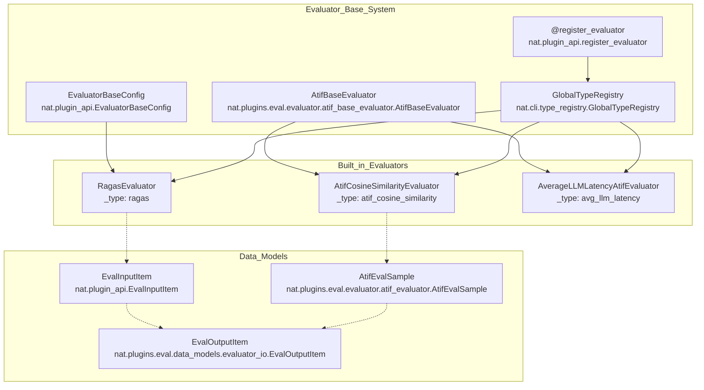
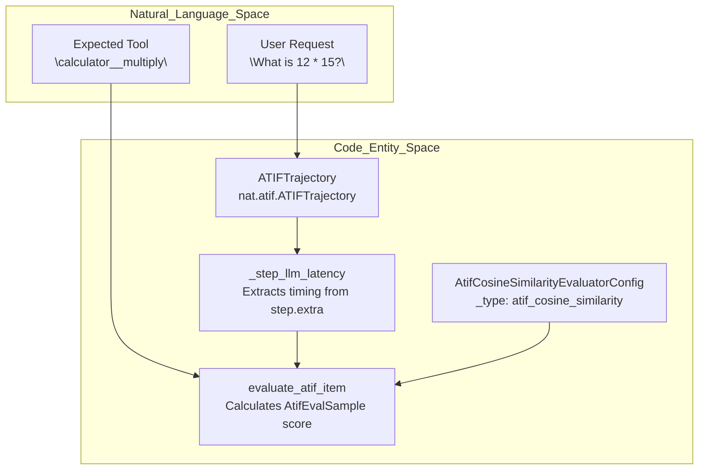
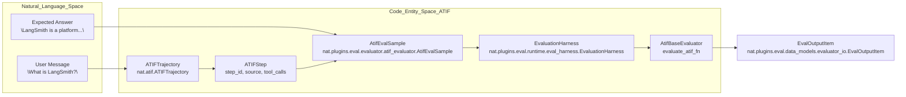

<!-- source: DeepWiki mcp.deepwiki.com · repo NVIDIA/NeMo-Agent-Toolkit · page 10.2 Evaluators and Metrics · fetched 2026-10-26 -->

# Evaluators and Metrics

Relevant source files

The following files were used as context for generating this wiki page:

- [docs/source/extend/custom-components/custom-evaluator.md](docs/source/extend/custom-components/custom-evaluator.md)
- [examples/evaluation_and_profiling/simple_calculator_eval/src/nat_simple_calculator_eval/configs/config-custom-dataset-format.yml](examples/evaluation_and_profiling/simple_calculator_eval/src/nat_simple_calculator_eval/configs/config-custom-dataset-format.yml)
- [examples/evaluation_and_profiling/simple_calculator_eval/src/nat_simple_calculator_eval/configs/config-sizing-calc.yml](examples/evaluation_and_profiling/simple_calculator_eval/src/nat_simple_calculator_eval/configs/config-sizing-calc.yml)
- [examples/evaluation_and_profiling/simple_calculator_eval/src/nat_simple_calculator_eval/configs/config-tunable-rag-eval.yml](examples/evaluation_and_profiling/simple_calculator_eval/src/nat_simple_calculator_eval/configs/config-tunable-rag-eval.yml)
- [examples/evaluation_and_profiling/simple_calculator_eval/src/nat_simple_calculator_eval/configs/config-with-custom-post-process.yml](examples/evaluation_and_profiling/simple_calculator_eval/src/nat_simple_calculator_eval/configs/config-with-custom-post-process.yml)
- [examples/evaluation_and_profiling/simple_web_query_eval/atif-eval-readme.md](examples/evaluation_and_profiling/simple_web_query_eval/atif-eval-readme.md)
- [examples/evaluation_and_profiling/simple_web_query_eval/src/nat_simple_web_query_eval/atif_only_evaluator_register.py](examples/evaluation_and_profiling/simple_web_query_eval/src/nat_simple_web_query_eval/atif_only_evaluator_register.py)
- [examples/evaluation_and_profiling/simple_web_query_eval/src/nat_simple_web_query_eval/configs/eval_config.yml](examples/evaluation_and_profiling/simple_web_query_eval/src/nat_simple_web_query_eval/configs/eval_config.yml)
- [examples/evaluation_and_profiling/simple_web_query_eval/src/nat_simple_web_query_eval/configs/eval_config_atif_custom_evaluator.yml](examples/evaluation_and_profiling/simple_web_query_eval/src/nat_simple_web_query_eval/configs/eval_config_atif_custom_evaluator.yml)
- [examples/evaluation_and_profiling/simple_web_query_eval/src/nat_simple_web_query_eval/configs/eval_config_llama31.yml](examples/evaluation_and_profiling/simple_web_query_eval/src/nat_simple_web_query_eval/configs/eval_config_llama31.yml)
- [examples/evaluation_and_profiling/simple_web_query_eval/src/nat_simple_web_query_eval/configs/eval_config_llama33.yml](examples/evaluation_and_profiling/simple_web_query_eval/src/nat_simple_web_query_eval/configs/eval_config_llama33.yml)
- [examples/evaluation_and_profiling/simple_web_query_eval/src/nat_simple_web_query_eval/configs/eval_config_openai.yml](examples/evaluation_and_profiling/simple_web_query_eval/src/nat_simple_web_query_eval/configs/eval_config_openai.yml)
- [examples/evaluation_and_profiling/simple_web_query_eval/src/nat_simple_web_query_eval/configs/eval_only_config.yml](examples/evaluation_and_profiling/simple_web_query_eval/src/nat_simple_web_query_eval/configs/eval_only_config.yml)
- [examples/evaluation_and_profiling/simple_web_query_eval/src/nat_simple_web_query_eval/configs/eval_upload.yml](examples/evaluation_and_profiling/simple_web_query_eval/src/nat_simple_web_query_eval/configs/eval_upload.yml)
- [examples/evaluation_and_profiling/simple_web_query_eval/src/nat_simple_web_query_eval/register.py](examples/evaluation_and_profiling/simple_web_query_eval/src/nat_simple_web_query_eval/register.py)
- [examples/evaluation_and_profiling/simple_web_query_eval/tests/test_atif_only_evaluator_register.py](examples/evaluation_and_profiling/simple_web_query_eval/tests/test_atif_only_evaluator_register.py)
- [examples/notebooks/eval_atif_custom_evaluator.ipynb](examples/notebooks/eval_atif_custom_evaluator.ipynb)
- [examples/notebooks/eval_atif_standalone.ipynb](examples/notebooks/eval_atif_standalone.ipynb)
- [examples/notebooks/eval_harbor_atif_interop.ipynb](examples/notebooks/eval_harbor_atif_interop.ipynb)
- [packages/nvidia_nat_eval/src/nat/plugins/eval/evaluator/__init__.py](packages/nvidia_nat_eval/src/nat/plugins/eval/evaluator/__init__.py)
- [packages/nvidia_nat_eval/src/nat/plugins/eval/evaluator/atif_base_evaluator.py](packages/nvidia_nat_eval/src/nat/plugins/eval/evaluator/atif_base_evaluator.py)
- [packages/nvidia_nat_eval/tests/eval/evaluator/test_atif_base_evaluator.py](packages/nvidia_nat_eval/tests/eval/evaluator/test_atif_base_evaluator.py)

## Purpose and Scope

This page documents the evaluator and metrics system in the NVIDIA NeMo Agent Toolkit (`nvidia-nat-eval` and related subsystems), covering built-in evaluators (TSQ, Accuracy, Runtime, Latency, RAGAS) and ATIF (Agent Trajectory Interchange Format) trajectory evaluation [examples/notebooks/eval_atif_standalone.ipynb:9-14](). Evaluators compute quantitative metrics to assess agent performance for offline evaluation and optimization pipelines [docs/source/extend/custom-components/custom-evaluator.md:24-27]().

---

## Evaluator Architecture and Registration

The toolkit provides core base classes for evaluators depending on whether they evaluate live workflow outputs or static trajectories. Evaluators are discovered and instantiated via the global type registry and plugin system [docs/source/extend/custom-components/custom-evaluator.md:24-37]().

### Evaluator Registration and Data Flow

Sources: [packages/nvidia_nat_eval/src/nat/plugins/eval/evaluator/atif_base_evaluator.py:29-35](), [docs/source/extend/custom-components/custom-evaluator.md:57-69](), [packages/nvidia_nat_profiler/src/nat/plugins/profiler/runtime_evaluator/atif_evaluate.py:71-80]().

Custom and built-in evaluators inherit from configuration mixins like `EvaluatorBaseConfig` and use the `@register_evaluator` decorator [docs/source/extend/custom-components/custom-evaluator.md:57-68](). When evaluating items, input data is encapsulated in `EvalInputItem` or `AtifEvalSample` instances, and results are returned as `EvalOutputItem` objects [docs/source/extend/custom-components/custom-evaluator.md:93-106](), [packages/nvidia_nat_eval/tests/eval/evaluator/test_atif_base_evaluator.py:20-22]().

Sources: [docs/source/extend/custom-components/custom-evaluator.md:24-106](), [packages/nvidia_nat_eval/src/nat/plugins/eval/evaluator/atif_base_evaluator.py:29-40]().

---

## Built-in Evaluators and Metrics

### RAGAS Integration and Accuracy
The `ragas` evaluator (`_type: ragas`) integrates RAGAS metrics such as `AnswerAccuracy`, `ResponseGroundedness`, and `ContextRelevance` using an evaluation LLM [examples/evaluation_and_profiling/simple_calculator_eval/src/nat_simple_calculator_eval/configs/config-tunable-rag-eval.yml:30-34](). It assesses factual correctness and grounding against dataset reference answers [docs/source/extend/custom-components/custom-evaluator.md:34-35]().

### ATIF-Native Runtime Evaluators
The `nvidia-nat-profiler` package provides performance evaluators that extract metrics directly from ATIF trajectory steps (`step.metrics` and `step.extra`) [packages/nvidia_nat_profiler/src/nat/plugins/profiler/runtime_evaluator/atif_evaluate.py:15-17]():
*   **Average LLM Latency (`avg_llm_latency`)**: Computes time intervals between invocation start and end timestamps [packages/nvidia_nat_profiler/src/nat/plugins/profiler/runtime_evaluator/atif_evaluate.py:38-50]().
*   **Workflow Runtime (`workflow_runtime`)**: Calculates end-to-end duration across all steps using `max(timestamp) - min(timestamp)` [packages/nvidia_nat_profiler/src/nat/plugins/profiler/runtime_evaluator/atif_evaluate.py:106-128]().
*   **LLM Call Count (`avg_llm_calls`)**: Aggregates step metrics to count total model invocations [packages/nvidia_nat_profiler/src/nat/plugins/profiler/runtime_evaluator/atif_evaluate.py:130-144]().
*   **Tokens Per Call (`avg_tokens`)**: Aggregates `prompt_tokens` and `completion_tokens` from step metrics [packages/nvidia_nat_profiler/src/nat/plugins/profiler/runtime_evaluator/atif_evaluate.py:147-170]().

### Tool Selection Quality (TSQ) and Accuracy
The TSQ evaluator assesses whether an agent selects the correct tools and parameters by matching trajectory tool calls against expected tool declarations [examples/notebooks/eval_atif_standalone.ipynb:153-198]().

Sources: [packages/nvidia_nat_profiler/src/nat/plugins/profiler/runtime_evaluator/atif_evaluate.py:38-68](), [examples/evaluation_and_profiling/simple_web_query_eval/src/nat_simple_web_query_eval/atif_only_evaluator_register.py:31-90]().

Sources: [packages/nvidia_nat_profiler/src/nat/plugins/profiler/runtime_evaluator/atif_evaluate.py:38-170](), [docs/source/extend/custom-components/custom-evaluator.md:34-35]().

---

## ATIF Trajectory Evaluation

ATIF trajectory evaluation allows the evaluation harness to consume serialized JSON trajectories from any framework without executing a live workflow [examples/notebooks/eval_atif_standalone.ipynb:9-19]().

Sources: [examples/notebooks/eval_atif_custom_evaluator.ipynb:156-202](), [packages/nvidia_nat_eval/src/nat/plugins/eval/evaluator/atif_base_evaluator.py:45-58](), [packages/nvidia_nat_profiler/src/nat/plugins/profiler/runtime_evaluator/atif_evaluate.py:85-103]().

### Implementation Details
*   **Concurrency Control**: `AtifBaseEvaluator` uses an `asyncio.Semaphore` based on `max_concurrency` to manage parallel item evaluation [packages/nvidia_nat_eval/src/nat/plugins/eval/evaluator/atif_base_evaluator.py:37-39]().
*   **Aggregation**: `evaluate_atif_fn` invokes `evaluate_atif_item` concurrently and averages numeric `EvalOutputItem.score` results [packages/nvidia_nat_eval/src/nat/plugins/eval/evaluator/atif_base_evaluator.py:45-58]().

Sources: [examples/notebooks/eval_atif_standalone.ipynb:9-20](), [packages/nvidia_nat_eval/src/nat/plugins/eval/evaluator/atif_base_evaluator.py:29-58]().

---

## Summary of Built-in Metrics

| Evaluator Type | Key Metric | Logic Source | Use Case |
| :--- | :--- | :--- | :--- |
| `ragas` | `Accuracy` | LLM-as-Judge | RAG factual correctness [docs/source/extend/custom-components/custom-evaluator.md:34-35]() |
| `avg_llm_latency` | `Latency (s)` | `extra["invocation"]` | LLM performance tracking [packages/nvidia_nat_profiler/src/nat/plugins/profiler/runtime_evaluator/atif_evaluate.py:71-80]() |
| `workflow_runtime` | `Duration (s)` | `step.timestamp` | End-to-end latency [packages/nvidia_nat_profiler/src/nat/plugins/profiler/runtime_evaluator/atif_evaluate.py:106-109]() |
| `avg_llm_calls` | `Call Count` | `step.metrics` | Agent efficiency analysis [packages/nvidia_nat_profiler/src/nat/plugins/profiler/runtime_evaluator/atif_evaluate.py:130-133]() |
| `avg_tokens` | `Token Count` | `metrics.prompt_tokens` | Cost and throughput estimation [packages/nvidia_nat_profiler/src/nat/plugins/profiler/runtime_evaluator/atif_evaluate.py:147-150]() |

Sources: [packages/nvidia_nat_profiler/src/nat/plugins/profiler/runtime_evaluator/atif_evaluate.py:71-170](), [docs/source/extend/custom-components/custom-evaluator.md:34-35]().

---

