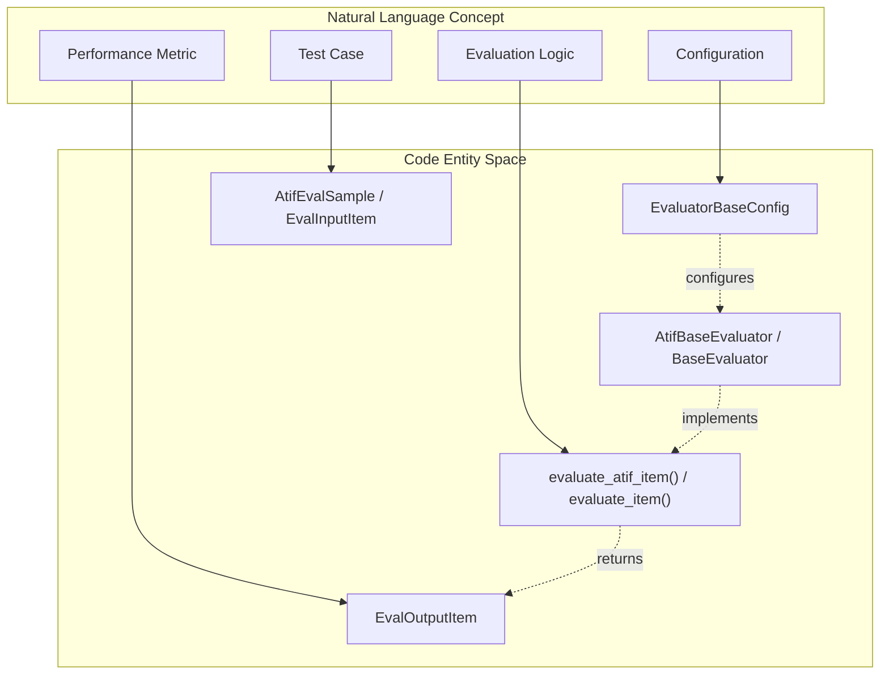
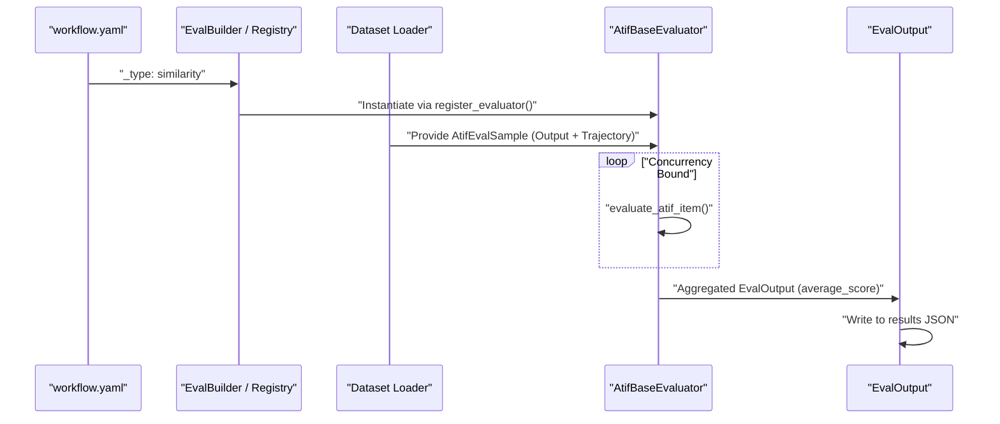
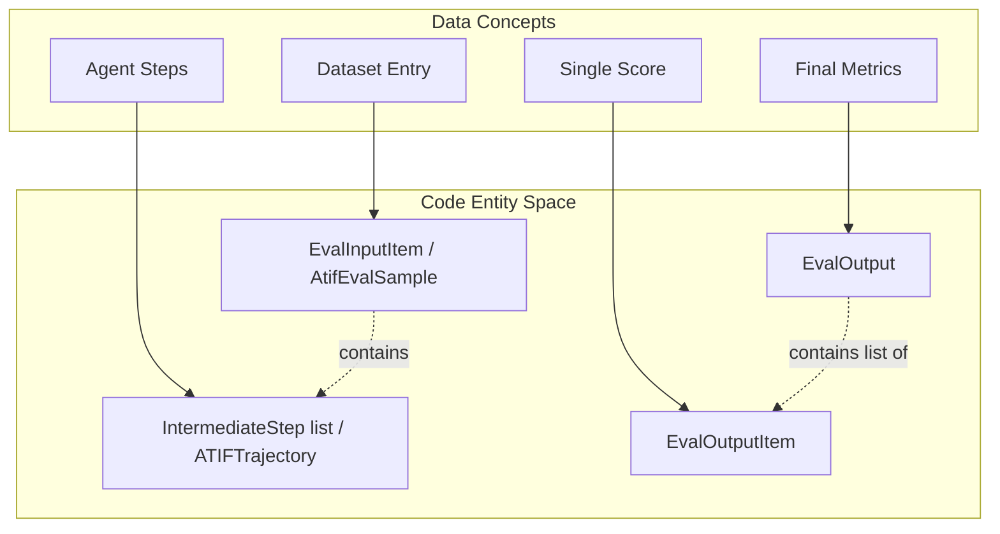

<!-- source: DeepWiki mcp.deepwiki.com · repo NVIDIA/NeMo-Agent-Toolkit · page 10.4 Custom Evaluator Development · fetched 2026-10-26 -->

# Custom Evaluator Development

<details>
<summary>Relevant source files</summary>

The following files were used as context for generating this wiki page:

- [docs/source/extend/custom-components/custom-evaluator.md](docs/source/extend/custom-components/custom-evaluator.md)
- [examples/evaluation_and_profiling/simple_web_query_eval/atif-eval-readme.md](examples/evaluation_and_profiling/simple_web_query_eval/atif-eval-readme.md)
- [examples/evaluation_and_profiling/simple_web_query_eval/src/nat_simple_web_query_eval/atif_only_evaluator_register.py](examples/evaluation_and_profiling/simple_web_query_eval/src/nat_simple_web_query_eval/atif_only_evaluator_register.py)
- [examples/evaluation_and_profiling/simple_web_query_eval/src/nat_simple_web_query_eval/configs/eval_config_atif_custom_evaluator.yml](examples/evaluation_and_profiling/simple_web_query_eval/src/nat_simple_web_query_eval/configs/eval_config_atif_custom_evaluator.yml)
- [examples/evaluation_and_profiling/simple_web_query_eval/src/nat_simple_web_query_eval/register.py](examples/evaluation_and_profiling/simple_web_query_eval/src/nat_simple_web_query_eval/register.py)
- [examples/evaluation_and_profiling/simple_web_query_eval/tests/test_atif_only_evaluator_register.py](examples/evaluation_and_profiling/simple_web_query_eval/tests/test_atif_only_evaluator_register.py)
- [examples/notebooks/eval_atif_custom_evaluator.ipynb](examples/notebooks/eval_atif_custom_evaluator.ipynb)
- [examples/notebooks/eval_atif_standalone.ipynb](examples/notebooks/eval_atif_standalone.ipynb)
- [examples/notebooks/eval_harbor_atif_interop.ipynb](examples/notebooks/eval_harbor_atif_interop.ipynb)
- [packages/nvidia_nat_eval/src/nat/plugins/eval/evaluator/__init__.py](packages/nvidia_nat_eval/src/nat/plugins/eval/evaluator/__init__.py)
- [packages/nvidia_nat_eval/src/nat/plugins/eval/evaluator/atif_base_evaluator.py](packages/nvidia_nat_eval/src/nat/plugins/eval/evaluator/atif_base_evaluator.py)
- [packages/nvidia_nat_eval/tests/eval/evaluator/test_atif_base_evaluator.py](packages/nvidia_nat_eval/tests/eval/evaluator/test_atif_base_evaluator.py)

</details>


This technical guide covers creating custom evaluators within the NVIDIA NeMo Agent Toolkit (`nvidia-nat-eval`), including configuration models, evaluation logic, bounded concurrency, and plugin registration patterns.

For information about built-in evaluators, see [10.2 Evaluators and Metrics](). For general evaluation execution, see [10.1 Evaluation Framework]().

## Purpose and Scope

Custom evaluators enable:
- **Domain-Specific Metrics**: Assessment logic tailored to specific industry requirements [docs/source/extend/custom-components/custom-evaluator.md:113-114]().
- **Trajectory Analysis**: Scoring based on the sequence of tool calls and intermediate steps via Agent Trajectory Interchange Format (ATIF) [examples/notebooks/eval_atif_custom_evaluator.ipynb:13-15]().
- **External Integrations**: Connecting to third-party observability or evaluation platforms [docs/source/extend/custom-components/custom-evaluator.md:34-36]().
- **Composite Scoring**: Combining multiple metrics into a single weighted performance indicator [docs/source/extend/custom-components/custom-evaluator.md:105-111]().

Sources: [docs/source/extend/custom-components/custom-evaluator.md:18-36](), [examples/notebooks/eval_atif_custom_evaluator.ipynb:7-25]()

## Evaluator Architecture

The toolkit supports two primary evaluator patterns:
1. **Standard Evaluators**: Inherit from `BaseEvaluator` [packages/nvidia_nat_eval/src/nat/plugins/eval/evaluator/__init__.py:21-23](). They process standard inputs (`input_obj`, `output_obj`, `expected_output_obj`) and `IntermediateStep` lists [docs/source/extend/custom-components/custom-evaluator.md:93-103]().
2. **ATIF-Native Evaluators**: Inherit from `AtifBaseEvaluator` [packages/nvidia_nat_eval/src/nat/plugins/eval/evaluator/atif_base_evaluator.py:27-35](). They process full `ATIFTrajectory` objects [examples/notebooks/eval_atif_standalone.ipynb:12-14](), enabling deep inspection of agent reasoning and tool usage [examples/evaluation_and_profiling/simple_web_query_eval/src/nat_simple_web_query_eval/atif_only_evaluator_register.py:57-60]().

### Natural Language to Code Entity Mapping

The following diagram maps high-level evaluation concepts to specific code entities within the toolkit.

**Evaluator Entity Mapping**

Sources: [docs/source/extend/custom-components/custom-evaluator.md:90-110](), [packages/nvidia_nat_eval/src/nat/plugins/eval/evaluator/atif_base_evaluator.py:29-44]()

## Creating a Custom Evaluator

### 1. Define the Configuration Model
Every evaluator requires a configuration class inheriting from `EvaluatorBaseConfig` [docs/source/extend/custom-components/custom-evaluator.md:63-63](). The `name` attribute serves as the identifier used in YAML configurations [docs/source/extend/custom-components/custom-evaluator.md:63-63]().

```python
from pydantic import Field
from nat.plugin_api import EvaluatorBaseConfig

class SimilarityEvaluatorConfig(EvaluatorBaseConfig, name="similarity"):
    '''Configuration for custom similarity evaluator'''
    similarity_type: str = Field(description="Similarity type to be computed", default="cosine")
```
Sources: [docs/source/extend/custom-components/custom-evaluator.md:55-66](), [examples/evaluation_and_profiling/simple_web_query_eval/src/nat_simple_web_query_eval/atif_only_evaluator_register.py:31-38]()

### 2. Implement the Evaluator Logic
For standard evaluation, subclass `BaseEvaluator` and implement `evaluate_item`. For trajectory-based evaluation, subclass `AtifBaseEvaluator` [packages/nvidia_nat_eval/src/nat/plugins/eval/evaluator/atif_base_evaluator.py:29-35]() and implement `evaluate_atif_item` [packages/nvidia_nat_eval/src/nat/plugins/eval/evaluator/atif_base_evaluator.py:41-43]().

```python
from nat.plugins.eval.evaluator.atif_base_evaluator import AtifBaseEvaluator
from nat.plugins.eval.evaluator.atif_evaluator import AtifEvalSample
from nat.plugins.eval.data_models.evaluator_io import EvalOutputItem

class AtifCosineSimilarityEvaluator(AtifBaseEvaluator):
    async def evaluate_atif_item(self, sample: AtifEvalSample) -> EvalOutputItem:
        similarity_score = self._cosine_similarity(sample.expected_output_obj, sample.output_obj)
        return EvalOutputItem(id=sample.item_id, score=similarity_score, reasoning={"comparison": "cosine"})
```
Sources: [docs/source/extend/custom-components/custom-evaluator.md:112-117](), [examples/evaluation_and_profiling/simple_web_query_eval/src/nat_simple_web_query_eval/atif_only_evaluator_register.py:40-90]()

### 3. Register the Evaluator
Use the `register_evaluator` decorator from `nat.plugin_api` [docs/source/extend/custom-components/custom-evaluator.md:37-37](). This function should be an `async` generator that yields an `EvaluatorInfo` object [docs/source/extend/custom-components/custom-evaluator.md:68-75]().

```python
from nat.plugin_api import EvalBuilder, EvaluatorInfo, register_evaluator

@register_evaluator(config_type=SimilarityEvaluatorConfig)
async def register_similarity_evaluator(config: SimilarityEvaluatorConfig, builder: EvalBuilder):
    '''Register custom evaluator'''
    from .similarity_evaluator import SimilarityEvaluator
    evaluator = SimilarityEvaluator(config.similarity_type, builder.get_max_concurrency())

    yield EvaluatorInfo(config=config, evaluate_fn=evaluator.evaluate, description="Similarity Evaluator")
```
Sources: [docs/source/extend/custom-components/custom-evaluator.md:57-75](), [examples/evaluation_and_profiling/simple_web_query_eval/src/nat_simple_web_query_eval/atif_only_evaluator_register.py:93-100]()

## Data Flow and Execution

When evaluation is triggered via the CLI, the harness orchestrates the flow from dataset loading to result aggregation.

**Evaluation Data Flow**

Sources: [docs/source/extend/custom-components/custom-evaluator.md:68-80](), [packages/nvidia_nat_eval/src/nat/plugins/eval/evaluator/atif_base_evaluator.py:45-58]()

## Plugin Discovery

To make the toolkit aware of the custom evaluator, import the evaluator registration module in the project's entry registration module (`register.py`) [docs/source/extend/custom-components/custom-evaluator.md:83-88](). This ensures the `@register_evaluator` decorator executes during component discovery.

```python
# In your project's register.py
from .evaluator_register import register_similarity_evaluator
```
Sources: [docs/source/extend/custom-components/custom-evaluator.md:83-88](), [examples/evaluation_and_profiling/simple_web_query_eval/src/nat_simple_web_query_eval/register.py:17-18]()

## Implementation Details

### Concurrency Control
`BaseEvaluator` and `AtifBaseEvaluator` utilize `asyncio.Semaphore` initialized with `max_concurrency` from `EvalBuilder` [packages/nvidia_nat_eval/src/nat/plugins/eval/evaluator/atif_base_evaluator.py:37-39](). This bounds concurrent evaluations and prevents rate limit saturation [packages/nvidia_nat_eval/tests/eval/evaluator/test_atif_base_evaluator.py:69-76]().

Sources: [packages/nvidia_nat_eval/src/nat/plugins/eval/evaluator/atif_base_evaluator.py:37-39](), [packages/nvidia_nat_eval/tests/eval/evaluator/test_atif_base_evaluator.py:69-76]()

### Evaluation IO Models

| Class | Purpose | Key Fields |
| :--- | :--- | :--- |
| `EvalInputItem` | Input for standard evaluation | `id`, `input_obj`, `expected_output_obj`, `output_obj`, `trajectory` [docs/source/extend/custom-components/custom-evaluator.md:95-100]() |
| `AtifEvalSample` | Input for ATIF-native evaluation | `item_id`, `trajectory`, `expected_output_obj`, `output_obj` [examples/evaluation_and_profiling/simple_web_query_eval/src/nat_simple_web_query_eval/atif_only_evaluator_register.py:38-41]() |
| `EvalOutputItem` | Result for a single item | `id`, `score`, `reasoning` [docs/source/extend/custom-components/custom-evaluator.md:106-109]() |

Sources: [docs/source/extend/custom-components/custom-evaluator.md:93-110](), [packages/nvidia_nat_eval/src/nat/plugins/eval/evaluator/atif_evaluator.py:20-29]()

**Natural Language to Code Entity Mapping: Data IO**

Sources: [docs/source/extend/custom-components/custom-evaluator.md:93-110](), [packages/nvidia_nat_eval/src/nat/plugins/eval/data_models/evaluator_io.py:23-24]()

### Evaluation Callbacks
The evaluation system supports callbacks for exporting metrics and trajectory evaluation results to external file sinks or telemetry backends via `EvalCallbackManager`.

Sources: [docs/source/extend/custom-components/custom-evaluator.md:18-125](), [examples/evaluation_and_profiling/simple_web_query_eval/src/nat_simple_web_query_eval/atif_only_evaluator_register.py:15-100]()

---

