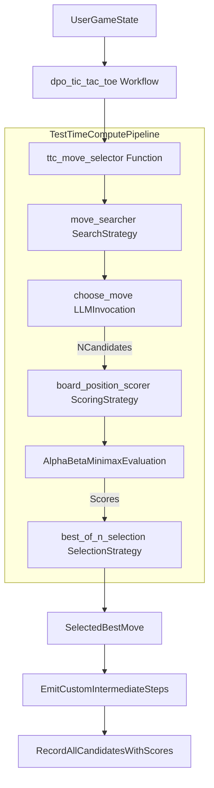
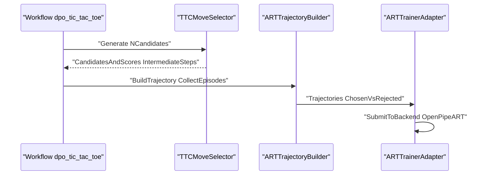
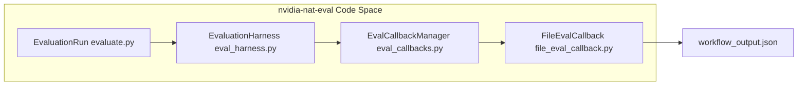

<!-- source: DeepWiki mcp.deepwiki.com · repo NVIDIA/NeMo-Agent-Toolkit · page 10.5 Test-Time Compute · fetched 2026-10-26 -->

# Test-Time Compute

Relevant source files

The following files were used as context for generating this wiki page:

- [docs/source/improve-workflows/about-improving-workflows.md](docs/source/improve-workflows/about-improving-workflows.md)
- [docs/source/improve-workflows/evaluate.md](docs/source/improve-workflows/evaluate.md)
- [docs/source/improve-workflows/finetuning/index.md](docs/source/improve-workflows/finetuning/index.md)
- [docs/source/improve-workflows/finetuning/rl_with_openpipe.md](docs/source/improve-workflows/finetuning/rl_with_openpipe.md)

Test-Time Compute (TTC) is a framework within the NVIDIA NeMo Agent Toolkit designed to improve agent performance at inference time by allocating additional computational resources to reasoning, candidate search, and decision-making [docs/source/improve-workflows/about-improving-workflows.md:26-26](). This document details the TTC pipeline architecture, which integrates Search, Editing, Scoring, and Selection strategies to optimize agent outputs and generate preference data for downstream training [docs/source/improve-workflows/about-improving-workflows.md:26-26]().

Sources: `docs/source/improve-workflows/about-improving-workflows.md:26-26()`, `docs/source/improve-workflows/evaluate.md:18-23()`

---

## 1. Overview

TTC allows agents to perform deeper exploration before committing to a final response. Instead of a single forward pass, the toolkit orchestrates a multi-step evaluation process across candidate solution spaces. 

### Key Components

| Component | Code Entity Space | Purpose |
| :--- | :--- | :--- |
| **Searcher** | `move_searcher` | Generates multiple move or response candidates via parallel LLM invocations or sampling. |
| **Scorer** | `board_position_scorer` | Assigns quantitative metrics or heuristic values to states/actions (e.g., Alpha-beta Minimax). |
| **Selector** | `best_of_n_selection` | Implements decision logic to choose the final result from scored candidates. |

Sources: `docs/source/improve-workflows/about-improving-workflows.md:26-26()`, `docs/source/improve-workflows/evaluate.md:20-22()`

---

## 2. Architecture and Data Flow

The TTC framework bridges high-level user requests with low-level search and scoring logic. Intermediate states and evaluation objects are captured during execution for real-time selection and trajectory dataset recording.

### TTC Execution Lifecycle

**TTC Execution Lifecycle**

Sources: `docs/source/improve-workflows/evaluate.md:140-151()`, `docs/source/improve-workflows/about-improving-workflows.md:26-26()`

---

## 3. Pipeline Stages

### Search Strategy
The search phase generates potential actions. In the toolkit, this is implemented by querying an LLM multiple times or applying randomized exploration strategies [docs/source/improve-workflows/finetuning/rl_with_openpipe.md:166-174]().
- Configured via `TrajectoryBuilder` parameters for reinforcement learning tasks [docs/source/improve-workflows/finetuning/rl_with_openpipe.md:166-174]().

Sources: `docs/source/improve-workflows/finetuning/rl_with_openpipe.md:166-174()`

### Editing Strategy
The editing phase mutates or refines generated candidates prior to scoring, supporting multi-turn agentic refinement and syntactic correction.

Sources: `docs/source/improve-workflows/evaluate.md:120-137()`

### Scoring Strategy
Scoring assigns explicit values to candidates using:
1. **LLM-as-a-Judge**: Utilizing a more powerful model to evaluate candidate outputs.
2. **Deterministic Evaluators**: Using code-based validation logic (e.g., minimax game tree evaluation).
3. **Reward Functions**: Computing reward metrics during fine-tuning.
4. **`AtifEvaluator`**: Evaluating trajectories using the Agentic Trajectory Interchange Format [docs/source/improve-workflows/evaluate.md:120-137]().

Sources: `docs/source/improve-workflows/evaluate.md:120-137()`

### Selection Strategy
Selection applies filtering or ranking rules over scored outputs (e.g., `Best-of-N`) and persists complete execution artifacts to preserve explored distributions.

Sources: `docs/source/improve-workflows/evaluate.md:120-137()`, `docs/source/improve-workflows/finetuning/rl_with_openpipe.md:28-32()`

---

## 4. Applications: Data Collection for Reinforcement Learning

A primary application of TTC is generating high-quality preference data for **Reinforcement Learning (RL)** and **Direct Preference Optimization (DPO)**. By executing the TTC pipeline, the system captures both chosen (highest score) and rejected (lower score) candidates, structuring them into episodes for trainers.

### Preference Data Generation Flow

**Preference Data Generation Flow**

Sources: `docs/source/improve-workflows/finetuning/rl_with_openpipe.md:44-67()`

---

## 5. Observability and Evaluation

TTC performance validation utilizes the toolkit's evaluation harness and tracing utilities. Evaluation run handlers record fine-grained token usage (prompt, completion, reasoning) and latency metrics across all candidate paths.

### Evaluation Code Entity Space

**Evaluation Code Entity Space**

Sources: `docs/source/improve-workflows/evaluate.md:140-158()`

---

## 6. Comparison with Multi-Phase Reasoning

The table below contrasts inference-time compute scaling with structural multi-phase planning models:

| Feature | TTC Framework | ReWOO Agent |
| :--- | :--- | :--- |
| **Primary Goal** | Inference-time accuracy via search | Efficiency via decoupled planning |
| **Optimization** | Best-of-N Candidate Search | Decoupled tool execution flow |
| **Data Structure** | `IntermediateStep` | `Planner/Solver` steps |
| **Training Integration** | Direct source for RL/DPO data | Structured prompt optimization |

Sources: `docs/source/improve-workflows/about-improving-workflows.md:20-27()`

---

