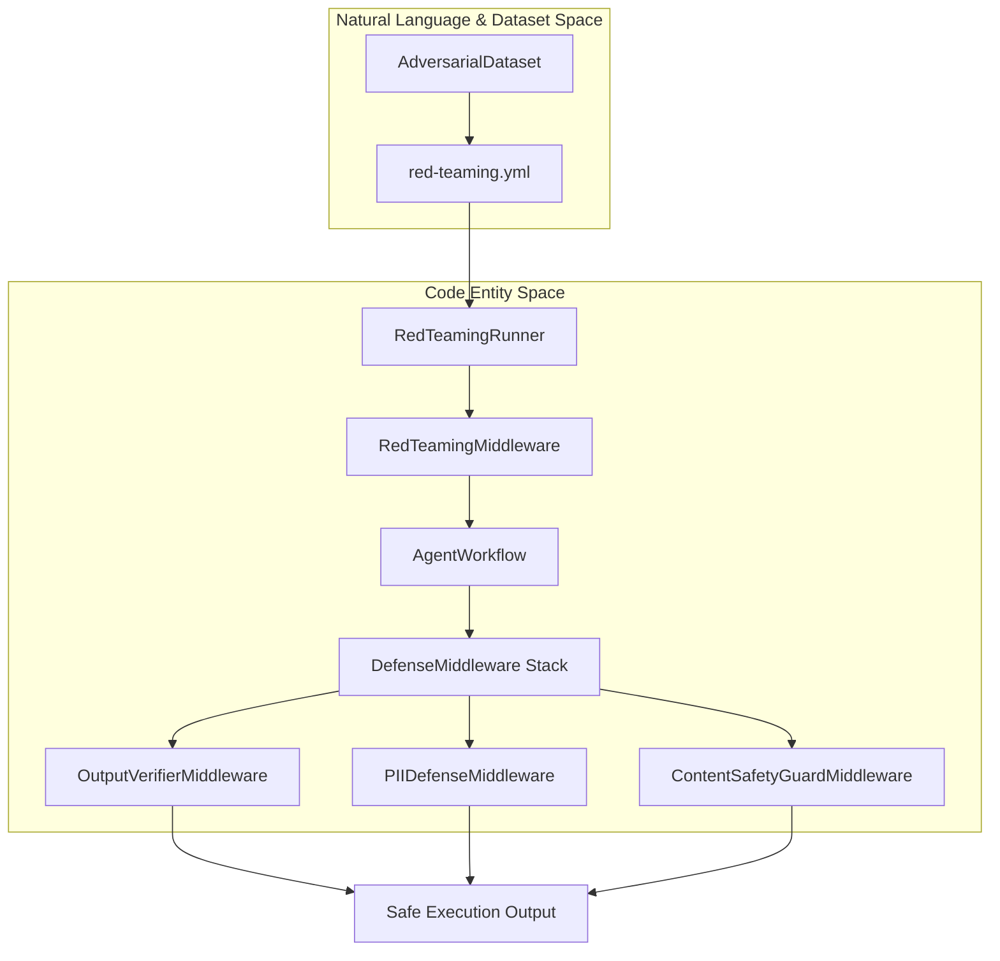
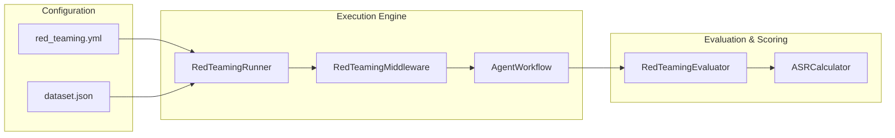
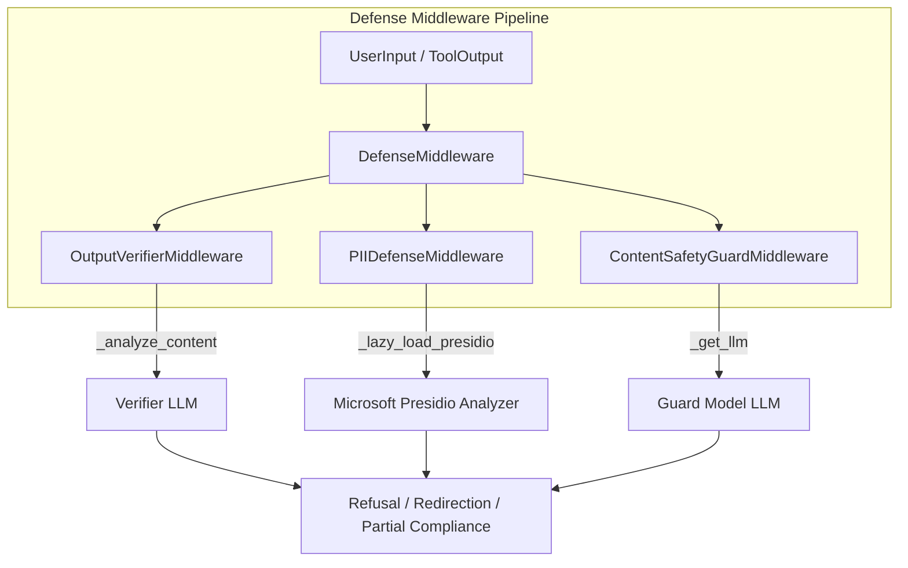

<!-- source: DeepWiki mcp.deepwiki.com · repo NVIDIA/NeMo-Agent-Toolkit · page 11 Security and Safety · fetched 2026-10-26 -->

# Security and Safety

<details>
<summary>Relevant source files</summary>

The following files were used as context for generating this wiki page:

- [docs/source/build-workflows/llms/index.md](docs/source/build-workflows/llms/index.md)
- [docs/source/components/integrations/frameworks.md](docs/source/components/integrations/frameworks.md)
- [docs/source/get-started/installation.md](docs/source/get-started/installation.md)
- [examples/safety_and_security/retail_agent/README.md](examples/safety_and_security/retail_agent/README.md)
- [packages/nvidia_nat_security/src/nat/plugins/security/middleware/defense/defense_middleware.py](packages/nvidia_nat_security/src/nat/plugins/security/middleware/defense/defense_middleware.py)
- [packages/nvidia_nat_security/src/nat/plugins/security/middleware/defense/defense_middleware_content_guard.py](packages/nvidia_nat_security/src/nat/plugins/security/middleware/defense/defense_middleware_content_guard.py)
- [packages/nvidia_nat_security/src/nat/plugins/security/middleware/defense/defense_middleware_output_verifier.py](packages/nvidia_nat_security/src/nat/plugins/security/middleware/defense/defense_middleware_output_verifier.py)
- [packages/nvidia_nat_security/src/nat/plugins/security/middleware/defense/defense_middleware_pii.py](packages/nvidia_nat_security/src/nat/plugins/security/middleware/defense/defense_middleware_pii.py)
- [packages/nvidia_nat_security/tests/middleware/conftest.py](packages/nvidia_nat_security/tests/middleware/conftest.py)
- [packages/nvidia_nat_security/tests/middleware/defense/test_defense_middleware_content_guard.py](packages/nvidia_nat_security/tests/middleware/defense/test_defense_middleware_content_guard.py)
- [packages/nvidia_nat_security/tests/middleware/defense/test_defense_middleware_output_verifier.py](packages/nvidia_nat_security/tests/middleware/defense/test_defense_middleware_output_verifier.py)
- [packages/nvidia_nat_security/tests/middleware/defense/test_defense_middleware_pii.py](packages/nvidia_nat_security/tests/middleware/defense/test_defense_middleware_pii.py)

</details>


## Purpose and Scope

NVIDIA NeMo Agent Toolkit provides a comprehensive security and safety framework designed to test, harden, and protect AI agents against adversarial attacks, data leaks, and policy violations. The security architecture addresses two primary operational phases: proactively discovering vulnerabilities prior to deployment through automated red teaming, and neutralizing threats in real-time using specialized defense middleware.

As a parent overview page, this section provides a high-level summary and links to three child pages for detailed technical guidance:
- [Red Teaming Framework](#11.1) — Vulnerability discovery, test runners, attack scenarios, injection middleware, and attack success rate (ASR) calculations.
- [Defense Middleware](#11.2) — Real-time mitigation components including `OutputVerifierMiddleware`, `PIIDefenseMiddleware`, `ContentSafetyGuardMiddleware`, and NeMo Guardrails policy middleware.
- [Safety Configuration](#11.3) — Production deployment best practices, YAML-based policy setup, model-gated fields, and fail-closed thresholds.

Sources: [examples/safety_and_security/retail_agent/README.md:62-132]()

---

## Security and Safety Architecture

The toolkit's security architecture bridges natural language security policies and adversarial threat models to concrete Python code entities. The workflow lifecycle integrates vulnerability assessment via red teaming runners and execution interception via function and middleware classes defined in `nvidia_nat_security`.

### Security Lifecycle and Code Mapping

Sources: [examples/safety_and_security/retail_agent/README.md:68-106](), [packages/nvidia_nat_security/src/nat/plugins/security/middleware/defense/defense_middleware_output_verifier.py:70-84](), [packages/nvidia_nat_security/src/nat/plugins/security/middleware/defense/defense_middleware_content_guard.py:61-73](), [packages/nvidia_nat_security/src/nat/plugins/security/middleware/defense/defense_middleware_pii.py:66-78]()

---

## Red Teaming Framework

The red teaming system systematically evaluates agent resilience by simulating multi-vector adversarial attacks against workflow endpoints. It utilizes configurable test suites and injection middleware to measure vulnerability metrics such as the Attack Success Rate (ASR).

### Red Teaming Execution Flow


For detailed documentation on the red teaming runner, attack scenarios, injection middleware, and ASR calculation, see [Red Teaming Framework](#11.1).

Sources: [examples/safety_and_security/retail_agent/README.md:133-145](), [packages/nvidia_nat_security/src/nat/plugins/security/middleware/defense/defense_middleware.py:122-149]()

---

## Defense Middleware

Defense middleware components intercept tool inputs and function outputs during workflow execution to enforce safety boundaries. These components support multiple action behaviors (`partial_compliance`, `refusal`, and `redirection`) and can target specific functions, function groups, or workflow fields using JSONPath expressions [packages/nvidia_nat_security/src/nat/plugins/security/middleware/defense/defense_middleware.py:78-121]().

### Defense Middleware Invocation Pipeline


Key mitigation components include:
*   `OutputVerifierMiddleware`: Uses an LLM to verify function outputs for correctness, detect security threats, and automatically provide corrections [packages/nvidia_nat_security/src/nat/plugins/security/middleware/defense/defense_middleware_output_verifier.py:70-84]().
*   `ContentSafetyGuardMiddleware`: Classifies content safety as safe, unsafe, or controversial using guard models [packages/nvidia_nat_security/src/nat/plugins/security/middleware/defense/defense_middleware_content_guard.py:61-73]().
*   `PIIDefenseMiddleware`: Detects and anonymizes Personally Identifiable Information (PII) in function outputs using Microsoft Presidio [packages/nvidia_nat_security/src/nat/plugins/security/middleware/defense/defense_middleware_pii.py:66-78]().

For details on implementing and configuring these components, see [Defense Middleware](#11.2).

Sources: [packages/nvidia_nat_security/src/nat/plugins/security/middleware/defense/defense_middleware.py:78-121](), [packages/nvidia_nat_security/src/nat/plugins/security/middleware/defense/defense_middleware_output_verifier.py:70-84](), [packages/nvidia_nat_security/src/nat/plugins/security/middleware/defense/defense_middleware_content_guard.py:61-73](), [packages/nvidia_nat_security/src/nat/plugins/security/middleware/defense/defense_middleware_pii.py:66-78]()

---

## Safety Configuration

The toolkit supports declarative safety configurations through YAML configuration files. Defenses are defined under the `middleware` section and can be bound to specific tool invocations or workflow levels [packages/nvidia_nat_security/src/nat/plugins/security/middleware/defense/defense_middleware.py:98-120]().

### Configuration Example
```yaml
middleware:
  pii_defense_tools:
    _type: pii_defense
    target_function_or_group: retail_tools__get_product_info
    action: redirection
    target_location: output
    entities: [EMAIL_ADDRESS, PERSON]

  content_guard:
    _type: content_safety_guard
    llm_name: huggingface_llm
    action: refusal
```

Production deployments leverage model-gated fields, fail-closed thresholds, and specialized guard models (such as `Qwen/Qwen3Guard-Gen-0.6B`) [docs/source/build-workflows/llms/index.md:37-71](), [packages/nvidia_nat_security/src/nat/plugins/security/middleware/defense/defense_middleware_output_verifier.py:58-64]().

For best practices on configuring safety and security features in production deployments, see [Safety Configuration](#11.3).

Sources: [docs/source/build-workflows/llms/index.md:37-71](), [packages/nvidia_nat_security/src/nat/plugins/security/middleware/defense/defense_middleware.py:78-121](), [packages/nvidia_nat_security/src/nat/plugins/security/middleware/defense/defense_middleware_output_verifier.py:58-64]()

---

