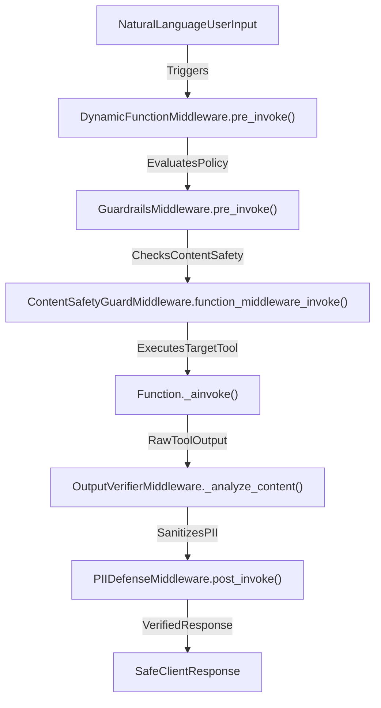
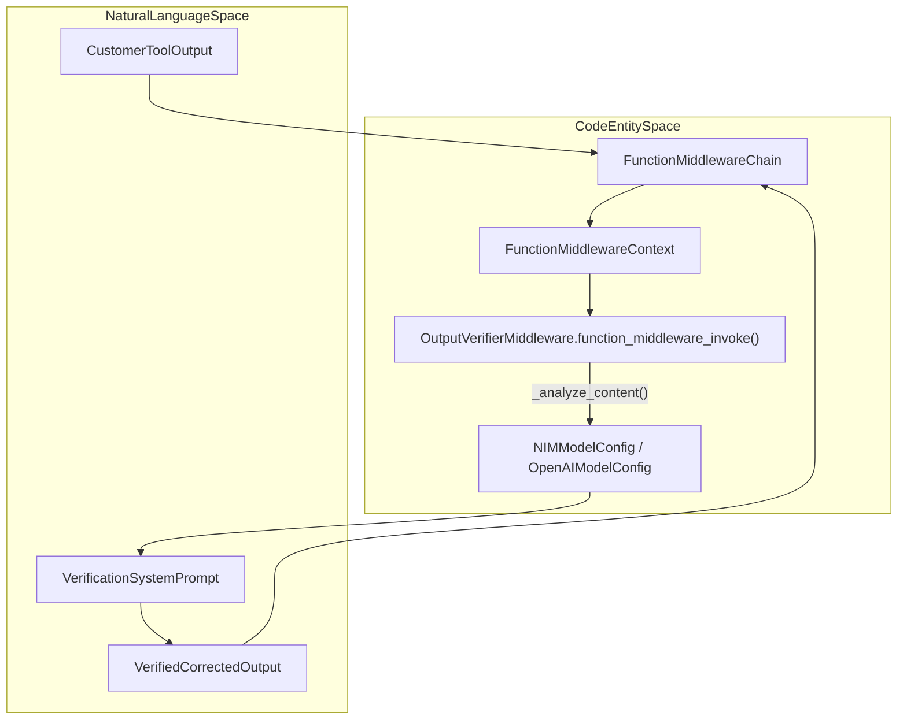
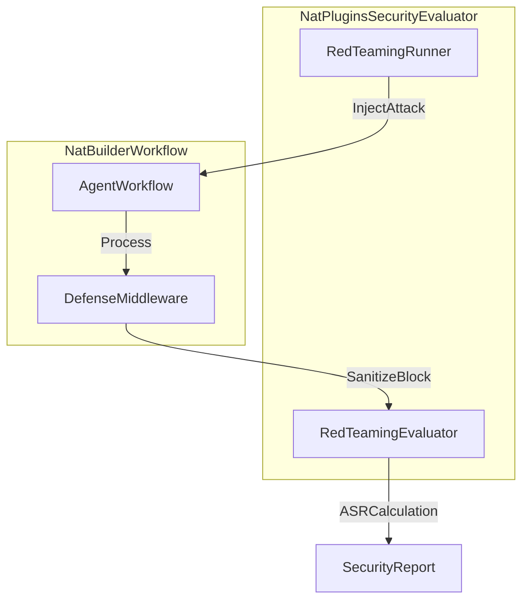

<!-- source: DeepWiki mcp.deepwiki.com · repo NVIDIA/NeMo-Agent-Toolkit · page 11.2 Defense Middleware · fetched 2026-10-26 -->

# Defense Middleware

Relevant source files

The following files were used as context for generating this wiki page:

- [docs/source/build-workflows/llms/index.md](docs/source/build-workflows/llms/index.md)
- [docs/source/components/integrations/frameworks.md](docs/source/components/integrations/frameworks.md)
- [docs/source/get-started/installation.md](docs/source/get-started/installation.md)
- [examples/safety_and_security/retail_agent/README.md](examples/safety_and_security/retail_agent/README.md)
- [packages/nvidia_nat_core/src/nat/data_models/intermediate_step.py](packages/nvidia_nat_core/src/nat/data_models/intermediate_step.py)
- [packages/nvidia_nat_core/src/nat/middleware/function_middleware.py](packages/nvidia_nat_core/src/nat/middleware/function_middleware.py)
- [packages/nvidia_nat_core/src/nat/middleware/telemetry.py](packages/nvidia_nat_core/src/nat/middleware/telemetry.py)
- [packages/nvidia_nat_core/tests/nat/middleware/test_middleware_telemetry.py](packages/nvidia_nat_core/tests/nat/middleware/test_middleware_telemetry.py)
- [packages/nvidia_nat_langchain/src/nat/plugins/langchain/callback_handler.py](packages/nvidia_nat_langchain/src/nat/plugins/langchain/callback_handler.py)
- [packages/nvidia_nat_langchain/tests/test_langchain_callback_handler.py](packages/nvidia_nat_langchain/tests/test_langchain_callback_handler.py)
- [packages/nvidia_nat_security/pyproject.toml](packages/nvidia_nat_security/pyproject.toml)
- [packages/nvidia_nat_security/src/nat/plugins/security/middleware/defense/defense_middleware.py](packages/nvidia_nat_security/src/nat/plugins/security/middleware/defense/defense_middleware.py)
- [packages/nvidia_nat_security/src/nat/plugins/security/middleware/defense/defense_middleware_content_guard.py](packages/nvidia_nat_security/src/nat/plugins/security/middleware/defense/defense_middleware_content_guard.py)
- [packages/nvidia_nat_security/src/nat/plugins/security/middleware/defense/defense_middleware_output_verifier.py](packages/nvidia_nat_security/src/nat/plugins/security/middleware/defense/defense_middleware_output_verifier.py)
- [packages/nvidia_nat_security/src/nat/plugins/security/middleware/defense/defense_middleware_pii.py](packages/nvidia_nat_security/src/nat/plugins/security/middleware/defense/defense_middleware_pii.py)
- [packages/nvidia_nat_security/src/nat/plugins/security/middleware/guardrails/callback_handler.py](packages/nvidia_nat_security/src/nat/plugins/security/middleware/guardrails/callback_handler.py)
- [packages/nvidia_nat_security/src/nat/plugins/security/middleware/guardrails/nemo_guardrails_middleware.py](packages/nvidia_nat_security/src/nat/plugins/security/middleware/guardrails/nemo_guardrails_middleware.py)
- [packages/nvidia_nat_security/tests/middleware/conftest.py](packages/nvidia_nat_security/tests/middleware/conftest.py)
- [packages/nvidia_nat_security/tests/middleware/defense/test_defense_middleware_content_guard.py](packages/nvidia_nat_security/tests/middleware/defense/test_defense_middleware_content_guard.py)
- [packages/nvidia_nat_security/tests/middleware/defense/test_defense_middleware_output_verifier.py](packages/nvidia_nat_security/tests/middleware/defense/test_defense_middleware_output_verifier.py)
- [packages/nvidia_nat_security/tests/middleware/defense/test_defense_middleware_pii.py](packages/nvidia_nat_security/tests/middleware/defense/test_defense_middleware_pii.py)
- [packages/nvidia_nat_security/tests/middleware/guardrails/test_nemo_guardrails_middleware.py](packages/nvidia_nat_security/tests/middleware/guardrails/test_nemo_guardrails_middleware.py)
- [packages/nvidia_nat_security/uv.lock](packages/nvidia_nat_security/uv.lock)

## Purpose and Scope

Defense Middleware provides runtime protection mechanisms that intercept and mitigate security threats in agentic workflows. This page documents the primary defense middleware types—`PIIDefenseMiddleware`, `ContentSafetyGuardMiddleware`, `OutputVerifierMiddleware`, and `GuardrailsMiddleware` (NeMo Guardrails policy middleware)—along with their implementation details, data flow, key functions/classes, and configuration patterns.

For information about attack simulation and evaluation, see [Red Teaming Framework](11.1). For configuring attack scenarios and defense strategies, see [Safety Configuration](11.3). For general middleware architecture and custom middleware development, see [Middleware System](8).

Sources: [examples/safety_and_security/retail_agent/README.md:85-89](), [packages/nvidia_nat_core/src/nat/middleware/function_middleware.py:15-29]()

---

## Overview and Architecture

Defense middleware operates by intercepting function calls at configured points (input or output) and applying security checks before allowing execution to proceed. These components follow the standard middleware pattern of preprocessing inputs, calling the next component, and postprocessing outputs [packages/nvidia_nat_core/src/nat/middleware/function_middleware.py:146-172](). Middleware in the NeMo Agent Toolkit wraps a function's `ainvoke` or `astream` methods and is configured at registration time or bound during workflow construction.

| Defense Type | Class Name | Purpose |
|--------------|------------|---------|
| **PII Defense** | `PIIDefenseMiddleware` | Detect and sanitize personally identifiable information using Microsoft Presidio. |
| **Content Safety** | `ContentSafetyGuardMiddleware` | Detect harmful, violent, or unsafe content using specialized guard models. |
| **Output Verifier** | `OutputVerifierMiddleware` | Detect manipulated or incorrect tool outputs via LLM reasoning. |
| **NeMo Guardrails** | `GuardrailsMiddleware` | Enforce programmable guardrails (Input/Output rails) using the NeMo Guardrails engine. |
| **Dynamic Defense** | `DynamicFunctionMiddleware` | Provides dynamic discovery and interception of workflow components without explicit per-component config. |

### Natural Language to Code Entity Space: Defense Flow

The following diagram bridges natural language security concepts to their corresponding code entities within `nat.middleware` and `nat.plugins.security`.

Title: "Defense Middleware Execution Flow"

Sources: [packages/nvidia_nat_security/src/nat/plugins/security/middleware/defense/defense_middleware_content_guard.py:61-74](), [packages/nvidia_nat_security/src/nat/plugins/security/middleware/guardrails/nemo_guardrails_middleware.py:57-79]()

---

## Defense Middleware Implementation

### PIIDefenseMiddleware

`PIIDefenseMiddleware` uses Microsoft Presidio to detect and redact PII such as email addresses, names, and phone numbers. It returns analysis results based on the configured entities and threshold.

**Key Attributes:**
- `entities`: List of PII types to detect (e.g., `EMAIL_ADDRESS`, `PERSON`) [examples/safety_and_security/retail_agent/README.md:79-81]().
- `score_threshold`: Confidence level for detection.
- `target_field`: Supports JSONPath for targeted redaction in structured tool outputs.

Sources: [examples/safety_and_security/retail_agent/README.md:79-81](), [examples/safety_and_security/retail_agent/README.md:120-121]()

### ContentSafetyGuardMiddleware

`ContentSafetyGuardMiddleware` utilizes guard models (e.g., `Qwen/Qwen3Guard-Gen-0.6B` [docs/source/build-workflows/llms/index.md:70]()) to classify content safety.

**Implementation Details:**
- **Verdict Extraction**: The middleware parses LLM responses for "Safe", "Unsafe", or "Controversial" verdicts.
- **Category Detection**: It extracts safety categories (e.g., "Violent", "Sexist") from both JSON and text-based model responses.
- **Streaming Behavior**: For `refusal` and `redirection` actions, chunks are buffered and checked before yielding to prevent unsafe content from leaking to the client.
- **Field Targeting**: Supports JSONPath (e.g., `$.message`) via `target_field` to analyze specific parts of structured output [packages/nvidia_nat_security/tests/middleware/defense/test_defense_middleware_content_guard.py:86-88]().

Sources: [packages/nvidia_nat_security/tests/middleware/defense/test_defense_middleware_content_guard.py:86-88](), [examples/safety_and_security/retail_agent/README.md:130-131]()

### OutputVerifierMiddleware

`OutputVerifierMiddleware` uses an LLM to verify if tool outputs match the expected schema or context, catching "indirect prompt injection" where malicious data in a tool output tricks the agent [examples/safety_and_security/retail_agent/README.md:112-116]().

**Implementation Details:**
- **Verification Logic**: It builds a system prompt instructing the LLM to verify correctness, detect suspicious values, and provide corrections.
- **Fail-Closed Mode**: If `fail_closed` is enabled, any verifier error or timeout is treated as a threat [packages/nvidia_nat_security/tests/middleware/defense/test_defense_middleware_output_verifier.py:83-116]().
- **Actions**:
    - `partial_compliance`: Logs threats but allows content through [packages/nvidia_nat_security/tests/middleware/defense/test_defense_middleware_output_verifier.py:117-135]().
    - `refusal`: Blocks output if a threat is detected [packages/nvidia_nat_security/tests/middleware/defense/test_defense_middleware_output_verifier.py:83-100]().
    - `redirection`: Replaces incorrect output with the `correct_answer` provided by the verifier LLM.

Sources: [examples/safety_and_security/retail_agent/README.md:125-126](), [packages/nvidia_nat_security/tests/middleware/defense/test_defense_middleware_output_verifier.py:57-135]()

### NeMo Guardrails Policy Middleware

The `GuardrailsMiddleware` integrates the `nemoguardrails` engine directly into the NAT middleware chain. It allows for enforcing programmable safety policies (Colang) at function boundaries [packages/nvidia_nat_security/src/nat/plugins/security/middleware/guardrails/nemo_guardrails_middleware.py:15-76]().

**Implementation Logic:**
- **Initialization**: Instantiates `LLMRails` with the provided `RailsConfig` [packages/nvidia_nat_security/src/nat/plugins/security/middleware/guardrails/nemo_guardrails_middleware.py:98-115]().
- **pre_invoke**: Runs input rails over the input fields. If a rail blocks the input, it returns a refusal message and skips the actual function call [packages/nvidia_nat_security/src/nat/plugins/security/middleware/guardrails/nemo_guardrails_middleware.py:116-150]().
- **post_invoke**: Runs output rails over the function's results. If blocked, it replaces the output with a refusal message.
- **LLM Bindings**: Automatically binds NAT-configured LLMs to the Guardrails engine for policy evaluation [packages/nvidia_nat_security/src/nat/plugins/security/middleware/guardrails/nemo_guardrails_middleware.py:111]().

Sources: [packages/nvidia_nat_security/src/nat/plugins/security/middleware/guardrails/nemo_guardrails_middleware.py:15-115](), [examples/safety_and_security/retail_agent/README.md:50-51]()

### Dynamic Defense Discovery

`DynamicFunctionMiddleware` enables discovery and interception of workflow components (LLMs, retrievers, functions) without requiring explicit per-component configuration in the YAML file.

- **Workflow Inventory**: It uses a `WorkflowInventory` to track discovered components [packages/nvidia_nat_security/src/nat/plugins/security/middleware/guardrails/nemo_guardrails_middleware.py:46]().
- **Interception**: It intercepts calls to builder getters, such as `builder.get_llm` and `builder.get_retriever`, to register these components for middleware application.

Sources: [packages/nvidia_nat_security/src/nat/plugins/security/middleware/guardrails/nemo_guardrails_middleware.py:37-46]()

---

## Configuration, Targeting, and Data Flow

Middleware is attached to NAT `Function` instances via builder binding logic.

### Function Middleware Context

When building the middleware chain, a `FunctionMiddlewareContext` is created to provide static metadata to each middleware component [packages/nvidia_nat_security/tests/middleware/defense/test_defense_middleware_output_verifier.py:51-60]().

| Attribute | Description |
|-----------|-------------|
| `name` | The instance name of the function. |
| `config` | The underlying `FunctionBaseConfig`. |
| `description` | The natural language description of the tool. |
| `input_schema` | Pydantic model for input validation [packages/nvidia_nat_security/tests/middleware/defense/test_defense_middleware_output_verifier.py:57](). |
| `single_output_schema` | Pydantic model for single output validation [packages/nvidia_nat_security/tests/middleware/defense/test_defense_middleware_output_verifier.py:58](). |
| `stream_output_schema` | Pydantic model for streaming output validation [packages/nvidia_nat_security/tests/middleware/defense/test_defense_middleware_output_verifier.py:59](). |

### Natural Language to Code Entity Space: Verification Pipeline

The following diagram associates natural language verifications and prompts with the internal code execution structures of `OutputVerifierMiddleware` and `FunctionMiddlewareChain`.

Title: "Verification Pipeline Code Mapping"

Sources: [packages/nvidia_nat_core/src/nat/middleware/function_middleware.py:131-154](), [packages/nvidia_nat_security/tests/middleware/defense/test_defense_middleware_output_verifier.py:51-60]()

---

## Integration with Red Teaming

Defense effectiveness is validated by running a red teaming evaluator against workflows with defense middleware enabled [examples/safety_and_security/retail_agent/README.md:64]().

**Red Teaming System Flow:**

**Metrics for Defense Validation:**
- **Attack Success Rate (ASR):** Percentage of successful attacks (lower is better) [examples/safety_and_security/retail_agent/README.md:133]().
- **Judge LLM Scoring**: The `RedTeamingEvaluator` scores agent behavior to determine attack success [examples/safety_and_security/retail_agent/README.md:96-97]().

Sources: [examples/safety_and_security/retail_agent/README.md:64-97](), [examples/safety_and_security/retail_agent/README.md:133]()

---

