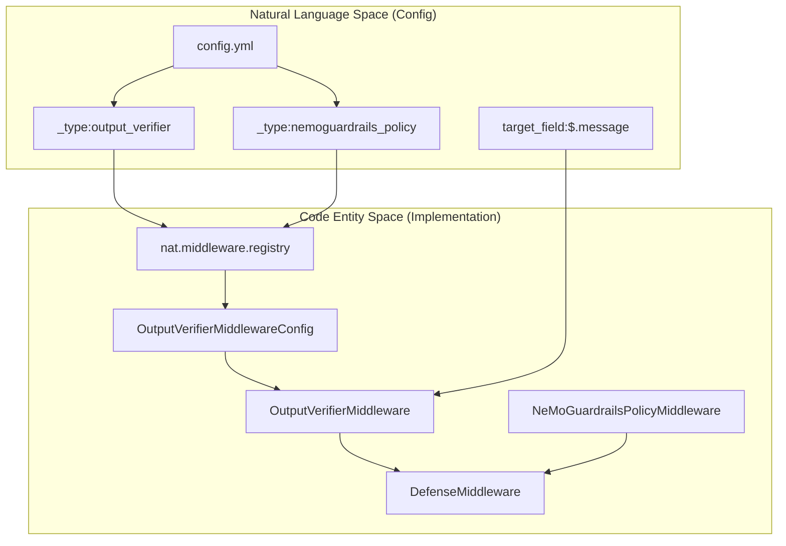
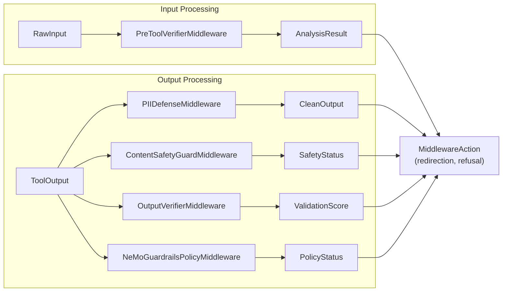

<!-- source: DeepWiki mcp.deepwiki.com · repo NVIDIA/NeMo-Agent-Toolkit · page 11.3 Safety Configuration · fetched 2026-10-26 -->

# Safety Configuration

<details>
<summary>Relevant source files</summary>

The following files were used as context for generating this wiki page:

- [.github/release.yml](.github/release.yml)
- [CHANGELOG.md](CHANGELOG.md)
- [SECURITY.md](SECURITY.md)
- [docs/source/build-workflows/about-building-workflows.md](docs/source/build-workflows/about-building-workflows.md)
- [docs/source/components/auth/api-authentication.md](docs/source/components/auth/api-authentication.md)
- [docs/source/extend/custom-components/memory.md](docs/source/extend/custom-components/memory.md)
- [docs/source/improve-workflows/profiler.md](docs/source/improve-workflows/profiler.md)
- [docs/source/release-notes.md](docs/source/release-notes.md)
- [docs/source/resources/security-considerations.md](docs/source/resources/security-considerations.md)
- [docs/source/run-workflows/observe/observe-workflow-with-mlflow.md](docs/source/run-workflows/observe/observe-workflow-with-mlflow.md)

</details>


This section covers best practices and configuration patterns for deploying safety and security features in production NVIDIA NeMo Agent Toolkit (NAT) workflows. It details defense middleware setup, multi-layer security strategies, action strategies (`refusal`, `redirection`, `partial_compliance`), and performance optimization for production deployments.

For information on testing agent vulnerabilities through adversarial scenarios, refer to [Red Teaming Framework](11.1). For detailed documentation of individual defense middleware implementations, refer to [Defense Middleware](11.2).

Sources: `[examples/safety_and_security/retail_agent/README.md:83-131]()`, `[CHANGELOG.md:48-49]()`, `[docs/source/build-workflows/llms/index.md:41-71]()`, `[packages/nvidia_nat_security/src/nat/plugins/security/middleware/defense/defense_middleware_output_verifier.py:41-51]()`

## Overview

Safety configuration in the NeMo Agent Toolkit centers around integrating defense middleware into the workflow and tool execution chains. The configuration architecture enables developers to:

- Apply multiple defense layers across workflows and function groups `[examples/safety_and_security/retail_agent/README.md:83-90]()`.
- Target specific functions or inputs using JSONPath expressions `[examples/safety_and_security/retail_agent/README.md:100-104]()`.
- Define explicit action behaviors such as `refusal` (blocking execution), `redirection` (sanitizing/transforming data), or `partial_compliance` (logging and allowing) `[examples/safety_and_security/retail_agent/README.md:112-131]()`, `[packages/nvidia_nat_security/src/nat/plugins/security/middleware/defense/defense_middleware_output_verifier.py:47-51]()`.
- Leverage guard models (e.g., NVIDIA Safety Guard or Qwen Guard variants) for high-accuracy verification `[docs/source/build-workflows/llms/index.md:41-45]()`.
- Enforce policy boundaries using **NeMo Guardrails** integration `[docs/source/release-notes.md:26-29]()`, `[CHANGELOG.md:28-29]()`.

Sources: `[examples/safety_and_security/retail_agent/README.md:83-131]()`, `[CHANGELOG.md:23-29]()`, `[docs/source/build-workflows/llms/index.md:41-71]()`, `[packages/nvidia_nat_security/src/nat/plugins/security/middleware/defense/defense_middleware_output_verifier.py:41-51]()`

## Defense Middleware Architecture

The mapping between Natural Language Space (YAML configuration files) and Code Entity Space (Python classes and registry objects) is governed by the component discovery and builder system.

### NAT Safety Component Mapping


Sources: `[examples/safety_and_security/retail_agent/README.md:94-104]()`, `[CHANGELOG.md:23-29]()`, `[packages/nvidia_nat_security/src/nat/plugins/security/middleware/defense/defense_middleware_output_verifier.py:29-41]()`

## Core Defense Middleware Types

The toolkit provides several built-in defense middleware implementations designed for distinct threat vectors.

| Middleware Type | Configuration `_type` | Primary Purpose | Detection Method |
|----------------|----------------------|-----------------|------------------|
| **Pre-Tool Verifier** | `pre_tool_verifier` | Detect instruction injection in inputs | LLM-based semantic verification `[examples/safety_and_security/retail_agent/README.md:120-121]()` |
| **PII Defense** | `pii_defense` | Detect and redact sensitive personal information | Pattern matching / NER `[examples/safety_and_security/retail_agent/README.md:121-121]()` |
| **Content Safety Guard** | `content_safety_guard` | Detect harmful, toxic, or unsafe content | Guard model classification `[packages/nvidia_nat_security/src/nat/plugins/security/middleware/defense/defense_middleware_content_guard.py:60-66]()` |
| **Output Verifier** | `output_verifier` | Validate tool outputs against specifications | LLM-based semantic validation `[packages/nvidia_nat_security/src/nat/plugins/security/middleware/defense/defense_middleware_output_verifier.py:69-76]()` |
| **NeMo Guardrails** | `nemoguardrails_policy` | Enforce programmatic and conversational rails | NeMo Guardrails engine `[CHANGELOG.md:23-29]()` |

Sources: `[examples/safety_and_security/retail_agent/README.md:112-131]()`, `[CHANGELOG.md:23-29]()`, `[packages/nvidia_nat_security/src/nat/plugins/security/middleware/defense/defense_middleware_content_guard.py:42-66]()`, `[packages/nvidia_nat_security/src/nat/plugins/security/middleware/defense/defense_middleware_output_verifier.py:41-76]()`

## Implementation Data Flow

Defense middleware intercepts requests and responses during the `InvocationContext` execution lifecycle. Components like `OutputVerifierMiddleware` and `ContentSafetyGuardMiddleware` support targeted evaluation on specific payload attributes via JSONPath selectors `[packages/nvidia_nat_security/tests/middleware/defense/test_defense_middleware_content_guard.py:86-88]()`, `[packages/nvidia_nat_security/tests/middleware/defense/test_defense_middleware_output_verifier.py:161-163]()`.

### Safety Analysis Data Flow


Sources: `[examples/safety_and_security/retail_agent/README.md:94-104]()`, `[CHANGELOG.md:23-29]()`, `[packages/nvidia_nat_security/tests/middleware/defense/test_defense_middleware_content_guard.py:86-88]()`, `[packages/nvidia_nat_security/tests/middleware/defense/test_defense_middleware_output_verifier.py:161-163]()`

## Configuration Patterns

### Output Verifier
The `OutputVerifierMiddleware` utilizes an LLM to evaluate function outputs. It supports `fail_closed` configuration to treat unexpected verifier errors as security threats `[packages/nvidia_nat_security/src/nat/plugins/security/middleware/defense/defense_middleware_output_verifier.py:57-63]()`, `[CHANGELOG.md:49-49]()`.

```yaml
middleware:
  output_verifier_tool:
    _type: output_verifier
    llm_name: safety_llm
    threshold: 0.8
    fail_closed: true
    action: refusal
    target_field: "$.result"
    tool_description: "Calculates retail tax rates based on region."
```

Sources: `[packages/nvidia_nat_security/src/nat/plugins/security/middleware/defense/defense_middleware_output_verifier.py:41-68]()`, `[CHANGELOG.md:49-49]()`

### Content Safety Guard
Designed for dedicated classification guard models. It inspects content length boundaries and categorizes text safety states `[packages/nvidia_nat_security/src/nat/plugins/security/middleware/defense/defense_middleware_content_guard.py:42-58]()`.

```yaml
middleware:
  content_guard:
    _type: content_safety_guard
    llm_name: qwen_guard_llm
    max_content_length: 32000
    action: redirection
```

Sources: `[packages/nvidia_nat_security/src/nat/plugins/security/middleware/defense/defense_middleware_content_guard.py:42-58]()`

### NeMo Guardrails Policy
Applies conversational and programmatic rails at the designated function or workflow boundary `[CHANGELOG.md:23-29]()`.

```yaml
middleware:
  guardrails_policy:
    _type: nemoguardrails_policy
    config_path: "./config/guardrails"
    target_function_or_group: workflow
    action: refusal
```

Sources: `[CHANGELOG.md:23-29]()`

## Multi-Layer Defense Strategy

Production deployments should implement defense-in-depth by attaching middleware at both the granular tool/function group level and the global workflow orchestrator level `[examples/safety_and_security/retail_agent/README.md:83-90]()`.

```yaml
function_groups:
  retail_tools:
    _type: retail_tools
    middleware:
      - pii_defense_tools
      - content_safety_guard_tools

workflow:
  _type: react_agent
  middleware:
    - pre_tool_verifier_workflow
    - pii_defense_workflow
    - guardrails_policy
```

Sources: `[examples/safety_and_security/retail_agent/README.md:83-90]()`, `[CHANGELOG.md:23-29]()`

## Performance Optimization and Observability

### Guard Model Selection
To minimize latency overhead in production, use optimized guard models hosted on high-performance inference engines:
- **NVIDIA NIM Guard Models**: Enterprise-grade models such as `meta/llama-3.1-70b-instruct` `[docs/source/build-workflows/llms/index.md:41-45]()`.
- **Lightweight Local Models**: Compact alternatives like `Qwen/Qwen3Guard-Gen-0.6B` for low-latency edge or local instances `[docs/source/build-workflows/llms/index.md:68-71]()`.

Sources: `[docs/source/build-workflows/llms/index.md:22-71]()`

### Telemetry Tracing
Safety infractions, redactions, and verification scores are recorded through the OpenTelemetry tracing pipeline. Telemetry spans can be ingested by observability platforms like Arize Phoenix, LangSmith, or MLflow `[docs/source/run-workflows/observe/observe-workflow-with-mlflow.md:20-21]()`.

Sources: `[docs/source/run-workflows/observe/observe-workflow-with-mlflow.md:20-21]()`

## Related Documentation

- [Red Teaming Framework](11.1)
- [Defense Middleware](11.2)
- [LLM Provider Architecture](7.1)
- [Observability and Monitoring](9)

Sources: `[docs/source/run-workflows/observe/observe-workflow-with-mlflow.md:20-21]()`

---

