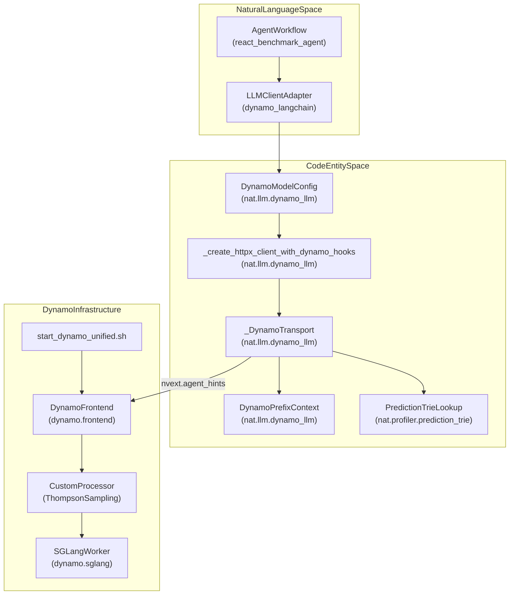
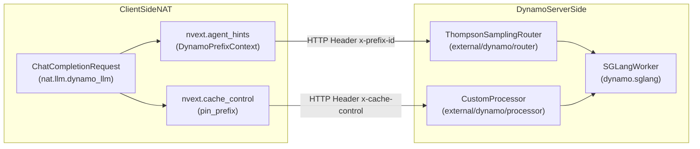

<!-- source: DeepWiki mcp.deepwiki.com · repo NVIDIA/NeMo-Agent-Toolkit · page 12 Dynamo High-Performance Inference · fetched 2026-10-26 -->

# Dynamo High-Performance Inference

Relevant source files

The following files were used as context for generating this wiki page:

- [docs/source/components/agents/auto-memory-wrapper/index.md](docs/source/components/agents/auto-memory-wrapper/index.md)
- [examples/dynamo_integration/.env.example](examples/dynamo_integration/.env.example)
- [examples/dynamo_integration/README.md](examples/dynamo_integration/README.md)
- [examples/dynamo_integration/react_benchmark_agent/README.md](examples/dynamo_integration/react_benchmark_agent/README.md)
- [examples/dynamo_integration/react_benchmark_agent/pyproject.toml](examples/dynamo_integration/react_benchmark_agent/pyproject.toml)
- [examples/dynamo_integration/react_benchmark_agent/src/react_benchmark_agent/DEVELOPER_NOTES.md](examples/dynamo_integration/react_benchmark_agent/src/react_benchmark_agent/DEVELOPER_NOTES.md)
- [external/dynamo/.env.example](external/dynamo/.env.example)
- [external/dynamo/README.md](external/dynamo/README.md)
- [external/dynamo/monitor_dynamo.sh](external/dynamo/monitor_dynamo.sh)
- [external/dynamo/start_dynamo_disagg.sh](external/dynamo/start_dynamo_disagg.sh)
- [external/dynamo/start_dynamo_unified.sh](external/dynamo/start_dynamo_unified.sh)
- [external/dynamo/stop_dynamo.sh](external/dynamo/stop_dynamo.sh)
- [external/dynamo/test_dynamo_integration.sh](external/dynamo/test_dynamo_integration.sh)

## Purpose and Scope

This document describes the NVIDIA Dynamo integration in the NeMo Agent Toolkit, which enables high-performance inference through KV cache optimization and intelligent request routing [external/dynamo/README.md:49-58](). Dynamo is NVIDIA's high-performance LLM serving platform that provides advanced features for managing key-value (KV) cache across distributed GPU workers and optimizing request scheduling based on workload characteristics [external/dynamo/README.md:49-58]().

The toolkit's Dynamo integration automatically injects routing hints (`nvext.agent_hints`) and cache management directives (`nvext.cache_control`) into LLM requests, supporting KV cache affinity, priority-based scheduling, predictive optimization, and cache lifetime management [packages/nvidia_nat_core/src/nat/llm/dynamo_llm.py:15-56]().

Sources: [packages/nvidia_nat_core/src/nat/llm/dynamo_llm.py:15-56](), [external/dynamo/README.md:49-58]()

---

## System Architecture and Overview

The Dynamo integration operates by intercepting HTTP requests to Dynamo-compatible inference endpoints and injecting custom metadata into the request body via `_DynamoTransport` [packages/nvidia_nat_core/src/nat/llm/dynamo_llm.py:455-460](). This metadata guides Dynamo's routing and scheduling decisions without requiring changes to application code or agent workflows [packages/nvidia_nat_core/src/nat/llm/dynamo_llm.py:22-24]().

Title: Dynamo Integration Architecture

Sources: [packages/nvidia_nat_core/src/nat/llm/dynamo_llm.py:15-56](), [external/dynamo/README.md:59-121]()

Title: Hint and Cache Control Flow

Sources: [external/dynamo/README.md:70-113](), [packages/nvidia_nat_core/src/nat/llm/dynamo_llm.py:633-652]()

---

## Dynamo LLM Provider

The `DynamoModelConfig` configuration class extends OpenAI-compatible configurations to support Dynamo endpoints, defining attributes for hint injection, request volume estimation, and cache control [packages/nvidia_nat_core/src/nat/llm/dynamo_llm.py:282-285](). It integrates seamlessly with LangChain and other model provider adapters via the meta-package registration system [packages/nvidia_nat_langchain/tests/test_llm_langchain.py:35-39]().

For detailed configuration parameters, field validators, and integration guides, see [Dynamo LLM Provider](#12.1).

Sources: [packages/nvidia_nat_core/src/nat/llm/dynamo_llm.py:282-448]()

---

## nvext Hints System

The `nvext` system provides routing optimization (`nvext.agent_hints`) and KV cache pinning (`nvext.cache_control`) capabilities [packages/nvidia_nat_core/src/nat/llm/dynamo_llm.py:633-652](). It encodes expected output sequence lengths (`osl`), inter-arrival times (`iat`), and total request counts into HTTP request headers or JSON payloads to direct traffic toward optimal backend workers.

For comprehensive details on hint parameters, validation logic, and routing optimization, see [nvext Hints System](#12.2).

Sources: [packages/nvidia_nat_core/src/nat/llm/dynamo_llm.py:51-56](), [external/dynamo/README.md:70-76]()

---

## KV Cache Management

KV cache management revolves around prefix ID generation and cache affinity tracking [packages/nvidia_nat_core/src/nat/llm/dynamo_llm.py:153-154](). By organizing conversation turns into hierarchical depth-based prefix IDs (`{workflow_run_id}-d{depth}`), the system maximizes token reuse across recurring agent thought-action loops [packages/nvidia_nat_core/src/nat/llm/dynamo_llm.py:157-162]().

For details on prefix ID generation, TTL configuration, cache control modes, and hierarchical cache policies, see [KV Cache Management](#12.3).

Sources: [packages/nvidia_nat_core/src/nat/llm/dynamo_llm.py:153-275]()

---

## Prediction Trie System

The prediction trie system uses profiled execution traces to dynamically inject task-specific hints into runtime requests [packages/nvidia_nat_core/src/nat/llm/dynamo_llm.py:529-535](). By matching current node paths in the execution tree against pre-computed execution profiles via `PredictionTrieLookup`, the system adapts OSL and IAT hints dynamically [packages/nvidia_nat_core/src/nat/llm/dynamo_llm.py:18-20]().

For details on profiling integration, trie construction, and dynamic hint injection, see [Prediction Trie System](#12.4).

Sources: [packages/nvidia_nat_core/src/nat/llm/dynamo_llm.py:18-20](), [packages/nvidia_nat_core/src/nat/llm/dynamo_llm.py:529-535]()

---

## Dynamo Backend Setup

Running high-performance inference requires setting up the Dynamo backend infrastructure, which consists of ETCD for metadata discovery, NATS for message passing, a Dynamo frontend with custom processors, and SGLang or vLLM backend workers [external/dynamo/README.md:53-58](). Startup scripts such as `start_dynamo_unified.sh` and `start_dynamo_disagg.sh` automate container orchestration across unified and disaggregated execution modes [external/dynamo/start_dynamo_unified.sh:17-30]().

For step-by-step guidance on environment variables, startup scripts, and worker topologies, see [Dynamo Backend Setup](#12.5).

Sources: [external/dynamo/README.md:53-58](), [external/dynamo/start_dynamo_unified.sh:17-30](), [external/dynamo/start_dynamo_disagg.sh:17-32]()

---

## Agent Benchmarking with Dynamo

The toolkit includes benchmark workflows like `react_benchmark_agent` to evaluate tool selection quality (TSQ), throughput, and latency against Dynamo-backed inference servers [examples/dynamo_integration/README.md:46-48](). These benchmarks support decision-only evaluations, automated retry loops, and self-evaluation mechanisms [examples/dynamo_integration/README.md:53-59]().

For instructions on executing benchmarks, scoring with TSQ, and analyzing results, see [Agent Benchmarking with Dynamo](#12.6).

Sources: [examples/dynamo_integration/README.md:46-60](), [examples/dynamo_integration/react_benchmark_agent/README.md:21-32]()

---

