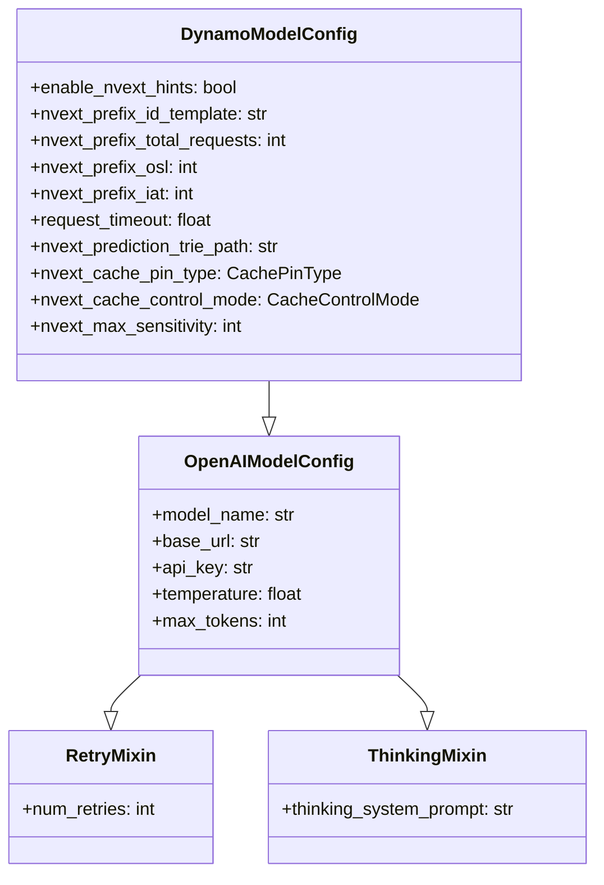
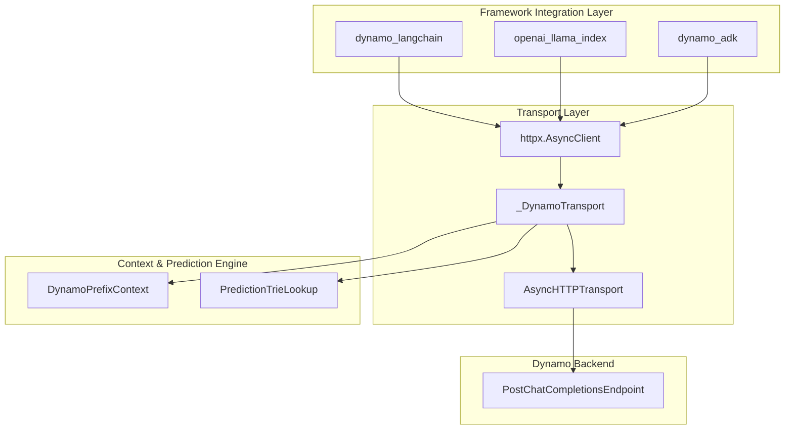
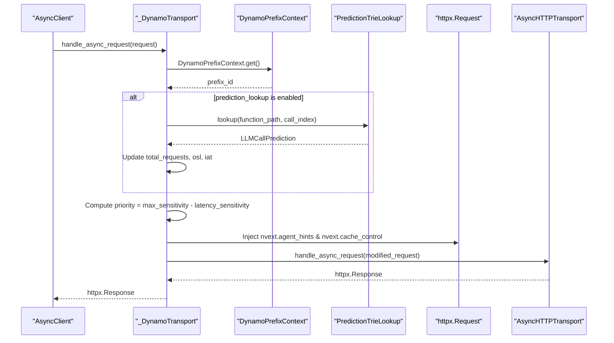

<!-- source: DeepWiki mcp.deepwiki.com · repo NVIDIA/NeMo-Agent-Toolkit · page 12.1 Dynamo LLM Provider · fetched 2026-10-26 -->

# Dynamo LLM Provider

Relevant source files

The following files were used as context for generating this wiki page:

- [examples/dynamo_integration/latency_sensitivity_demo/src/latency_sensitivity_demo/configs/config_profile.yml](examples/dynamo_integration/latency_sensitivity_demo/src/latency_sensitivity_demo/configs/config_profile.yml)
- [examples/dynamo_integration/latency_sensitivity_demo/src/latency_sensitivity_demo/configs/config_with_trie.yml](examples/dynamo_integration/latency_sensitivity_demo/src/latency_sensitivity_demo/configs/config_with_trie.yml)
- [packages/nvidia_nat_core/src/nat/llm/dynamo_llm.py](packages/nvidia_nat_core/src/nat/llm/dynamo_llm.py)
- [packages/nvidia_nat_core/src/nat/llm/utils/hooks.py](packages/nvidia_nat_core/src/nat/llm/utils/hooks.py)
- [packages/nvidia_nat_core/tests/nat/llm/test_dynamic_prediction_hook.py](packages/nvidia_nat_core/tests/nat/llm/test_dynamic_prediction_hook.py)
- [packages/nvidia_nat_core/tests/nat/llm/test_dynamo_llm.py](packages/nvidia_nat_core/tests/nat/llm/test_dynamo_llm.py)
- [packages/nvidia_nat_core/tests/nat/llm/test_runtime_prediction_e2e.py](packages/nvidia_nat_core/tests/nat/llm/test_runtime_prediction_e2e.py)
- [packages/nvidia_nat_core/tests/nat/llm/utils/test_thinking.py](packages/nvidia_nat_core/tests/nat/llm/utils/test_thinking.py)

## Purpose and Scope

The Dynamo LLM provider bridges framework-agnostic agent execution (LangChain, LlamaIndex, ADK, Agno) with NVIDIA Dynamo serving endpoints. By leveraging a custom `httpx` transport layer (`_DynamoTransport`), it dynamically injects `nvext.agent_hints` and `nvext.cache_control` into OpenAI-compatible HTTP requests to optimize KV cache management and request routing.

Sources: [packages/nvidia_nat_core/src/nat/llm/dynamo_llm.py:15-24]()

---

## DynamoModelConfig Class

`DynamoModelConfig` is defined in `packages/nvidia_nat_core/src/nat/llm/dynamo_llm.py` and inherits from `OpenAIModelConfig`. It is registered under the type key `dynamo` using `register_llm_provider`.

Title: DynamoModelConfig Class Hierarchy (Code Entity Space)

Sources: [packages/nvidia_nat_core/src/nat/llm/dynamo_llm.py:80-88](), [packages/nvidia_nat_core/src/nat/llm/dynamo_llm.py:282-448]()

---

## Configuration Fields

### Core Fields

| Field | Type | Default | Description |
|-------|------|---------|-------------|
| `enable_nvext_hints` | `bool` | `False` | Enables injection of `nvext.agent_hints` and `nvext.cache_control` |
| `nvext_prefix_id_template` | `str \| None` | `"nat-dynamo-{uuid}"` | Template string for generating unique prefix identifiers |
| `request_timeout` | `float` | `600.0` | HTTP client request timeout in seconds |

Sources: [packages/nvidia_nat_core/src/nat/llm/dynamo_llm.py:303-348]()

### nvext Hint Parameters (Optimizable)

These fields represent hint values sent in request bodies and can be optimized using the NAT optimizer via `OptimizableField`.

| Field | Type | Default | Constraints | Description |
|-------|------|---------|-------------|-------------|
| `nvext_prefix_total_requests` | `int` | `10` | `1 <= x <= 50` | Expected requests per conversation session |
| `nvext_prefix_osl` | `int` | `512` | `>= 1` | Expected output sequence length in tokens |
| `nvext_prefix_iat` | `int` | `250` | `>= 1` | Expected inter-arrival time in milliseconds |

**Categorical String Coercion:**
String values (`"LOW"`, `"MEDIUM"`, `"HIGH"`) are automatically coerced into integer representations by Pydantic validators.

| Category | OSL Token Value | IAT Millisecond Value |
|----------|-----------------|-----------------------|
| `"LOW"`  | 128 | 50 |
| `"MEDIUM"`| 512 | 250 |
| `"HIGH"` | 2048 | 750 |

Sources: [packages/nvidia_nat_core/src/nat/llm/dynamo_llm.py:91-100](), [packages/nvidia_nat_core/src/nat/llm/dynamo_llm.py:317-343](), [packages/nvidia_nat_core/src/nat/llm/dynamo_llm.py:386-412]()

### Cache Control Fields

- `nvext_cache_pin_type`: Defaults to `CachePinType.EPHEMERAL`. Controls KV cache retention strategy.
- `nvext_cache_control_mode`: Defaults to `CacheControlMode.ALWAYS`. Determines whether cache control headers are sent on every request (`ALWAYS`) or only on the first request (`FIRST_ONLY`).

Sources: [packages/nvidia_nat_core/src/nat/llm/dynamo_llm.py:120-145](), [packages/nvidia_nat_core/src/nat/llm/dynamo_llm.py:357-371]()

---

## Custom Transport Architecture

When `enable_nvext_hints` is active, client requests flow through `_DynamoTransport`, intercepting `httpx.Request` objects before dispatching to downstream endpoints.

Title: Dynamo Transport and Hint Injection Architecture (Code Entity Space)

Sources: [packages/nvidia_nat_core/src/nat/llm/dynamo_llm.py:22-23](), [packages/nvidia_nat_core/src/nat/llm/dynamo_llm.py:455-697]()

---

## `_DynamoTransport` Implementation

`_DynamoTransport` implements `httpx.AsyncBaseTransport` inside `packages/nvidia_nat_core/src/nat/llm/dynamo_llm.py`. It inspects active context states and prediction lookups to modify outbound JSON payloads.

Title: _DynamoTransport Execution Flow (Code Entity Space)

Sources: [packages/nvidia_nat_core/src/nat/llm/dynamo_llm.py:503-693](), [packages/nvidia_nat_core/tests/nat/llm/test_runtime_prediction_e2e.py:114-153]()

---

## DynamoPrefixContext

`DynamoPrefixContext` manages prefix IDs via `ContextVar` to provide scoped caching behaviors across nested function call stacks.

Sources: [packages/nvidia_nat_core/src/nat/llm/dynamo_llm.py:153-275](), [packages/nvidia_nat_core/tests/nat/llm/test_dynamo_llm.py:25-25]()

---

## Prediction Trie Integration

`DynamoModelConfig` accepts `nvext_prediction_trie_path`. When configured, `_DynamoTransport` queries `PredictionTrieLookup` to dynamically override static hint values using profiled runtime metrics.

Sources: [packages/nvidia_nat_core/src/nat/llm/dynamo_llm.py:350-354](), [packages/nvidia_nat_core/src/nat/llm/dynamo_llm.py:534-574](), [packages/nvidia_nat_core/tests/nat/llm/test_dynamic_prediction_hook.py:66-108]()

---

## Validation and Error Handling

Before transmitting requests, `_DynamoTransport` validates hint parameters against predefined numerical constraints:
- `total_requests` must fall between `1` and `50`.
- `osl` and `iat` must be positive integers `>= 1`.
- `latency_sensitivity` is bounded by `0` and `max_sensitivity`.

Sources: [packages/nvidia_nat_core/src/nat/llm/dynamo_llm.py:321-343](), [packages/nvidia_nat_core/src/nat/llm/dynamo_llm.py:599-618](), [packages/nvidia_nat_core/tests/nat/llm/test_dynamo_llm.py:89-156]()

---

