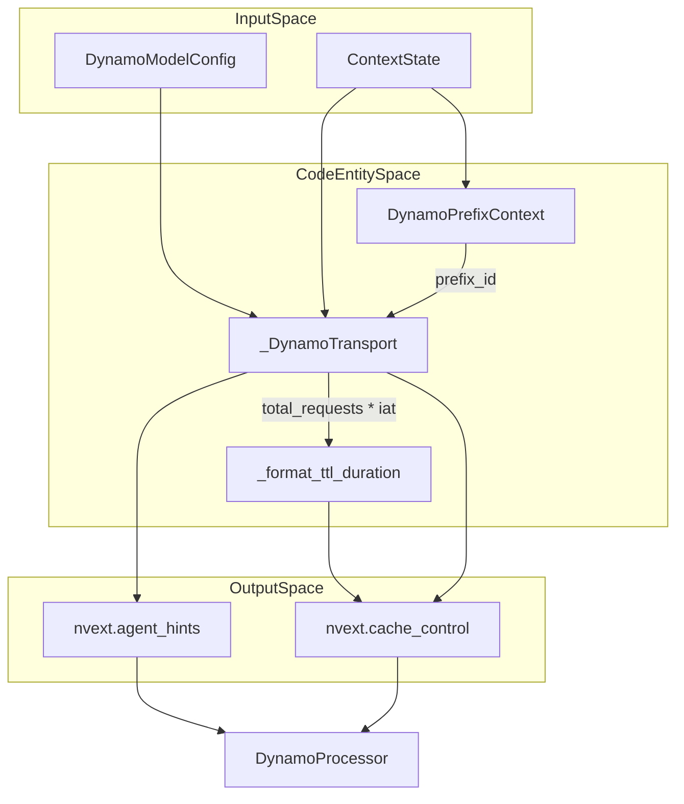
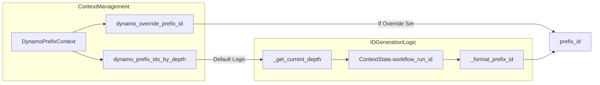

<!-- source: DeepWiki mcp.deepwiki.com · repo NVIDIA/NeMo-Agent-Toolkit · page 12.2 nvext Hints System · fetched 2026-10-26 -->

# nvext Hints System

<details>
<summary>Relevant source files</summary>

The following files were used as context for generating this wiki page:

- [examples/dynamo_integration/latency_sensitivity_demo/src/latency_sensitivity_demo/configs/config_profile.yml](examples/dynamo_integration/latency_sensitivity_demo/src/latency_sensitivity_demo/configs/config_profile.yml)
- [examples/dynamo_integration/latency_sensitivity_demo/src/latency_sensitivity_demo/configs/config_with_trie.yml](examples/dynamo_integration/latency_sensitivity_demo/src/latency_sensitivity_demo/configs/config_with_trie.yml)
- [packages/nvidia_nat_core/src/nat/llm/dynamo_llm.py](packages/nvidia_nat_core/src/nat/llm/dynamo_llm.py)
- [packages/nvidia_nat_core/src/nat/llm/utils/hooks.py](packages/nvidia_nat_core/src/nat/llm/utils/hooks.py)
- [packages/nvidia_nat_core/tests/nat/llm/test_dynamic_prediction_hook.py](packages/nvidia_nat_core/tests/nat/llm/test_dynamic_prediction_hook.py)
- [packages/nvidia_nat_core/tests/nat/llm/test_dynamo_llm.py](packages/nvidia_nat_core/tests/nat/llm/test_dynamo_llm.py)
- [packages/nvidia_nat_core/tests/nat/llm/test_runtime_prediction_e2e.py](packages/nvidia_nat_core/tests/nat/llm/test_runtime_prediction_e2e.py)
- [packages/nvidia_nat_core/tests/nat/llm/utils/test_thinking.py](packages/nvidia_nat_core/tests/nat/llm/utils/test_thinking.py)

</details>


## Purpose and Scope

The `nvext` (NVIDIA Extensions) hints system provides a mechanism to inject routing and caching metadata into OpenAI-compatible API requests sent to NVIDIA Dynamo [packages/nvidia_nat_core/src/nat/llm/dynamo_llm.py:15-16](). These hints enable high-performance inference by optimizing KV cache management and request routing based on agentic workflow patterns.

The system documents and implements the `nvext.agent_hints` and `nvext.cache_control` extensions used by the `DynamoModelConfig` and its underlying transport [packages/nvidia_nat_core/src/nat/llm/dynamo_llm.py:15-56](). These extensions allow the agent toolkit to communicate its internal state and predicted future requirements to the Dynamo backend, enabling:

1.  **Request Priority Routing**: Control queue ordering and scheduling priority based on latency sensitivity [packages/nvidia_nat_core/src/nat/llm/dynamo_llm.py:32-34]().
2.  **Output Length Hinting**: Inform the router about expected response length for resource estimation [packages/nvidia_nat_core/src/nat/llm/dynamo_llm.py:39-43]().
3.  **KV Cache Affinity**: Enable worker stickiness by routing requests with the same `prefix_id` to the same worker [packages/nvidia_nat_core/src/nat/llm/dynamo_llm.py:33-34]().
4.  **Cache Lifetime Management**: Control when KV cache entries are pinned and evicted via TTL [packages/nvidia_nat_core/src/nat/llm/dynamo_llm.py:120-129]().

All hints are injected into the request body as JSON fields under the `nvext` namespace when `enable_nvext_hints` is enabled in `DynamoModelConfig` [packages/nvidia_nat_core/src/nat/llm/dynamo_llm.py:15-56]().

Sources: [packages/nvidia_nat_core/src/nat/llm/dynamo_llm.py:15-56]()

---

## nvext Extensions Overview

The Dynamo transport injects two top-level extensions into OpenAI API request bodies: `agent_hints` and `cache_control` [packages/nvidia_nat_core/src/nat/llm/dynamo_llm.py:28-56]().

```json
{
  "model": "nvidia/NVIDIA-Nemotron-3-Nano-30B-A3B-BF16",
  "messages": [...],
  "nvext": {
    "agent_hints": {
      "prefix_id": "nat-dynamo-uuid-d0",
      "total_requests": 10,
      "osl": 512,
      "iat": 250,
      "latency_sensitivity": 2.0,
      "priority": 2
    },
    "cache_control": {
      "type": "ephemeral",
      "ttl": "2500ms"
    }
  }
}
```

### Request Flow Diagram

The following diagram illustrates how configuration and runtime context are transformed into `nvext` hints by the `_DynamoTransport` class [packages/nvidia_nat_core/src/nat/llm/dynamo_llm.py:455-698]().

**Figure 1: Natural Language Space to Code Entity Space — Hint Generation**



Sources: [packages/nvidia_nat_core/src/nat/llm/dynamo_llm.py:455-698](), [packages/nvidia_nat_core/src/nat/llm/dynamo_llm.py:170-176]()

---

## nvext.agent_hints Fields

The `agent_hints` dictionary contains fields that control request routing and resource allocation [packages/nvidia_nat_core/src/nat/llm/dynamo_llm.py:28-56]().

| Field | Type | Consumer | Purpose |
| :--- | :--- | :--- | :--- |
| `latency_sensitivity` | float | Dynamo Router | Queue ordering priority (higher = more sensitive) [packages/nvidia_nat_core/src/nat/llm/dynamo_llm.py:32-34]() |
| `osl` | int | Dynamo Router | Expected output tokens (Output Sequence Length) [packages/nvidia_nat_core/src/nat/llm/dynamo_llm.py:39-43]() |
| `priority` | int | Engine Scheduler | Scheduling priority (higher = higher priority in Dynamo >= 1.1.0) [packages/nvidia_nat_core/src/nat/llm/dynamo_llm.py:107-112]() |
| `prefix_id` | str | Processor | KV cache prefix identity for worker stickiness [packages/nvidia_nat_core/src/nat/llm/dynamo_llm.py:33-34]() |
| `total_requests` | int | Processor | Expected requests per conversation [packages/nvidia_nat_core/src/nat/llm/dynamo_llm.py:51-55]() |
| `iat` | int | Processor | Expected inter-arrival time in milliseconds [packages/nvidia_nat_core/src/nat/llm/dynamo_llm.py:45-49]() |

### Categorical Mappings
For backward compatibility, `osl` and `iat` accept categorical strings which are converted to representative integers [packages/nvidia_nat_core/src/nat/llm/dynamo_llm.py:91-100]():
*   **OSL**: `LOW` (128), `MEDIUM` (512), `HIGH` (2048) [packages/nvidia_nat_core/src/nat/llm/dynamo_llm.py:95]().
*   **IAT**: `LOW` (50), `MEDIUM` (250), `HIGH` (750) [packages/nvidia_nat_core/src/nat/llm/dynamo_llm.py:100]().

Sources: [packages/nvidia_nat_core/src/nat/llm/dynamo_llm.py:28-56](), [packages/nvidia_nat_core/src/nat/llm/dynamo_llm.py:91-100](), [packages/nvidia_nat_core/tests/nat/llm/test_dynamo_llm.py:126-144]()

---

## nvext.cache_control Fields

The `cache_control` dictionary manages KV cache entry lifetime and pinning [packages/nvidia_nat_core/src/nat/llm/dynamo_llm.py:120-132]().

### Cache Pinning Strategy
*   **type**: Currently supports `CachePinType.EPHEMERAL`. Cache entries auto-expire after a computed TTL of inactivity [packages/nvidia_nat_core/src/nat/llm/dynamo_llm.py:125-129]().
*   **ttl**: Formatted string (e.g., `"2500ms"`, `"30s"`, `"5m"`). Computed as `total_requests * iat` [packages/nvidia_nat_core/src/nat/llm/dynamo_llm.py:651-653]().

### Cache Control Mode
Controlled by `nvext_cache_control_mode` in `DynamoModelConfig` [packages/nvidia_nat_core/src/nat/llm/dynamo_llm.py:307-308](). Options include:
*   **ALWAYS**: Inject on every request (refreshes TTL each turn) [packages/nvidia_nat_core/src/nat/llm/dynamo_llm.py:144]().
*   **FIRST_ONLY**: Inject only on the first request per `prefix_id`. This pins the system prompt while allowing subsequent requests to benefit from prefix matching without re-pinning the growing context [packages/nvidia_nat_core/src/nat/llm/dynamo_llm.py:145-146]().

Sources: [packages/nvidia_nat_core/src/nat/llm/dynamo_llm.py:120-132](), [packages/nvidia_nat_core/src/nat/llm/dynamo_llm.py:647-667]()

---

## DynamoPrefixContext and prefix_id

The `DynamoPrefixContext` singleton manages `prefix_id` generation to ensure KV cache affinity [packages/nvidia_nat_core/src/nat/llm/dynamo_llm.py:153-241]().

**Figure 2: Natural Language Space to Code Entity Space — Prefix ID Generation**



Prefix IDs are unique per depth level in the function call stack. This allows different caching behavior at different levels of nested function calls (e.g., a main agent vs. a sub-agent tool) [packages/nvidia_nat_core/src/nat/llm/dynamo_llm.py:153-162]().

Sources: [packages/nvidia_nat_core/src/nat/llm/dynamo_llm.py:153-241](), [packages/nvidia_nat_core/src/nat/llm/dynamo_llm.py:165-167]()

---

## Implementation Details: _DynamoTransport

The `_DynamoTransport` class is a custom `httpx` transport that performs hint injection at the HTTP level, making the system framework-agnostic across LangChain, LlamaIndex, and ADK [packages/nvidia_nat_core/src/nat/llm/dynamo_llm.py:22-24]().

### Dynamic Prediction Lookup
If a `PredictionTrieLookup` instance is provided to the transport, static configuration values are dynamically overridden with predicted values based on the current call stack and call index [packages/nvidia_nat_core/tests/nat/llm/test_dynamic_prediction_hook.py:69-108]().

*   **Call Index Tracking**: The `IntermediateStepManager` increments a call tracker on `LLM_START` events [packages/nvidia_nat_core/tests/nat/llm/test_runtime_prediction_e2e.py:95-153]().
*   **Path Matching**: The transport uses `Context.get().function_path` to navigate the prediction trie [packages/nvidia_nat_core/tests/nat/llm/test_dynamic_prediction_hook.py:89-92]().
*   **Fallback**: If no path-specific prediction exists, it falls back to root-level aggregated predictions or static config [packages/nvidia_nat_core/tests/nat/llm/test_dynamic_prediction_hook.py:111-146]().

### Priority Normalization
In Dynamo versions >= 1.1.0, the client injects `priority == latency_sensitivity` [packages/nvidia_nat_core/src/nat/llm/dynamo_llm.py:106-110](). Dynamo normalizes this value so that higher values indicate higher priority, negating it for engines like vLLM as needed [packages/nvidia_nat_core/src/nat/llm/dynamo_llm.py:108-110]().

Sources: [packages/nvidia_nat_core/src/nat/llm/dynamo_llm.py:455-698](), [packages/nvidia_nat_core/src/nat/llm/dynamo_llm.py:705-753](), [packages/nvidia_nat_core/tests/nat/llm/test_dynamic_prediction_hook.py:15-181]()

---

## Configuration and Optimization

The `DynamoModelConfig` class exposes hint parameters as `OptimizableField`, allowing the NAT optimizer to find optimal values for specific workflows [packages/nvidia_nat_core/src/nat/llm/dynamo_llm.py:282-301]().

| Parameter | Default | Search Space |
| :--- | :--- | :--- |
| `nvext_prefix_total_requests` | 10 | [1, 50], step=5 [packages/nvidia_nat_core/src/nat/llm/dynamo_llm.py:284-288]() |
| `nvext_prefix_osl` | 512 | [64, 4096], step=64 [packages/nvidia_nat_core/src/nat/llm/dynamo_llm.py:290-294]() |
| `nvext_prefix_iat` | 250 | [10, 1000], step=50 [packages/nvidia_nat_core/src/nat/llm/dynamo_llm.py:296-300]() |

### Profiling Integration
Workflows can be profiled to generate a `prediction_trie.json` file, which is then referenced in the configuration to enable dynamic hint injection [examples/dynamo_integration/latency_sensitivity_demo/src/latency_sensitivity_demo/configs/config_with_trie.yml:72-73]().

Sources: [packages/nvidia_nat_core/src/nat/llm/dynamo_llm.py:282-381](), [packages/nvidia_nat_core/tests/nat/llm/test_dynamo_llm.py:36-50](), [examples/dynamo_integration/latency_sensitivity_demo/src/latency_sensitivity_demo/configs/config_with_trie.yml:55-73]()

---

