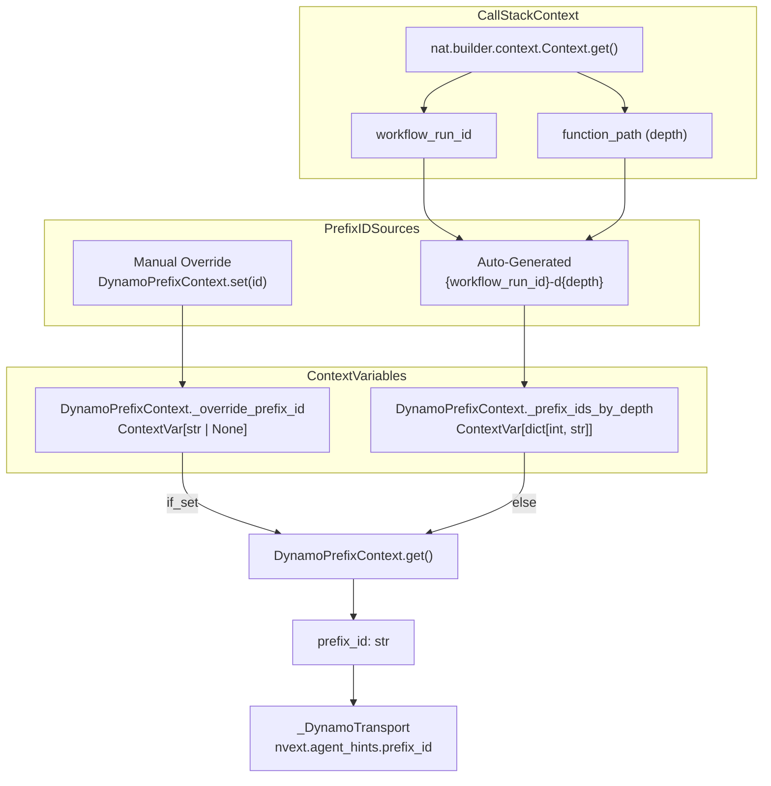
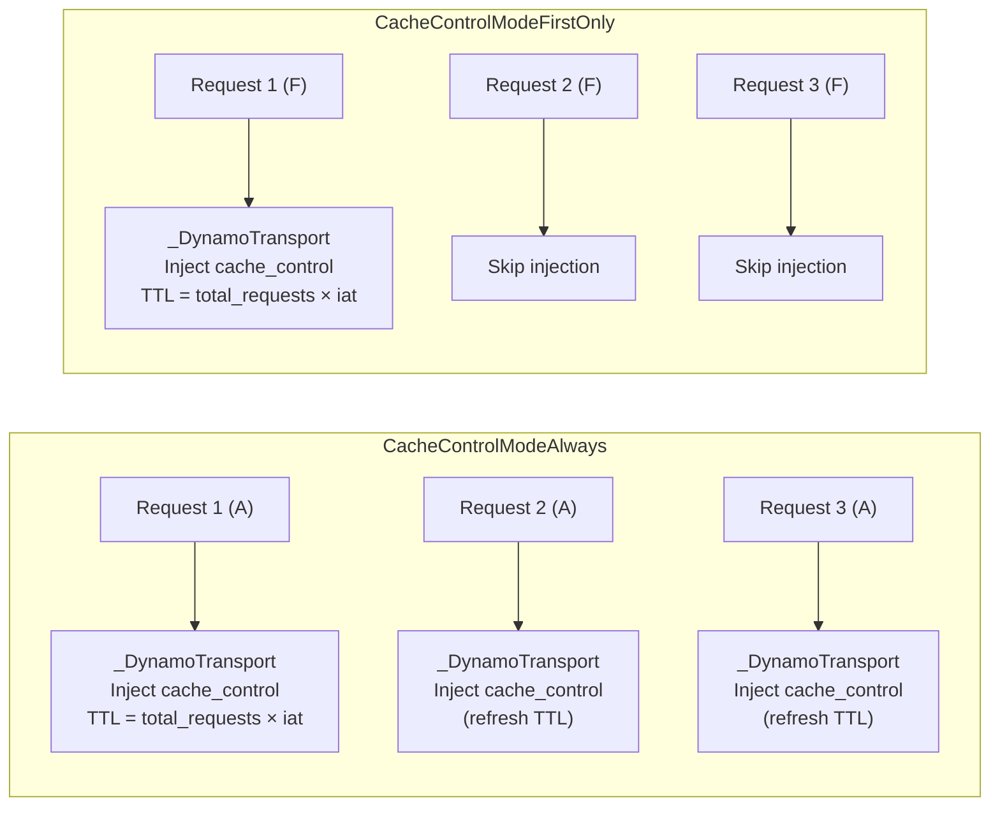
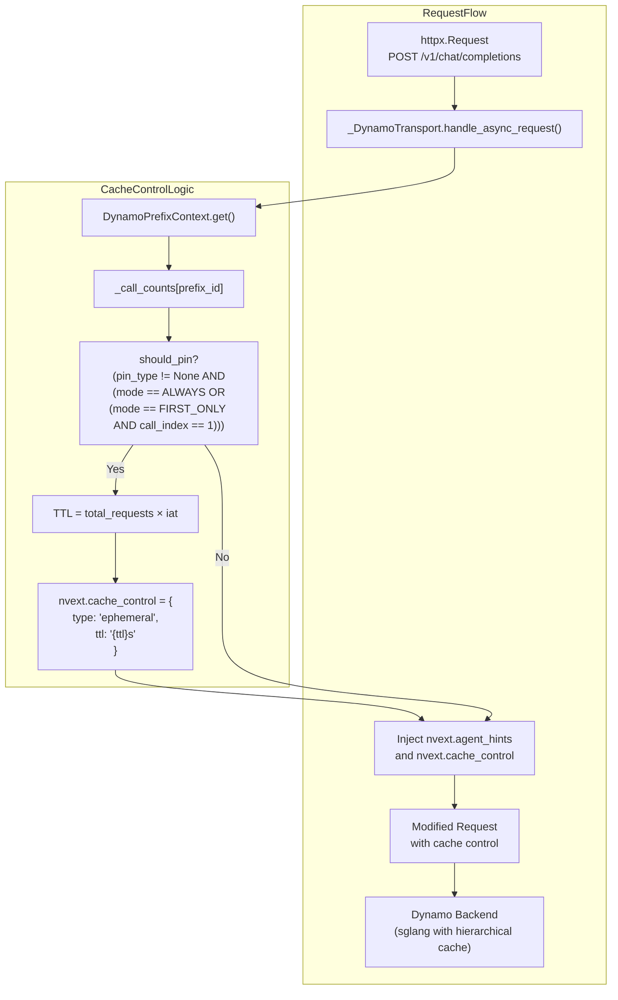
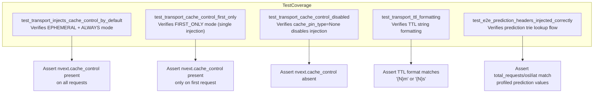

<!-- source: DeepWiki mcp.deepwiki.com · repo NVIDIA/NeMo-Agent-Toolkit · page 12.3 KV Cache Management · fetched 2026-10-26 -->

# KV Cache Management

<details>
<summary>Relevant source files</summary>

The following files were used as context for generating this wiki page:

- [docs/source/components/agents/auto-memory-wrapper/index.md](docs/source/components/agents/auto-memory-wrapper/index.md)
- [examples/dynamo_integration/.env.example](examples/dynamo_integration/.env.example)
- [examples/dynamo_integration/README.md](examples/dynamo_integration/README.md)
- [examples/dynamo_integration/react_benchmark_agent/README.md](examples/dynamo_integration/react_benchmark_agent/README.md)
- [examples/dynamo_integration/react_benchmark_agent/pyproject.toml](examples/dynamo_integration/react_benchmark_agent/pyproject.toml)
- [examples/dynamo_integration/react_benchmark_agent/src/react_benchmark_agent/DEVELOPER_NOTES.md](examples/dynamo_integration/react_benchmark_agent/src/react_benchmark_agent/DEVELOPER_NOTES.md)
- [external/dynamo/.env.example](external/dynamo/.env.example)
- [external/dynamo/README.md](external/dynamo/README.md)
- [external/dynamo/monitor_dynamo.sh](external/dynamo/monitor_dynamo.sh)
- [external/dynamo/start_dynamo_disagg.sh](external/dynamo/start_dynamo_disagg.sh)
- [external/dynamo/start_dynamo_unified.sh](external/dynamo/start_dynamo_unified.sh)
- [external/dynamo/stop_dynamo.sh](external/dynamo/stop_dynamo.sh)
- [external/dynamo/test_dynamo_integration.sh](external/dynamo/test_dynamo_integration.sh)

</details>


This page details the KV cache management system for NVIDIA Dynamo inference, covering `prefix_id` generation, cache affinity, TTL configuration, and cache control modes. For Dynamo LLM provider configuration, see [Dynamo LLM Provider](12.1). For nvext hints system details, see [nvext Hints System](12.2). For prediction-based cache optimization, see [Prediction Trie System](12.4).

## Overview

The KV cache management system enables optimal KV cache reuse across LLM requests by:

1. **Prefix IDs**: Unique identifiers that route requests with shared context to the same worker for cache affinity (`[packages/nvidia_nat_core/src/nat/llm/dynamo_llm.py:140-150]()`).
2. **Cache Control**: Explicit cache pinning with TTL to prevent premature eviction of valuable cache entries (`[packages/nvidia_nat_core/src/nat/llm/dynamo_llm.py:120-133]()`).
3. **Depth-Based Isolation**: Separate cache entries for different levels of nested function calls (`[packages/nvidia_nat_core/src/nat/llm/dynamo_llm.py:153-162]()`).
4. **Dynamic TTL**: TTL computed from expected conversation length (`total_requests` $\times$ `iat`) (`[packages/nvidia_nat_core/src/nat/llm/dynamo_llm.py:126-128]()`).

The system operates at the HTTP transport layer via `_DynamoTransport`, injecting `nvext.cache_control` and `nvext.agent_hints` fields into request bodies (`[packages/nvidia_nat_core/src/nat/llm/dynamo_llm.py:18-34]()`).

Sources: `[packages/nvidia_nat_core/src/nat/llm/dynamo_llm.py:15-56]()`

## Prefix ID Management

### DynamoPrefixContext

The `DynamoPrefixContext` singleton manages prefix IDs across LLM calls (`[packages/nvidia_nat_core/src/nat/llm/dynamo_llm.py:153-162]()`). Prefix IDs identify cache-coherent request sequences, enabling the Dynamo router to maintain KV cache affinity by directing related requests to the same worker.

Title: "Prefix ID Resolution Flow"


Sources: `[packages/nvidia_nat_core/src/nat/llm/dynamo_llm.py:153-275]()`, `[packages/nvidia_nat_core/src/nat/builder/context.py:126-129]()`

### Depth-Based Prefix IDs

The system automatically generates unique prefix IDs for each depth level in the function call stack (`[packages/nvidia_nat_core/src/nat/llm/dynamo_llm.py:153-162]()`). This enables separate cache entries for different nested contexts within the same workflow run.

**Format**: `{workflow_run_id}-d{depth}` (`[packages/nvidia_nat_core/src/nat/llm/dynamo_llm.py:155-160]()`)

| Depth | Example Function Path | Generated Prefix ID |
| :--- | :--- | :--- |
| 0 | `[]` (root) | `abc123-d0` |
| 1 | `["workflow"]` | `abc123-d1` |
| 2 | `["workflow", "agent"]` | `abc123-d2` |
| 3 | `["workflow", "agent", "tool"]` | `abc123-d3` |

Depth-based IDs ensure that different call stack levels do not collide in the KV cache, allowing fine-grained cache control for multi-level workflows (`[packages/nvidia_nat_core/src/nat/llm/dynamo_llm.py:153-162]()`).

Sources: `[packages/nvidia_nat_core/src/nat/llm/dynamo_llm.py:153-242]()`

### Manual Override

For explicit control (e.g., during batch evaluation), use `DynamoPrefixContext.set()` or the `scope()` context manager (`[packages/nvidia_nat_core/src/nat/llm/dynamo_llm.py:158-161]()`).

```python
from nat.llm.dynamo_llm import DynamoPrefixContext

# Scoped override (preferred)
with DynamoPrefixContext.scope("eval-question-001"):
    # All LLM calls here use "eval-question-001" prefix
    ...
```

Overrides take precedence over depth-based generation and support nesting. The `scope` context manager ensures proper cleanup even if exceptions occur (`[packages/nvidia_nat_core/src/nat/llm/dynamo_llm.py:255-274]()`).

Sources: `[packages/nvidia_nat_core/src/nat/llm/dynamo_llm.py:186-274]()`

## Cache Control System

### Cache Pinning Types

The `CachePinType` enum defines cache retention strategies (`[packages/nvidia_nat_core/src/nat/llm/dynamo_llm.py:120-133]()`).

| Type | Behavior | Use Case |
| :--- | :--- | :--- |
| `EPHEMERAL` | Auto-expire after computed TTL of inactivity (`[packages/nvidia_nat_core/src/nat/llm/dynamo_llm.py:125-130]()`). | Standard conversations with predictable length. |

Currently, only `EPHEMERAL` pinning is supported. Cache entries expire after a TTL computed from expected conversation duration (`[packages/nvidia_nat_core/src/nat/llm/dynamo_llm.py:125-130]()`).

Sources: `[packages/nvidia_nat_core/src/nat/llm/dynamo_llm.py:120-133]()`

### Cache Control Modes

The `CacheControlMode` enum controls when `nvext.cache_control` is injected into requests (`[packages/nvidia_nat_core/src/nat/llm/dynamo_llm.py:134-147]()`).

Title: "Cache Control Mode Behavior"


| Mode | Description | Best For |
| :--- | :--- | :--- |
| `ALWAYS` | Inject on every request, refreshing TTL each turn (`[packages/nvidia_nat_core/src/nat/llm/dynamo_llm.py:144-144]()`). | Long conversations where TTL should extend with activity. |
| `FIRST_ONLY` | Inject only on the first request per `prefix_id` (`[packages/nvidia_nat_core/src/nat/llm/dynamo_llm.py:138-142]()`). | Pinning system prompt when first established. |

Sources: `[packages/nvidia_nat_core/src/nat/llm/dynamo_llm.py:134-147]()`

### TTL Computation

TTL (Time-To-Live) is computed as `total_requests` $\times$ `iat` (`[packages/nvidia_nat_core/src/nat/llm/dynamo_llm.py:125-130]()`).

Where:
* `total_requests`: Expected number of requests for this conversation (`[packages/nvidia_nat_core/src/nat/llm/dynamo_llm.py:51-54]()`).
* `iat`: Inter-arrival time in milliseconds (`[packages/nvidia_nat_core/src/nat/llm/dynamo_llm.py:45-49]()`).

The TTL represents the estimated total conversation duration. Cache entries expire if inactive for this period (`[packages/nvidia_nat_core/src/nat/llm/dynamo_llm.py:125-130]()`).

Sources: `[packages/nvidia_nat_core/src/nat/llm/dynamo_llm.py:646-667]()`

## Transport Integration

The `_DynamoTransport` class injects cache control into request bodies by overriding the standard `httpx` transport (`[packages/nvidia_nat_core/src/nat/llm/dynamo_llm.py:489-491]()`).

Title: "Cache Control Injection in _DynamoTransport"


Sources: `[packages/nvidia_nat_core/src/nat/llm/dynamo_llm.py:489-645]()`

### Call Index Tracking

The transport maintains a per-prefix call counter to track which request this is for a given `prefix_id` (`[packages/nvidia_nat_core/src/nat/llm/dynamo_llm.py:510-512]()`).

This ensures `FIRST_ONLY` mode only injects on the first request per `prefix_id`, even if multiple requests are in-flight concurrently (`[packages/nvidia_nat_core/src/nat/llm/dynamo_llm.py:138-142]()`).

Sources: `[packages/nvidia_nat_core/src/nat/llm/dynamo_llm.py:489-645]()`

## Dynamic Prediction Integration

When a `PredictionTrieLookup` is provided to `_DynamoTransport`, cache parameters (`total_requests`, `iat`, `osl`) are dynamically adjusted based on profiled historical data for the specific function path and call index (`[packages/nvidia_nat_core/src/nat/llm/dynamo_llm.py:532-550]()`).

* Total Requests: Derived from the mean `remaining_calls` prediction (`[packages/nvidia_nat_core/tests/nat/llm/test_dynamic_prediction_hook.py:102-105]()`).
* Inter-Arrival Time (IAT): Derived from the mean `interarrival_ms` prediction (`[packages/nvidia_nat_core/tests/nat/llm/test_dynamic_prediction_hook.py:104-107]()`).
* Output Sequence Length (OSL): Derived from the P90 `output_tokens` prediction (`[packages/nvidia_nat_core/tests/nat/llm/test_dynamic_prediction_hook.py:103-106]()`).

This allows the system to automatically optimize TTL and worker affinity based on the actual complexity of the agentic workflow (`[packages/nvidia_nat_core/tests/nat/llm/test_runtime_prediction_e2e.py:15-22]()`).

Sources: `[packages/nvidia_nat_core/src/nat/llm/dynamo_llm.py:489-560]()`, `[packages/nvidia_nat_core/tests/nat/llm/test_dynamic_prediction_hook.py:69-108]()`, `[packages/nvidia_nat_core/tests/nat/llm/test_runtime_prediction_e2e.py:95-152]()`

## Configuration

### DynamoModelConfig Fields

| Field | Type | Default | Description |
| :--- | :--- | :--- | :--- |
| `nvext_cache_pin_type` | `CachePinType \| None` | `EPHEMERAL` | Cache pinning strategy (`[packages/nvidia_nat_core/src/nat/llm/dynamo_llm.py:365-365]()`). |
| `nvext_cache_control_mode` | `CacheControlMode` | `ALWAYS` | When to inject cache control (`[packages/nvidia_nat_core/src/nat/llm/dynamo_llm.py:369-369]()`). |
| `nvext_prefix_total_requests` | `int` | `10` | Expected requests per conversation (`[packages/nvidia_nat_core/src/nat/llm/dynamo_llm.py:349-349]()`). |
| `nvext_prefix_iat` | `int, str` | `250` | Inter-arrival time in ms. Accepts "LOW"/"MEDIUM"/"HIGH" (`[packages/nvidia_nat_core/src/nat/llm/dynamo_llm.py:357-357]()`). |
| `nvext_prefix_osl` | `int, str` | `512` | Expected output tokens. Accepts "LOW"/"MEDIUM"/"HIGH" (`[packages/nvidia_nat_core/src/nat/llm/dynamo_llm.py:353-353]()`). |
| `nvext_prediction_trie_path` | `str \| None` | `None` | Path to a profiled prediction trie for dynamic hints (`[packages/nvidia_nat_core/src/nat/llm/dynamo_llm.py:381-381]()`). |

### Example Configuration

```yaml
llms:
  dynamo_llm:
    _type: dynamo
    model_name: nvidia/llama-3.1-8b-instruct
    base_url: http://localhost:8099/v1
    enable_nvext_hints: true
    
    # Cache control configuration
    nvext_cache_pin_type: ephemeral
    nvext_cache_control_mode: first_only
    nvext_prefix_total_requests: 15
    nvext_prefix_iat: MEDIUM  # Coerced to 250ms
    nvext_prefix_osl: 1024
    
    # Optional dynamic optimization
    nvext_prediction_trie_path: "./outputs/profile/prediction_trie.json"
```

Sources: `[packages/nvidia_nat_core/src/nat/llm/dynamo_llm.py:357-381]()`, `[packages/nvidia_nat_core/src/nat/llm/dynamo_llm.py:95-100]()`

## Testing

The test suite validates cache control behavior and dynamic prediction integration (`[packages/nvidia_nat_core/tests/nat/llm/test_dynamo_llm.py:15-15]()`).

Title: "Cache Control Test Coverage"


Sources: `[packages/nvidia_nat_core/tests/nat/llm/test_dynamo_llm.py:814-923]()`, `[packages/nvidia_nat_core/tests/nat/llm/test_runtime_prediction_e2e.py:95-152]()`

---

