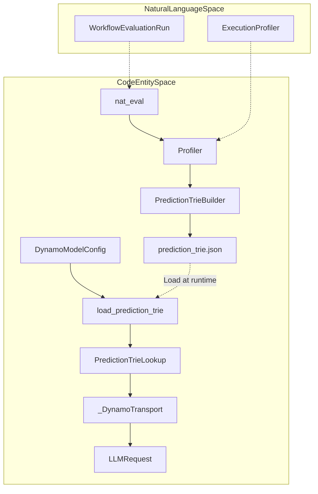
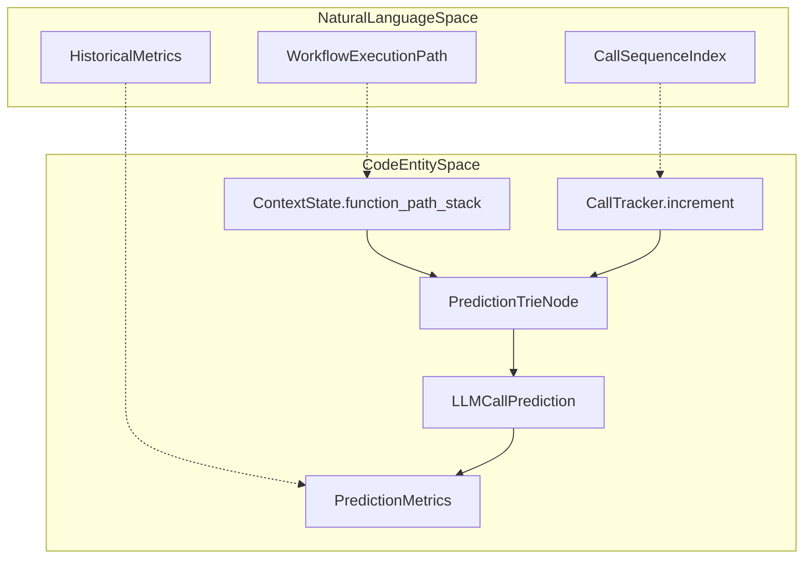
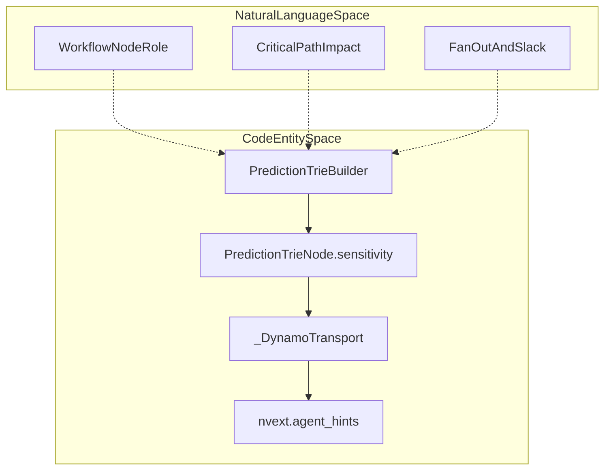
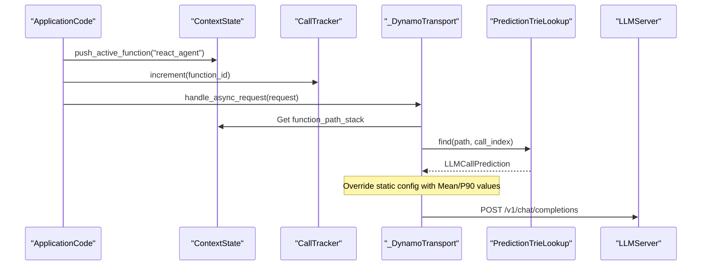

<!-- source: DeepWiki mcp.deepwiki.com · repo NVIDIA/NeMo-Agent-Toolkit · page 12.4 Prediction Trie System · fetched 2026-10-26 -->

# Prediction Trie System

<details>
<summary>Relevant source files</summary>

The following files were used as context for generating this wiki page:

- [examples/dynamo_integration/ARCHITECTURE.md](examples/dynamo_integration/ARCHITECTURE.md)
- [examples/dynamo_integration/latency_sensitivity_demo/INSTALL_LIBRARY.md](examples/dynamo_integration/latency_sensitivity_demo/INSTALL_LIBRARY.md)
- [examples/dynamo_integration/latency_sensitivity_demo/README.md](examples/dynamo_integration/latency_sensitivity_demo/README.md)
- [examples/dynamo_integration/latency_sensitivity_demo/src/latency_sensitivity_demo/configs/config_profile.yml](examples/dynamo_integration/latency_sensitivity_demo/src/latency_sensitivity_demo/configs/config_profile.yml)
- [examples/dynamo_integration/latency_sensitivity_demo/src/latency_sensitivity_demo/configs/config_with_trie.yml](examples/dynamo_integration/latency_sensitivity_demo/src/latency_sensitivity_demo/configs/config_with_trie.yml)
- [examples/dynamo_integration/latency_sensitivity_demo/src/latency_sensitivity_demo/scripts/dynamo_stack.sh](examples/dynamo_integration/latency_sensitivity_demo/src/latency_sensitivity_demo/scripts/dynamo_stack.sh)
- [examples/dynamo_integration/latency_sensitivity_demo/src/latency_sensitivity_demo/scripts/dynamo_stack_sensitivity.sh](examples/dynamo_integration/latency_sensitivity_demo/src/latency_sensitivity_demo/scripts/dynamo_stack_sensitivity.sh)
- [examples/dynamo_integration/latency_sensitivity_demo/tests/test_workflow.py](examples/dynamo_integration/latency_sensitivity_demo/tests/test_workflow.py)
- [packages/nvidia_nat_core/src/nat/llm/dynamo_llm.py](packages/nvidia_nat_core/src/nat/llm/dynamo_llm.py)
- [packages/nvidia_nat_core/src/nat/llm/utils/hooks.py](packages/nvidia_nat_core/src/nat/llm/utils/hooks.py)
- [packages/nvidia_nat_core/tests/nat/llm/test_dynamic_prediction_hook.py](packages/nvidia_nat_core/tests/nat/llm/test_dynamic_prediction_hook.py)
- [packages/nvidia_nat_core/tests/nat/llm/test_dynamo_llm.py](packages/nvidia_nat_core/tests/nat/llm/test_dynamo_llm.py)
- [packages/nvidia_nat_core/tests/nat/llm/test_runtime_prediction_e2e.py](packages/nvidia_nat_core/tests/nat/llm/test_runtime_prediction_e2e.py)
- [packages/nvidia_nat_core/tests/nat/llm/utils/test_thinking.py](packages/nvidia_nat_core/tests/nat/llm/utils/test_thinking.py)

</details>


The purpose of this page is to explain profiling-based prediction tries for dynamic hint injection and performance optimization within the NVIDIA NeMo Agent Toolkit. This system enables context-aware tuning of `nvext.agent_hints` parameters by encoding execution patterns into a trie data structure [packages/nvidia_nat_core/src/nat/llm/dynamo_llm.py:15-23]().

Sources: [packages/nvidia_nat_core/src/nat/llm/dynamo_llm.py:15-23]()

---

## Overview

The Prediction Trie System is a profiling-based optimization mechanism for the Dynamo LLM provider (`DynamoModelConfig`) that records execution patterns during profiling runs, encodes them in a trie data structure, and predicts future LLM call characteristics—specifically remaining calls (`remaining_calls`), output tokens (`output_tokens`), and inter-arrival time (`interarrival_ms`)—to automatically adjust Dynamo routing hints at runtime [packages/nvidia_nat_core/src/nat/llm/dynamo_llm.py:15-23]().

This system is a core component of the **Dynamo High-Performance Inference** subsystem. For information about the `nvext.agent_hints` fields that predictions override, see section 12.2. For KV cache management details, see section 12.3.

**Key capabilities:**
- **Profile once, optimize everywhere**: Record call patterns during evaluation to build the trie, then apply predictions to production runs [examples/dynamo_integration/latency_sensitivity_demo/src/latency_sensitivity_demo/configs/config_with_trie.yml:20-24]().
- **Per-call-index predictions**: Distinguishes between the 1st, 2nd, and 3rd LLM calls within the same function, providing unique hints for each step [packages/nvidia_nat_core/tests/nat/llm/test_runtime_prediction_e2e.py:44-92]().
- **Path-aware lookup**: Predictions are specific to the full function call stack (e.g., `my_workflow` -> `react_agent`) [packages/nvidia_nat_core/tests/nat/llm/test_dynamic_prediction_hook.py:43-62]().
- **Automatic latency sensitivity**: The trie builder computes sensitivity scores during profiling based on critical path analysis, fan-out, and parallel slack [examples/dynamo_integration/latency_sensitivity_demo/README.md:57-68]().

Sources: [packages/nvidia_nat_core/src/nat/llm/dynamo_llm.py:15-56](), [examples/dynamo_integration/latency_sensitivity_demo/src/latency_sensitivity_demo/configs/config_with_trie.yml:17-30](), [packages/nvidia_nat_core/tests/nat/llm/test_dynamic_prediction_hook.py:43-62](), [examples/dynamo_integration/latency_sensitivity_demo/README.md:57-68]()

---

## System Architecture

The Prediction Trie System operates in two distinct phases: **profiling** (building the trie from traces) and **runtime** (querying the trie to inject hints).

Title: "Prediction Trie Lifecycle"

Sources: [packages/nvidia_nat_core/src/nat/llm/dynamo_llm.py:73-75](), [packages/nvidia_nat_core/tests/nat/llm/test_dynamic_prediction_hook.py:89-108](), [packages/nvidia_nat_core/tests/nat/llm/test_runtime_prediction_e2e.py:44-92](), [examples/dynamo_integration/latency_sensitivity_demo/src/latency_sensitivity_demo/configs/config_profile.yml:37-52]()

---

## Data Models

### PredictionMetrics
Statistical distribution of a single metric across multiple samples [packages/nvidia_nat_core/tests/nat/llm/test_dynamic_prediction_hook.py:29-31]().

| Field | Type | Description |
|-------|------|-------------|
| `sample_count` | `int` | Number of samples |
| `mean` | `float` | Mean value |
| `p50` | `float` | 50th percentile (median) |
| `p90` | `float` | 90th percentile |
| `p95` | `float` | 95th percentile |

**Usage:** `_DynamoTransport` uses `mean` for `remaining_calls` and `interarrival_ms`, and `p90` for `output_tokens` (to provide a conservative estimate for sequence length) [packages/nvidia_nat_core/tests/nat/llm/test_dynamic_prediction_hook.py:102-107]().

### LLMCallPrediction
Predictions for a specific LLM call [packages/nvidia_nat_core/tests/nat/llm/test_dynamic_prediction_hook.py:28]().

| Field | Type | Description |
|-------|------|-------------|
| `remaining_calls` | `PredictionMetrics` | How many more LLM calls are expected after this one |
| `output_tokens` | `PredictionMetrics` | Expected output token count for this call |
| `interarrival_ms` | `PredictionMetrics` | Expected time in milliseconds until the next LLM call |
| `latency_sensitivity` | `int | None` | Auto-computed latency sensitivity score from profiler analysis |

Sources: [packages/nvidia_nat_core/tests/nat/llm/test_runtime_prediction_e2e.py:38-41](), [packages/nvidia_nat_core/tests/nat/llm/test_dynamic_prediction_hook.py:28-31]()

---

## Trie Structure and Indexing

The prediction trie (`PredictionTrieNode`) is indexed by function path ancestry and ordinal call index within a specific function scope [packages/nvidia_nat_core/tests/nat/llm/test_dynamic_prediction_hook.py:43-62]().

Title: "Trie Lookup Resolution"

Sources: [packages/nvidia_nat_core/tests/nat/llm/test_dynamic_prediction_hook.py:43-62](), [packages/nvidia_nat_core/tests/nat/llm/test_dynamic_prediction_hook.py:89-108]()

**Lookup algorithm (`PredictionTrieLookup`):**
1. Traverse `PredictionTrieNode` children using the list of function names in `Context.function_path_stack` [packages/nvidia_nat_core/tests/nat/llm/test_dynamic_prediction_hook.py:89-90]().
2. If the specific node is found, check the `predictions_by_call_index` mapping [packages/nvidia_nat_core/tests/nat/llm/test_dynamic_prediction_hook.py:45-47]().
3. If the specific `call_index` is missing, fall back to `predictions_any_index` for that node [packages/nvidia_nat_core/tests/nat/llm/test_dynamic_prediction_hook.py:48]().
4. If the entire path is missing, fall back to the root's `predictions_any_index` [packages/nvidia_nat_core/tests/nat/llm/test_dynamic_prediction_hook.py:111-112]().

Sources: [packages/nvidia_nat_core/tests/nat/llm/test_dynamic_prediction_hook.py:43-62](), [packages/nvidia_nat_core/tests/nat/llm/test_dynamic_prediction_hook.py:89-108]()

---

## Sensitivity Computation and Mapping

The profiler computes latency sensitivity scores by combining weighted signals across workflow trajectories.

Title: "Sensitivity Computation Mapping"

Sources: [examples/dynamo_integration/latency_sensitivity_demo/README.md:57-68](), [packages/nvidia_nat_core/src/nat/llm/dynamo_llm.py:18-35]()

---

## Integration with _DynamoTransport

The `_DynamoTransport` class is a specialized `httpx` transport that intercepts LLM requests to inject Dynamo-specific metadata [packages/nvidia_nat_core/src/nat/llm/dynamo_llm.py:18-23]().

Title: "Dynamic Hint Injection Sequence"

Sources: [packages/nvidia_nat_core/src/nat/llm/dynamo_llm.py:18-35](), [packages/nvidia_nat_core/tests/nat/llm/test_dynamic_prediction_hook.py:69-108](), [packages/nvidia_nat_core/tests/nat/llm/test_runtime_prediction_e2e.py:114-120]()

**Implementation Detail:** The transport maps `LLMCallPrediction` fields to `agent_hints`:
- `total_requests` = `remaining_calls.mean` [packages/nvidia_nat_core/tests/nat/llm/test_dynamic_prediction_hook.py:105]()
- `osl` = `output_tokens.p90` [packages/nvidia_nat_core/tests/nat/llm/test_dynamic_prediction_hook.py:106]()
- `iat` = `interarrival_ms.mean` [packages/nvidia_nat_core/tests/nat/llm/test_dynamic_prediction_hook.py:107]()

The transport is initialized via `_create_httpx_client_with_dynamo_hooks` [packages/nvidia_nat_core/src/nat/llm/dynamo_llm.py:340-357]().

Sources: [packages/nvidia_nat_core/src/nat/llm/dynamo_llm.py:18-35](), [packages/nvidia_nat_core/tests/nat/llm/test_dynamic_prediction_hook.py:69-108](), [packages/nvidia_nat_core/tests/nat/llm/test_runtime_prediction_e2e.py:114-120]()

---

## Configuration

### DynamoModelConfig
Configuration for the LLM provider to utilize a pre-built trie [packages/nvidia_nat_core/src/nat/llm/dynamo_llm.py:185-220]().

| Field | Type | Description |
|-------|------|-------------|
| `nvext_prediction_trie_path` | `str | None` | Path to the generated `prediction_trie.json` [examples/dynamo_integration/latency_sensitivity_demo/src/latency_sensitivity_demo/configs/config_with_trie.yml:73](). |
| `enable_nvext_hints` | `bool` | Master toggle for hint injection [packages/nvidia_nat_core/src/nat/llm/dynamo_llm.py:226](). |
| `nvext_max_sensitivity` | `int` | Maximum sensitivity for Dynamo routing [packages/nvidia_nat_core/src/nat/llm/dynamo_llm.py:227](). |

### Profiler Setup
To generate the trie during evaluation, use the `prediction_trie` block in the profiler configuration [examples/dynamo_integration/latency_sensitivity_demo/src/latency_sensitivity_demo/configs/config_profile.yml:37-52]().

```yaml
eval:
  general:
    profiler:
      compute_llm_metrics: true
      prediction_trie:
        enable: true
        auto_sensitivity: true
        w_critical: 0.35
        w_fanout: 0.15
        w_position: 0.5
        w_parallel: 0.5
```

Sources: [examples/dynamo_integration/latency_sensitivity_demo/src/latency_sensitivity_demo/configs/config_profile.yml:37-52](), [packages/nvidia_nat_core/src/nat/llm/dynamo_llm.py:226-227](), [examples/dynamo_integration/latency_sensitivity_demo/src/latency_sensitivity_demo/configs/config_with_trie.yml:73]()

---

## Summary

The Prediction Trie System provides a closed-loop optimization path for Dynamo-based agents. By profiling execution trajectories, the toolkit can predict the resource needs and timing of future LLM calls. This allows `_DynamoTransport` to move beyond static defaults and provide the Dynamo router with high-fidelity hints for KV cache pinning and priority scheduling, significantly improving performance in complex, multi-step agent workflows.

Sources: [packages/nvidia_nat_core/src/nat/llm/dynamo_llm.py:15-34](), [packages/nvidia_nat_core/tests/nat/llm/test_dynamic_prediction_hook.py:69-108]()

---

