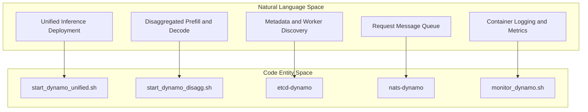
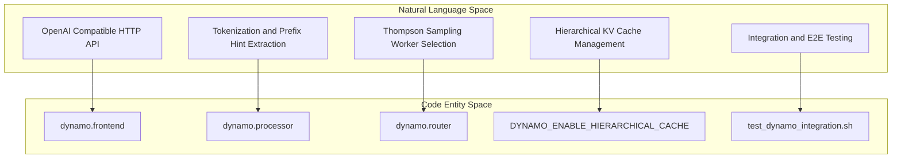
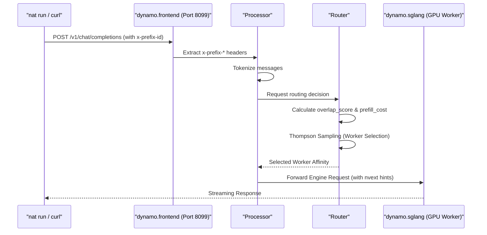

<!-- source: DeepWiki mcp.deepwiki.com · repo NVIDIA/NeMo-Agent-Toolkit · page 12.5 Dynamo Backend Setup · fetched 2026-10-26 -->

# Dynamo Backend Setup

<details>
<summary>Relevant source files</summary>

The following files were used as context for generating this wiki page:

- [docs/source/components/agents/auto-memory-wrapper/index.md](docs/source/components/agents/auto-memory-wrapper/index.md)
- [examples/dynamo_integration/.env.example](examples/dynamo_integration/.env.example)
- [examples/dynamo_integration/README.md](examples/dynamo_integration/README.md)
- [examples/dynamo_integration/react_benchmark_agent/README.md](examples/dynamo_integration/react_benchmark_agent/README.md)
- [examples/dynamo_integration/react_benchmark_agent/pyproject.toml](examples/dynamo_integration/react_benchmark_agent/pyproject.toml)
- [examples/dynamo_integration/react_benchmark_agent/src/react_benchmark_agent/DEVELOPER_NOTES.md](examples/dynamo_integration/react_benchmark_agent/src/react_benchmark_agent/DEVELOPER_NOTES.md)
- [external/dynamo/.env.example](external/dynamo/.env.example)
- [external/dynamo/README.md](external/dynamo/README.md)
- [external/dynamo/monitor_dynamo.sh](external/dynamo/monitor_dynamo.sh)
- [external/dynamo/start_dynamo_disagg.sh](external/dynamo/start_dynamo_disagg.sh)
- [external/dynamo/start_dynamo_unified.sh](external/dynamo/start_dynamo_unified.sh)
- [external/dynamo/stop_dynamo.sh](external/dynamo/stop_dynamo.sh)
- [external/dynamo/test_dynamo_integration.sh](external/dynamo/test_dynamo_integration.sh)

</details>


This document guides you through setting up and configuring the NVIDIA Dynamo inference backend for use with NeMo Agent Toolkit workflows. It covers infrastructure deployment, service configuration, and verification procedures for SGLang-based workers, processors, and routers using external Dynamo startup scripts.

For integration with NeMo Agent Toolkit workflows, see [examples/dynamo_integration/README.md]() for Dynamo LLM provider configuration. For KV cache optimization features, see [external/dynamo/README.md]() for `nvext` hints and cache management. For benchmarking workflows with Dynamo, see [examples/dynamo_integration/react_benchmark_agent/README.md]().

Sources: [examples/dynamo_integration/README.md](), [external/dynamo/README.md]()

## Prerequisites and System Requirements

### Platform Requirements

Dynamo requires a Linux system with NVIDIA GPU hardware. Supported platforms include Ubuntu 22.04/24.04 (x86_64/ARM64) and CentOS Stream 9 (x86_64, experimental). macOS and Windows are not supported. [examples/dynamo_integration/README.md:25-38]()

The Dynamo server runs inside pre-built Docker images from NGC (`nvcr.io/nvidia/ai-dynamo/sglang-runtime`), which include all necessary components. You do not need to install `ai-dynamo` or `ai-dynamo-runtime` packages locally. The toolkit's Dynamo LLM client (`_type: dynamo`) is a pure HTTP client that works on any platform. [examples/dynamo_integration/README.md:39]()

Sources: [examples/dynamo_integration/README.md:25-39](), [external/dynamo/README.md:18-28]()

### Hardware Requirements

| Component | Minimum | Recommended |
|-----------|---------|-------------|
| **GPU Architecture** | NVIDIA Hopper (H100) | B200 |
| **GPU Count** | 4 GPUs (TP=4 for 70B) | 8 GPUs |
| **GPU Memory** | 96GB per GPU (H100) | 192GB per GPU (B200) |

The Llama-3.3-70B-Instruct model requires approximately 140GB of GPU memory when loaded with TP=4 (tensor parallelism across 4 GPUs). Ensure your GPU configuration has sufficient aggregate memory. [examples/dynamo_integration/README.md:80-90]()

Sources: [examples/dynamo_integration/README.md:80-92](), [examples/dynamo_integration/react_benchmark_agent/README.md:89-95]()

### Software Requirements

1. **Docker** with NVIDIA Container Toolkit. [examples/dynamo_integration/README.md:67]()
2. **NVIDIA Driver** with CUDA 12.0+ support and `nvidia-fabricmanager` enabled. [examples/dynamo_integration/README.md:68-75]()
3. **Hugging Face account** with access to Llama-3.3-70B-Instruct model (requires approval from Meta). [examples/dynamo_integration/README.md:77]()
4. **Model weights** downloaded locally. The startup script validates the directory structure, checking for `config.json` and the mandatory `model_type` field to prevent corrupted download issues. [external/dynamo/start_dynamo_unified.sh:133-156]()
5. **Python environment** (3.11-3.13) with `uv` for toolkit installation. [examples/dynamo_integration/README.md:65-66]()

Sources: [examples/dynamo_integration/README.md:59-78](), [external/dynamo/start_dynamo_unified.sh:133-156]()

## Architecture Overview and Script Mapping

The Dynamo backend architecture coordinates client requests through a frontend that manages processors and routers before hitting the GPU workers.

### Natural Language to Code Entity Mapping: Infrastructure & Scripts
This diagram bridges natural language architecture descriptions to the specific shell scripts and container orchestration targets that manage the backend lifecycle.


Sources: [external/dynamo/README.md:51-58](), [external/dynamo/start_dynamo_unified.sh:21-29](), [external/dynamo/start_dynamo_disagg.sh:24-30](), [external/dynamo/monitor_dynamo.sh:17-20]()

### Natural Language to Code Entity Mapping: Routing & Execution
This diagram maps high-level routing and KV cache optimization concepts to their implementation components within the Dynamo backend stack.


Sources: [external/dynamo/README.md:79-115](), [external/dynamo/start_dynamo_unified.sh:70-73](), [external/dynamo/test_dynamo_integration.sh:17-48]()

### System Component Interaction
The following diagram illustrates the data flow from a client request through the Dynamo stack, associating toolkit components with their roles.


Sources: [external/dynamo/README.md:61-123](), [external/dynamo/README.md:105-115]()

### Deployment Modes

| Mode | Script | Description | Best For |
|------|--------|-------------|----------|
| **Unified** | `start_dynamo_unified.sh` | Workers responsible for both `prefill` and `decode`. [external/dynamo/README.md:55]() | Development, testing. |
| **Unified + Thompson** | `start_dynamo_unified_thompson_hints.sh` | Unified with a predictive KV-aware router using LinTS/Beta bandits. [external/dynamo/README.md:56, 109-115]() | Production, KV optimization. |
| **Disaggregated** | `start_dynamo_disagg.sh` | Separate `prefill` and `decode` workers using `nixl` or `nccl` backends. [external/dynamo/README.md:57](), [external/dynamo/start_dynamo_disagg.sh:47]() | High-throughput production. |

Sources: [external/dynamo/README.md:51-58](), [external/dynamo/start_dynamo_disagg.sh:47]()

## Environment Configuration

Configure the environment by setting up a `.env` file in the `external/dynamo` directory. [external/dynamo/README.md:136-145]()

```bash
cd external/dynamo/
cp .env.example .env
vi .env # update variables
source .env
```

### Key Configuration Variables

* **`DYNAMO_MODEL_DIR`**: Path to the local directory containing model weights. [external/dynamo/start_dynamo_unified.sh:122-130]()
* **`DYNAMO_GPU_DEVICES`**: Comma-separated GPU IDs to use (e.g., `0,1,2,3`). [external/dynamo/start_dynamo_unified.sh:41]()
* **`DYNAMO_TP_SIZE`**: Tensor parallelism size (must match number of GPUs per worker). [external/dynamo/start_dynamo_unified.sh:36, 110-114]()
* **`DYNAMO_ENABLE_HIERARCHICAL_CACHE`**: Enables CPU-backed overflow cache (HiCache) for SGLang KV cache. [external/dynamo/start_dynamo_unified.sh:70]()
* **`DYNAMO_KV_BLOCK_SIZE`**: Block size in tokens (must match between SGLang and Frontend). [external/dynamo/.env.example:122]()
* **`DYNAMO_MEM_FRACTION_STATIC`**: Fraction of GPU memory reserved for the KV cache (default 0.9). [external/dynamo/start_dynamo_unified.sh:61-62]()

Sources: [external/dynamo/.env.example:16-127](), [external/dynamo/start_dynamo_unified.sh:34-90]()

## Starting Dynamo Services

### Unified Mode
This mode starts ETCD, NATS, and a single SGLang worker container.

```bash
cd external/dynamo/
bash start_dynamo_unified.sh
```
The script performs the following:
1. Starts `etcd-dynamo` for metadata and worker discovery on port `2379`. [external/dynamo/start_dynamo_unified.sh:21, 43]()
2. Starts `nats-dynamo` as a message queue for requests on port `4222`. [external/dynamo/start_dynamo_unified.sh:22, 45]()
3. Starts the `dynamo-sglang` worker container using the `nvcr.io/nvidia/ai-dynamo/sglang-runtime:0.9.0` image. [external/dynamo/start_dynamo_unified.sh:29, 39]()

Sources: [external/dynamo/start_dynamo_unified.sh:17-156]()

### Disaggregated Mode
Separates prefill and decode operations across different GPU sets to optimize throughput.

```bash
bash start_dynamo_disagg.sh
```
* **Prefill Worker**: Handles initial prompt processing (GPUs defined by `DYNAMO_PREFILL_GPUS`). [external/dynamo/start_dynamo_disagg.sh:24, 36]()
* **Decode Worker**: Handles token generation (GPUs defined by `DYNAMO_DECODE_GPUS`). [external/dynamo/start_dynamo_disagg.sh:25, 37]()
* **Transfer Backend**: Uses `nixl`, `nccl`, or `gloo` for KV cache transfer between workers. [external/dynamo/start_dynamo_disagg.sh:47]()

Sources: [external/dynamo/start_dynamo_disagg.sh:17-48](), [external/dynamo/.env.example:43-110]()

### Monitoring and Shutdown Control
* **Monitoring Stack**: Use `monitor_dynamo.sh` to inspect container health, view component logs (frontend, processor, router), and check GPU metrics. [external/dynamo/monitor_dynamo.sh:17-167]()
* **Shutdown Control**: Use `stop_dynamo.sh` to gracefully terminate Dynamo worker containers, ETCD, NATS, and optional metrics stacks (`--kill-metrics` / `--clear-metrics`). [external/dynamo/stop_dynamo.sh:17-51]()

Sources: [external/dynamo/monitor_dynamo.sh:17-167](), [external/dynamo/stop_dynamo.sh:17-51]()

## Verification and Testing

### Testing the Integration
Use the provided test script to verify full stack responsiveness, basic inference execution, and prefix hint handling.

```bash
cd external/dynamo/
bash test_dynamo_integration.sh
```
This script validates:
1. Frontend responsiveness on `DYNAMO_PORT` (default 8099). [external/dynamo/test_dynamo_integration.sh:48, 108]()
2. Successful chat completion via `curl` requests. [external/dynamo/test_dynamo_integration.sh:128-137]()
3. End-to-end NAT workflow execution with basic and prefix hint configurations. [external/dynamo/test_dynamo_integration.sh:148-176]()

Sources: [external/dynamo/test_dynamo_integration.sh:17-201]()

## Troubleshooting

### Common Issues

* **Model Directory Validation**: The startup scripts verify the presence of `config.json` and the `model_type` field in `DYNAMO_MODEL_DIR`. [external/dynamo/start_dynamo_unified.sh:133-156]()
* **GPU Sizing**: If `TP_SIZE` is not divisible by the number of GPUs, the script will exit with an error. [external/dynamo/start_dynamo_unified.sh:110-114]()
* **Infrastructure Failures**: If `etcd-dynamo` or `nats-dynamo` fail to start, check for port conflicts (default ports 2379 and 4222). [external/dynamo/start_dynamo_unified.sh:21-28]()
* **Fabricmanager**: Ensure `nvidia-fabricmanager` is running and matches the driver version, otherwise multi-GPU communication may fail. [examples/dynamo_integration/README.md:73-75]()
* **HiCache Configuration**: If hierarchical cache is enabled, `HICACHE_RATIO` must be positive and `HICACHE_POLICY` must be `write_through` or `write_back`. [external/dynamo/start_dynamo_unified.sh:75-90]()

Sources: [external/dynamo/start_dynamo_unified.sh:21-156](), [examples/dynamo_integration/README.md:68-75]()

---

