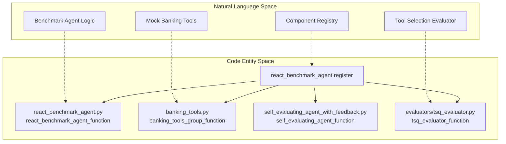
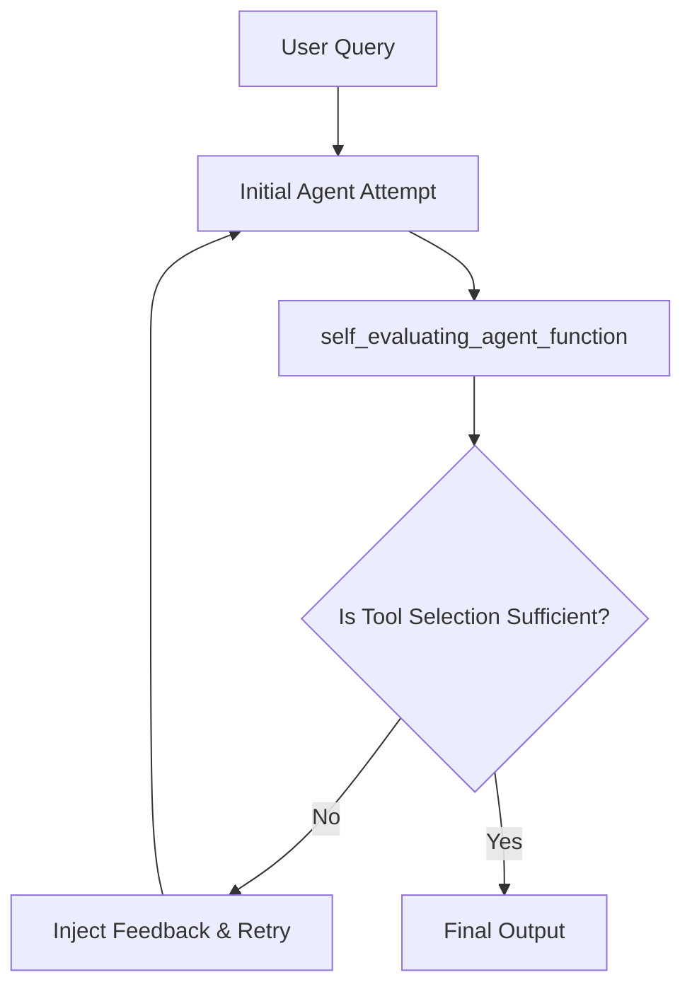
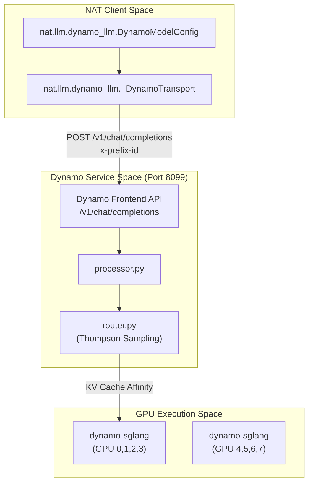

<!-- source: DeepWiki mcp.deepwiki.com · repo NVIDIA/NeMo-Agent-Toolkit · page 12.6 Agent Benchmarking with Dynamo · fetched 2026-10-26 -->

# Agent Benchmarking with Dynamo

Relevant source files

The following files were used as context for generating this wiki page:

- [docs/source/components/agents/auto-memory-wrapper/index.md](docs/source/components/agents/auto-memory-wrapper/index.md)
- [examples/dynamo_integration/.env.example](examples/dynamo_integration/.env.example)
- [examples/dynamo_integration/README.md](examples/dynamo_integration/README.md)
- [examples/dynamo_integration/react_benchmark_agent/README.md](examples/dynamo_integration/react_benchmark_agent/README.md)
- [examples/dynamo_integration/react_benchmark_agent/pyproject.toml](examples/dynamo_integration/react_benchmark_agent/pyproject.toml)
- [examples/dynamo_integration/react_benchmark_agent/src/react_benchmark_agent/DEVELOPER_NOTES.md](examples/dynamo_integration/react_benchmark_agent/src/react_benchmark_agent/DEVELOPER_NOTES.md)
- [external/dynamo/.env.example](external/dynamo/.env.example)
- [external/dynamo/README.md](external/dynamo/README.md)
- [external/dynamo/monitor_dynamo.sh](external/dynamo/monitor_dynamo.sh)
- [external/dynamo/start_dynamo_disagg.sh](external/dynamo/start_dynamo_disagg.sh)
- [external/dynamo/start_dynamo_unified.sh](external/dynamo/start_dynamo_unified.sh)
- [external/dynamo/stop_dynamo.sh](external/dynamo/stop_dynamo.sh)
- [external/dynamo/test_dynamo_integration.sh](external/dynamo/test_dynamo_integration.sh)

This page documents the agent benchmarking framework for evaluating agent performance with Dynamo-hosted LLM endpoints. The framework provides decision-only evaluation harnesses, Tool Selection Quality (TSQ) scoring, self-evaluation loops, and comprehensive performance analysis for agent workflows.

For Dynamo LLM provider configuration, see [12.1. Dynamo LLM Provider](). For backend setup and deployment, see [12.5. Dynamo Backend Setup](). For general evaluation concepts, see [10.1. Evaluation Framework]().

## Purpose and Scope

The benchmarking framework enables systematic evaluation of agent workflows using Dynamo inference with focus on:

- **Decision-Only Evaluation**: Testing agent tool selection without executing real banking operations. Tool stubs capture intent and return template-based success messages [examples/dynamo_integration/README.md:48-48](), [examples/dynamo_integration/README.md:54-54]().
- **TSQ Scoring**: Measuring Tool Selection Quality (TSQ) based on the accuracy of tool selection from the [Galileo Agent Leaderboard v2](https://huggingface.co/datasets/galileo-ai/agent-leaderboard-v2) dataset [examples/dynamo_integration/README.md:48-48](), [examples/dynamo_integration/README.md:58-58]().
- **Self-Evaluation Loop**: Allowing agents to re-evaluate and retry tool selection for improved quality [examples/dynamo_integration/README.md:57-57]().
- **Performance Analysis**: Capturing token throughput, latency analysis (TTFT/ITL), and KV cache optimization metrics [examples/dynamo_integration/README.md:58-58]().

Sources: [examples/dynamo_integration/README.md:46-60](), [examples/dynamo_integration/react_benchmark_agent/README.md:21-48]()

## Benchmark Architecture & Code Entities

The benchmarking system consists of a custom workflow package (`react_benchmark_agent`), dataset preparation scripts, and specialized evaluators registered through NAT entry points [examples/dynamo_integration/react_benchmark_agent/pyproject.toml:29-45]().

### Diagram: Component Registry and Code Mapping

Sources: [examples/dynamo_integration/react_benchmark_agent/pyproject.toml:44-45](), [examples/dynamo_integration/react_benchmark_agent/src/react_benchmark_agent/DEVELOPER_NOTES.md:55-64]()

### Package Structure Summary

| Component | Entity Name | Purpose |
|-----------|----------|---------|
| **Registry** | `react_benchmark_agent.register` | Entry point for NAT component discovery [examples/dynamo_integration/react_benchmark_agent/pyproject.toml:44-45]() |
| **Agent** | `react_benchmark_agent_function` | Core benchmark agent implementation logic [examples/dynamo_integration/react_benchmark_agent/src/react_benchmark_agent/DEVELOPER_NOTES.md:58-58]() |
| **Tools** | `banking_tools_group_function` | Mock banking tools group for decision-only eval [examples/dynamo_integration/react_benchmark_agent/src/react_benchmark_agent/DEVELOPER_NOTES.md:59-59]() |
| **Self-Eval** | `self_evaluating_agent_function` | Wraps agents with self-correction feedback loops [examples/dynamo_integration/react_benchmark_agent/src/react_benchmark_agent/DEVELOPER_NOTES.md:60-60]() |
| **Evaluators** | `tsq_evaluator_function` | Evaluator for scoring tool selection accuracy [examples/dynamo_integration/react_benchmark_agent/src/react_benchmark_agent/DEVELOPER_NOTES.md:62-62]() |

Sources: [examples/dynamo_integration/react_benchmark_agent/pyproject.toml:44-45](), [examples/dynamo_integration/README.md:54-58](), [examples/dynamo_integration/react_benchmark_agent/src/react_benchmark_agent/DEVELOPER_NOTES.md:55-64]()

## Tool Selection Quality (TSQ) Evaluation

TSQ measures the accuracy of agent tool selection using F1 score to balance precision (avoiding unnecessary tools) and recall (calling all expected tools).

### Implementation Details

The `tsq_evaluator_function` implementation:
1. Extracts the sequence of tool names from the execution trajectory.
2. Compares the set of unique tool names against the ground truth.
3. Calculates an F1 score (0.0 to 1.0) [examples/dynamo_integration/README.md:58-58]().

Note: Parameter accuracy is currently excluded from the default TSQ score to focus purely on tool selection logic [examples/dynamo_integration/README.md:58-58]().

Sources: [examples/dynamo_integration/README.md:58-58](), [examples/dynamo_integration/react_benchmark_agent/src/react_benchmark_agent/DEVELOPER_NOTES.md:62-62]()

## Self-Evaluation Loop

The self-evaluation mechanism allows agents to evaluate their own tool selection and retry if confidence is below a threshold. This iterative refinement can improve TSQ scores [examples/dynamo_integration/README.md:57-57]().

### Self-Evaluation Workflow

The implementation resides in `self_evaluating_agent_with_feedback.py`, providing logic to analyze trajectories and determine if a retry is required based on agent-generated feedback [examples/dynamo_integration/README.md:57-57](), [examples/dynamo_integration/react_benchmark_agent/src/react_benchmark_agent/DEVELOPER_NOTES.md:112-113]().

Sources: [examples/dynamo_integration/README.md:57-57](), [examples/dynamo_integration/react_benchmark_agent/src/react_benchmark_agent/DEVELOPER_NOTES.md:60-61]()

## Dynamo Backend Integration & Routing

The benchmark is designed to run against a Dynamo backend, which provides high-performance LLM serving with KV cache optimization [external/dynamo/README.md:49-51]().

### Diagram: Dynamo Client and Service Data Flow

The `DynamoModelConfig` class handles the injection of `nvext.agent_hints` and `nvext.cache_control`. The Dynamo backend uses these to optimize request routing via the Thompson Sampling router [external/dynamo/README.md:67-76](), [external/dynamo/README.md:103-115](). The system supports unified workers (handling both prefill and decode) or disaggregated workers [external/dynamo/start_dynamo_unified.sh:17-29](), [external/dynamo/start_dynamo_disagg.sh:17-30]().

Sources: [external/dynamo/README.md:59-118](), [external/dynamo/start_dynamo_unified.sh:23-29](), [external/dynamo/start_dynamo_disagg.sh:20-30]()

## Performance and Concurrency Benchmarking

Dynamo benchmarking includes specific configurations for measuring performance under load:

| Mode | Configuration File | Objective |
|------|-------------------|-----------|
| **Standard** | `eval_config_no_rethinking_full_test.yml` | Baseline TSQ and latency [examples/dynamo_integration/react_benchmark_agent/src/react_benchmark_agent/DEVELOPER_NOTES.md:128-137]() |
| **Self-Eval** | `eval_config_rethinking_full_test.yml` | Quality improvement via feedback loops [examples/dynamo_integration/react_benchmark_agent/src/react_benchmark_agent/DEVELOPER_NOTES.md:36-36]() |
| **Optimized** | `eval_config_dynamo_prefix_full_test.yml` | Performance gains using KV cache hints [external/dynamo/test_dynamo_integration.sh:163-177]() |

### Metrics Collection
The framework captures:
* **Throughput**: Tokens per second across concurrent requests [examples/dynamo_integration/README.md:58-58]().
* **Latency**: TTFT (Time to First Token) and ITL (Inter-Token Latency) [examples/dynamo_integration/README.md:58-58]().
* **Cache Efficiency**: KV cache hit rates and affinity metrics via Dynamo router logs [external/dynamo/README.md:103-115]().

Sources: [examples/dynamo_integration/README.md:58-58](), [examples/dynamo_integration/react_benchmark_agent/src/react_benchmark_agent/DEVELOPER_NOTES.md:128-137](), [external/dynamo/README.md:103-115]()

---

