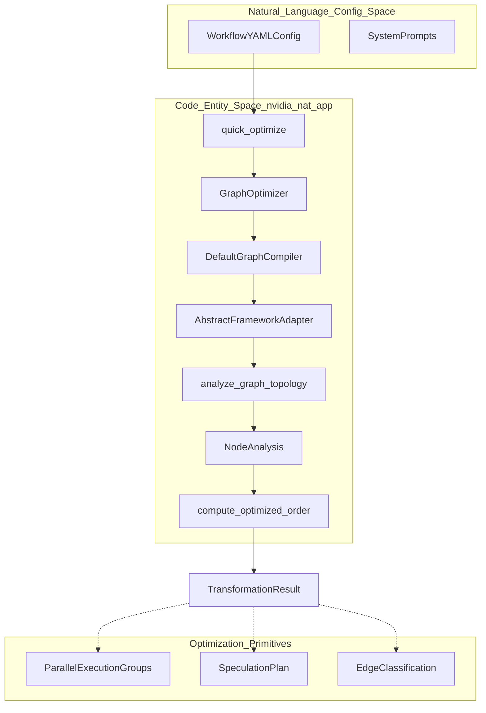
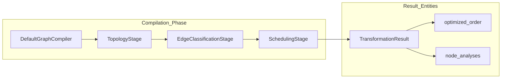

<!-- source: DeepWiki mcp.deepwiki.com · repo NVIDIA/NeMo-Agent-Toolkit · page 13.1 APP Architecture and Graph Compilation · fetched 2026-10-26 -->

# APP Architecture and Graph Compilation

Relevant source files

The following files were used as context for generating this wiki page:

- [README.md](README.md)
- [ci/markdown-link-check-config.json](ci/markdown-link-check-config.json)
- [ci/scripts/path_checks.py](ci/scripts/path_checks.py)
- [ci/vale/styles/config/vocabularies/nat/accept.txt](ci/vale/styles/config/vocabularies/nat/accept.txt)
- [docs/Makefile](docs/Makefile)
- [docs/source/build-workflows/memory.md](docs/source/build-workflows/memory.md)
- [docs/source/components/agents/auto-memory-wrapper/auto-memory-wrapper.md](docs/source/components/agents/auto-memory-wrapper/auto-memory-wrapper.md)
- [docs/source/components/integrations/index.md](docs/source/components/integrations/index.md)
- [docs/source/components/integrations/integrating-oci-generative-ai-models.md](docs/source/components/integrations/integrating-oci-generative-ai-models.md)
- [docs/source/conf.py](docs/source/conf.py)
- [docs/source/index.md](docs/source/index.md)
- [examples/README.md](examples/README.md)
- [examples/agents/auto_memory_wrapper/README.md](examples/agents/auto_memory_wrapper/README.md)
- [examples/memory/memanto/README.md](examples/memory/memanto/README.md)
- [packages/nvidia_nat_langchain/src/nat/plugins/langchain/agent/auto_memory_wrapper/agent.py](packages/nvidia_nat_langchain/src/nat/plugins/langchain/agent/auto_memory_wrapper/agent.py)

The Agent Performance Primitives (APP) package (`nvidia-nat-app`) provides a framework-agnostic system for optimizing agentic workflows [README.md:44-44](). It transforms high-level agent definitions into execution-ready graphs using a sophisticated compilation pipeline [README.md:44-44](). This pipeline enables features like parallel scheduling, speculative execution, and automated LLM analysis to reduce latency and improve throughput in complex agent systems [README.md:44-44]().

Sources: [README.md:44-44]()

## DefaultGraphCompiler Pipeline

The `DefaultGraphCompiler` is the primary implementation responsible for transforming an agent's logic into an optimized execution graph [README.md:44-44](). It operates through a series of discrete stages that analyze the topology, profile data access, classify edges, and schedule operations [README.md:44-44]().

### Compilation Stages

The compilation process follows a linear progression of specialized analysis phases [README.md:44-44]():

1. **extract**: Ingests the raw workflow source and converts it into a normalized `Graph` object using a framework-specific `AbstractFrameworkAdapter` [README.md:44-44]().
2. **validate**: Ensures the graph is structurally sound, checking for valid entry points and terminal nodes [README.md:44-44]().
3. **topology**: Performs structural analysis to detect cycles (`detect_cycles`), routers (`detect_routers`), and terminal paths [README.md:44-44]().
4. **node_analysis**: Profiles each node's read/write behavior on the state object using AST analysis to identify data dependencies [README.md:44-44]().
5. **edge_classification**: Determines if edges are `NECESSARY` (data dependency), `UNNECESSARY` (parallelizable), or `CONDITIONAL` (router branch) [README.md:44-44]().
6. **scheduling**: Generates the `optimized_order`, a sequence of parallel execution groups [README.md:44-44]().

Sources: [README.md:44-44]()

### Architecture Overview

The following diagram bridges the natural language configuration space to specific code entities within the `nvidia-nat-app` package.

**Graph Compilation and Optimization Flow**

Sources: [README.md:44-44]()

## Key Classes and Implementation

### Node Analysis and Conflict Detection

The `NodeAnalysis` logic tracks access patterns for reads and writes [README.md:44-44](). The system determines if two nodes can run in parallel by checking for Read-After-Write (RAW) or Write-After-Write (WAW) hazards [README.md:44-44](). It specifically respects reducer fields (e.g., in LangGraph state) which allow safe parallel updates like appending to a message list without a conflict [README.md:44-44](). The toolkit uses structured state schemas during analysis [README.md:44-44]().

Sources: [README.md:44-44]()

### The quick_optimize API

While `GraphOptimizer` provides the full control surface, the `quick_optimize` entry point abstracts the complexity for common use cases [README.md:44-44](). It internally leverages `GraphOptimizer.optimize` and `AbstractFrameworkAdapter.build` to return a `TransformationResult` [README.md:44-44]().

| Component | Code Entity | Role |
| :--- | :--- | :--- |
| **Compiler** | `DefaultGraphCompiler` | Orchestrates the 6-stage pipeline to produce a `TransformationResult` [README.md:44-44](). |
| **Optimizer** | `GraphOptimizer` | High-level API to trigger compilation and build optimized graphs [README.md:44-44](). |
| **Adapter** | `AbstractFrameworkAdapter` | Abstract base for framework-specific logic (LangChain, LangGraph, etc.) [README.md:44-44](). |
| **Scheduler** | `find_parallel_groups` | Uses the dependency graph to group independent nodes [README.md:44-44](). |
| **Topology** | `CycleInfo` | Represents detected loops to ensure correct scheduling within cycles [README.md:44-44](). |

Sources: [README.md:44-44]()

### Data Flow and Execution

The compiler transforms a framework-specific graph into an optimized execution schedule [README.md:44-44]().

**Compilation to Runtime Mapping**

Sources: [README.md:44-44]()

## Framework Integration and Analysis

The `nvidia-nat-app` package uses `AbstractFrameworkAdapter` to remain framework-agnostic [README.md:44-44](). It provides [README.md:44-44]():

* **Static Analysis**: Automatically detects state access patterns in Python functions, assigning a confidence level (`full`, `partial`, or `opaque`) [README.md:44-44]().
* **Cycle Handling**: Identifies parallelism within loops, allowing iterations to be accelerated where possible [README.md:44-44]().
* **Router Detection**: Identifies conditional branching points, which is essential for determining `CONDITIONAL` edges and `SpeculationPlan` generation [README.md:44-44]().
* **Dependency Graph**: Constructs a map of node dependencies based on data flow (RAW hazards), which is then used to determine safe concurrent execution sets [README.md:44-44]().
* **LangGraph Integration**: The `langgraph_wrapper` workflow type enables these features for existing LangGraph agents without requiring full rewrites [README.md:44-44]().

Sources: [README.md:44-44]()

---

