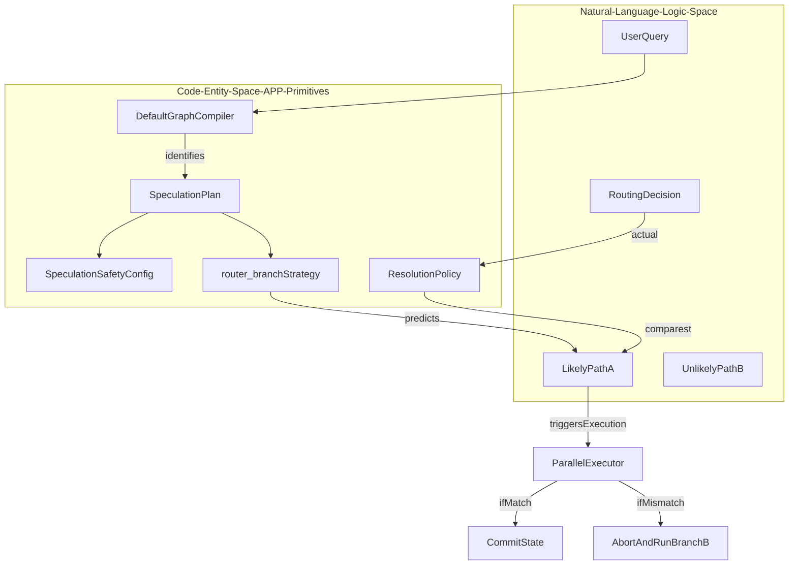
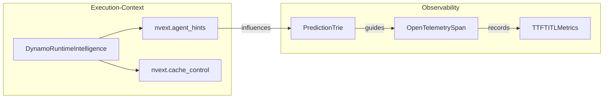

<!-- source: DeepWiki mcp.deepwiki.com · repo NVIDIA/NeMo-Agent-Toolkit · page 13.2 Speculative Execution · fetched 2026-10-26 -->

# Speculative Execution

Relevant source files

The following files were used as context for generating this wiki page:

- [README.md](README.md)
- [ci/markdown-link-check-config.json](ci/markdown-link-check-config.json)
- [ci/scripts/path_checks.py](ci/scripts/path_checks.py)
- [ci/vale/styles/config/vocabularies/nat/accept.txt](ci/vale/styles/config/vocabularies/nat/accept.txt)
- [docs/Makefile](docs/Makefile)
- [docs/source/build-workflows/memory.md](docs/source/build-workflows/memory.md)
- [docs/source/components/agents/auto-memory-wrapper/auto-memory-wrapper.md](docs/source/components/agents/auto-memory-wrapper/auto-memory-wrapper.md)
- [docs/source/components/integrations/index.md](docs/source/components/integrations/index.md)
- [docs/source/components/integrations/integrating-oci-generative-ai-models.md](docs/source/components/integrations/integrating-oci-generative-ai-models.md)
- [docs/source/conf.py](docs/source/conf.py)
- [docs/source/index.md](docs/source/index.md)
- [examples/README.md](examples/README.md)
- [examples/agents/auto_memory_wrapper/README.md](examples/agents/auto_memory_wrapper/README.md)
- [examples/memory/memanto/README.md](examples/memory/memanto/README.md)
- [packages/nvidia_nat_langchain/src/nat/plugins/langchain/agent/auto_memory_wrapper/agent.py](packages/nvidia_nat_langchain/src/nat/plugins/langchain/agent/auto_memory_wrapper/agent.py)

## Purpose and Scope

This page documents the speculative execution subsystem within the Agent Performance Primitives (APP) package (`nvidia-nat-app`) of the NVIDIA NeMo Agent Toolkit [README.md:44-44](). Speculative execution reduces end-to-end workflow latency by pre-emptively executing likely future graph nodes while a preceding router or decision node is still generating its LLM response. This section details the `SpeculationPlan` configuration structure, the `router_branch` strategy, `ResolutionPolicy` rules, and `SpeculationSafetyConfig` safeguards.

Sources: [README.md:44-44]()

---

## Overview

In standard graph execution models, a router node must finish its full LLM generation cycle before the workflow can determine which downstream branch to evaluate. Speculative execution predicts the most probable target branch based on runtime heuristics and begins executing that branch concurrently with the router's generation. If the prediction proves accurate, the router's execution latency is hidden. If inaccurate, the speculative state changes are discarded, and the system falls back to the correct deterministic branch.

Key structural components include:
*   **`SpeculationPlan`**: Encapsulates the configuration and mapping for speculative node execution.
*   **`router_branch` Strategy**: Executes speculative branches keyed to anticipated router output labels.
*   **`ResolutionPolicy`**: Determines whether the speculation matches actual runtime outcomes and handles commit/rollback decisions.
*   **`SpeculationSafetyConfig`**: Enforces strict execution boundaries to prevent side effects or non-idempotent operations during speculation.

Sources: [README.md:44-44]()

---

## Architecture and Data Flow

The speculative execution pipeline is embedded within the workflow graph compiler and concurrent scheduler. During compilation, the graph topology is analyzed for conditional branching points suitable for pre-execution [README.md:44-44]().

### Execution Lifecycle

1.  **Prediction**: As workflow execution approaches a router node, prediction heuristics (such as a prediction trie or configuration hints) forecast the next node.
2.  **Trigger**: The `SpeculationPlan` initiates a parallel asynchronous task for the predicted branch.
3.  **Concurrency Management**: The scheduler runs the primary router task and the speculative branch concurrently.
4.  **Resolution**: When the router finishes, the `ResolutionPolicy` compares the definitive route against the speculative prediction.
5.  **Commit or Abort**:
    *   *Match*: Speculative results are committed to the workflow state graph, skipping redundant scheduling.
    *   *Mismatch*: Speculative results are dropped, and execution resumes down the correct branch.

### System Components Diagram

Title: "Speculative Execution Component Mapping"

Sources: [README.md:44-44]()

---

## Implementation Details

### SpeculationPlan and Strategies
The `SpeculationPlan` configures the binding between a parent router node and speculative successor nodes. The primary supported strategy is `router_branch`, which correlates LLM generation string outputs directly with graph edge identifiers.

### SpeculationSafetyConfig
Because speculative tasks execute before branching conditions are logically verified, safety rules are enforced via `SpeculationSafetyConfig`:
*   **Idempotency Validation**: Only read-only or idempotent functions (e.g., searches, database lookups) are eligible for speculation.
*   **Side-Effect Mitigation**: State-modifying operations are blocked from speculative execution paths.
*   **Conflict Detection**: Read/write sets are evaluated to ensure parallel task isolation.

### Resolution Policy
The `ResolutionPolicy` evaluates whether a speculation branch matches the true execution path. For `router_branch`, it validates the string output of the router against the predicted target node signature.

Sources: [README.md:44-44]()

---

## Performance Impact and Latency Sensitivity

Speculative execution integrates with NVIDIA Dynamo to infer latency sensitivity profiles from agent metrics, applying runtime hints for prefix caching, load-aware routing, and KV cache pinning [README.md:43-44]().

### Performance Tracking Flow

Title: "Latency and Telemetry Integration"

Sources: [README.md:43-44](), [README.md:58-59]()

### Performance Summary
*   **Latency Reduction**: Offsets router evaluation overhead by overlapping generation time with node execution.
*   **Parallel Scheduling**: Utilizes framework-agnostic primitives to execute non-conflicting subgraphs concurrently [README.md:44-44]().
*   **Telemetry Traceability**: OpenTelemetry exporters track speculative tasks, recording metrics for discarded work [README.md:58-59]().
*   **KV Cache Warming**: Employs `nvext.cache_control` hints to pre-warm cache allocations for predicted branches [README.md:43-44]().

Sources: [README.md:43-44](), [README.md:44-44](), [README.md:58-59]()

---

