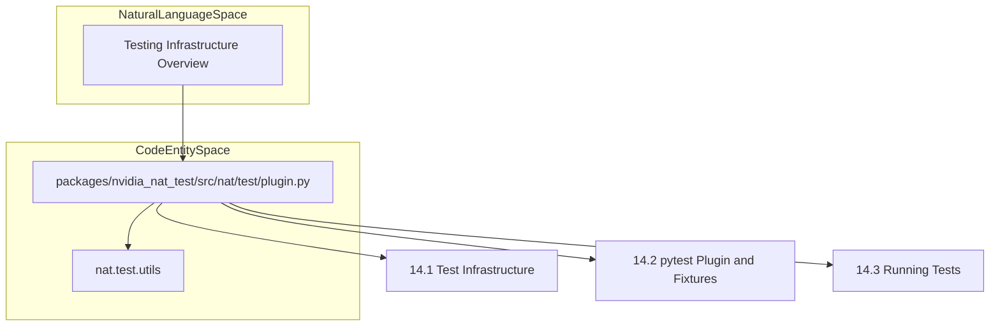

<!-- source: DeepWiki mcp.deepwiki.com · repo NVIDIA/NeMo-Agent-Toolkit · page 14 Testing · fetched 2026-10-26 -->

# Testing

<details>
<summary>Relevant source files</summary>

The following files were used as context for generating this wiki page:

- [examples/documentation_guides/tests/test_text_file_ingest.py](examples/documentation_guides/tests/test_text_file_ingest.py)
- [examples/observability/simple_calculator_observability/tests/test_simple_calc_observability.py](examples/observability/simple_calculator_observability/tests/test_simple_calc_observability.py)
- [packages/nvidia_nat_adk/tests/test_adk_llm.py](packages/nvidia_nat_adk/tests/test_adk_llm.py)
- [packages/nvidia_nat_test/src/nat/test/plugin.py](packages/nvidia_nat_test/src/nat/test/plugin.py)

</details>


This document provides a high-level overview of the testing infrastructure, custom pytest plugin, service fixtures, and test execution workflows for the NVIDIA NeMo Agent Toolkit.

For information about the CI/CD build and packaging process, see [CI/CD Pipeline](#15.1). For details about code quality checks and pre-commit hooks, see [Code Quality](#15.4).

## Overview

The toolkit provides a multi-layered testing infrastructure designed to support unit tests, integration tests, slow end-to-end tests, and service-dependent workflows [packages/nvidia_nat_test/src/nat/test/plugin.py:40-76](). Tests are categorized using custom pytest markers such as `@pytest.mark.integration` and `@pytest.mark.slow`, which are skipped by default unless enabled via command-line flags [packages/nvidia_nat_test/src/nat/test/plugin.py:68-76]().


Sources: [packages/nvidia_nat_test/src/nat/test/plugin.py:40-76]()

## 14.1 Test Infrastructure

The testing infrastructure encompasses Docker-based service orchestration, database and storage fixtures (such as MySQL, Redis, and S3), observability backends like Arize Phoenix, and data ingestion utility scripts [packages/nvidia_nat_test/src/nat/test/plugin.py:1-30](). These components ensure that integration and service-dependent tests run against properly configured backing stores and service endpoints.

For comprehensive details on service fixtures, configuration files like `test_data/docker-compose.services.yml`, and data ingestion utilities, see [Test Infrastructure](#14.1).

Sources: [packages/nvidia_nat_test/src/nat/test/plugin.py:1-30]()

## 14.2 pytest Plugin and Fixtures

The toolkit utilizes a custom pytest plugin (`nvidia_nat_test`) that manages component discovery, registry isolation, and conditional test execution [packages/nvidia_nat_test/src/nat/test/plugin.py:40-116](). It provides session-scoped API key fixtures (such as `openai_api_key`, `nvidia_api_key`, and `oci_nemotron_endpoint`) that automatically check for required environment variables and skip or fail tests accordingly [packages/nvidia_nat_test/src/nat/test/plugin.py:126-188](). Furthermore, `module_registry` and `registry` fixtures ensure that the global type registry state is cleanly isolated between test modules and functions [packages/nvidia_nat_test/src/nat/test/plugin.py:91-116]().

```mermaid
graph LR
    subgraph "NaturalLanguageSpace"
        RunOptions[""Test Execution Options""]
    end
    subgraph "CodeEntitySpace"
        Parser[""pytest_addoption()""]
        Setup[""pytest_runtest_setup()""]
        Fixture[""module_registry_fixture()""]
    end
    RunOptions --> Parser
    Parser --> Setup
    Setup --> Fixture
```
Sources: [packages/nvidia_nat_test/src/nat/test/plugin.py:40-188]()

## 14.3 Running Tests

Running tests locally or within CI environments is streamlined through unified execution wrappers and standard pytest commands. Developers can use test flags like `--run_integration` and `--run_slow` to include external API calls and long-running workflows, while the `--fail_missing` flag converts dependency skips into test failures for CI verification [packages/nvidia_nat_test/src/nat/test/plugin.py:40-66]().

For step-by-step guides on executing test suites locally, managing dependencies, and configuring CI pipelines, see [Running Tests](#14.3).

Sources: [packages/nvidia_nat_test/src/nat/test/plugin.py:40-66]()

---

