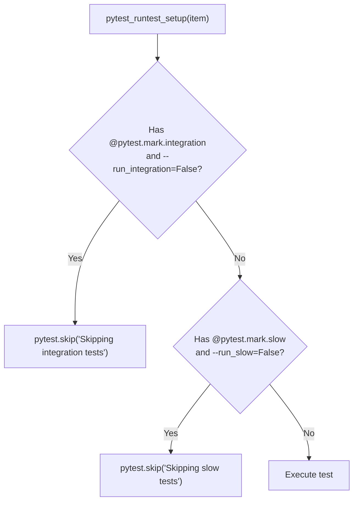
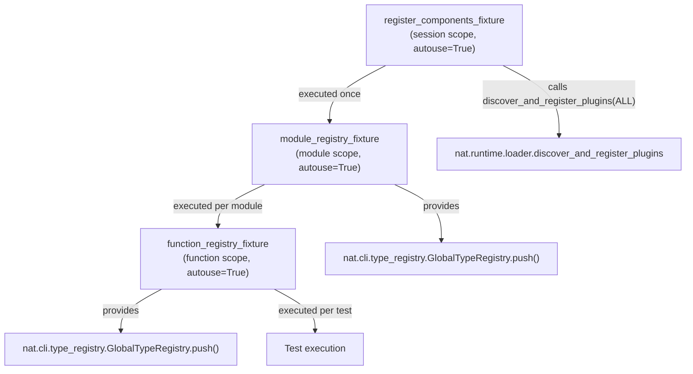
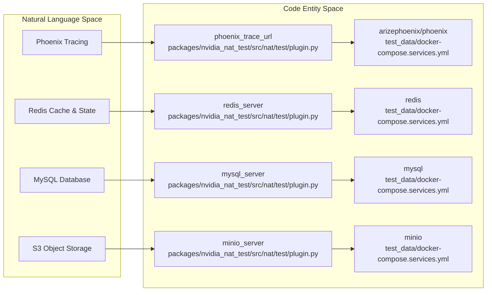
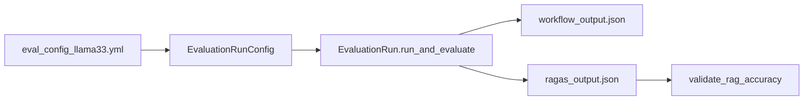

<!-- source: DeepWiki mcp.deepwiki.com · repo NVIDIA/NeMo-Agent-Toolkit · page 14.1 Test Infrastructure · fetched 2026-10-26 -->

# Test Infrastructure

Relevant source files

The following files were used as context for generating this wiki page:

- [examples/RAG/simple_rag/tests/test_langchain_web_ingest.py](examples/RAG/simple_rag/tests/test_langchain_web_ingest.py)
- [examples/custom_functions/automated_description_generation/src/nat_automated_description_generation/configs/config.yml](examples/custom_functions/automated_description_generation/src/nat_automated_description_generation/configs/config.yml)
- [examples/custom_functions/automated_description_generation/src/nat_automated_description_generation/configs/config_no_auto.yml](examples/custom_functions/automated_description_generation/src/nat_automated_description_generation/configs/config_no_auto.yml)
- [examples/evaluation_and_profiling/simple_web_query_eval/tests/test_simple_web_query_eval.py](examples/evaluation_and_profiling/simple_web_query_eval/tests/test_simple_web_query_eval.py)
- [examples/memory/redis/tests/test_memory_redis.py](examples/memory/redis/tests/test_memory_redis.py)
- [examples/object_store/user_report/tests/test_objext_store_example_user_report_tool.py](examples/object_store/user_report/tests/test_objext_store_example_user_report_tool.py)
- [packages/nvidia_nat_core/src/nat/cli/commands/workflow/templates/config.yml.j2](packages/nvidia_nat_core/src/nat/cli/commands/workflow/templates/config.yml.j2)
- [packages/nvidia_nat_mysql/tests/test_mysql_object_store.py](packages/nvidia_nat_mysql/tests/test_mysql_object_store.py)
- [packages/nvidia_nat_s3/src/nat/plugins/s3/object_store.py](packages/nvidia_nat_s3/src/nat/plugins/s3/object_store.py)
- [packages/nvidia_nat_s3/tests/test_s3_object_store.py](packages/nvidia_nat_s3/tests/test_s3_object_store.py)
- [scripts/bootstrap_milvus.sh](scripts/bootstrap_milvus.sh)
- [scripts/langchain_web_ingest.py](scripts/langchain_web_ingest.py)
- [scripts/sitemap_scraper.py](scripts/sitemap_scraper.py)
- [scripts/web_utils.py](scripts/web_utils.py)
- [test_data/docker-compose.services.yml](test_data/docker-compose.services.yml)

This document describes the test infrastructure provided by the NVIDIA NeMo Agent Toolkit, detailing the custom pytest plugin system, component registration fixtures, service fixtures (MySQL, Redis, S3/MinIO, Phoenix), `test_data/docker-compose.services.yml`, and data ingestion and scraping utilities located in `scripts/`.

---

## Pytest Plugin System

The testing infrastructure relies on a custom pytest plugin that automatically discovers and registers plugins, manages test execution flags, and enforces environment requirements. The plugin is implemented in `packages/nvidia_nat_test/src/nat/test/plugin.py` [packages/nvidia_nat_test/src/nat/test/plugin.py:1-200]().

### Command-Line Options and Execution Filtering

The plugin introduces CLI options via `pytest_addoption()` [packages/nvidia_nat_test/src/nat/test/plugin.py:40-66]() to control test selection:
- `--run_integration`: Enables execution of tests marked with `@pytest.mark.integration`.
- `--run_slow`: Enables execution of end-to-end tests marked with `@pytest.mark.slow`.
- `--fail_missing`: Causes tests with unmet environment dependencies or missing service fixtures to fail immediately instead of skipping.

Execution control is enforced via `pytest_runtest_setup()` [packages/nvidia_nat_test/src/nat/test/plugin.py:68-76]().

**Title: "Test Execution Filter Logic"**

Sources: [packages/nvidia_nat_test/src/nat/test/plugin.py:40-76]()

---

## Component Registration Fixtures

To prevent state leakage and ensure all workflow components, functions, and LLM types are registered before test execution, the plugin provides scoped fixtures.

### Fixture Hierarchy

**Title: "Component Registration and Registry Isolation"**

Sources: [packages/nvidia_nat_test/src/nat/test/plugin.py:78-114]()

---

## Service Infrastructure and Docker Stack

Integration tests interact with external datastores, vector databases, and observability backends. These services are defined in `test_data/docker-compose.services.yml` [test_data/docker-compose.services.yml:1-157]() for local development and CI container orchestration.

### Service Stack Overview
- **Databases & Caches:** MySQL, Redis, Milvus, ClickHouse, and PostgreSQL.
- **Object Storage:** MinIO (compatible with S3 APIs).
- **Observability:** Arize Phoenix and Langfuse (worker and web instances).
- **Runtime Utilities:** ETCD and Piston code execution sandboxes.

### Natural Language to Code Entity Space: Fixture and Service Mapping

The following diagram bridges natural language requirements for testing services (such as distributed caching, object storage, and observability tracing) to their exact Python fixture implementations and Docker container services.

**Title: "Service Fixture to Container Mapping"**

Sources: [packages/nvidia_nat_test/src/nat/test/plugin.py:1-200](), [test_data/docker-compose.services.yml:1-157](), [packages/nvidia_nat_mysql/tests/test_mysql_object_store.py:29-32](), [packages/nvidia_nat_s3/tests/test_s3_object_store.py:30-33](), [examples/memory/redis/tests/test_memory_redis.py:23-23]()

---

## Data Ingestion and Scraping Utilities

The `scripts/` directory provides utility modules to ingest test data, scrape web documentation, and bootstrap vector stores for RAG testing.

### Web Scraping and Caching (`scripts/web_utils.py`)
`web_utils.py` handles asynchronous web page retrieval, same-origin redirect validation, and local HTML caching:
- `scrape(urls, headers)`: Uses `httpx.AsyncClient` to asynchronously retrieve URLs, returning successful responses and failures [scripts/web_utils.py:79-105]().
- `_get_with_same_origin_redirects()`: Enforces same-origin policy during redirects to prevent security vulnerabilities [scripts/web_utils.py:53-76]().
- `cache_html(input_dict, base_path)`: Persists scraped content to disk under `{base_path}/{domain}/{path}` [scripts/web_utils.py:132-158]().

### LangChain Web Ingestion (`scripts/langchain_web_ingest.py`)
`langchain_web_ingest.py` orchestrates document parsing, chunking, and embedding generation into Milvus:
- `main()`: Scrapes input URLs (defaulting to NVIDIA CUDA documentation), parses HTML with `BSHTMLLoader`, splits text via `RecursiveCharacterTextSplitter`, computes embeddings using `NVIDIAEmbeddings`, and stores chunks in Milvus [scripts/langchain_web_ingest.py:37-122]().

### Sitemap Scraping (`scripts/sitemap_scraper.py`)
`get_urls_from_sitemap()` recursively traverses XML sitemap indices using `BeautifulSoup` to extract URL lists, last modification timestamps, and change frequencies [scripts/sitemap_scraper.py:24-50]().

Sources: [scripts/langchain_web_ingest.py:1-163](), [scripts/web_utils.py:1-166](), [scripts/sitemap_scraper.py:1-76]()

---

## Workflow Evaluation and Test Execution

End-to-end tests utilize evaluation harnesses and workflow execution utilities to validate agent outputs, RAG accuracy, and execution trajectories.

### Evaluation Test Data Flow

**Title: "Evaluation Test Data Flow"**

Sources: [examples/evaluation_and_profiling/simple_web_query_eval/tests/test_simple_web_query_eval.py:22-155]()

---

