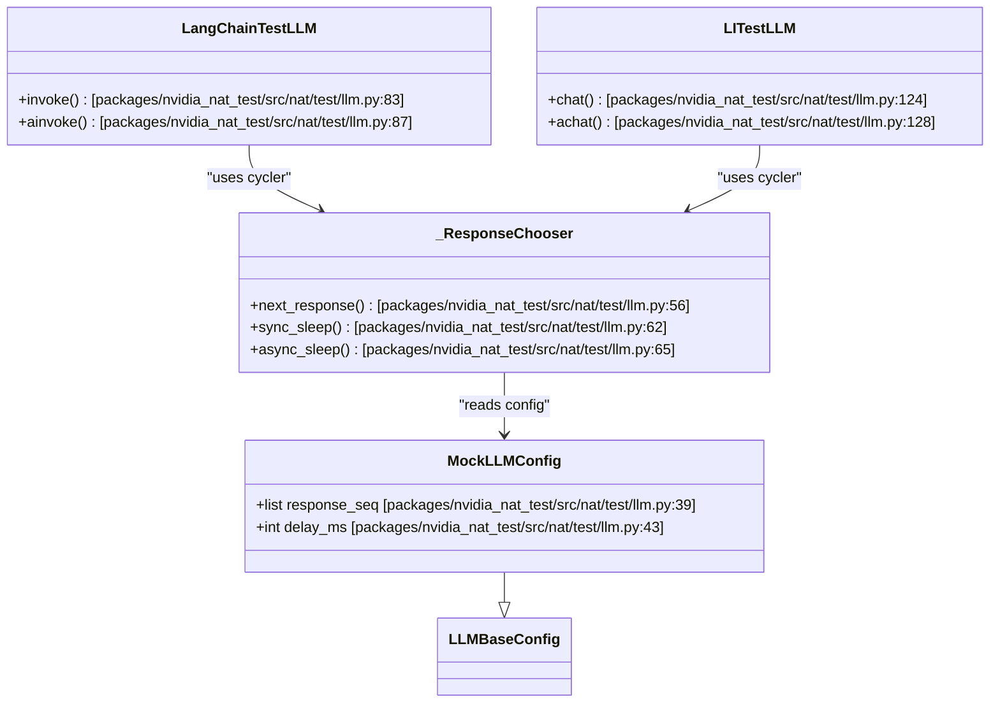

<!-- source: DeepWiki mcp.deepwiki.com · repo NVIDIA/NeMo-Agent-Toolkit · page 14.2 pytest Plugin and Fixtures · fetched 2026-10-26 -->

# pytest Plugin and Fixtures

<details>
<summary>Relevant source files</summary>

The following files were used as context for generating this wiki page:

- [examples/documentation_guides/tests/test_text_file_ingest.py](examples/documentation_guides/tests/test_text_file_ingest.py)
- [examples/frameworks/adk_demo/src/nat_adk_demo/agent.py](examples/frameworks/adk_demo/src/nat_adk_demo/agent.py)
- [examples/frameworks/adk_demo/src/nat_adk_demo/register.py](examples/frameworks/adk_demo/src/nat_adk_demo/register.py)
- [examples/observability/simple_calculator_observability/tests/test_simple_calc_observability.py](examples/observability/simple_calculator_observability/tests/test_simple_calc_observability.py)
- [packages/nvidia_nat_adk/src/nat/plugins/adk/register.py](packages/nvidia_nat_adk/src/nat/plugins/adk/register.py)
- [packages/nvidia_nat_adk/tests/test_adk_llm.py](packages/nvidia_nat_adk/tests/test_adk_llm.py)
- [packages/nvidia_nat_test/src/nat/test/llm.py](packages/nvidia_nat_test/src/nat/test/llm.py)
- [packages/nvidia_nat_test/src/nat/test/plugin.py](packages/nvidia_nat_test/src/nat/test/plugin.py)
- [packages/nvidia_nat_test/src/nat/test/register.py](packages/nvidia_nat_test/src/nat/test/register.py)
- [packages/nvidia_nat_test/tests/test_env_fixtures.py](packages/nvidia_nat_test/tests/test_env_fixtures.py)
- [packages/nvidia_nat_test/tests/test_test_llm.py](packages/nvidia_nat_test/tests/test_test_llm.py)

</details>


## Purpose and Scope

This document details the custom pytest plugin and fixtures provided by the `nvidia-nat-test` package. The plugin is designed to support the complex testing requirements of the NeMo Agent Toolkit, including automated discovery of toolkit components via `discover_and_register_plugins(PluginTypes.ALL)` [packages/nvidia_nat_test/src/nat/test/plugin.py:81-86](), management of the global type registry (`GlobalTypeRegistry`) to prevent state leakage between tests [packages/nvidia_nat_test/src/nat/test/plugin.py:91-115](), and environment validation for external services used in integration tests. It also supplies specialized mock LLM providers (`MockLLMConfig`) for deterministic testing across multiple frameworks [packages/nvidia_nat_test/src/nat/test/llm.py:36-44]().

Sources: [packages/nvidia_nat_test/src/nat/test/plugin.py:81-115](), [packages/nvidia_nat_test/src/nat/test/llm.py:36-44]()

---

## pytest Plugin Architecture

The pytest plugin is implemented in `packages/nvidia_nat_test/src/nat/test/plugin.py` [packages/nvidia_nat_test/src/nat/test/plugin.py:1-38]() and is automatically loaded when the `nvidia-nat-test` package is installed.

### Command Line Options

The plugin adds several command-line options via `pytest_addoption` [packages/nvidia_nat_test/src/nat/test/plugin.py:40-66]():

| Option | Purpose | Default |
|--------|---------|---------|
| `--run_integration` | Enable tests marked with `@pytest.mark.integration` which call external services [packages/nvidia_nat_test/src/nat/test/plugin.py:45-50](). | Disabled |
| `--run_slow` | Enable tests marked with `@pytest.mark.slow` (typically end-to-end tests) [packages/nvidia_nat_test/src/nat/test/plugin.py:52-57](). | Disabled |
| `--fail_missing` | If set, tests requiring unmet dependencies or missing environment variables will fail instead of being skipped [packages/nvidia_nat_test/src/nat/test/plugin.py:59-65](). | Disabled |

### Test Markers and Setup Hook

The `pytest_runtest_setup` hook [packages/nvidia_nat_test/src/nat/test/plugin.py:68-77]() automatically handles the skipping logic based on markers and command-line flags. Integration tests typically require real API calls and are skipped by default to prevent unexpected costs or failures in environments without keys [packages/nvidia_nat_test/src/nat/test/plugin.py:69-71]().

**Diagram: Natural Language Space to Code Entity Space for Test Execution & Skipping**

```mermaid
graph TB
    NaturalTestExecution[""Integration/Slow Test Execution""] --> Hook[""pytest_runtest_setup(item) [packages/nvidia_nat_test/src/nat/test/plugin.py:68-77]""]
    Hook --> CheckIntegration{""Has 'integration' marker?""}
    CheckIntegration -->|"Yes"| CheckIntegrationFlag{""--run_integration passed? [packages/nvidia_nat_test/src/nat/test/plugin.py:69-70]"}"}
    CheckIntegration -->|"No"| CheckSlow{""Has 'slow' marker? [packages/nvidia_nat_test/src/nat/test/plugin.py:73-74]"}"}
    CheckIntegrationFlag -->|"No"| Skip[""pytest.skip() [packages/nvidia_nat_test/src/nat/test/plugin.py:71]""]
    CheckIntegrationFlag -->|"Yes"| CheckSlow
    CheckSlow -->|"Yes"| CheckSlowFlag{""--run_slow passed? [packages/nvidia_nat_test/src/nat/test/plugin.py:73-74]"}"}
    CheckSlow -->|"No"| Run[""Execute Test""]
    CheckSlowFlag -->|"No"| Skip
    CheckSlowFlag -->|"Yes"| Run
```

Sources: [packages/nvidia_nat_test/src/nat/test/plugin.py:40-77]()

---

## Registry Management Fixtures

The toolkit relies on `GlobalTypeRegistry` [packages/nvidia_nat_test/src/nat/cli/type_registry.py:20-20]() for mapping configurations to component factories. To ensure test isolation, the plugin provides auto-used fixtures that manage registry state.

### Fixture Hierarchy and Data Flow

**Diagram: Registry Isolation Architecture and Code Entities**

```mermaid
graph TB
    Session[""register_components_fixture (session scope) [packages/nvidia_nat_test/src/nat/test/plugin.py:78-87]""] --> Loader[""discover_and_register_plugins(PluginTypes.ALL) [packages/nvidia_nat_test/src/nat/test/plugin.py:81-86]""]
    Module[""module_registry_fixture (module scope) [packages/nvidia_nat_test/src/nat/test/plugin.py:91-102]""] --> PushModule[""GlobalTypeRegistry.push() [packages/nvidia_nat_test/src/nat/test/plugin.py:100]""]
    Function[""function_registry_fixture (function scope) [packages/nvidia_nat_test/src/nat/test/plugin.py:104-115]""] --> PushFunc[""GlobalTypeRegistry.push() [packages/nvidia_nat_test/src/nat/test/plugin.py:113]""]
    
    subgraph RegistryLifecycle[""Registry Lifecycle""]
        PushModule --> TestBody[""Execute Test Module/Function""]
        PushFunc --> TestBody
        TestBody --> Cleanup[""Restore Previous Registry Context""]
    end
```

### Key Registry Fixtures

*   **`register_components`**: A session-scoped autouse fixture [packages/nvidia_nat_test/src/nat/test/plugin.py:78-87]() that calls `discover_and_register_plugins(PluginTypes.ALL)` [packages/nvidia_nat_test/src/nat/test/plugin.py:81-86](). This ensures all toolkit components (agents, tools, LLMs) are registered before any tests run.
*   **`module_registry`**: A module-scoped autouse fixture [packages/nvidia_nat_test/src/nat/test/plugin.py:91-102]() that uses `GlobalTypeRegistry.push()` [packages/nvidia_nat_test/src/nat/test/plugin.py:100-100]() to isolate registry state between test files.
*   **`registry`**: A function-scoped autouse fixture [packages/nvidia_nat_test/src/nat/test/plugin.py:104-115]() that pushes a new registry for every single test case, ensuring absolute isolation.

Sources: [packages/nvidia_nat_test/src/nat/test/plugin.py:78-115]()

---

## API Key and Environment Fixtures

Integration tests often require external API keys. The plugin provides session-scoped fixtures that validate environment variables using the `require_env_variables` helper function [packages/nvidia_nat_test/src/nat/test/plugin.py:126-141](). If variables are missing, tests are skipped unless `--fail_missing` is active, in which case a `RuntimeError` is raised [packages/nvidia_nat_test/src/nat/test/plugin.py:132-140]().

### API Key Fixture Table

| Fixture Name | Required Env Vars | Implementation |
|--------------|-------------------|----------------|
| `openai_api_key` | `OPENAI_API_KEY`, `OPENAI_BASE_URL` | [packages/nvidia_nat_test/src/nat/test/plugin.py:144-153]() |
| `oci_nemotron_endpoint` | `OCI_NEMOTRON_BASE_URL`, `OCI_NEMOTRON_MODEL` | [packages/nvidia_nat_test/src/nat/test/plugin.py:155-166]() |
| `nvidia_api_key` | `NVIDIA_API_KEY` | [packages/nvidia_nat_test/src/nat/test/plugin.py:168-177]() |
| `serp_api_key` | `SERP_API_KEY` | [packages/nvidia_nat_test/src/nat/test/plugin.py:179-188]() |

Sources: [packages/nvidia_nat_test/src/nat/test/plugin.py:126-188](), [packages/nvidia_nat_test/tests/test_env_fixtures.py:23-60]()

---

## Specialized Test Utilities

### Mock LLM Provider (`nat_test_llm`)

The toolkit includes a `MockLLMConfig` [packages/nvidia_nat_test/src/nat/test/llm.py:36-44]() and associated provider designed for deterministic unit testing. It allows developers to define a `response_seq` (a sequence of strings the LLM will return in a repeating cycle) and a `delay_ms` to simulate latency [packages/nvidia_nat_test/src/nat/test/llm.py:39-44]().

**Diagram: Natural Language Space to Code Entity Space for Mock LLM Architecture**



The mock provider supports multiple framework wrappers including LangChain [packages/nvidia_nat_test/src/nat/test/llm.py:75-108](), LlamaIndex [packages/nvidia_nat_test/src/nat/test/llm.py:110-143](), CrewAI [packages/nvidia_nat_test/src/nat/test/llm.py:145-158](), and Semantic Kernel [packages/nvidia_nat_test/src/nat/test/llm.py:160-192](). It can be activated in YAML configurations by setting `_type: nat_test_llm` [packages/nvidia_nat_test/tests/test_test_llm.py:61-61]().

Sources: [packages/nvidia_nat_test/src/nat/test/llm.py:36-192](), [packages/nvidia_nat_test/tests/test_test_llm.py:27-143]()

### Observability and Workflow Testing Helpers

For testing telemetry and specialized server behaviors, the toolkit provides fixtures and helper utilities:

*   **`weave_client`**: Initializes a `WeaveClient` using `weave.init` and handles cleanup by flushing and deleting calls after test execution [examples/observability/simple_calculator_observability/tests/test_simple_calc_observability.py:103-115]().
*   **`aiq_compatibility_span_prefix`**: A fixture that temporarily patches `SpanAttributes` to use an `aiq.` prefix for compatibility testing [examples/observability/simple_calculator_observability/tests/test_simple_calc_observability.py:80-101]().
*   **`run_workflow`**: A test-specific wrapper [examples/documentation_guides/tests/test_text_file_ingest.py:24-24]() for executing workflows with prompts and asserting against expected answers [examples/documentation_guides/tests/test_text_file_ingest.py:65-66]().
*   **`load_workflow`**: Used to instantiate a workflow from a YAML configuration file for end-to-end testing [packages/nvidia_nat_test/tests/test_test_llm.py:72-72]().

Sources: [examples/observability/simple_calculator_observability/tests/test_simple_calc_observability.py:80-115](), [examples/documentation_guides/tests/test_text_file_ingest.py:24-66](), [packages/nvidia_nat_test/tests/test_test_llm.py:72-72]()

---

