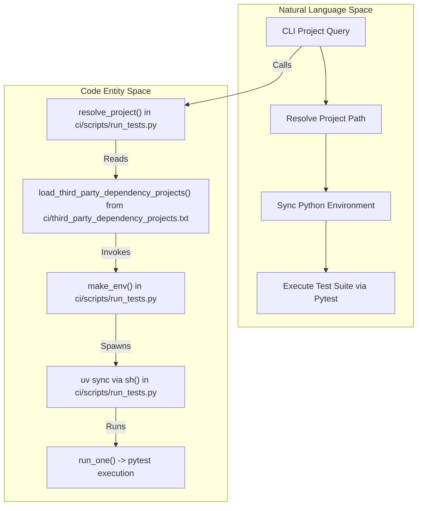
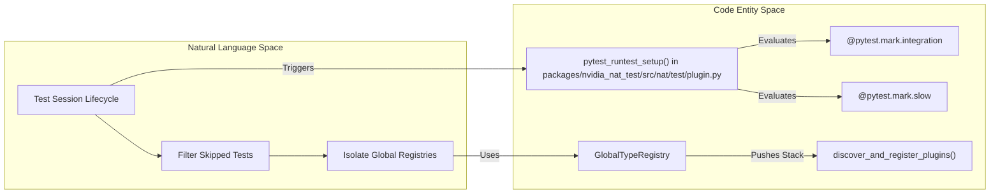
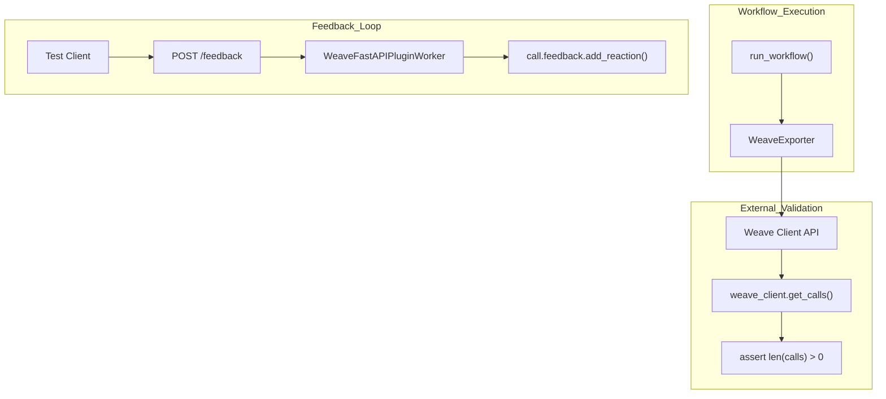

<!-- source: DeepWiki mcp.deepwiki.com · repo NVIDIA/NeMo-Agent-Toolkit · page 14.3 Running Tests · fetched 2026-10-26 -->

# Running Tests

Relevant source files

The following files were used as context for generating this wiki page:

- [.pytest.ini](.pytest.ini)
- [ci/scripts/copyright.py](ci/scripts/copyright.py)
- [ci/scripts/run_tests.py](ci/scripts/run_tests.py)
- [docs/source/_static/agent_with_reasoning_wrapper.png](docs/source/_static/agent_with_reasoning_wrapper.png)
- [docs/source/_static/agent_without_reasoning_wrapper.png](docs/source/_static/agent_without_reasoning_wrapper.png)
- [docs/source/_static/css/custom.css](docs/source/_static/css/custom.css)
- [examples/frameworks/strands_demo/pyproject.toml](examples/frameworks/strands_demo/pyproject.toml)
- [packages/nvidia_nat_strands/pyproject.toml](packages/nvidia_nat_strands/pyproject.toml)
- [packages/nvidia_nat_strands/tests/test_strands_integration.py](packages/nvidia_nat_strands/tests/test_strands_integration.py)

This page documents how to execute tests in the NeMo Agent Toolkit, including local test execution, CI pipeline test execution, and configuration options for controlling which tests run. For information about the test infrastructure and Docker services, see [14.1 Test Infrastructure](). For details about pytest fixtures and the custom pytest plugin, see [14.2 pytest Plugin and Fixtures]().

## Overview

The NeMo Agent Toolkit uses `pytest` as its test framework with custom plugins and fixtures. Tests are categorized using markers to control execution and resource usage.

- **Unit tests**: Run by default, typically involving logic that does not require external service connectivity.
- **Integration tests**: Require actual API keys and make real API calls to LLM providers or external services. These are marked with `@pytest.mark.integration` and triggered via the `--run_integration` flag [packages/nvidia_nat_test/src/nat/test/plugin.py:44-50]().
- **Slow tests**: Long-running tests that may involve complex multi-step reasoning, end-to-end workflows, or framework-heavy setup. These are marked with `@pytest.mark.slow` and triggered via the `--run_slow` flag [packages/nvidia_nat_test/src/nat/test/plugin.py:52-57]().

Tests can be executed locally using `pytest` directly or via the toolkit's orchestration script `ci/scripts/run_tests.py`, which manages multi-project testing across the monorepo structure [ci/scripts/run_tests.py:1-23]().

Sources: [packages/nvidia_nat_test/src/nat/test/plugin.py:44-57](), [ci/scripts/run_tests.py:1-23]()

## Local Test Execution

### The run_tests.py Utility

The toolkit provides a centralized test runner at `ci/scripts/run_tests.py` to automate testing across multiple subpackages (found in `packages/`) and examples (found in `examples/`). This script handles environment setup for each project's isolated environment using `uv` before execution [ci/scripts/run_tests.py:62-81](). It also enforces exclusions for third-party dependency projects listed in `ci/third_party_dependency_projects.txt` [ci/scripts/run_tests.py:36-50]().

| Flag | Purpose | Implementation |
| :--- | :--- | :--- |
| `--run_integration` | Enable integration tests | Passes flag to the `pytest` command [ci/scripts/run_tests.py:208](). |
| `--run_slow` | Enable slow tests | Passes flag to the `pytest` command [ci/scripts/run_tests.py:206](). |
| `--fail_missing` | Fail on missing dependencies | Passes flag to `pytest` to cause tests with unmet environment variables to fail instead of skip [packages/nvidia_nat_test/src/nat/test/plugin.py:59-65](). |
| `--junit_xml` | Generate JUnit report | Specifies output path for XML test results [ci/scripts/run_tests.py:210](). |
| `--cov_xml` | Generate coverage report | Specifies output path for XML coverage results [ci/scripts/run_tests.py:213](). |

Sources: [packages/nvidia_nat_test/src/nat/test/plugin.py:59-65](), [ci/scripts/run_tests.py:36-50](), [ci/scripts/run_tests.py:200-215]()

### Project Resolution and Setup Flow

The `ci/scripts/run_tests.py` script uses `resolve_project()` to locate directories containing a `pyproject.toml` [ci/scripts/run_tests.py:84-111](). For each discovered project, it creates an isolated environment using `uv sync` which ensures the worker's venv is exact and removes extraneous packages [ci/scripts/run_tests.py:172-181]().

Title: Local Test Orchestration and Resolution Flow

Sources: [ci/scripts/run_tests.py:84-111](), [ci/scripts/run_tests.py:161-181](), [ci/scripts/run_tests.py:198-215](), [ci/third_party_dependency_projects.txt:1-5]()

## Test Markers and Plugin Configuration

The toolkit implements a custom `pytest` plugin to handle conditional execution and registry isolation [packages/nvidia_nat_test/src/nat/test/plugin.py:40]().

### Marker Implementation
The `pytest_runtest_setup` hook intercepts test execution based on the presence of markers:
- **`@pytest.mark.integration`**: Tests are skipped unless `--run_integration` is provided [packages/nvidia_nat_test/src/nat/test/plugin.py:68-72]().
- **`@pytest.mark.slow`**: Tests are skipped unless `--run_slow` is provided [packages/nvidia_nat_test/src/nat/test/plugin.py:73-76]().

### Plugin Lifecycle and Registry Management
To prevent state leakage between tests, the plugin manages the `GlobalTypeRegistry` and component registration:
- **`register_components`**: Ensures all plugins are discovered and registered via `discover_and_register_plugins` at the start of a session [packages/nvidia_nat_test/src/nat/test/plugin.py:78-86]().
- **Registry Stacks**: Uses `GlobalTypeRegistry.push()` to provide isolated registry stacks for modules and individual functions [packages/nvidia_nat_test/src/nat/test/plugin.py:91-115]().

Title: Plugin Lifecycle and Registry Management

Sources: [packages/nvidia_nat_test/src/nat/test/plugin.py:40](), [packages/nvidia_nat_test/src/nat/test/plugin.py:68-76](), [packages/nvidia_nat_test/src/nat/test/plugin.py:78-86](), [packages/nvidia_nat_test/src/nat/test/plugin.py:91-115]()

## Observability and Integration Testing

The toolkit includes specialized tests for observability plugins, such as W&B Weave and Arize Phoenix. These tests often use the `@pytest.mark.integration` marker because they require valid API keys and communication with external dashboards [examples/observability/simple_calculator_observability/tests/test_simple_calc_observability.py:116-125]().

### Weave Feedback Integration Tests
The `WeaveFastAPIPluginWorker` adds a `/feedback` route to the FastAPI server [packages/nvidia_nat_weave/src/nat/plugins/weave/fastapi_plugin_worker.py:83-89](). Tests for this worker verify that the route is correctly registered only when Weave telemetry is active [packages/nvidia_nat_weave/tests/test_fastapi_plugin_worker.py:60-69]().

Title: Observability Test Data Flow

Sources: [packages/nvidia_nat_weave/src/nat/plugins/weave/fastapi_plugin_worker.py:83-89](), [packages/nvidia_nat_weave/tests/test_fastapi_plugin_worker.py:60-69]()

## CI Pipeline Execution

The toolkit utilizes automated testing pipelines to ensure code quality across all sub-packages, orchestrated via shell and python scripts in `ci/scripts/` [ci/scripts/gitlab/tests.sh:1-45]().

### Nightly Tests, Reporting, and Model Health
During nightly cron jobs (identified by the `CI_CRON_NIGHTLY` environment variable in `ci/scripts/gitlab/tests.sh`), the CI executes integration and slow tests via `ci/scripts/run_tests.py --run_slow --run_integration` [ci/scripts/gitlab/tests.sh:33-45](). Results are aggregated into JUnit and coverage XML reports, and test results are reported directly to Slack using `ci/scripts/gitlab/report_test_results.py` [ci/scripts/gitlab/tests.sh:49-59](). The `report_test_results.py` script parses JUnit XML files to extract test results, including total tests, failures, errors, and skipped tests, and formats them into Slack messages [ci/scripts/gitlab/report_test_results.py:45-82](). Additionally, model health validation is executed via `ci/scripts/gitlab/model_health_check.sh` and `ci/scripts/model_health_check.py` to check remote NIM endpoints [ci/scripts/model_health_check.py:16-32](), [ci/scripts/gitlab/model_health_check.sh:25-44](). The `model_health_check.py` script scans example configurations for NIM model references and checks their availability and catalog status [ci/scripts/model_health_check.py:107-115]().

### Third-Party Dependency Exclusion
Certain projects that rely on provider-managed third-party code (such as `packages/nvidia_nat_redis`) are excluded from automatic CI installation and execution via `ci/third_party_dependency_projects.txt` to prevent environment contamination [ci/third_party_dependency_projects.txt:1-5](). The `run_tests.py` script loads these exclusions utilizing `load_third_party_dependency_projects()` [ci/scripts/run_tests.py:43-50]().

Sources: [ci/third_party_dependency_projects.txt:1-5](), [ci/scripts/run_tests.py:43-50](), [ci/scripts/gitlab/tests.sh:33-59](), [ci/scripts/gitlab/report_test_results.py:45-82](), [ci/scripts/gitlab/model_health_check.sh:25-44](), [ci/scripts/model_health_check.py:16-32](), [ci/scripts/model_health_check.py:107-115]()

## Integration Test Examples

### API Key Fixtures
The test plugin provides fixtures that automatically check for required environment variables (e.g., `OPENAI_API_KEY`, `NVIDIA_API_KEY`). If these are missing, the tests are skipped unless `--fail_missing` is set [packages/nvidia_nat_test/src/nat/test/plugin.py:144-176]().

| Fixture Name | Required Environment Variable |
| :--- | :--- |
| `openai_api_key` | `OPENAI_API_KEY`, `OPENAI_BASE_URL` [packages/nvidia_nat_test/src/nat/test/plugin.py:149-152]() |
| `nvidia_api_key` | `NVIDIA_API_KEY` [packages/nvidia_nat_test/src/nat/test/plugin.py:173-176]() |
| `serp_api_key` | `SERP_API_KEY` [packages/nvidia_nat_test/src/nat/test/plugin.py:184-187]() |

### Subpackage Integration Tests
Subpackages exercise the full stack from LLM provider to tool execution. For example, observability tests verify that `WeaveExporter` correctly captures and transmits spans to the W&B platform [packages/nvidia_nat_weave/src/nat/plugins/weave/weave_exporter.py:79-91](). The integration tests for the `WeaveFastAPIPluginWorker` ensure that feedback loops are correctly processed and attributed to users via fields like `trace_user_id` [packages/nvidia_nat_weave/src/nat/plugins/weave/fastapi_plugin_worker.py:128-132]().

Sources: [packages/nvidia_nat_test/src/nat/test/plugin.py:144-187](), [packages/nvidia_nat_weave/src/nat/plugins/weave/weave_exporter.py:79-91](), [packages/nvidia_nat_weave/src/nat/plugins/weave/fastapi_plugin_worker.py:128-132]()

---

