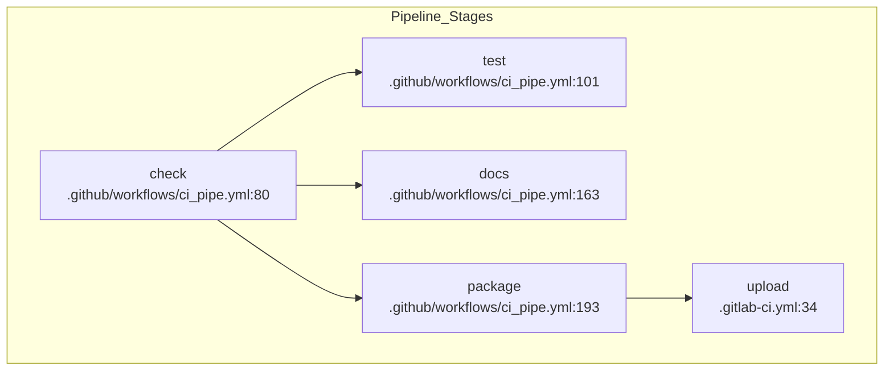
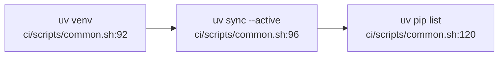
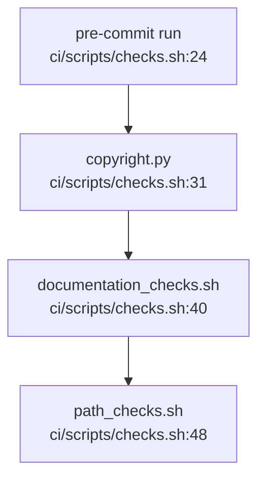

<!-- source: DeepWiki mcp.deepwiki.com · repo NVIDIA/NeMo-Agent-Toolkit · page 15 Development and CI/CD · fetched 2026-10-26 -->

# Development and CI/CD

<details>
<summary>Relevant source files</summary>

The following files were used as context for generating this wiki page:

- [.github/workflows/ci_pipe.yml](.github/workflows/ci_pipe.yml)
- [.github/workflows/pr.yaml](.github/workflows/pr.yaml)
- [.gitlab-ci.yml](.gitlab-ci.yml)
- [AGENTS.md](AGENTS.md)
- [ci/scripts/checks.sh](ci/scripts/checks.sh)
- [ci/scripts/common.sh](ci/scripts/common.sh)
- [ci/scripts/documentation_checks.sh](ci/scripts/documentation_checks.sh)
- [ci/scripts/github/build_wheel.sh](ci/scripts/github/build_wheel.sh)
- [ci/scripts/github/checks.sh](ci/scripts/github/checks.sh)
- [ci/scripts/github/common.sh](ci/scripts/github/common.sh)
- [ci/scripts/github/docs.sh](ci/scripts/github/docs.sh)
- [ci/scripts/github/tests.sh](ci/scripts/github/tests.sh)
- [ci/scripts/gitlab/artifactory/Dockerfile](ci/scripts/gitlab/artifactory/Dockerfile)
- [ci/scripts/gitlab/artifactory_upload.py](ci/scripts/gitlab/artifactory_upload.py)
- [ci/scripts/gitlab/artifactory_upload.sh](ci/scripts/gitlab/artifactory_upload.sh)
- [ci/scripts/gitlab/build_wheel.sh](ci/scripts/gitlab/build_wheel.sh)
- [ci/scripts/gitlab/checks.sh](ci/scripts/gitlab/checks.sh)
- [ci/scripts/gitlab/common.sh](ci/scripts/gitlab/common.sh)
- [ci/scripts/gitlab/docs.sh](ci/scripts/gitlab/docs.sh)
- [ci/scripts/path_checks.sh](ci/scripts/path_checks.sh)
- [docs/source/resources/contributing/agent-skills.md](docs/source/resources/contributing/agent-skills.md)
- [docs/source/resources/contributing/index.md](docs/source/resources/contributing/index.md)
- [examples/dynamo_integration/latency_sensitivity_demo/src/latency_sensitivity_demo/workflow.py](examples/dynamo_integration/latency_sensitivity_demo/src/latency_sensitivity_demo/workflow.py)
- [skills/skill-evolution/SKILL.md](skills/skill-evolution/SKILL.md)

</details>


This document provides a comprehensive high-level overview of the development workflow, continuous integration and deployment (CI/CD) pipelines, build systems, code quality standards, and AI coding assistance patterns for the NVIDIA NeMo Agent Toolkit [.github/workflows/ci_pipe.yml:79-119](), [.gitlab-ci.yml:29-35](), [ci/scripts/common.sh:18]().

The toolkit utilizes automated dual CI/CD pipelines via GitHub Actions and GitLab CI, fast dependency management through `uv`, strict pre-commit static analysis, and structured AI agent coding skills to maintain high reliability across multiple architectures and Python versions [.github/workflows/ci_pipe.yml:79-119](), [.gitlab-ci.yml:29-35](), [docs/source/resources/contributing/index.md:39-85]().

---

## 15.1 CI/CD Pipeline

The NeMo Agent Toolkit maintains cross-environment consistency by employing parallel workflow definitions in GitHub Actions (`.github/workflows/ci_pipe.yml`) and GitLab CI (`.gitlab-ci.yml`) [.github/workflows/ci_pipe.yml:79-230](), [.gitlab-ci.yml:29-35](). Both pipelines execute sequential stages covering code linting checks (`check`), multi-architecture unit and integration tests (`test`), documentation generation (`docs`), package building (`package`), and artifact distribution (`upload`) [.github/workflows/ci_pipe.yml:79-230](), [.gitlab-ci.yml:29-35]().

Title: "CI_CD_Pipeline_Stages_Flow"


For complete details on pipeline job configurations, concurrency controls, and service containers, see [CI/CD Pipeline](#15.1).

Sources: [.github/workflows/ci_pipe.yml:79-230](), [.gitlab-ci.yml:29-35](), [ci/scripts/github/checks.sh:1-27](), [ci/scripts/github/tests.sh:1-39]()

---

## 15.2 Build and Packaging

The build system leverages `uv build` and custom shell scripts to construct Python wheel distributions for the root meta-package (`nvidia-nat`) as well as modular sub-packages under `packages/` [ci/scripts/common.sh:75-86](), [ci/scripts/github/build_wheel.sh:32-43](). Versioning is dynamically determined using `setuptools_scm` or Git tags via `get_git_tag()` [ci/scripts/common.sh:53-73](), [ci/scripts/gitlab/common.sh:23-44](). Built artifacts undergo rigorous installation testing across multiple Python versions before upload to Artifactory or GitLab package registries [ci/scripts/gitlab/build_wheel.sh:46-60](), [ci/scripts/github/build_wheel.sh:74-148](), [ci/scripts/gitlab/artifactory_upload.sh:68]().

Title: "Build_and_Package_Verification_Flow"
```mermaid
graph TB
    subgraph "Version_Resolution"
        GIT_TAG[""get_git_tag()<br/>ci/scripts/gitlab/common.sh:23""]
        SCM[""setuptools_scm<br/>ci/scripts/common.sh:61""]
    end
    
    subgraph "Build_System"
        ROOT[""nvidia-nat<br/>ci/scripts/github/build_wheel.sh:32""]
        PKGS[""nvidia_nat_* Sub-packages<br/>ci/scripts/github/build_wheel.sh:35""]
        BUILD[""uv build --wheel<br/>ci/scripts/common.sh:77""]
    end
    
    subgraph "Verification"
        INSTALL[""Clean venv Install<br/>ci/scripts/github/build_wheel.sh:83""]
        IMPORT[""import nat<br/>ci/scripts/github/build_wheel.sh:110""]
        CLI[""nat --version<br/>ci/scripts/github/build_wheel.sh:122""]
    end
    
    GIT_TAG --> BUILD
    SCM --> BUILD
    ROOT --> BUILD
    PKGS --> BUILD
    BUILD --> INSTALL
    INSTALL --> IMPORT
    IMPORT --> CLI
```

For details on wheel building scripts, verification routines, and artifact management, see [Build and Packaging](#15.2).

Sources: [ci/scripts/common.sh:53-86](), [ci/scripts/github/build_wheel.sh:32-148](), [ci/scripts/gitlab/build_wheel.sh:46-60](), [ci/scripts/gitlab/artifactory_upload.sh:68]()

---

## 15.3 Dependency Management

Dependency management across the repository relies on `uv` for lightning-fast virtual environment provisioning and dependency synchronization [ci/scripts/common.sh:88-121](). The environment setup function `create_env()` handles bootstrapping virtual environments, syncing workspace packages, and ensuring lower-bound constraints are correctly enforced without emitting unhandled sync warnings [ci/scripts/common.sh:88-117](), [docs/source/resources/contributing/index.md:79-85]().

Title: "Dependency_Management_Lifecycle"


For details on lock files, dependency groups, and cross-version Python management, see [Dependency Management](#15.3).

Sources: [ci/scripts/common.sh:88-121](), [docs/source/resources/contributing/index.md:39-85]()

---

## 15.4 Code Quality

Code style, formatting, and correctness are enforced through automated `pre-commit` hooks, static analysis via `checks.sh`, copyright header validators (`copyright.py`), and documentation style checkers [ci/scripts/checks.sh:1-54](). Checks execute automatically on pull requests and merge requests to validate path integrity and repository standards [ci/scripts/checks.sh:23-49](), [.gitlab-ci.yml:80-94]().

Title: "Code_Quality_Checks_Flow"


For detailed configuration of Ruff, YAPF, pre-commit hooks, and `.cursor/rules` coding guidelines, see [Code Quality](#15.4).

Sources: [ci/scripts/checks.sh:1-54](), [.gitlab-ci.yml:80-94]()

---

## 15.5 Local CI Execution

To facilitate developer debugging and verify changes prior to submission, the toolkit supports local execution of CI workflows using containerized environments mirroring the remote CI setup [.gitlab-ci.yml:113-220](). This ensures that integration services like MySQL, Redis, MinIO, Milvus, and Phoenix behave identically during local test execution [.gitlab-ci.yml:113-220]().

For step-by-step instructions on running pipeline stages locally via Docker, see [Local CI Execution](#15.5).

Sources: [.gitlab-ci.yml:113-220]()

---

## 15.6 AI Coding Skills

The repository incorporates an advanced AI-assisted development structure located in the `skills/` directory, paired with task routing rules defined in `AGENTS.md` [AGENTS.md:1-44](), [skills/skill-evolution/SKILL.md:1-46](). These definitions provide coding assistants with precise context on modular packaging, task execution pathways, and the skill-evolution lifecycle [docs/source/resources/contributing/agent-skills.md:1-30]().

For documentation on skill definitions, task routing, and evolutionary workflows, see [AI Coding Skills](#15.6).

Sources: [AGENTS.md:1-44](), [skills/skill-evolution/SKILL.md:1-46](), [docs/source/resources/contributing/agent-skills.md:1-30]()

---

