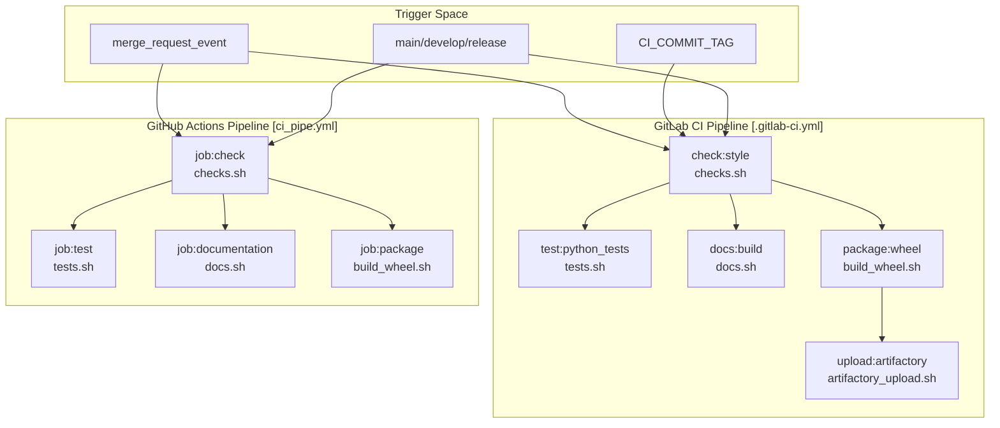
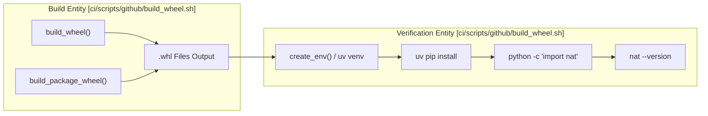
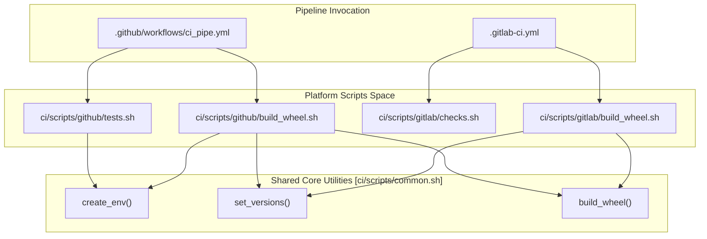

<!-- source: DeepWiki mcp.deepwiki.com · repo NVIDIA/NeMo-Agent-Toolkit · page 15.1 CI/CD Pipeline · fetched 2026-10-26 -->

# CI/CD Pipeline

Relevant source files

The following files were used as context for generating this wiki page:

- [.github/CODEOWNERS](.github/CODEOWNERS)
- [.github/ISSUE_TEMPLATE/bug_report.yml](.github/ISSUE_TEMPLATE/bug_report.yml)
- [.github/ISSUE_TEMPLATE/config.yml](.github/ISSUE_TEMPLATE/config.yml)
- [.github/ISSUE_TEMPLATE/documentation_request_correction.yml](.github/ISSUE_TEMPLATE/documentation_request_correction.yml)
- [.github/ISSUE_TEMPLATE/documentation_request_new.yml](.github/ISSUE_TEMPLATE/documentation_request_new.yml)
- [.github/ISSUE_TEMPLATE/feature_request.yml](.github/ISSUE_TEMPLATE/feature_request.yml)
- [.github/PULL_REQUEST_TEMPLATE.md](.github/PULL_REQUEST_TEMPLATE.md)
- [.github/copy-pr-bot.yaml](.github/copy-pr-bot.yaml)
- [.github/ops-bot.yaml](.github/ops-bot.yaml)
- [.github/workflows/ci_pipe.yml](.github/workflows/ci_pipe.yml)
- [.github/workflows/pr.yaml](.github/workflows/pr.yaml)
- [.gitlab-ci.yml](.gitlab-ci.yml)
- [ci/scripts/checks.sh](ci/scripts/checks.sh)
- [ci/scripts/common.sh](ci/scripts/common.sh)
- [ci/scripts/github/build_wheel.sh](ci/scripts/github/build_wheel.sh)
- [ci/scripts/github/checks.sh](ci/scripts/github/checks.sh)
- [ci/scripts/github/common.sh](ci/scripts/github/common.sh)
- [ci/scripts/github/docs.sh](ci/scripts/github/docs.sh)
- [ci/scripts/github/tests.sh](ci/scripts/github/tests.sh)
- [ci/scripts/gitlab/artifactory/Dockerfile](ci/scripts/gitlab/artifactory/Dockerfile)
- [ci/scripts/gitlab/artifactory_upload.py](ci/scripts/gitlab/artifactory_upload.py)
- [ci/scripts/gitlab/artifactory_upload.sh](ci/scripts/gitlab/artifactory_upload.sh)
- [ci/scripts/gitlab/build_wheel.sh](ci/scripts/gitlab/build_wheel.sh)
- [ci/scripts/gitlab/checks.sh](ci/scripts/gitlab/checks.sh)
- [ci/scripts/gitlab/common.sh](ci/scripts/gitlab/common.sh)
- [ci/scripts/gitlab/docs.sh](ci/scripts/gitlab/docs.sh)
- [ci/scripts/gitlab/model_health_check.sh](ci/scripts/gitlab/model_health_check.sh)
- [ci/scripts/gitlab/report_test_results.py](ci/scripts/gitlab/report_test_results.py)
- [ci/scripts/gitlab/tests.sh](ci/scripts/gitlab/tests.sh)
- [ci/scripts/model_health_check.py](ci/scripts/model_health_check.py)
- [ci/scripts/path_checks.sh](ci/scripts/path_checks.sh)
- [docs/source/build-workflows/llms/using-local-llms.md](docs/source/build-workflows/llms/using-local-llms.md)
- [examples/documentation_guides/locally_hosted_llms/nim_config.yml](examples/documentation_guides/locally_hosted_llms/nim_config.yml)
- [examples/documentation_guides/locally_hosted_llms/vllm_config.yml](examples/documentation_guides/locally_hosted_llms/vllm_config.yml)
- [examples/documentation_guides/workflows/custom_workflow/custom_config.yml](examples/documentation_guides/workflows/custom_workflow/custom_config.yml)

## Purpose and Scope

This document describes the Continuous Integration and Continuous Deployment (CI/CD) infrastructure for the NVIDIA NeMo Agent Toolkit (`nvidia-nat`). The system implements a dual-platform approach with both GitLab CI ([.gitlab-ci.yml]()) and GitHub Actions ([.github/workflows/ci_pipe.yml]()) pipelines that provide parallel coverage for code quality checks, comprehensive testing across multiple architectures and Python versions, documentation builds, and package distribution. The pipeline orchestrates a suite of Docker service containers for integration testing, manages Python wheel packages via `uv` [.gitlab-ci.yml:68](), and integrates with external platforms for artifact storage and validation.

For information about the build system and package structure, see [Build and Packaging](15.2). For dependency management details, see [Dependency Management](15.3). For code quality enforcement mechanisms, see [Code Quality](15.4).

Sources: [.gitlab-ci.yml:1-35](), [.github/workflows/ci_pipe.yml:1-50]()

---

## Dual-Platform CI/CD Architecture

The toolkit maintains parallel CI/CD implementations on GitLab and GitHub, each with distinct responsibilities. The GitLab pipeline serves as the primary system for internal development, nightly builds, and Artifactory uploads, while GitHub Actions provides public-validation and matrix testing.

### Pipeline Trigger Rules

- **GitLab CI** [.gitlab-ci.yml:21-27]() triggers on merge request events (`CI_PIPELINE_SOURCE == 'merge_request_event'`), tagged commits (`CI_COMMIT_TAG`), default branch commits (`CI_DEFAULT_BRANCH` or `main`), and release branches (`release/.*`).
- **GitHub Actions** [.github/workflows/pr.yaml:18-24]() triggers on pushes to pull request branches (`pull-request/**`), development (`develop`), main (`main`), and release branches (`release/**`).

Both platforms implement concurrency controls [.github/workflows/pr.yaml:27-29]() to cancel outdated pipeline runs when new commits are pushed.

### Pipeline Stage Overview

Title: "Pipeline Execution and Script Mapping Flow"

Sources: [.gitlab-ci.yml:21-34](), [.github/workflows/pr.yaml:18-29]()

---

## GitLab CI Pipeline Stages

The GitLab pipeline defines five sequential stages: `check`, `test`, `docs`, `package`, and `upload` [.gitlab-ci.yml:29-34](). All jobs use the `ghcr.io/astral-sh/uv` container image [.gitlab-ci.yml:68]() and share a common cache strategy for the `$UV_CACHE_DIR` directory [.gitlab-ci.yml:69-72]().

### Stage 1: Check

- **`check:style`**: Executes code quality checks via `./ci/scripts/gitlab/checks.sh` [.gitlab-ci.yml:84](). This job runs on merge requests and uses a dedicated pre-commit cache [.gitlab-ci.yml:87-94]().
- **`check:model_health`**: Validates NVIDIA NIM model endpoints on nightly cron builds [.gitlab-ci.yml:106-107]() by running `./ci/scripts/gitlab/model_health_check.sh` [.gitlab-ci.yml:100]().

Sources: [.gitlab-ci.yml:80-108](), [ci/scripts/gitlab/checks.sh]()

### Stage 2: Test

The GitLab test stage (`test:python_tests`) executes the comprehensive test suite with Docker service containers running in parallel as background services [.gitlab-ci.yml:110-210](). Environment variables configure service endpoints [.gitlab-ci.yml:36-66](), allowing tests to connect via hostnames like `NAT_CI_REDIS_HOST: "redis"` [.gitlab-ci.yml:63]().

#### Service Stack
- **Databases**: `clickhouse/clickhouse-server` [.gitlab-ci.yml:113](), `mysql:9.3` [.gitlab-ci.yml:124](), `postgres:17` [.gitlab-ci.yml:136]().
- **Search & Vector**: `milvusdb/milvus:v2.3.1` [.gitlab-ci.yml:154](), `opensearchproject/opensearch:2.11.1` [.gitlab-ci.yml:170]().
- **Observability**: `arizephoenix/phoenix:13.22` [.gitlab-ci.yml:128](), `langfuse/langfuse-worker:3` [.gitlab-ci.yml:181]().
- **Infrastructure**: `redis:8.0` [.gitlab-ci.yml:143](), `quay.io/coreos/etcd:v3.5.5` [.gitlab-ci.yml:149](), `minio/minio` [.gitlab-ci.yml:119]().
- **Security & Sandbox**: OAuth2 server container [.gitlab-ci.yml:162]() and Piston code execution sandbox [.gitlab-ci.yml:177]().

Sources: [.gitlab-ci.yml:110-210]()

### Stage 3 & 4: Documentation and Package

- **Docs Stage**: Builds Sphinx documentation via `ci/scripts/gitlab/docs.sh` (or `ci/scripts/github/docs.sh` in GitHub Actions [.github/workflows/ci_pipe.yml:182]()).
- **Package Stage**: Executes `ci/scripts/gitlab/build_wheel.sh` [ci/scripts/gitlab/build_wheel.sh:1-60](), which creates Python wheels using `build_wheel` and `build_package_wheel` functions [ci/scripts/common.sh:75-86](), then uploads them via `twine` to the GitLab package registry for branch builds [ci/scripts/gitlab/build_wheel.sh:53-59]().

Sources: [.gitlab-ci.yml:32-33](), [ci/scripts/gitlab/build_wheel.sh:1-60](), [ci/scripts/common.sh:75-86]()

### Stage 5: Upload

The `upload:artifactory` stage runs on tagged releases or nightly builds, invoking `ci/scripts/gitlab/artifactory_upload.sh` to transfer built wheels to NVIDIA's internal Artifactory [ci/scripts/gitlab/artifactory_upload.sh:1-71]().

Sources: [.gitlab-ci.yml:34](), [ci/scripts/gitlab/artifactory_upload.sh:1-71]()

---

## GitHub Actions Pipeline

The GitHub Actions implementation (`.github/workflows/ci_pipe.yml`) provides a reusable workflow with matrix-based testing across multiple Python versions and CPU architectures.

### Job Matrix Strategy

The `test` job uses a matrix strategy to create **6 parallel test jobs** (2 architectures × 3 Python versions) [.github/workflows/ci_pipe.yml:109-118]():

| Architecture | Python Versions | Container Image |
|--------------|-----------------|-----------------|
| `amd64`      | 3.11, 3.12, 3.13 | `inputs.py_XX_container` [.github/workflows/ci_pipe.yml:115-119]() |
| `arm64`      | 3.11, 3.12, 3.13 | `inputs.py_XX_container` [.github/workflows/ci_pipe.yml:115-119]() |

Each matrix job executes `./nat/ci/scripts/github/tests.sh` [.github/workflows/ci_pipe.yml:136]().

### Package Verification Flow

Title: "Wheel Verification Code Entity Flow"

Sources: [.github/workflows/ci_pipe.yml:100-146](), [ci/scripts/github/build_wheel.sh:32-132]()

---

## Common CI Scripts and Utilities

The toolkit uses a shared library of bash scripts located in `ci/scripts/` to ensure consistency across platforms.

### common.sh Functions
- **`set_versions()`**: Determines versioning via `setuptools_scm` or git tags depending on nightly/release status [ci/scripts/common.sh:53-73]().
- **`create_env()`**: Initializes virtual environments using `uv venv` and synchronizes development dependencies via `uv sync` with error handling [ci/scripts/common.sh:88-121]().
- **`install_python_versions()`**: Installs managed Python versions via `uv python install` for multi-version wheel testing [ci/scripts/common.sh:141-166]().

Title: "CI Script Invocation Hierarchy"

Sources: [ci/scripts/common.sh:1-181](), [ci/scripts/github/common.sh:1-27](), [ci/scripts/gitlab/common.sh:1-70]()

---

## Testing Infrastructure

Tests are executed via `run_tests.py` invoked from `ci/scripts/github/tests.sh` or GitLab counterparts. Key execution flags include:
- `--run_slow`: Executes long-running integration tests [ci/scripts/github/tests.sh:34]().
- `--junit_xml`: Outputs JUnit-compatible XML reports to `${REPORTS_DIR}` for CI dashboard ingestion [ci/scripts/github/tests.sh:35]().
- `--cov_xml`: Generates code coverage summaries [ci/scripts/github/tests.sh:36]().

Additionally, `is_third_party_dependency_wheel` filters wheels against `ci/third_party_dependency_projects.txt` [ci/scripts/common.sh:179-183]() to bypass installation verification for external compatibility packages [ci/scripts/common.sh:185-202]().

Sources: [ci/scripts/github/tests.sh:1-39](), [ci/scripts/common.sh:179-202](), [ci/scripts/checks.sh:1-54]()

---

