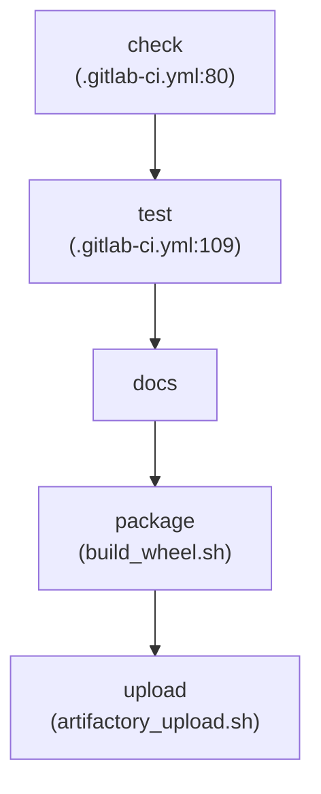
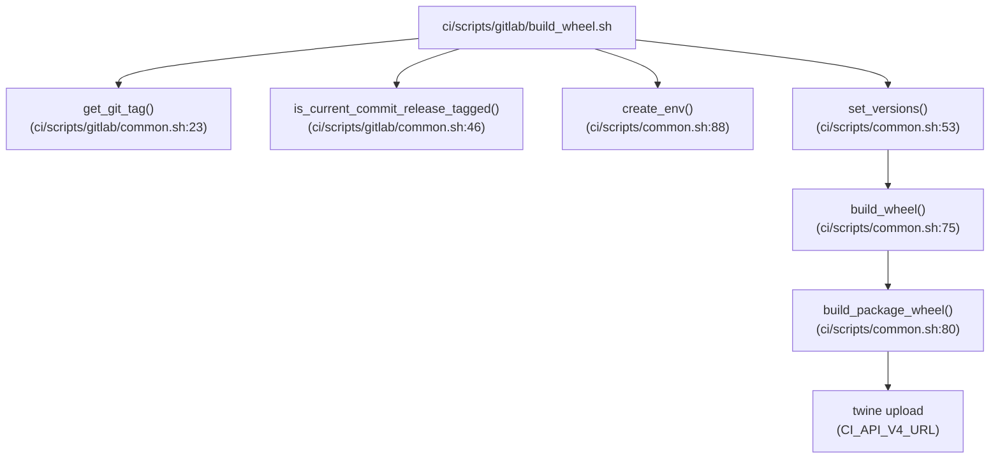
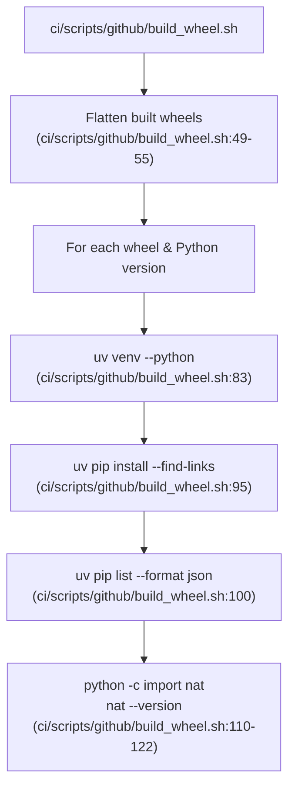
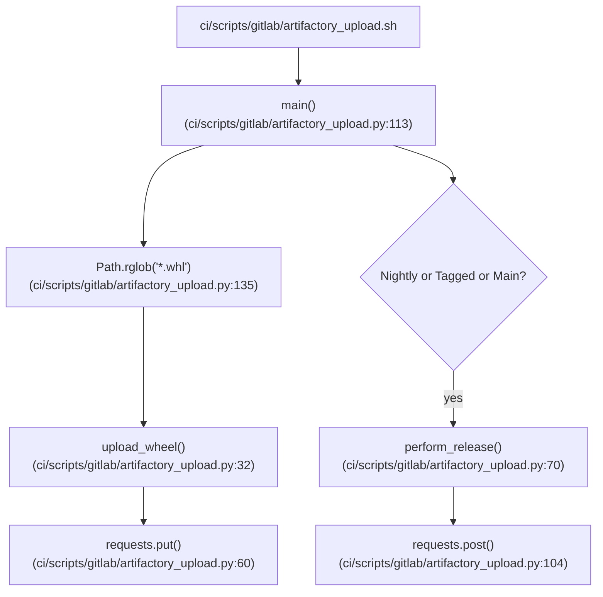
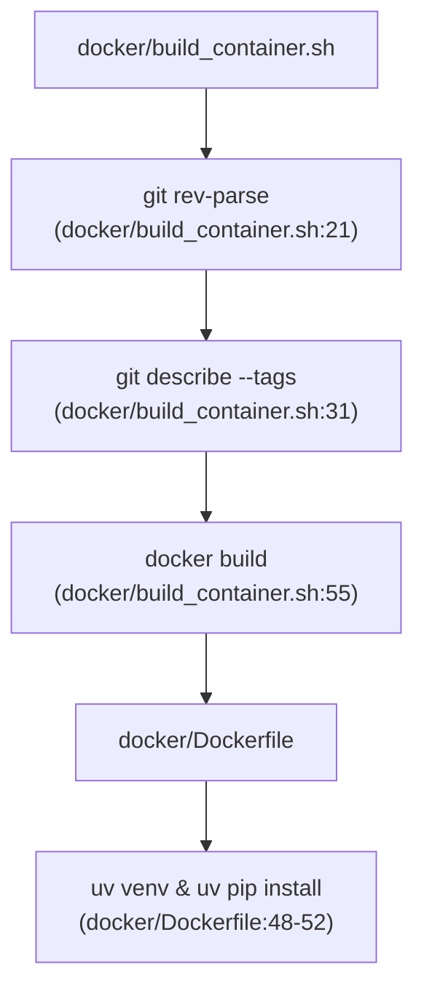

<!-- source: DeepWiki mcp.deepwiki.com · repo NVIDIA/NeMo-Agent-Toolkit · page 15.2 Build and Packaging · fetched 2026-10-26 -->

# Build and Packaging

Relevant source files

The following files were used as context for generating this wiki page:

- [.cursor/rules/nat-setup/nat-toolkit-installation.mdc](.cursor/rules/nat-setup/nat-toolkit-installation.mdc)
- [.github/workflows/ci_pipe.yml](.github/workflows/ci_pipe.yml)
- [.github/workflows/pr.yaml](.github/workflows/pr.yaml)
- [.gitlab-ci.yml](.gitlab-ci.yml)
- [ci/scripts/bootstrap_local_ci.sh](ci/scripts/bootstrap_local_ci.sh)
- [ci/scripts/checks.sh](ci/scripts/checks.sh)
- [ci/scripts/common.sh](ci/scripts/common.sh)
- [ci/scripts/github/build_wheel.sh](ci/scripts/github/build_wheel.sh)
- [ci/scripts/github/checks.sh](ci/scripts/github/checks.sh)
- [ci/scripts/github/common.sh](ci/scripts/github/common.sh)
- [ci/scripts/github/docs.sh](ci/scripts/github/docs.sh)
- [ci/scripts/github/tests.sh](ci/scripts/github/tests.sh)
- [ci/scripts/gitlab/artifactory/Dockerfile](ci/scripts/gitlab/artifactory/Dockerfile)
- [ci/scripts/gitlab/artifactory_upload.py](ci/scripts/gitlab/artifactory_upload.py)
- [ci/scripts/gitlab/artifactory_upload.sh](ci/scripts/gitlab/artifactory_upload.sh)
- [ci/scripts/gitlab/build_wheel.sh](ci/scripts/gitlab/build_wheel.sh)
- [ci/scripts/gitlab/checks.sh](ci/scripts/gitlab/checks.sh)
- [ci/scripts/gitlab/common.sh](ci/scripts/gitlab/common.sh)
- [ci/scripts/gitlab/docs.sh](ci/scripts/gitlab/docs.sh)
- [ci/scripts/gitutils.py](ci/scripts/gitutils.py)
- [ci/scripts/license_diff.py](ci/scripts/license_diff.py)
- [ci/scripts/package_utils.py](ci/scripts/package_utils.py)
- [ci/scripts/path_checks.sh](ci/scripts/path_checks.sh)
- [ci/scripts/run_ci_local.sh](ci/scripts/run_ci_local.sh)
- [ci/scripts/sbom_list.py](ci/scripts/sbom_list.py)
- [docker/Dockerfile](docker/Dockerfile)
- [docker/build_container.sh](docker/build_container.sh)

This page details the build, packaging, verification, Docker container creation, and artifact distribution processes for the NVIDIA NeMo Agent Toolkit. It covers GitLab CI and GitHub Actions packaging scripts, wheel generation logic, verification loops, Artifactory upload automation, and containerization. For dependency management and lockfile generation, see [Dependency Management](15.3); for the overall CI/CD stages, see [CI/CD Pipeline](15.1).

---

## Pipeline Overview and Stages

The packaging and deployment workflow is orchestrated via GitLab CI [.gitlab-ci.yml:2-333]() and GitHub Actions [.github/workflows/ci_pipe.yml:1-230]() utilizing a standard Astral `uv` environment with Python 3.13 [.gitlab-ci.yml:68](). The CI pipelines define distinct stages including `check`, `test`, `docs`, `package`, and `upload` [.gitlab-ci.yml:29-34]().

**Diagram: Pipeline Stage Execution Flow (`.gitlab-ci.yml`)**

Sources: [.gitlab-ci.yml:29-34](), [.gitlab-ci.yml:80](), [.gitlab-ci.yml:109]()

---

## Wheel Building Process

Wheel compilation is driven by `ci/scripts/gitlab/build_wheel.sh` [ci/scripts/gitlab/build_wheel.sh:1-60]() and `ci/scripts/github/build_wheel.sh` [ci/scripts/github/build_wheel.sh:1-150](). These scripts configure the environment, determine versioning information using git tags, compile the root meta-package (`nvidia-nat`), and iterate through sub-packages defined in `NAT_PACKAGES` [ci/scripts/gitlab/build_wheel.sh:27-40](), [ci/scripts/github/build_wheel.sh:27-43]().

**Diagram: Code Entity Flow for `build_wheel.sh`**

Sources: [ci/scripts/gitlab/build_wheel.sh:1-60](), [ci/scripts/gitlab/common.sh:23-64](), [ci/scripts/common.sh:53-86]()

### Package Registry Upload Gating

Once wheels are generated under `.tmp/wheels/`, the build script checks if the current execution context corresponds to the default or release branches (`main`, `release/*`) [ci/scripts/gitlab/build_wheel.sh:46](). If matched, it invokes `twine upload` using the GitLab job token (`CI_JOB_TOKEN`) to publish packages to the internal PyPI package registry [ci/scripts/gitlab/build_wheel.sh:53-58]().

Sources: [ci/scripts/gitlab/build_wheel.sh:46-60]()

---

## Wheel Verification and Testing Loop

To ensure built artifacts are functional across multiple Python runtimes, the GitHub Actions packaging script iterates through supported Python versions (`SUPPORTED_PYTHON_VERSIONS`) and validates each wheel [ci/scripts/github/build_wheel.sh:74-148]().

**Diagram: Wheel Verification Lifecycle (`ci/scripts/github/build_wheel.sh`)**

Sources: [ci/scripts/github/build_wheel.sh:49-148](), [ci/scripts/common.sh:18]()

---

## Artifactory Upload and KitMaker Integration

The `upload` stage executes `ci/scripts/gitlab/artifactory_upload.sh` [ci/scripts/gitlab/artifactory_upload.sh:1-71](), which verifies authentication tokens (`URM_USER`, `URM_API_KEY`) and artifact endpoints (`NAT_ARTIFACTORY_URL`) before delegating to `ci/scripts/gitlab/artifactory_upload.py` [ci/scripts/gitlab/artifactory_upload.sh:33-68]().

**Diagram: Code Entity Mapping for Artifactory Upload (`artifactory_upload.py`)**

Sources: [ci/scripts/gitlab/artifactory_upload.sh:33-68](), [ci/scripts/gitlab/artifactory_upload.py:32-111](), [ci/scripts/gitlab/artifactory_upload.py:113-166]()

### Matrix Parameters and Metadata Properties

In `upload_wheel`, packages are uploaded via HTTP `PUT` requests embedding matrix parameters such as `arch`, `os`, `branch`, `component_name`, `version`, and `release_approver` [ci/scripts/gitlab/artifactory_upload.py:46-56](). For nightly builds, tags, or commits on `main`, `perform_release` queries the KitMaker service and triggers `wheel-release-job` payloads using `pkginfo.Wheel` metadata inspection [ci/scripts/gitlab/artifactory_upload.py:70-111]().

Sources: [ci/scripts/gitlab/artifactory_upload.py:32-111]()

---

## Docker Image Packaging

Containerization scripts are located in `docker/`. The primary container definition is specified in `docker/Dockerfile` [docker/Dockerfile:1-58](), which accepts a `NAT_VERSION` build argument and utilizes `uv` to install the `nvidia-nat[most]` package bundle [docker/Dockerfile:16-52]().

**Diagram: Docker Build Pipeline (`docker/build_container.sh`)**

Sources: [docker/build_container.sh:17-55](), [docker/Dockerfile:16-58]()

### Container Build Arguments

`docker/build_container.sh` evaluates target host architectures (`dpkg --print-architecture`), sets up BuildKit variables, and executes `docker build` with `--build-arg NAT_VERSION` [docker/build_container.sh:24-55](). The resulting container configures `/workspace/.venv/bin` in the `PATH` and defines `nat` as the default entry point [docker/Dockerfile:55-58]().

Sources: [docker/build_container.sh:24-55](), [docker/Dockerfile:55-58]()

---

