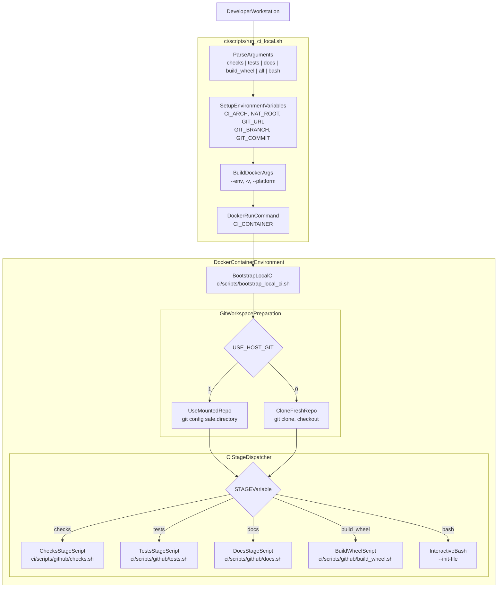
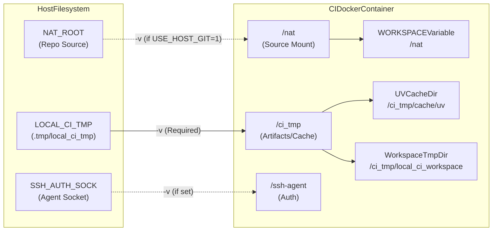

<!-- source: DeepWiki mcp.deepwiki.com · repo NVIDIA/NeMo-Agent-Toolkit · page 15.5 Local CI Execution · fetched 2026-10-26 -->

# Local CI Execution

<details>
<summary>Relevant source files</summary>

The following files were used as context for generating this wiki page:

- [.cursor/rules/nat-setup/nat-toolkit-installation.mdc](.cursor/rules/nat-setup/nat-toolkit-installation.mdc)
- [ci/scripts/bootstrap_local_ci.sh](ci/scripts/bootstrap_local_ci.sh)
- [ci/scripts/gitutils.py](ci/scripts/gitutils.py)
- [ci/scripts/run_ci_local.sh](ci/scripts/run_ci_local.sh)
- [docker/Dockerfile](docker/Dockerfile)
- [docker/build_container.sh](docker/build_container.sh)

</details>


This page documents the local CI execution system, which allows developers to run the same CI pipeline stages locally in Docker containers that match the GitHub Actions and GitLab CI environments. This enables pre-flight validation of code changes before pushing to remote repositories.

For information about the full CI/CD pipeline architecture and remote execution, see [CI/CD Pipeline](#15.1). For dependency management and build system details, see [Dependency Management](#15.3). For code quality checks that run as part of CI, see [Code Quality](#15.4).

## Purpose and Scope

The local CI execution system provides scripts to replicate CI pipeline stages on a developer's workstation using Docker. It supports running individual stages (`checks`, `tests`, `docs`, `build_wheel`) or all stages together, with the same environment and dependencies as the remote CI systems. This enables developers to catch issues early without requiring remote CI execution cycles.

Sources: [ci/scripts/run_ci_local.sh:17-32](), [ci/scripts/bootstrap_local_ci.sh:1-60]()

## System Overview

The local CI system consists of two main scripts that work together to create an isolated, reproducible CI environment:

1.  `run_ci_local.sh` - Entry point script that sets up the Docker environment, volume mounts, and handles argument parsing [ci/scripts/run_ci_local.sh:17-105]().
2.  `bootstrap_local_ci.sh` - Bootstrap script executed inside the container to prepare the workspace, handle git logic, and trigger the requested stage [ci/scripts/bootstrap_local_ci.sh:1-60]().

### Local CI Execution Flow

The following diagram illustrates the transition from the developer's natural language command to the execution of specific code entities within the container.

**Figure 1: Local CI Execution Pipeline**


Sources: [ci/scripts/run_ci_local.sh:17-32](), [ci/scripts/run_ci_local.sh:80-98](), [ci/scripts/bootstrap_local_ci.sh:22-41](), [ci/scripts/bootstrap_local_ci.sh:55-60]()

## Prerequisites

Before using the local CI execution system, ensure the following tools are available:

| Prerequisite | Purpose | Verification Command |
| :--- | :--- | :--- |
| Docker | Container runtime for isolation | `docker --version` |
| Git | Repository operations and metadata | `git --version` |
| Bash | Script execution engine | `bash --version` |
| uv | Dependency management and venv | `uv --version` |

The default CI container image used for local execution is `ghcr.io/astral-sh/uv:0.9.28-python3.13-bookworm` [ci/scripts/run_ci_local.sh:62](). For building production-ready images, a separate `Dockerfile` is provided [docker/Dockerfile:1-58]().

Sources: [ci/scripts/run_ci_local.sh:62](), [docker/Dockerfile:1-58]()

## Usage

### Basic Invocation

Navigate to the repository root and execute the local CI script:

```bash
# Run all stages sequentially
./ci/scripts/run_ci_local.sh all

# Run a specific stage
./ci/scripts/run_ci_local.sh checks
./ci/scripts/run_ci_local.sh tests
./ci/scripts/run_ci_local.sh docs
./ci/scripts/run_ci_local.sh build_wheel

# Drop into an interactive bash shell within the CI environment
./ci/scripts/run_ci_local.sh bash
```

Sources: [ci/scripts/run_ci_local.sh:17-32]()

### Stage Descriptions

| Stage | Script Executed | Purpose |
| :--- | :--- | :--- |
| `checks` | `ci/scripts/github/checks.sh` | Runs code style, linting, and pre-commit hooks. |
| `tests` | `ci/scripts/github/tests.sh` | Executes tests with coverage and slow tests enabled using test runners. |
| `docs` | `ci/scripts/github/docs.sh` | Validates documentation build process using Sphinx. |
| `build_wheel` | `ci/scripts/github/build_wheel.sh` | Builds wheels for core packages and verifies them across supported Python versions. |
| `bash` | Interactive shell | Provides a debug environment with `bootstrap_local_ci.sh` as init file [ci/scripts/run_ci_local.sh:92](). |

Sources: [ci/scripts/run_ci_local.sh:17-105]()

## Architecture

### Docker Container Environment

The `run_ci_local.sh` script maps host directories to container paths to ensure persistence and access to source code.

**Figure 2: Host to Container Volume Mapping**


Sources: [ci/scripts/run_ci_local.sh:80-88](), [ci/scripts/bootstrap_local_ci.sh:43-50]()

### Git Repository Modes

The system supports two modes for handling the repository source:

1.  **Mounted Repository (`USE_HOST_GIT=1`)**: The current directory on the host is mounted into the container at `/nat` [ci/scripts/run_ci_local.sh:83](). This allows testing local, uncommitted changes. The script configures the directory as safe for git [ci/scripts/bootstrap_local_ci.sh:24]().
2.  **Fresh Clone (`USE_HOST_GIT=0`, default)**: The script performs a fresh `git clone` of the `GIT_URL` inside the container [ci/scripts/bootstrap_local_ci.sh:27-30](). It fetches all tags and checks out the specific commit and branch [ci/scripts/bootstrap_local_ci.sh:34-37]().

Sources: [ci/scripts/run_ci_local.sh:57](), [ci/scripts/run_ci_local.sh:83](), [ci/scripts/bootstrap_local_ci.sh:22-41]()

### Environment Variables

| Variable | Default | Source | Purpose |
| :--- | :--- | :--- | :--- |
| `CI_ARCH` | Host Arch | [ci/scripts/run_ci_local.sh:41]() | Sets target architecture for the container platform. |
| `USE_HOST_GIT` | `0` | [ci/scripts/run_ci_local.sh:57]() | Controls whether to mount host repo or clone fresh. |
| `LOCAL_CI_TMP` | `${NAT_ROOT}/.tmp/local_ci_tmp/${CI_ARCH}` | [ci/scripts/run_ci_local.sh:59]() | Persistent storage for `uv` cache and build artifacts. |
| `CI_CONTAINER` | `ghcr.io/astral-sh/uv:0.9.28-python3.13-bookworm` | [ci/scripts/run_ci_local.sh:62]() | The Docker image used for execution. |

Sources: [ci/scripts/run_ci_local.sh:41-62]()

## Specialized Scripts and Utilities

### Production Dockerfile
The production `Dockerfile` [docker/Dockerfile:1-58]() differs from the development CI container:
1.  **Base Image**: Uses an Ubuntu base image `nvcr.io/nvidia/base/ubuntu:22.04_20240212` [docker/Dockerfile:16-22]().
2.  **Tooling**: Installs `uv` for high-performance dependency resolution [docker/Dockerfile:27]().
3.  **Installation**: Installs the `nvidia-nat[most]` package at the specified `NAT_VERSION` into a virtual environment [docker/Dockerfile:48-52](). The `NAT_VERSION` is passed as a build argument, typically derived from `git describe --tags --abbrev=0` [docker/build_container.sh:31-32]().
4.  **Entry Point**: Configures the `nat` CLI as the primary entry point [docker/Dockerfile:58]().

Sources: [docker/Dockerfile:1-58](), [docker/build_container.sh:31-32]()

---

