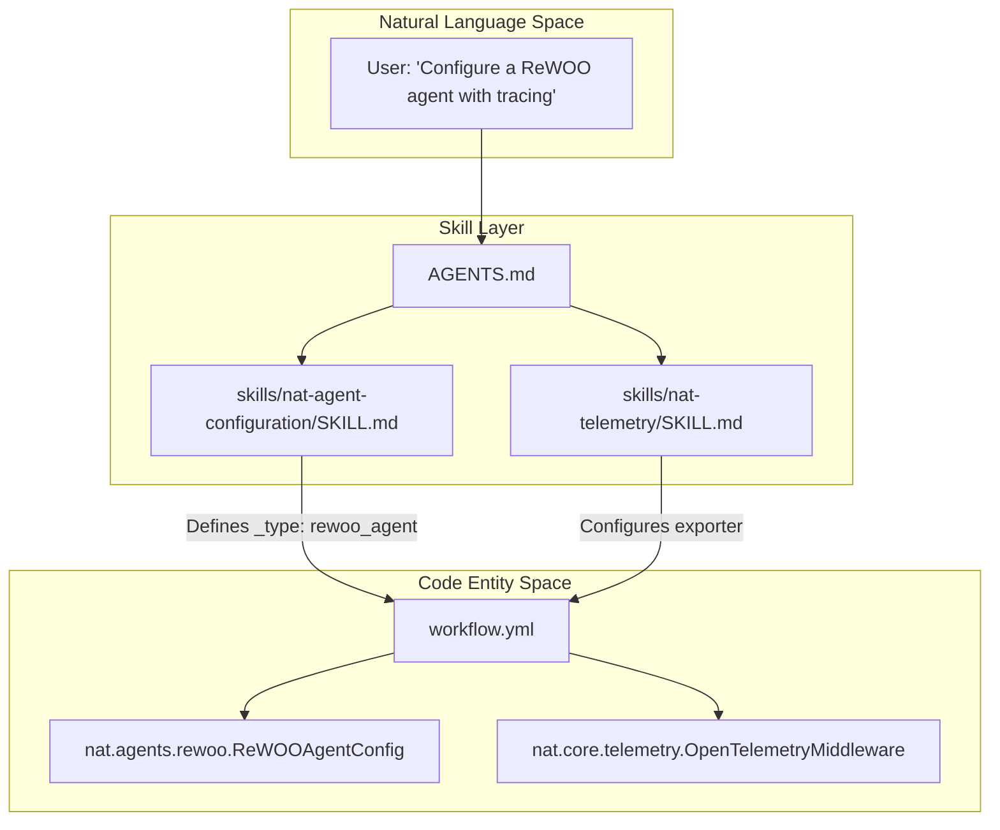
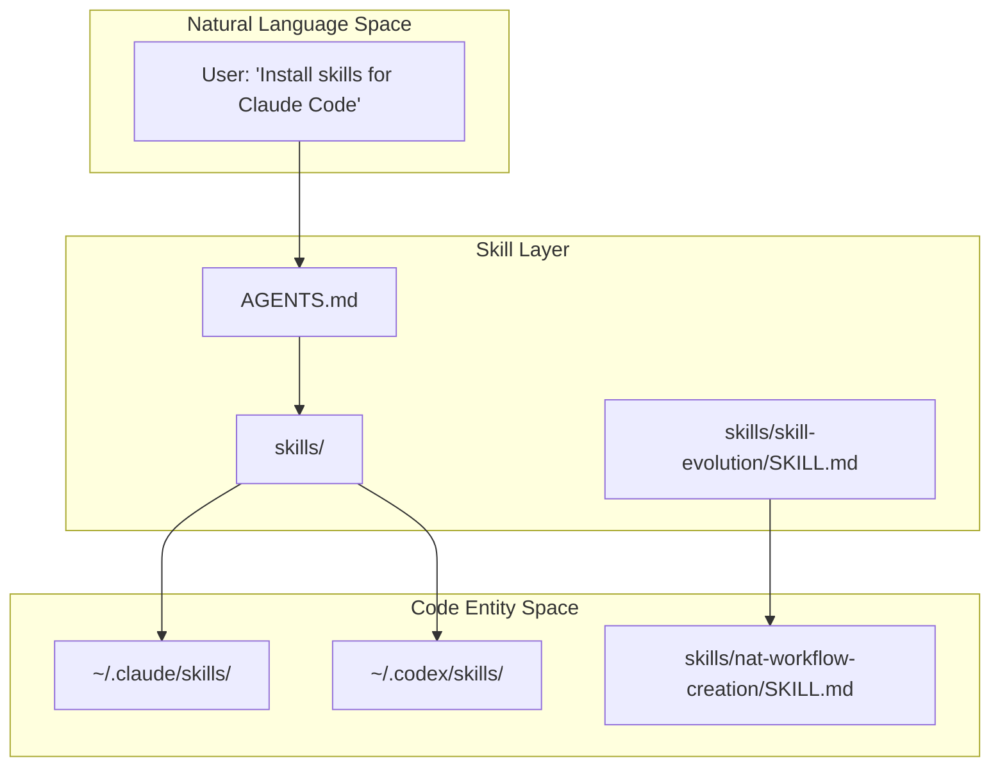

<!-- source: DeepWiki mcp.deepwiki.com · repo NVIDIA/NeMo-Agent-Toolkit · page 15.6 AI Coding Skills · fetched 2026-10-26 -->

# AI Coding Skills

Relevant source files

The following files were used as context for generating this wiki page:

- [AGENTS.md](AGENTS.md)
- [ci/scripts/documentation_checks.sh](ci/scripts/documentation_checks.sh)
- [docs/source/resources/contributing/agent-skills.md](docs/source/resources/contributing/agent-skills.md)
- [docs/source/resources/contributing/index.md](docs/source/resources/contributing/index.md)
- [examples/dynamo_integration/latency_sensitivity_demo/src/latency_sensitivity_demo/workflow.py](examples/dynamo_integration/latency_sensitivity_demo/src/latency_sensitivity_demo/workflow.py)
- [skills/skill-evolution/SKILL.md](skills/skill-evolution/SKILL.md)

The `skills/` directory in the NVIDIA NeMo Agent Toolkit contains portable AI coding assistant skill definitions and reference materials designed for coding assistants like Claude Code, Codex, and Cursor [.coderabbit.yaml:118-125](), [skills/skill-evolution/SKILL.md:1-10](), [AGENTS.md:18-20](). These skills bridge the gap between natural language requirements and the toolkit's specific code entities, providing specialized rules for agent configuration, evaluation, Model Context Protocol (MCP) serving, telemetry, and workflow creation [AGENTS.md:31-44]().

Sources: [.coderabbit.yaml:118-125](), [skills/skill-evolution/SKILL.md:1-10](), [AGENTS.md:18-44]()

## Overview and Purpose

The AI coding skills are non-runtime instruction sets intended to guide LLM-based coding assistants in generating valid, high-quality code and configurations for the toolkit [skills/skill-evolution/SKILL.md:1-10](). Unlike published documentation, these files contain agent-facing instructions that enforce official naming conventions, architectural patterns, and task-specific logic [AGENTS.md:22-30]().

Key objectives of the skills directory include:
*   **Task Routing**: Directing AI agents to the correct skill based on user intent via `AGENTS.md` [AGENTS.md:45-66]().
*   **Consistency**: Standardizing the use of the full product name "NVIDIA NeMo Agent Toolkit" on first use, and `nat` for technical identifiers [AGENTS.md:27-27]().
*   **Extensibility**: Providing structured patterns for creating new workflows, tools, evaluation harnesses, and telemetry exporters [AGENTS.md:31-44]().

Sources: [skills/skill-evolution/SKILL.md:1-10](), [AGENTS.md:22-66]()

## Skill Directory Structure and Task Routing

The toolkit utilizes a **flat layout** for skills under the repository root to simplify discovery and maintenance [AGENTS.md:20](). Each skill folder contains a `SKILL.md` file with standardized frontmatter and an optional `references/` directory for detailed examples [skills/skill-evolution/SKILL.md:36-59]().

### Task Routing Index

The root `AGENTS.md` file acts as the primary entry point for AI agents, containing a routing table that maps user tasks to specific skill files [AGENTS.md:18-66]().

| Task | Skill and Reference |
| :--- | :--- |
| Installing or configuring NeMo Agent Toolkit | `skills/nat-installation/SKILL.md` |
| Discovering registered component `_type` values | `skills/nat-workflow-creation/SKILL.md` |
| Writing or editing workflow YAML | `skills/nat-workflow-creation/SKILL.md` |
| Configuring LLMs | `skills/nat-workflow-creation/SKILL.md` |
| Choosing or configuring agents | `skills/nat-agent-configuration/SKILL.md` |
| Writing custom tools or functions | `skills/nat-tools-and-functions/SKILL.md` |
| Wiring MCP client or server workflows | `skills/nat-mcp-and-serving/SKILL.md` |
| Serving with FastAPI | `skills/nat-mcp-and-serving/SKILL.md` |
| Composing sub-agents | `skills/nat-agent-configuration/SKILL.md` |
| Adding tracing or telemetry | `skills/nat-telemetry/SKILL.md` |
| Designing an evaluation suite | `skills/nat-evaluation/SKILL.md` |
| Choosing an evaluator | `skills/nat-evaluation/SKILL.md` |
| Running `nat optimize` | `skills/nat-optimization/SKILL.md` |
| Fixing documentation path-check failures | `skills/nat-path-checks/SKILL.md` |
| Creating or improving skills | `skills/skill-evolution/SKILL.md` |

Sources: [AGENTS.md:45-66](), [skills/skill-evolution/SKILL.md:36-59]()

## Skill Evolution Process

The toolkit implements a structured "Skill Evolution" workflow to ensure AI assistant instructions remain accurate as the codebase evolves [skills/skill-evolution/SKILL.md:8-33](). Agents are instructed to consult `skills/skill-evolution/SKILL.md` before creating or editing any skill file [AGENTS.md:67-72]().

**Evolution Trigger Conditions:**
*   A user corrects agent behavior in a way that should generalize [skills/skill-evolution/SKILL.md:16-16]().
*   A command fails and the recovery path should be remembered [skills/skill-evolution/SKILL.md:17-17]().
*   A reference link, command, component `_type`, or installation instruction is stale [skills/skill-evolution/SKILL.md:18-18]().
*   Task routing is too broad, too narrow, or points to the wrong skill [skills/skill-evolution/SKILL.md:19-19]().
*   A repeated instruction appears across multiple skills and should be refactored into a shared entry point [skills/skill-evolution/SKILL.md:20-21]().

Sources: [skills/skill-evolution/SKILL.md:12-33](), [AGENTS.md:67-72]()

## Component Mapping: Natural Language to Code

The following diagrams bridge natural language requests to code entities and configuration components within the toolkit.

### Intent Resolution Flow

This diagram maps the transition from a natural language request to specific skill files, configuration types, and runtime classes.

Title: "Intent Resolution Flow"

Sources: [AGENTS.md:45-66](), [skills/skill-evolution/SKILL.md:1-10]()

### Skill Installation and Agent Routing Mapping

This diagram illustrates how user workspaces integrate the flat skill layout for coding assistants like Claude Code and Codex.

Title: "Skill Installation and Agent Routing Mapping"

Sources: [skills/skill-evolution/SKILL.md:36-60](), [AGENTS.md:18-44]()

## Documentation and CI Integration

The toolkit includes automated scripts to ensure documentation quality, such as `ci/scripts/documentation_checks.sh` which executes `vale` checks on Markdown files [ci/scripts/documentation_checks.sh:45-46](). Notably, the script intentionally **excludes** the `skills/` directory from published documentation validation because skills serve as instruction and reference payloads for coding agents rather than end-user documentation [ci/scripts/documentation_checks.sh:19-21]().

Sources: [ci/scripts/documentation_checks.sh:19-54]()

---

